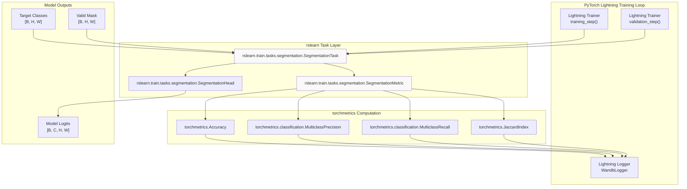
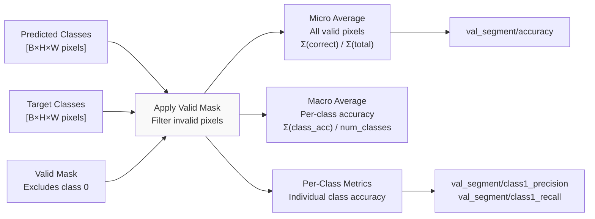
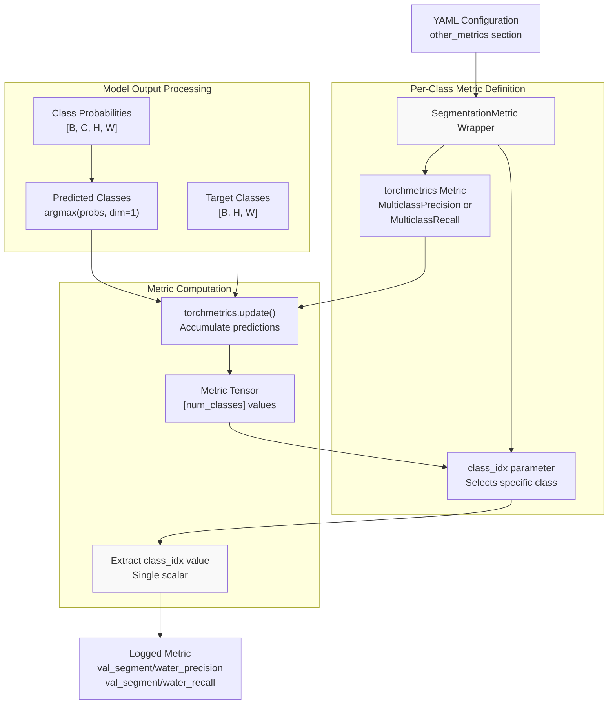
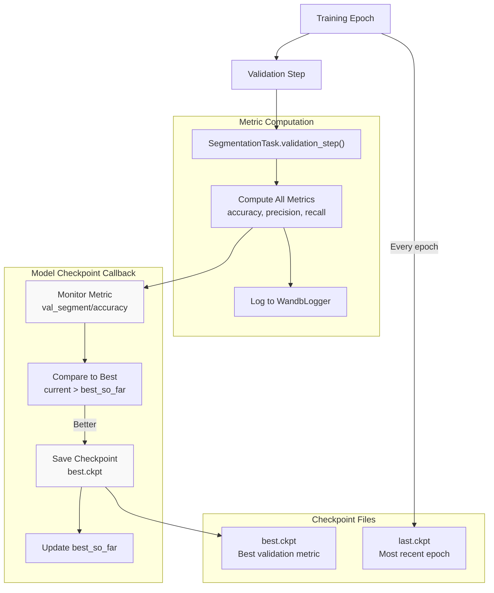

<!-- source: DeepWiki mcp.deepwiki.com · repo allenai/olmoearth_projects · page 5.5 Metrics and Evaluation · fetched 2026-10-26 -->

# Metrics and Evaluation

<details>
<summary>Relevant source files</summary>

The following files were used as context for generating this wiki page:

- [olmoearth_run_data/mangrove/dataset.json](olmoearth_run_data/mangrove/dataset.json)
- [olmoearth_run_data/mangrove/model.yaml](olmoearth_run_data/mangrove/model.yaml)
- [olmoearth_run_data/mangrove/olmoearth_run.yaml](olmoearth_run_data/mangrove/olmoearth_run.yaml)
- [olmoearth_run_data/mozambique_lulc/rslp_finetuning.yaml](olmoearth_run_data/mozambique_lulc/rslp_finetuning.yaml)
- [olmoearth_run_data/mozambique_lulc/rslp_finetuning_croptype.yaml](olmoearth_run_data/mozambique_lulc/rslp_finetuning_croptype.yaml)
- [olmoearth_run_data/mozambique_lulc/rslp_finetuning_croptype_in_season_novmar.yaml](olmoearth_run_data/mozambique_lulc/rslp_finetuning_croptype_in_season_novmar.yaml)
- [olmoearth_run_data/mozambique_lulc/rslp_finetuning_in_season_novmar.yaml](olmoearth_run_data/mozambique_lulc/rslp_finetuning_in_season_novmar.yaml)

</details>


This document describes the metrics and evaluation system used during model training in the olmoearth_projects repository. It covers the configuration and usage of classification metrics for segmentation tasks, including overall accuracy, per-class precision and recall, and how these metrics integrate with the training loop and model checkpointing.

For information about the overall training configuration structure, see [Training Configuration Files](#5.1). For details about the training loop and callbacks, see [Fine-tuning Process](#5.3).

## Metric System Architecture

The metrics system integrates three frameworks: PyTorch Lightning for training orchestration, rslearn for geospatial task definitions, and torchmetrics for metric computations. All models in this repository use segmentation tasks, which output per-pixel classifications evaluated using multiclass classification metrics.



**Sources:** [olmoearth_run_data/mozambique_lulc/rslp_finetuning.yaml:69-98](), [olmoearth_run_data/mangrove/model.yaml:84-147]()

## Segmentation Task Configuration

The `SegmentationTask` class from rslearn defines the evaluation behavior for per-pixel classification problems. All configuration is specified in the training YAML files under the `task` section.

### Core Task Parameters

| Parameter | Type | Description | Common Values |
|-----------|------|-------------|---------------|
| `num_classes` | int | Total number of output classes including background | 4, 7, 8, 10, 60 |
| `zero_is_invalid` | bool | Whether class 0 represents invalid/background pixels | `true` |
| `metric_kwargs` | dict | Arguments passed to primary accuracy metric | `{"average": "micro"}` |
| `enable_accuracy_metric` | bool | Enable overall accuracy computation | `true` (default) |
| `enable_miou_metric` | bool | Enable mean Intersection over Union | `false` (default) |
| `enable_f1_metric` | bool | Enable F1 score computation | `false` (default) |

The `zero_is_invalid` parameter is critical - when set to `true`, pixels with label 0 are excluded from all metric calculations, and the actual class indices are 1 through `num_classes-1`.

**Sources:** [olmoearth_run_data/mozambique_lulc/rslp_finetuning.yaml:73-79](), [olmoearth_run_data/mangrove/model.yaml:88-145]()

## Overall Accuracy Metrics

The primary metric for all segmentation models is overall classification accuracy, computed using micro-averaging across all valid pixels. This metric is automatically enabled and logged as `val_segment/accuracy` (validation) and `train_segment/accuracy` (training).

### Averaging Strategies

The `metric_kwargs.average` parameter controls how metrics are aggregated across classes:

- **`"micro"`**: Compute metrics globally across all pixels, treating all classes equally. This is the most common setting for imbalanced datasets.
- **`"macro"`**: Compute metrics per-class then average, giving equal weight to each class regardless of frequency.
- **`"weighted"`**: Compute metrics per-class then average weighted by class support.
- **`null`**: Return per-class metrics without aggregation (used for individual class metrics).



**Sources:** [olmoearth_run_data/mozambique_lulc/rslp_finetuning.yaml:78-79](), [olmoearth_run_data/mangrove/model.yaml:144-145]()

## Per-Class Metrics

All models define per-class precision and recall metrics using the `other_metrics` configuration section. These metrics provide detailed performance analysis for individual classes, which is critical for imbalanced datasets common in earth observation tasks.

### Metric Configuration Pattern

Each per-class metric follows this configuration structure:

```yaml
other_metrics:
  classname_precision:
    class_path: rslearn.train.tasks.segmentation.SegmentationMetric
    init_args:
      metric:
        class_path: torchmetrics.classification.MulticlassPrecision
        init_args:
          num_classes: 8
          average: null  # Return per-class values
      class_idx: 1  # Extract metrics for this class index
  classname_recall:
    class_path: rslearn.train.tasks.segmentation.SegmentationMetric
    init_args:
      metric:
        class_path: torchmetrics.classification.MulticlassRecall
        init_args:
          num_classes: 8
          average: null
      class_idx: 1
```

The `SegmentationMetric` wrapper extracts the metric value for a specific `class_idx` from the tensor returned by torchmetrics.

### Example Configurations by Model

| Model | Classes | Example Per-Class Metrics |
|-------|---------|---------------------------|
| Mozambique LULC | 8 classes | water, bareground, rangeland, floodedvegetation, trees, cropland, buildings |
| Mozambique Crop Type | 8 classes | corn, cassava, rice, sesame, beans, millet, sorghum |
| Mangrove | 4 classes | mangrove, water, other |



**Sources:** [olmoearth_run_data/mozambique_lulc/rslp_finetuning.yaml:80-206](), [olmoearth_run_data/mozambique_lulc/rslp_finetuning_croptype.yaml:80-206](), [olmoearth_run_data/mangrove/model.yaml:148-238]()

## Metric Computation Details

### Multiclass Precision

Precision measures the proportion of predicted positive instances that are actually positive:

**Precision(class c) = TP(c) / (TP(c) + FP(c))**

Where:
- TP(c) = True Positives for class c (pixels correctly predicted as c)
- FP(c) = False Positives for class c (pixels incorrectly predicted as c)

Configuration parameters:
- `num_classes`: Total number of classes in the problem
- `average: null`: Returns per-class precision as a tensor
- `top_k: 1`: Use the top prediction (standard classification)
- `multidim_average: "global"`: Aggregate across spatial dimensions
- `ignore_index: null`: No classes are ignored (handled by valid mask)
- `zero_division: 0`: Return 0 when denominator is zero

### Multiclass Recall

Recall measures the proportion of actual positive instances that are correctly predicted:

**Recall(class c) = TP(c) / (TP(c) + FN(c))**

Where:
- TP(c) = True Positives for class c
- FN(c) = False Negatives for class c (pixels of class c predicted as other classes)

Configuration parameters match precision, using `torchmetrics.classification.MulticlassRecall` instead.

### Pass Probabilities Option

Some configurations use `pass_probabilities: true` in the `SegmentationMetric` wrapper. This passes the raw probability tensor to torchmetrics instead of predicted classes, though most torchmetrics classification metrics internally convert to classes anyway.

**Sources:** [olmoearth_run_data/mangrove/model.yaml:152-177](), [olmoearth_run_data/mozambique_lulc/rslp_finetuning.yaml:81-98]()

## Checkpoint Monitoring

The `ModelCheckpoint` callback uses metrics to determine which model checkpoint to save. The configuration specifies which metric to monitor and whether to maximize or minimize it.

### Checkpoint Configuration Structure

```yaml
callbacks:
  - class_path: lightning.pytorch.callbacks.ModelCheckpoint
    init_args:
      save_top_k: 1        # Keep best checkpoint
      save_last: true      # Also keep last checkpoint
      monitor: val_segment/accuracy  # Metric to track
      mode: max            # Maximize accuracy
```

Common monitoring strategies:

| Strategy | Monitor Metric | Mode | Use Case |
|----------|---------------|------|----------|
| Accuracy-based | `val_segment/accuracy` | `max` | Most segmentation tasks |
| Loss-based | `val_loss` | `min` | When accuracy is not representative |
| Class-specific | `val_segment/mangrove_recall` | `max` | When specific class is critical |



**Sources:** [olmoearth_run_data/mozambique_lulc/rslp_finetuning.yaml:255-260](), [olmoearth_run_data/mangrove/model.yaml:362-377]()

## Metric Logging and Visualization

All metrics are automatically logged to WandbLogger during training. The logging format follows this naming convention:

| Metric Type | Format | Example |
|-------------|--------|---------|
| Overall accuracy | `{split}_segment/accuracy` | `val_segment/accuracy`, `train_segment/accuracy` |
| Per-class precision | `{split}_segment/{class}_precision` | `val_segment/water_precision` |
| Per-class recall | `{split}_segment/{class}_recall` | `val_segment/cropland_recall` |
| Task loss | `{split}_loss` | `val_loss`, `train_loss` |

The `LearningRateMonitor` callback additionally logs the learning rate at each epoch:

```yaml
callbacks:
  - class_path: lightning.pytorch.callbacks.LearningRateMonitor
    init_args:
      logging_interval: "epoch"
```

This enables tracking of learning rate changes during progressive unfreezing and plateau-based learning rate reduction.

**Sources:** [olmoearth_run_data/mozambique_lulc/rslp_finetuning.yaml:251-254](), [olmoearth_run_data/mangrove/model.yaml:349-354]()

## Common Metric Configurations

### Standard LULC Configuration (8 Classes)

Used by Mozambique LULC models with 7 land cover classes plus invalid (0):

- **Primary metric**: Micro-averaged accuracy
- **Per-class metrics**: Precision and recall for all 7 classes
- **Monitoring**: `val_segment/accuracy` (maximize)
- **Classes**: water, bareground, rangeland, floodedvegetation, trees, cropland, buildings

Configuration location: [olmoearth_run_data/mozambique_lulc/rslp_finetuning.yaml:73-206]()

### Crop Type Configuration (8 Classes)

Used by Mozambique crop type models:

- **Primary metric**: Micro-averaged accuracy
- **Per-class metrics**: Precision and recall for all 7 crop types
- **Monitoring**: `val_segment/accuracy` (maximize)
- **Classes**: corn, cassava, rice, sesame, beans, millet, sorghum

Configuration location: [olmoearth_run_data/mozambique_lulc/rslp_finetuning_croptype.yaml:73-206]()

### Mangrove Configuration (4 Classes)

Used by mangrove extent model:

- **Primary metric**: Micro-averaged accuracy
- **Per-class metrics**: Precision and recall for 3 classes
- **Monitoring**: `val_loss` (minimize)
- **Classes**: mangrove, water, other
- **Special setting**: `pass_probabilities: true`

Configuration location: [olmoearth_run_data/mangrove/model.yaml:88-238]()

## Validation vs Test Metrics

The training configuration defines separate splits for validation and testing:

```yaml
val_config:
  patch_size: 16
  groups: ["gaza", "manica", "zambezia"]
  tags:
    split: "val"

test_config:
  patch_size: 16
  groups: ["gaza", "manica", "zambezia"]
  tags:
    split: "test"
```

- **Validation metrics** are computed during training and used for checkpoint selection
- **Test metrics** are computed after training on held-out data for final model evaluation
- The same metric configurations apply to both splits, with prefixes `val_` and `test_`

**Sources:** [olmoearth_run_data/mozambique_lulc/rslp_finetuning.yaml:239-248](), [olmoearth_run_data/mangrove/model.yaml:296-311]()

---

