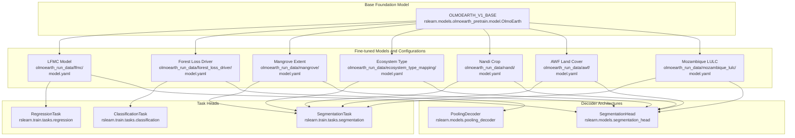
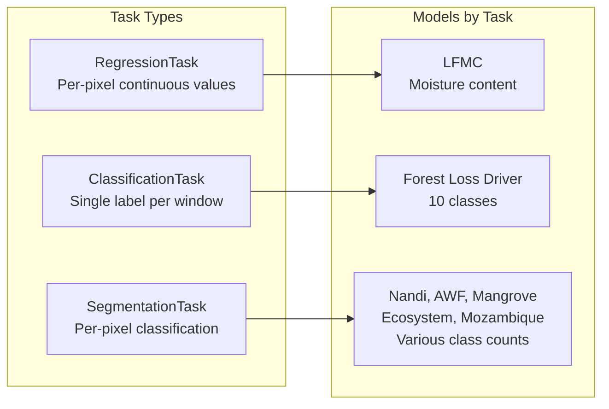
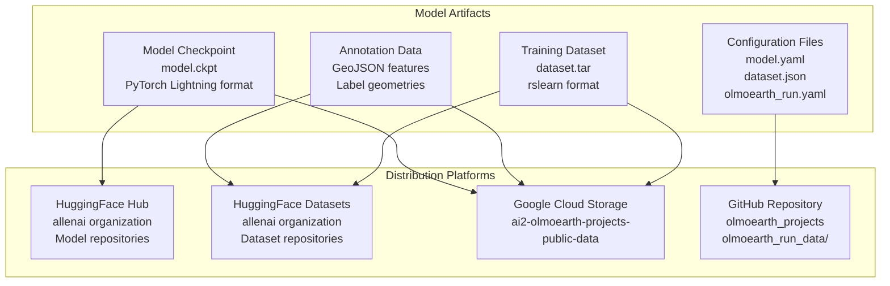

<!-- source: DeepWiki mcp.deepwiki.com · repo allenai/olmoearth_projects · page 6 Available Models · fetched 2026-10-26 -->

# Available Models

<details>
<summary>Relevant source files</summary>

The following files were used as context for generating this wiki page:

- [LICENSE](LICENSE)
- [README.md](README.md)
- [docs/awf.md](docs/awf.md)
- [docs/forest_loss_driver.md](docs/forest_loss_driver.md)
- [docs/lfmc.md](docs/lfmc.md)
- [docs/nandi.md](docs/nandi.md)
- [olmoearth_run_data/forest_loss_driver/model.yaml](olmoearth_run_data/forest_loss_driver/model.yaml)
- [olmoearth_run_data/nandi/prediction_request_geometry.geojson](olmoearth_run_data/nandi/prediction_request_geometry.geojson)

</details>


This page provides an overview of all fine-tuned OlmoEarth models available in this repository, including their applications, performance characteristics, and access information. Each model is built on the OlmoEarth-v1-Base foundation model and fine-tuned for specific remote sensing tasks. For detailed information about individual models including training data, inference procedures, and usage examples, see the corresponding child pages (sections 6.1-6.7).

For information about the training process used to create these models, see [Model Training](#5). For information about running inference with these models, see [Inference and Deployment](#7).

## Model Catalog

The repository contains seven distinct fine-tuned models, each targeting a specific application domain:

| Model Name | Task Type | Classes/Output | Accuracy/MSE | Geographic Focus | HuggingFace Link |
|------------|-----------|----------------|--------------|------------------|------------------|
| Mozambique LULC | Segmentation | 7 LULC classes + 7 crop types | TBD | Mozambique (3 provinces) | See [6.1](#6.1) |
| LFMC | Regression | Continuous moisture % | MSE: 580.6 | Continental US | [allenai/OlmoEarth-v1-FT-LFMC-Base](https://huggingface.co/allenai/OlmoEarth-v1-FT-LFMC-Base) |
| Forest Loss Driver | Classification | 10 driver classes | 76.1% | Tropical forests | [allenai/OlmoEarth-v1-FT-ForestLossDriver-Base](https://huggingface.co/allenai/OlmoEarth-v1-FT-ForestLossDriver-Base) |
| Mangrove Extent | Segmentation | 3 classes | 97.6% | Global mangroves | [allenai/OlmoEarth-v1-FT-Mangrove-Base](https://huggingface.co/allenai/OlmoEarth-v1-FT-Mangrove-Base) |
| Ecosystem Type | Segmentation | 60 ecosystem types | 64.8% | North Africa | [allenai/OlmoEarth-v1-FT-EcosystemTypeMapping-Base](https://huggingface.co/allenai/OlmoEarth-v1-FT-EcosystemTypeMapping-Base) |
| Nandi Crop | Segmentation | 10 crop/land types | 87.3% | Nandi County, Kenya | [allenai/OlmoEarth-v1-FT-Nandi-Base](https://huggingface.co/allenai/OlmoEarth-v1-FT-Nandi-Base) |
| AWF Land Cover | Segmentation | 9 land cover types | 89.5% | Southern Kenya | [allenai/OlmoEarth-v1-FT-AWF-Base](https://huggingface.co/allenai/OlmoEarth-v1-FT-AWF-Base) |

**Sources:** [README.md:8-17](), [docs/lfmc.md:1-24](), [docs/forest_loss_driver.md:1-39](), [docs/nandi.md:1-18](), [docs/awf.md:1-18]()

## Model Architecture Mapping

The following diagram shows how each model maps to its configuration files and the code entities that define its architecture:



**Sources:** [olmoearth_run_data/forest_loss_driver/model.yaml:14-16](), [README.md:62-73]()

## Common Architecture Pattern

All models in this repository follow a consistent architecture pattern defined in their `model.yaml` configuration files:

### Encoder-Decoder Structure

Each model uses `rslearn.models.singletask.SingleTaskModel` with two main components:

1. **Encoder**: `rslearn.models.olmoearth_pretrain.model.OlmoEarth` initialized with `model_id: OLMOEARTH_V1_BASE`
2. **Decoder**: Task-specific head (either `SegmentationHead` or `PoolingDecoder`)

The encoder configuration specifies:
- `patch_size`: Typically 1, 2, or 4 depending on the model
- `image_channels`: Number of input channels (varies by temporal depth and bands)
- `image_key`: Input data key (e.g., `"sentinel2_l2a"`)

**Sources:** [olmoearth_run_data/forest_loss_driver/model.yaml:6-28]()

### Task Configurations

Models use three different task types from `rslearn.train.tasks`:



**Sources:** [olmoearth_run_data/forest_loss_driver/model.yaml:56-64]()

## Model Distribution Locations

Each model has associated artifacts distributed across multiple platforms:



**Sources:** [docs/lfmc.md:10-12](), [docs/nandi.md:8-10](), [docs/awf.md:8-10](), [docs/forest_loss_driver.md:27-28]()

## Input Data Requirements

All models consume satellite imagery with temporal sequences. The following table summarizes input requirements:

| Model | Primary Data | Secondary Data | Timesteps | Temporal Resolution |
|-------|-------------|----------------|-----------|-------------------|
| LFMC | Sentinel-2 L2A | Sentinel-1 RTC | 12 | 14-day periods |
| Forest Loss Driver | Sentinel-2 L2A | - | 8 (4 pre + 4 post) | Variable |
| Mangrove | Sentinel-2 L2A | - | 12 | 30-day periods |
| Ecosystem Type | Sentinel-2 L2A | - | 6 | 30-day periods |
| Nandi | Sentinel-2 L2A | Sentinel-1 RTC | 12 | 30-day periods |
| AWF | Sentinel-2 L2A | Sentinel-1 RTC | 12 | 30-day periods |
| Mozambique LULC | Sentinel-2 L2A | - | Seasonal | Variable |

All models retrieve data from Microsoft Planetary Computer as configured in their respective `dataset.json` files.

**Sources:** [docs/lfmc.md:16-20](), [docs/forest_loss_driver.md:32-36](), [docs/nandi.md:14](), [docs/awf.md:14]()

## Configuration File Structure

Each model's configuration is stored in `olmoearth_run_data/PROJECT_NAME/` with three files:

### dataset.json
Specifies data sources and query parameters:
- Data source URLs (Planetary Computer endpoints)
- Band selections for Sentinel-2 and Sentinel-1
- Harmonization settings
- Temporal query configurations

### model.yaml
Defines model architecture and training:
- Encoder: OlmoEarth initialization parameters
- Decoder: Task-specific head configuration
- Optimizer: AdamW with learning rate
- Scheduler: PlateauScheduler parameters
- Callbacks: FreezeUnfreeze, ModelCheckpoint, etc.

### olmoearth_run.yaml
Configures inference pipeline:
- Partitioning strategy (coarse and fine grids)
- Post-processing rules (CombineGeotiff)
- Output projection settings
- Metadata for visualization

**Sources:** [README.md:62-73](), [olmoearth_run_data/forest_loss_driver/model.yaml:1-128]()

## Model Checkpoint Access

Model checkpoints can be downloaded directly from HuggingFace using wget:

```bash
# LFMC model
wget https://huggingface.co/allenai/OlmoEarth-v1-FT-LFMC-Base/resolve/main/model.ckpt

# Forest Loss Driver model
wget https://huggingface.co/allenai/OlmoEarth-v1-FT-ForestLossDriver-Base/resolve/main/model.ckpt

# Nandi model
wget https://huggingface.co/allenai/OlmoEarth-v1-FT-Nandi-Base/blob/main/model.ckpt

# AWF model
wget https://huggingface.co/allenai/OlmoEarth-v1-FT-AWF-Base/blob/main/model.ckpt
```

Checkpoints are in PyTorch Lightning format (`.ckpt`) and can be loaded using the `--checkpoint_path` argument when running `olmoearth_run`.

**Sources:** [README.md:109-114](), [docs/lfmc.md:10](), [docs/forest_loss_driver.md:27]()

## Training Data Access

Training datasets are available in rslearn format as tar archives:

```bash
# LFMC dataset (from GCS)
wget https://storage.googleapis.com/ai2-olmoearth-projects-public-data/projects/lfmc/20251029/dataset.tar

# Forest Loss Driver dataset (from GCS)
wget https://storage.googleapis.com/ai2-olmoearth-projects-public-data/projects/forest_loss_driver/20251029/dataset.tar

# Nandi dataset (from HuggingFace)
wget https://huggingface.co/datasets/allenai/olmoearth_projects_nandi/blob/main/dataset.tar

# AWF dataset (from HuggingFace)
wget https://huggingface.co/datasets/allenai/olmoearth_projects_awf/blob/main/dataset.tar
```

Extract with `tar xvf dataset.tar` and set `DATASET_PATH` environment variable to the extracted directory when fine-tuning.

**Sources:** [README.md:148-154](), [docs/lfmc.md:12](), [docs/forest_loss_driver.md:28]()

## Model Performance Characteristics

### Segmentation Models

Most models perform per-pixel segmentation using `SegmentationHead` decoder:

- **Mangrove**: 97.6% accuracy on 3 classes (mangrove, water, other)
- **AWF**: 89.5% accuracy on 9 land cover classes
- **Nandi**: 87.3% accuracy on 10 crop/land types
- **Ecosystem Type**: 64.8% accuracy on 60 ecosystem types

Performance generally decreases as the number of classes increases, which is expected.

### Classification Model

**Forest Loss Driver** uses `PoolingDecoder` for whole-window classification:
- 76.1% accuracy on 10 driver classes
- Confusion matrix shows strong performance on agriculture, burned, and road classes
- Challenges with underrepresented classes (airstrip, landslide)

### Regression Model

**LFMC** predicts continuous moisture content values:
- MSE of 580.6 on test set
- Outputs per-pixel regression values
- Uses `RegressionTask` instead of classification

**Sources:** [docs/nandi.md:18](), [docs/awf.md:18](), [docs/forest_loss_driver.md:38-52](), [docs/lfmc.md:24]()

## Licensing

All models and code in this repository are released under the OlmoEarth Artifact License, which permits use, modification, and distribution with restrictions on military/defense and extractive industry applications.

Training data licenses vary by model:
- **LFMC**: CC0 (public domain)
- **Forest Loss Driver**: CC BY 4.0

Refer to individual model documentation for specific licensing terms.

**Sources:** [LICENSE:1-128](), [docs/lfmc.md:40](), [docs/forest_loss_driver.md:63]()

---

