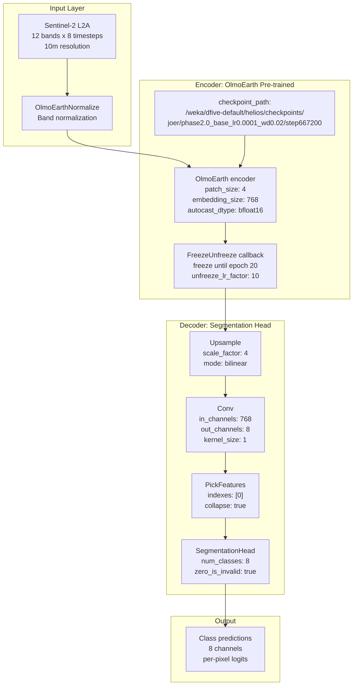
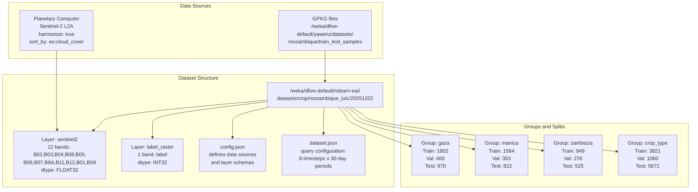
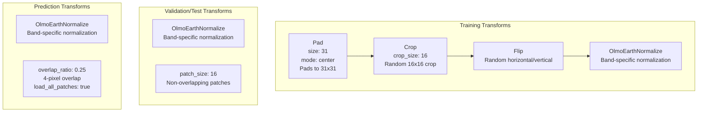

<!-- source: DeepWiki mcp.deepwiki.com · repo allenai/olmoearth_projects · page 6.1 Mozambique LULC Models · fetched 2026-10-26 -->

# Mozambique LULC Models

<details>
<summary>Relevant source files</summary>

The following files were used as context for generating this wiki page:

- [olmoearth_run_data/mozambique_lulc/README.md](olmoearth_run_data/mozambique_lulc/README.md)
- [olmoearth_run_data/mozambique_lulc/config.json](olmoearth_run_data/mozambique_lulc/config.json)
- [olmoearth_run_data/mozambique_lulc/dataset.json](olmoearth_run_data/mozambique_lulc/dataset.json)
- [olmoearth_run_data/mozambique_lulc/model.yaml](olmoearth_run_data/mozambique_lulc/model.yaml)
- [olmoearth_run_data/mozambique_lulc/olmoearth_run.yaml](olmoearth_run_data/mozambique_lulc/olmoearth_run.yaml)
- [olmoearth_run_data/mozambique_lulc/rslp_finetuning.yaml](olmoearth_run_data/mozambique_lulc/rslp_finetuning.yaml)
- [olmoearth_run_data/mozambique_lulc/rslp_finetuning_croptype.yaml](olmoearth_run_data/mozambique_lulc/rslp_finetuning_croptype.yaml)
- [olmoearth_run_data/mozambique_lulc/rslp_finetuning_croptype_in_season_novmar.yaml](olmoearth_run_data/mozambique_lulc/rslp_finetuning_croptype_in_season_novmar.yaml)
- [olmoearth_run_data/mozambique_lulc/rslp_finetuning_in_season_novmar.yaml](olmoearth_run_data/mozambique_lulc/rslp_finetuning_in_season_novmar.yaml)

</details>


This document covers the Mozambique Land Use Land Cover (LULC) classification models, which include two fine-tuned OlmoEarth variants: a 7-class LULC classifier and a 7-class crop type classifier. These models are trained on field survey data from three provinces in Mozambique (Gaza, Manica, and Zambezia) and perform pixel-level segmentation using Sentinel-2 imagery.

For general information about the model training process, see [Model Training](#5). For details on the inference pipeline, see [olmoearth_run Pipeline](#7.1). For information about other fine-tuned models in the repository, see [Available Models](#6).

## Overview

The Mozambique LULC project consists of two distinct classification tasks:

| Task | Classes | Training Samples | Purpose |
|------|---------|-----------------|---------|
| **LULC Classification** | 7 land cover types | 4,881 (train), 1,623 (val), 2,317 (test) | General land cover mapping including water, vegetation, buildings, cropland |
| **Crop Type Classification** | 7 crop types | 3,821 (train), 1,060 (val), 5,671 (test) | Agricultural crop identification within cropland areas |

Both models use the same OlmoEarth-v1-Base encoder with task-specific segmentation heads. Training data is organized by province groups to enable spatial generalization assessment.

**Sources**: [olmoearth_run_data/mozambique_lulc/README.md:1-49]()

## Model Variants

### LULC Classification Model

The LULC model classifies land cover into 7 categories plus an invalid class:

| Class Index | Label | Description |
|-------------|-------|-------------|
| 0 | Invalid | No data or unlabeled pixels (zero_is_invalid=true) |
| 1 | Water | Water bodies including rivers, lakes, ponds |
| 2 | Bare Ground | Exposed soil, sand, or rock |
| 3 | Rangeland | Grasslands and shrublands |
| 4 | Flooded Vegetation | Wetlands and seasonally flooded areas |
| 5 | Trees | Forest and tree cover |
| 6 | Cropland | Agricultural fields (all crop types) |
| 7 | Buildings | Built-up areas and structures |

The model is configured in [olmoearth_run_data/mozambique_lulc/rslp_finetuning.yaml:1-268]() and trains on all three province groups (gaza, manica, zambezia) as specified in [olmoearth_run_data/mozambique_lulc/rslp_finetuning.yaml:236-246]().

**Sources**: [olmoearth_run_data/mozambique_lulc/rslp_finetuning.yaml:76-188](), [olmoearth_run_data/mozambique_lulc/README.md:49](), [olmoearth_run_data/mozambique_lulc/olmoearth_run.yaml:6-27]()

### Crop Type Classification Model

The crop type model identifies specific crops within agricultural areas:

| Class Index | Label | Typical Growing Season |
|-------------|-------|----------------------|
| 0 | Invalid | No data or unlabeled pixels |
| 1 | Corn | November-March |
| 2 | Cassava | Year-round perennial |
| 3 | Rice | November-March |
| 4 | Sesame | November-March |
| 5 | Beans | November-March |
| 6 | Millet | November-March |
| 7 | Sorghum | November-March |

The crop type model configuration is in [olmoearth_run_data/mozambique_lulc/rslp_finetuning_croptype.yaml:1-268]() and trains on the `crop_type` group as specified in [olmoearth_run_data/mozambique_lulc/rslp_finetuning_croptype.yaml:236-247]().

**Sources**: [olmoearth_run_data/mozambique_lulc/rslp_finetuning_croptype.yaml:75-206](), [olmoearth_run_data/mozambique_lulc/README.md:45-48]()

### Seasonal Variants

Both models have seasonal variants optimized for the November-March growing season:
- `rslp_finetuning_in_season_novmar.yaml` for LULC
- `rslp_finetuning_croptype_in_season_novmar.yaml` for crop type

These variants load 5 Sentinel-2 layers ([olmoearth_run_data/mozambique_lulc/rslp_finetuning_in_season_novmar.yaml:57]()) corresponding to monthly observations during the growing season, compared to the standard 8-month configuration that uses all available temporal data.

**Sources**: [olmoearth_run_data/mozambique_lulc/rslp_finetuning_in_season_novmar.yaml:1-267](), [olmoearth_run_data/mozambique_lulc/rslp_finetuning_croptype_in_season_novmar.yaml:1-267]()

## Model Architecture



**Architecture Configuration Mapping**

The model uses `rslearn.models.multitask.MultiTaskModel` as defined in [olmoearth_run_data/mozambique_lulc/rslp_finetuning.yaml:5-41](). Key architectural components:

1. **Encoder**: `rslearn.models.olmoearth_pretrain.model.OlmoEarth` ([olmoearth_run_data/mozambique_lulc/rslp_finetuning.yaml:8-16]())
   - Loads pre-trained weights from checkpoint at step 667200
   - Uses selector `["encoder"]` to extract only encoder weights
   - Patch size of 4 means the encoder operates at 1/4 the input resolution

2. **Decoder Pipeline** ([olmoearth_run_data/mozambique_lulc/rslp_finetuning.yaml:17-38]()):
   - `rslearn.models.upsample.Upsample`: Bilinear upsampling by 4x to restore original resolution
   - `rslearn.models.conv.Conv`: 1x1 convolution to project 768 encoder features to 8 class channels
   - `rslearn.models.pick_features.PickFeatures`: Selects first feature map
   - `rslearn.train.tasks.segmentation.SegmentationHead`: Applies softmax and loss computation

3. **Training Configuration** ([olmoearth_run_data/mozambique_lulc/rslp_finetuning.yaml:42-49]()):
   - Base learning rate: 0.0001
   - `rslearn.train.scheduler.PlateauScheduler` with factor=0.2, patience=2
   - `rslearn.train.callbacks.freeze_unfreeze.FreezeUnfreeze` unfreezes encoder at epoch 20 with 10x LR boost

**Sources**: [olmoearth_run_data/mozambique_lulc/rslp_finetuning.yaml:1-49](), [olmoearth_run_data/mozambique_lulc/model.yaml:1-31]()

## Dataset Configuration



**Dataset Location and Structure**

The dataset is stored at `/weka/dfive-default/rslearn-eai/datasets/crop/mozambique_lulc/20251202` as specified in [olmoearth_run_data/mozambique_lulc/rslp_finetuning.yaml:53](). This version (20251202) is the latest iteration with aligned temporal configurations and updated train/val/test splits.

**Data Layers**

The `RslearnDataModule` configuration ([olmoearth_run_data/mozambique_lulc/rslp_finetuning.yaml:50-68]()) defines two input layers:

1. **sentinel2_l2a** ([olmoearth_run_data/mozambique_lulc/rslp_finetuning.yaml:55-62]())
   - 12 Sentinel-2 bands in canonical order
   - `load_all_item_groups: true` loads all 8 timesteps
   - `passthrough: true` allows direct access to raw values

2. **label** ([olmoearth_run_data/mozambique_lulc/rslp_finetuning.yaml:63-68]())
   - Single integer band containing class labels
   - `is_target: true` marks as ground truth
   - Stored in rasterized format (see label_raster layer in [olmoearth_run_data/mozambique_lulc/config.json:6-16]())

**Temporal Configuration**

The `dataset.json` ([olmoearth_run_data/mozambique_lulc/dataset.json:45-58]()) specifies:
- `max_matches: 8` and `min_matches: 8` enforce exactly 8 temporal observations
- `period_duration: "30d"` creates monthly mosaics
- `space_mode: "PER_PERIOD_MOSAIC"` aggregates all images within each 30-day period

**Sources**: [olmoearth_run_data/mozambique_lulc/rslp_finetuning.yaml:50-68](), [olmoearth_run_data/mozambique_lulc/dataset.json:1-63](), [olmoearth_run_data/mozambique_lulc/config.json:1-69](), [olmoearth_run_data/mozambique_lulc/README.md:39-49]()

## Data Processing Pipeline

```mermaid
graph LR
    subgraph "Step 1: Window Creation"
        GPKG_INPUT["GPKG point<br/>annotations"]
        CREATE_WINDOWS["create_windows_for_lulc.py<br/>--gpkg_dir<br/>--ds_path<br/>--window_size 32"]
        WINDOWS["32x32 pixel<br/>windows created"]
    end
    
    subgraph "Step 2: Spatial Splitting"
        UPDATE_SPLIT["update_train_test_split.py<br/>SpatialDataSplitter<br/>grid_size: 128<br/>val_ratio: 0.1"]
        SPLIT_TAGS["Tags added:<br/>split: train/val/test"]
    end
    
    subgraph "Step 3: Data Preparation"
        RSLEARN_PREPARE["rslearn dataset prepare<br/>--root $DATASET_PATH<br/>--workers 64"]
        MATERIALIZE["rslp launch_data_<br/>materialization_jobs<br/>--num_jobs 5"]
    end
    
    subgraph "Step 4: Label Rasterization"
        CREATE_LABEL["create_label_raster.py<br/>--ds_path"]
        RASTER_LAYER["label_raster layer<br/>created from points"]
    end
    
    subgraph "Step 5: Quality Check"
        CHECK_QUALITY["check_label_quality.py<br/>--ds_path<br/>--split train"]
        METRICS["Spatial clustering F1<br/>Label imbalance<br/>Spatial extent"]
    end
    
    GPKG_INPUT --> CREATE_WINDOWS
    CREATE_WINDOWS --> WINDOWS
    WINDOWS --> UPDATE_SPLIT
    UPDATE_SPLIT --> SPLIT_TAGS
    SPLIT_TAGS --> RSLEARN_PREPARE
    RSLEARN_PREPARE --> MATERIALIZE
    MATERIALIZE --> CREATE_LABEL
    CREATE_LABEL --> RASTER_LAYER
    RASTER_LAYER --> CHECK_QUALITY
    CHECK_QUALITY --> METRICS
```



**Window Creation**

Windows are created using scripts in the project directory. The command structure is:

```bash
python olmoearth_projects/projects/mozambique_lulc/create_windows_for_lulc.py \
    --gpkg_dir /weka/dfive-default/yawenz/datasets/mozambique/train_test_samples \
    --ds_path $DATASET_PATH \
    --window_size 32
```

For crop type data, add the `--crop_type` flag ([olmoearth_run_data/mozambique_lulc/README.md:20]()).

The window creation process:
- Reads point annotations from GPKG files
- Creates 32x32 pixel windows centered on each point
- Sets 10m resolution as configured in [olmoearth_run_data/mozambique_lulc/olmoearth_run.yaml:36]()
- Applies 31-pixel buffer as specified in [olmoearth_run_data/mozambique_lulc/olmoearth_run.yaml:35]()

**Data Splitting**

The `SpatialDataSplitter` ([olmoearth_run_data/mozambique_lulc/olmoearth_run.yaml:40-48]()) creates spatially-coherent splits:
- Uses grid_size of 128 pixels to define spatial blocks
- Splits blocks with train_prop=0.75, val_prop=0.25, test_prop=0.0
- Assigns split tags to each window
- Prevents data leakage by ensuring spatial separation between splits

**Label Rasterization**

The script `create_label_raster.py` converts point labels to rasters:
```bash
python olmoearth_projects/projects/mozambique_lulc/create_label_raster.py \
    --ds_path $DATASET_PATH
```

This step is necessary because the model uses `rslearn.train.tasks.segmentation.SegmentationTask` ([olmoearth_run_data/mozambique_lulc/rslp_finetuning.yaml:74]()) which expects raster inputs, not point geometries. The conversion creates a `label_raster` layer with dtype INT32 and nodata_value 255 ([olmoearth_run_data/mozambique_lulc/olmoearth_run.yaml:37-38]()).

**Sources**: [olmoearth_run_data/mozambique_lulc/README.md:14-37](), [olmoearth_run_data/mozambique_lulc/olmoearth_run.yaml:29-48]()

## Training Configuration

### Data Augmentation and Transforms



**Training Configuration**

The `train_config` ([olmoearth_run_data/mozambique_lulc/rslp_finetuning.yaml:218-238]()) applies aggressive augmentation:

1. **Padding**: [olmoearth_run_data/mozambique_lulc/rslp_finetuning.yaml:220-224]()
   - Pads input from 16x16 to 31x31 pixels (center mode)
   - Applied to sentinel2_l2a, target/segment/classes, and target/segment/valid

2. **Random Cropping**: [olmoearth_run_data/mozambique_lulc/rslp_finetuning.yaml:225-228]()
   - Crops back to 16x16 at random location
   - Provides spatial jittering augmentation

3. **Random Flipping**: [olmoearth_run_data/mozambique_lulc/rslp_finetuning.yaml:229-231]()
   - Random horizontal and vertical flips
   - Improves rotation invariance

4. **Normalization**: [olmoearth_run_data/mozambique_lulc/rslp_finetuning.yaml:232-235]()
   - `rslearn.models.olmoearth_pretrain.norm.OlmoEarthNormalize`
   - Band-specific mean/std normalization for Sentinel-2

**Validation and Test Configuration**

The `val_config` and `test_config` ([olmoearth_run_data/mozambique_lulc/rslp_finetuning.yaml:239-248]()) use:
- `patch_size: 16` for consistent 16x16 evaluation patches
- Only normalization transform, no augmentation
- Evaluates on respective groups and split tags

**Prediction Configuration**

The `predict_config` in [olmoearth_run_data/mozambique_lulc/model.yaml:236-245]() uses:
- `load_all_patches: true` for full coverage
- `overlap_ratio: 0.25` (4 pixels) to smooth boundaries
- `skip_targets: true` since no ground truth available during inference

**Sources**: [olmoearth_run_data/mozambique_lulc/rslp_finetuning.yaml:218-248](), [olmoearth_run_data/mozambique_lulc/model.yaml:236-245]()

### Training Hyperparameters

| Parameter | Value | Configuration Location |
|-----------|-------|----------------------|
| **Learning Rate** | 0.0001 | [rslp_finetuning.yaml:42]() |
| **Batch Size** | 64 | [rslp_finetuning.yaml:210]() |
| **Max Epochs** | 100 | [rslp_finetuning.yaml:250]() |
| **Num Workers** | 32 | [rslp_finetuning.yaml:211]() |
| **Scheduler** | PlateauScheduler | [rslp_finetuning.yaml:44]() |
| **Scheduler Factor** | 0.2 | [rslp_finetuning.yaml:46]() |
| **Scheduler Patience** | 2 epochs | [rslp_finetuning.yaml:47]() |
| **Scheduler Cooldown** | 10 epochs | [rslp_finetuning.yaml:49]() |
| **FreezeUnfreeze Epoch** | 20 | [rslp_finetuning.yaml:264]() |
| **Unfreeze LR Factor** | 10x | [rslp_finetuning.yaml:265]() |

**Callbacks**

The trainer uses several callbacks ([olmoearth_run_data/mozambique_lulc/rslp_finetuning.yaml:251-265]()):

1. **LearningRateMonitor** ([olmoearth_run_data/mozambique_lulc/rslp_finetuning.yaml:252-254]())
   - Logs learning rate per epoch

2. **ModelCheckpoint** ([olmoearth_run_data/mozambique_lulc/rslp_finetuning.yaml:255-260]())
   - Monitors `val_segment/accuracy`
   - Saves best model (mode: max)
   - Also saves last checkpoint

3. **FreezeUnfreeze** ([olmoearth_run_data/mozambique_lulc/rslp_finetuning.yaml:261-265]())
   - Freezes encoder until epoch 20
   - Module selector: `["model", "encoder", 0]`
   - Applies 10x learning rate boost on unfreeze
   - Enables progressive fine-tuning strategy

**Sources**: [olmoearth_run_data/mozambique_lulc/rslp_finetuning.yaml:42-265]()

## Metrics and Evaluation

### Task Configuration

The `SegmentationTask` ([olmoearth_run_data/mozambique_lulc/rslp_finetuning.yaml:73-206]()) defines:
- `num_classes: 8` (including invalid class 0)
- `zero_is_invalid: true` treats class 0 as unlabeled/invalid
- `metric_kwargs: {average: "micro"}` computes overall accuracy across all classes

### Per-Class Metrics

Both LULC and crop type models compute precision and recall for each class using `SegmentationMetric` wrapper around `torchmetrics.classification.MulticlassPrecision` and `MulticlassRecall`.

**LULC Model Metrics** ([olmoearth_run_data/mozambique_lulc/rslp_finetuning.yaml:80-206]()):

| Metric Name | Class | Class Index |
|-------------|-------|-------------|
| water_precision / water_recall | Water | 1 |
| bareground_precision / bareground_recall | Bare Ground | 2 |
| rangeland_precision / rangeland_recall | Rangeland | 3 |
| floodedvegetation_precision / floodedvegetation_recall | Flooded Vegetation | 4 |
| trees_precision / trees_recall | Trees | 5 |
| cropland_precision / cropland_recall | Cropland | 6 |
| buildings_precision / buildings_recall | Buildings | 7 |

**Crop Type Model Metrics** ([olmoearth_run_data/mozambique_lulc/rslp_finetuning_croptype.yaml:80-206]()):

| Metric Name | Class | Class Index |
|-------------|-------|-------------|
| corn_precision / corn_recall | Corn | 1 |
| cassava_precision / cassava_recall | Cassava | 2 |
| rice_precision / rice_recall | Rice | 3 |
| sesame_precision / sesame_recall | Sesame | 4 |
| beans_precision / beans_recall | Beans | 5 |
| millet_precision / millet_recall | Millet | 6 |
| sorghum_precision / sorghum_recall | Sorghum | 7 |

Each metric is configured with `average: null` to compute per-class metrics and uses `class_idx` to select the specific class for evaluation.

**Sources**: [olmoearth_run_data/mozambique_lulc/rslp_finetuning.yaml:69-206](), [olmoearth_run_data/mozambique_lulc/rslp_finetuning_croptype.yaml:69-206]()

## Label Quality Assessment

The script `check_label_quality.py` performs three quality checks on the training data:

```bash
python olmoearth_projects/projects/mozambique_lulc/check_label_quality.py \
    --ds_path /weka/dfive-default/rslearn-eai/datasets/crop/mozambique_lulc/20251202 \
    --split train
```

### LULC Label Quality Results

From [olmoearth_run_data/mozambique_lulc/README.md:56-83]():

| Check | Metric | Value | Interpretation |
|-------|--------|-------|----------------|
| **Label Imbalance** | Cropland | 0.278 | Most common class (28%) |
| | Buildings | 0.176 | Second most common (18%) |
| | Bare Ground | 0.127 | Balanced representation |
| | Other classes | 0.098-0.114 | Adequate representation |
| **Spatial Clustering F1** | Buildings | 0.964 | Strong spatial coherence |
| | Trees | 0.918 | Strong spatial coherence |
| | Cropland | 0.820 | Good spatial clustering |
| | Bare Ground | 0.776 | Moderate clustering |
| | Rangeland | 0.710 | Moderate clustering |
| | Flooded Vegetation | 0.647 | Some spatial scatter |
| | Water | 0.561 | Most spatially dispersed |
| **Spatial Extent** | Rangeland | 0.989 | Wide geographic coverage |
| | Bare Ground | 0.906 | Wide coverage |
| | Flooded Vegetation | 0.820 | Good coverage |
| | Cropland | 0.818 | Good coverage |
| | Trees | 0.814 | Good coverage |
| | Water | 0.802 | Good coverage |
| | Buildings | 0.726 | More concentrated |

### Crop Type Label Quality Results

From [olmoearth_run_data/mozambique_lulc/README.md:85-114]():

| Check | Metric | Value | Interpretation |
|-------|--------|-------|----------------|
| **Label Imbalance** | Beans | 0.261 | Most common crop (26%) |
| | Corn | 0.245 | Well represented |
| | Rice | 0.186 | Good representation |
| | Cassava | 0.185 | Good representation |
| | Sesame | 0.100 | Limited samples |
| | Millet | 0.009 | Very few samples |
| | Sorghum | 0.014 | Very few samples |
| **Spatial Clustering F1** | Sesame | 1.000 | Perfect clustering (small area) |
| | Millet | 1.000 | Perfect clustering (small area) |
| | Rice | 0.994 | Strong clustering |
| | Corn | 0.995 | Strong clustering |
| | Sorghum | 0.990 | Strong clustering |
| | Beans | 0.989 | Strong clustering |
| | Cassava | 0.973 | Strong clustering |
| **Spatial Extent** | Cassava | 0.938 | Widest distribution |
| | Corn | 0.836 | Good coverage |
| | Beans | 0.783 | Good coverage |
| | Rice | 0.765 | Good coverage |
| | Sesame | 0.0004 | Very localized |
| | Millet | 0.0002 | Very localized |
| | Sorghum | 0.0000003 | Extremely localized |

**Quality Check Interpretation**

1. **Label Imbalance**: Measures class distribution. Values closer to 1/num_classes indicate balanced representation. Millet and sorghum are underrepresented in the crop type dataset.

2. **Spatial Clustering F1**: Measures whether similar labels cluster together. High values (>0.9) indicate labels are spatially coherent, which is expected for land cover types. Low values may indicate noisy labels or naturally dispersed classes.

3. **Spatial Extent**: Measures geographic spread of each class across the study area. Low values indicate the class is concentrated in a small region, which may limit model generalization.

**Sources**: [olmoearth_run_data/mozambique_lulc/README.md:51-114]()

## Training and Testing Workflow

### Training via rslearn_projects

Training is executed through the `rslp` command-line interface from the rslearn_projects repository:

```bash
python -m rslp.main olmoearth_pretrain launch_finetune \
    --image_name yawenzzzz/rslp20251112h \
    --config_paths+=olmoearth_run_data/mozambique_lulc/rslp_finetuning.yaml \
    --cluster+=ai2/saturn \
    --rslp_project <MY_RSLP_PROJECT_NAME> \
    --experiment_id <MY_EXPERIMENT_ID>
```

This command submits a Beaker job with GPU resources on the Saturn cluster. The specified Docker image contains the full training environment with rslearn and dependencies.

For crop type training, replace the config path with `rslp_finetuning_croptype.yaml` ([olmoearth_run_data/mozambique_lulc/README.md:119-123]()).

### Testing Workflow

Testing is performed interactively on Beaker:

1. **Start Interactive Session** ([olmoearth_run_data/mozambique_lulc/README.md:128]()):
```bash
beaker session create --remote --bare \
    --budget ai2/es-platform \
    --cluster ai2/saturn \
    --mount src=weka,ref=dfive-default,dst=/weka/dfive-default \
    --image beaker://yawenzzzz/rslp20251112h \
    --gpus 1
```

2. **Set Environment** ([olmoearth_run_data/mozambique_lulc/README.md:130]()):
```bash
cd /weka/dfive-default/gabrielt/olmoearth_projects
export RSLP_PREFIX=/weka/dfive-default/rslearn-eai
```

3. **Run Testing** ([olmoearth_run_data/mozambique_lulc/README.md:131]()):
```bash
python -m rslp.rslearn_main model test \
    --config olmoearth_run_data/mozambique_lulc/rslp_finetuning.yaml \
    --rslp_experiment <MY_EXPERIMENT_ID> \
    --rslp_project <MY_RSLP_PROJECT_NAME> \
    --force_log=true \
    --load_best=true \
    --verbose true
```

The `--load_best=true` flag loads the checkpoint with highest validation accuracy as saved by the `ModelCheckpoint` callback ([olmoearth_run_data/mozambique_lulc/rslp_finetuning.yaml:255-260]()).

**Sources**: [olmoearth_run_data/mozambique_lulc/README.md:117-131]()

## Inference Configuration

### Output Specification

The `olmoearth_run.yaml` ([olmoearth_run_data/mozambique_lulc/olmoearth_run.yaml:1-81]()) defines inference output format:

**Classification Fields** ([olmoearth_run_data/mozambique_lulc/olmoearth_run.yaml:2-27]()):

```yaml
inference_results_config:
  data_type: RASTER
  classification_fields:
    - property_name: crop_type_classification
      band_index: 1
      allowed_values:
        - value: 1
          label: Water
          color: [136, 33, 233]
        # ... additional classes
```

This configuration maps integer pixel values (1-7) to human-readable labels with associated colors for visualization. The output is a single-band GeoTIFF where each pixel value represents the predicted class.

### Partitioning Strategy

The inference pipeline uses hierarchical partitioning ([olmoearth_run_data/mozambique_lulc/olmoearth_run.yaml:50-66]()):

1. **Coarse Partitioning** ([olmoearth_run_data/mozambique_lulc/olmoearth_run.yaml:51-54]())
   - `GridPartitioner` with grid_size=0.25 degrees
   - Divides large geographic areas into manageable tiles

2. **Window Partitioning** ([olmoearth_run_data/mozambique_lulc/olmoearth_run.yaml:56-66]())
   - `GridPartitioner` with grid_size=1024 pixels
   - Output projection: EPSG:3857 or UTM (use_utm=true)
   - Resolution: 10m x 10m

### Post-processing

Three post-processing stages merge results ([olmoearth_run_data/mozambique_lulc/olmoearth_run.yaml:68-80]()):

1. **process_window**: `NoopRaster` (no per-window processing)
2. **process_partition**: `CombineGeotiff` merges windows within each partition
3. **process_dataset**: `CombineGeotiff` merges all partitions into final output

All use `nodata_value: 255` to mark invalid pixels.

**Deployment**

Inference is performed through OlmoEarth Studio ([olmoearth_run_data/mozambique_lulc/README.md:135]()), where users can draw polygons and execute predictions interactively. The system uses the configuration files in `olmoearth_run_data/mozambique_lulc/` to define model behavior and output formatting.

**Sources**: [olmoearth_run_data/mozambique_lulc/olmoearth_run.yaml:1-81](), [olmoearth_run_data/mozambique_lulc/README.md:133-135]()

## Dataset Versions and Evolution

The dataset has evolved through multiple versions stored under `/weka/dfive-default/rslearn-eai/datasets/crop/mozambique_lulc/`:

| Version | Date | Key Changes | Documentation |
|---------|------|-------------|---------------|
| **20251023** | Oct 2023 | Initial version with train/test split from GPKG files | [README.md:40]() |
| **20251113** | Nov 2023 | Added spatial validation split (val_ratio=0.2) | [README.md:41-45]() |
| **20251114** | Nov 2023 | Aligned temporal dates across all provinces | [README.md:46]() |
| **20251202** | Dec 2023 | **Current version**: 8-month data export, val_ratio=0.1, aligned configs | [README.md:47-49]() |

The current version (20251202) is specified in both training configurations:
- [olmoearth_run_data/mozambique_lulc/rslp_finetuning.yaml:53]()
- [olmoearth_run_data/mozambique_lulc/rslp_finetuning_croptype.yaml:53]()

This version provides the most comprehensive temporal coverage (8 months) and optimized validation split for both model variants.

**Sources**: [olmoearth_run_data/mozambique_lulc/README.md:39-49](), [olmoearth_run_data/mozambique_lulc/rslp_finetuning.yaml:53]()

## Key Configuration Files

| File | Purpose | Key Settings |
|------|---------|--------------|
| [rslp_finetuning.yaml]() | LULC training config | 7 land cover classes, gaza/manica/zambezia groups |
| [rslp_finetuning_croptype.yaml]() | Crop type training config | 7 crop classes, crop_type group |
| [rslp_finetuning_in_season_novmar.yaml]() | Seasonal LULC variant | 5 Sentinel-2 layers for Nov-Mar season |
| [rslp_finetuning_croptype_in_season_novmar.yaml]() | Seasonal crop type variant | 5 Sentinel-2 layers for Nov-Mar season |
| [model.yaml]() | Generic model template | Environment variable placeholders for deployment |
| [dataset.json]() | Data source specification | 8 timesteps, 30-day periods, harmonized Sentinel-2 |
| [config.json]() | rslearn dataset config | Layer definitions with zoom offsets |
| [olmoearth_run.yaml]() | Inference configuration | Partitioning, post-processing, output format |

**Sources**: [olmoearth_run_data/mozambique_lulc/rslp_finetuning.yaml:1-268](), [olmoearth_run_data/mozambique_lulc/rslp_finetuning_croptype.yaml:1-268](), [olmoearth_run_data/mozambique_lulc/model.yaml:1-278](), [olmoearth_run_data/mozambique_lulc/dataset.json:1-63](), [olmoearth_run_data/mozambique_lulc/config.json:1-69](), [olmoearth_run_data/mozambique_lulc/olmoearth_run.yaml:1-81]()

---

