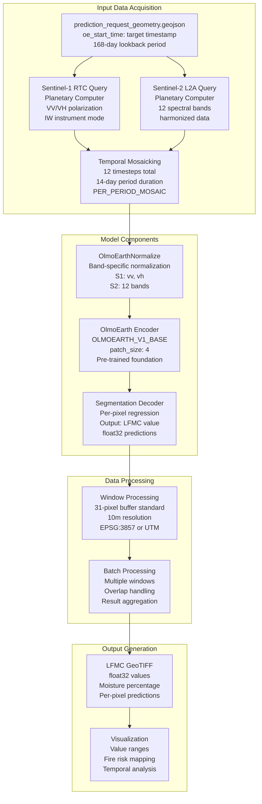
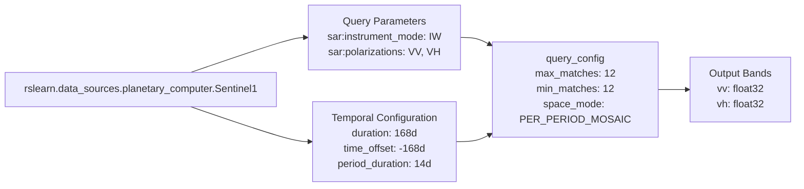
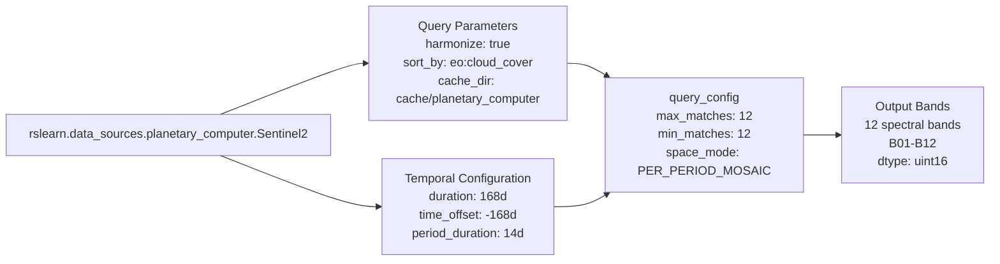
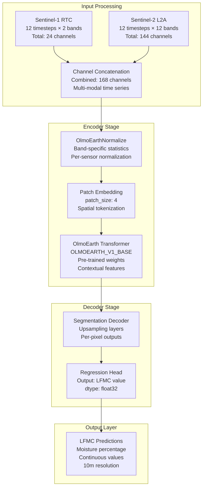
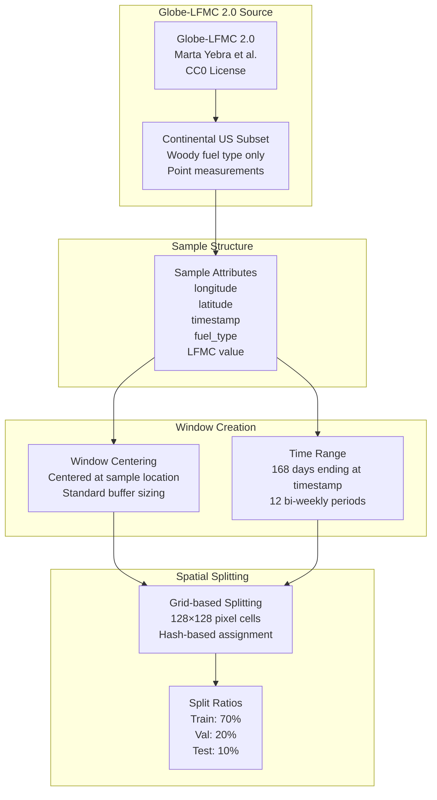
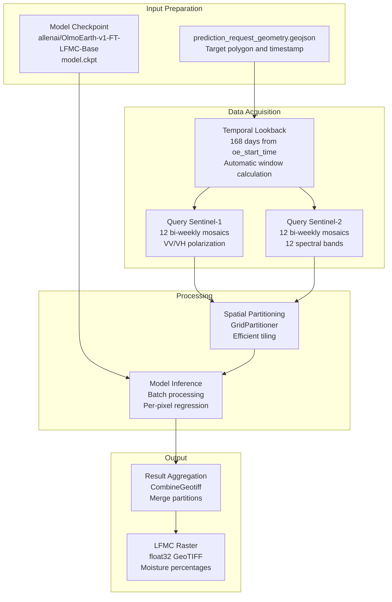

<!-- source: DeepWiki mcp.deepwiki.com · repo allenai/olmoearth_projects · page 6.2 LFMC Model · fetched 2026-10-26 -->

# LFMC Model

<details>
<summary>Relevant source files</summary>

The following files were used as context for generating this wiki page:

- [docs/forest_loss_driver.md](docs/forest_loss_driver.md)
- [docs/lfmc.md](docs/lfmc.md)
- [olmoearth_run_data/ecosystem_type_mapping/dataset.json](olmoearth_run_data/ecosystem_type_mapping/dataset.json)
- [olmoearth_run_data/forest_loss_driver/dataset.json](olmoearth_run_data/forest_loss_driver/dataset.json)
- [olmoearth_run_data/forest_loss_driver/model.yaml](olmoearth_run_data/forest_loss_driver/model.yaml)
- [olmoearth_run_data/lfmc/dataset.json](olmoearth_run_data/lfmc/dataset.json)

</details>


This document describes the Live Fuel Moisture Content (LFMC) prediction model, a fine-tuned variant of OlmoEarth-v1-Base that performs per-pixel regression of vegetation moisture content for wildfire risk assessment. The model processes multi-temporal satellite imagery from Sentinel-1 and Sentinel-2 to predict LFMC values at 10-meter resolution.

For information about the base OlmoEarth encoder architecture, see [OlmoEarth Encoder Architecture](#5.2). For general inference procedures, see [olmoearth_run Pipeline](#7.1). For training configuration details, see [Training Configuration Files](#5.1).

**Sources:** [docs/lfmc.md:1-52]()

## Model Purpose and Application

The LFMC model addresses wildfire risk assessment by predicting the live fuel moisture content of woody vegetation. Lower LFMC values indicate drier vegetation, which correlates with higher fire risk. The model outputs continuous LFMC percentage values for each pixel, enabling spatial analysis of fire susceptibility across landscapes.

The model achieves a mean squared error of 580.6 on the test set, trained exclusively on woody vegetation samples from the continental United States.

**Sources:** [docs/lfmc.md:3-24]()

## System Architecture



**Sources:** [docs/lfmc.md:14-22](), [olmoearth_run_data/lfmc/dataset.json:1-103]()

## Input Data Configuration

The model requires a precisely configured temporal sequence of satellite observations. The input data configuration is defined in `dataset.json` and specifies two satellite data sources with synchronized temporal sampling.

### Sentinel-1 RTC Configuration



The Sentinel-1 configuration queries radar backscatter data in Interferometric Wide (IW) mode with dual polarization (VV and VH). The system retrieves 12 mosaics, one per 14-day period, covering 168 days (approximately 5.5 months) prior to the target timestamp.

**Sources:** [olmoearth_run_data/lfmc/dataset.json:25-61]()

### Sentinel-2 L2A Configuration



The Sentinel-2 configuration uses harmonized Level 2A (surface reflectance) data with cloud cover sorting to select the clearest imagery. The 12 spectral bands include visible, near-infrared, shortwave infrared, and atmospheric bands.

| Band | Wavelength | Resolution | Purpose |
|------|------------|------------|---------|
| B01 | 443 nm (Coastal/Aerosol) | 60m | Atmospheric correction |
| B02 | 490 nm (Blue) | 10m | Visible spectrum |
| B03 | 560 nm (Green) | 10m | Visible spectrum |
| B04 | 665 nm (Red) | 10m | Visible spectrum |
| B05 | 705 nm (Red Edge 1) | 20m | Vegetation monitoring |
| B06 | 740 nm (Red Edge 2) | 20m | Vegetation monitoring |
| B07 | 783 nm (Red Edge 3) | 20m | Vegetation monitoring |
| B08 | 842 nm (NIR) | 10m | Vegetation health |
| B8A | 865 nm (Narrow NIR) | 20m | Vegetation health |
| B09 | 945 nm (Water Vapor) | 60m | Atmospheric correction |
| B11 | 1610 nm (SWIR 1) | 20m | Moisture content |
| B12 | 2190 nm (SWIR 2) | 20m | Moisture content |

**Sources:** [olmoearth_run_data/lfmc/dataset.json:63-101]()

### Temporal Alignment

Both data sources use identical temporal configuration parameters:

- **Duration**: 168 days (24 weeks)
- **Time Offset**: -168 days (lookback from target date)
- **Period Duration**: 14 days (bi-weekly sampling)
- **Matches**: Exactly 12 timesteps required
- **Space Mode**: `PER_PERIOD_MOSAIC` (create composite for each period)

This configuration ensures synchronized observations where each timestep contains both radar and optical data for the same 14-day period, providing complementary information about vegetation structure (Sentinel-1) and spectral properties (Sentinel-2).

**Sources:** [olmoearth_run_data/lfmc/dataset.json:37-59](), [olmoearth_run_data/lfmc/dataset.json:85-99]()

## Model Architecture



The LFMC model uses a standard encoder-decoder architecture with the pre-trained OlmoEarth foundation model as the encoder. The model processes multi-modal, multi-temporal satellite data through the following stages:

1. **Input Concatenation**: Sentinel-1 and Sentinel-2 data are concatenated along the channel dimension, creating a 168-channel input (24 + 144 channels)

2. **Normalization**: The `OlmoEarthNormalize` transform applies band-specific normalization using pre-computed statistics for each sensor type

3. **Encoder**: The OlmoEarth encoder with patch size 4 processes the normalized input, producing contextualized feature representations

4. **Decoder**: A segmentation decoder upsamples the encoded features back to the original spatial resolution

5. **Regression Head**: The final layer outputs a single-channel float32 raster representing LFMC values at each pixel

**Sources:** [docs/lfmc.md:14-22](), [olmoearth_run_data/lfmc/dataset.json:1-103]()

## Training Data and Configuration

The LFMC model is trained on the Globe-LFMC 2.0 dataset, a comprehensive collection of field-measured live fuel moisture content values.

### Training Dataset



### Dataset Details

| Attribute | Value |
|-----------|-------|
| Source | Globe-LFMC 2.0 (Figshare) |
| Geographic Coverage | Continental United States |
| Fuel Type | Woody vegetation only |
| Measurement Type | Field-collected point samples |
| Temporal Range | 168 days per sample |
| License | CC0 (Public Domain) |

### Spatial Data Splitting

The dataset uses a spatial splitting strategy to prevent data leakage and ensure model generalization:

1. The study area is divided into 128×128 pixel grid cells
2. Each grid cell is assigned to train, validation, or test split via hash function
3. All samples within a grid cell belong to the same split
4. Split ratios: 70% training, 20% validation, 10% test

This approach ensures that geographically proximate samples remain in the same split, preventing the model from exploiting spatial autocorrelation during evaluation.

**Sources:** [docs/lfmc.md:26-40]()

### Training Configuration

The model training follows the standard fine-tuning workflow described in [Fine-tuning Process](#5.3). Key training parameters include:

- **Optimizer**: AdamW with initial learning rate
- **Scheduler**: PlateauScheduler with patience for validation loss
- **Loss Function**: Mean Squared Error (MSE) for regression
- **Callbacks**: FreezeUnfreeze for progressive training, ModelCheckpoint for best model saving
- **Data Augmentation**: Padding, flipping, and normalization transforms

The encoder starts frozen and unfreezes after a specified number of epochs, following the progressive fine-tuning strategy used across all OlmoEarth models.

**Sources:** [docs/lfmc.md:49-51]()

## Inference Usage

### Prediction Request Configuration

To run inference, create a `prediction_request_geometry.geojson` file specifying the target timestamp and geographic extent:

```json
{
  "type": "FeatureCollection",
  "features": [{
    "type": "Feature",
    "geometry": {
      "type": "Polygon",
      "coordinates": [[...]]
    },
    "properties": {
      "oe_start_time": "2024-01-15T00:00:00Z"
    }
  }]
}
```

**Important**: Set `oe_start_time` to the timestamp for which you want LFMC predictions (e.g., current date). The model automatically queries satellite data from the 168 days preceding this timestamp. The `oe_end_time` property is not used and can be omitted or set equal to `oe_start_time`.

**Sources:** [docs/lfmc.md:42-47]()

### Inference Pipeline



### Command Line Usage

Download the model checkpoint and run inference:

```bash
# Download model checkpoint
mkdir -p ./checkpoints
wget -O checkpoints/lfmc.ckpt \
  https://huggingface.co/allenai/OlmoEarth-v1-FT-LFMC-Base/resolve/main/model.ckpt

# Place prediction request geometry
mv prediction_request_geometry.geojson \
  olmoearth_run_data/lfmc/prediction_request_geometry.geojson

# Run inference
export NUM_WORKERS=32
export WANDB_PROJECT=lfmc_inference
export WANDB_NAME=lfmc_run
export WANDB_ENTITY=YOUR_ENTITY

python -m olmoearth_projects.main olmoearth_run olmoearth_run \
  --config_path $PWD/olmoearth_run_data/lfmc/ \
  --checkpoint_path $PWD/checkpoints/lfmc.ckpt \
  --scratch_path project_data/lfmc/
```

The output will be a GeoTIFF file with float32 values representing LFMC percentages at each pixel. Lower values indicate drier vegetation with higher fire risk.

**Sources:** [docs/lfmc.md:42-47]()

## Output Interpretation

The model outputs continuous LFMC values as floating-point percentages. Typical interpretation ranges:

| LFMC Range | Vegetation State | Fire Risk |
|------------|------------------|-----------|
| > 120% | Very high moisture | Very low |
| 80-120% | Adequate moisture | Low |
| 50-80% | Moderate moisture | Moderate |
| 30-50% | Low moisture | High |
| < 30% | Critical dryness | Extreme |

The output raster can be visualized in GIS software (QGIS, ArcGIS) or through OlmoEarth Studio for interactive mapping. Temporal analysis comparing LFMC values across multiple dates reveals vegetation stress patterns and seasonal dynamics.

**Sources:** [docs/lfmc.md:1-24]()

## Model Performance

The LFMC model achieves a **mean squared error (MSE) of 580.6** on the test set. This MSE represents the average squared difference between predicted and actual LFMC values for woody vegetation in the continental United States.

Given that LFMC values typically range from 30% to 200%, the root mean squared error (RMSE) of approximately 24% indicates the model's predictions are generally within this margin of the true values.

**Sources:** [docs/lfmc.md:24]()

## Model Distribution

The LFMC model and associated data are publicly available:

| Resource | Location |
|----------|----------|
| Model Checkpoint | [HuggingFace Hub](https://huggingface.co/allenai/OlmoEarth-v1-FT-LFMC-Base) |
| Annotation GeoJSONs | [Google Cloud Storage](https://storage.googleapis.com/ai2-olmoearth-projects-public-data/projects/lfmc/20251029/) |
| rslearn Dataset | [dataset.tar](https://storage.googleapis.com/ai2-olmoearth-projects-public-data/projects/lfmc/20251029/dataset.tar) |
| Training Data License | CC0 (Public Domain) |

**Sources:** [docs/lfmc.md:10-12](), [docs/lfmc.md:40]()

---

