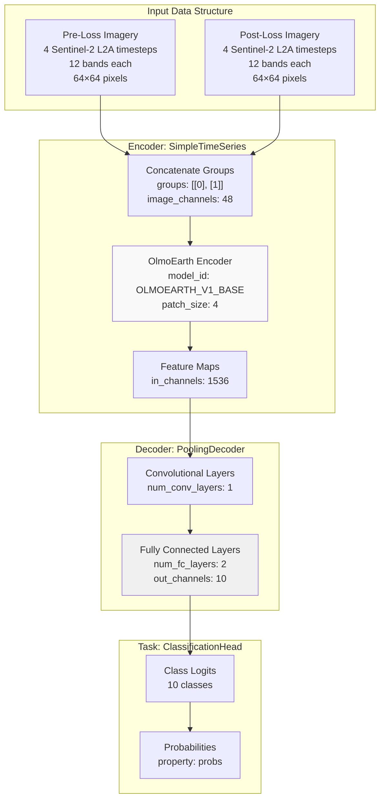
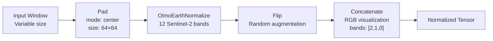
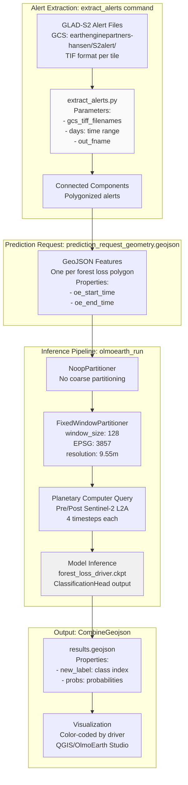

<!-- source: DeepWiki mcp.deepwiki.com · repo allenai/olmoearth_projects · page 6.3 Forest Loss Driver Model · fetched 2026-10-26 -->

# Forest Loss Driver Model

<details>
<summary>Relevant source files</summary>

The following files were used as context for generating this wiki page:

- [docs/forest_loss_driver.md](docs/forest_loss_driver.md)
- [docs/lfmc.md](docs/lfmc.md)
- [olmoearth_run_data/forest_loss_driver/model.yaml](olmoearth_run_data/forest_loss_driver/model.yaml)
- [olmoearth_run_data/forest_loss_driver/olmoearth_run.yaml](olmoearth_run_data/forest_loss_driver/olmoearth_run.yaml)

</details>


This document describes the Forest Loss Driver classification model, which predicts the cause of deforestation from satellite imagery. The model operates on GLAD-S2 forest loss alerts and classifies the driver into 10 categories including agriculture, mining, logging, and natural causes. For information about other classification models in the repository, see [Available Models](#6). For details on the general inference pipeline, see [olmoearth_run Pipeline](#7.1).

## Purpose and Scope

The Forest Loss Driver model (`OlmoEarth-v1-FT-ForestLossDriver-Base`) is a fine-tuned classification model that extends GLAD-S2 forest loss alerts with driver attribution. Rather than detecting forest loss from scratch, this model takes existing forest loss detections and predicts what caused the loss. The model analyzes pre-deforestation and post-deforestation Sentinel-2 imagery to classify the driver into one of 10 categories.

**Key Characteristics:**
- **Task Type:** Multi-class classification (10 classes)
- **Input:** Pre and post forest loss Sentinel-2 L2A imagery (4 timesteps each)
- **Output:** Driver classification per forest loss polygon
- **Validation Accuracy:** 76.1%
- **Data Source:** Amazon Conservation Association annotations
- **Integration:** Operates on GLAD-S2 forest loss alerts

**Sources:** [docs/forest_loss_driver.md:1-10]()

## Driver Categories

The model classifies forest loss into the following 10 categories:

| Category | Description | Use Case |
|----------|-------------|----------|
| `agriculture` | Forest cleared for agricultural expansion | Crop production, livestock grazing |
| `mining` | Forest removal for mineral extraction | Open-pit mining, quarrying |
| `airstrip` | Forest cleared for aviation infrastructure | Remote area access |
| `road` | Forest loss due to road construction | Transportation infrastructure |
| `logging` | Selective or clear-cut timber harvesting | Timber production |
| `burned` | Forest loss from fire events | Wildfire, controlled burns |
| `landslide` | Natural loss from geological events | Slope failure |
| `hurricane` | Storm damage to forest canopy | Tropical cyclone impacts |
| `river` | Forest loss from river course changes | Erosion, flooding |
| `none` | No clear driver or unclassifiable | Ambiguous cases |

**Sources:** [docs/forest_loss_driver.md:11-22](), [olmoearth_run_data/forest_loss_driver/model.yaml:59]()

## Model Architecture

### Architecture Overview



**Diagram: Forest Loss Driver Model Architecture with Code Entities**

The model uses a two-stage encoder approach. The `SimpleTimeSeries` wrapper concatenates pre-forest-loss and post-forest-loss feature maps before feeding them to the decoder. Despite its name, `SimpleTimeSeries` is used here to combine spatial features from the two temporal groups rather than for true time series processing.

**Sources:** [olmoearth_run_data/forest_loss_driver/model.yaml:6-28]()

### Encoder Configuration

The encoder consists of the `OlmoEarth` foundation model wrapped in a `SimpleTimeSeries` module:

| Parameter | Value | Purpose |
|-----------|-------|---------|
| `model_id` | `OLMOEARTH_V1_BASE` | Pre-trained OlmoEarth checkpoint identifier |
| `patch_size` | `4` | Patch size for vision transformer |
| `image_channels` | `48` | Total channels (12 bands × 4 timesteps) |
| `image_key` | `sentinel2_l2a` | Input data key |
| `groups` | `[[0], [1]]` | Group 0: pre-loss, Group 1: post-loss |

The encoder processes two groups separately:
- **Group 0:** Four pre-loss Sentinel-2 timesteps (layers: `pre_sentinel2`, `pre_sentinel2.1`, `pre_sentinel2.2`, `pre_sentinel2.3`)
- **Group 1:** Four post-loss Sentinel-2 timesteps (layers: `post_sentinel2`, `post_sentinel2.1`, `post_sentinel2.2`, `post_sentinel2.3`)

Each group contains 12 Sentinel-2 bands: `B02`, `B03`, `B04`, `B08`, `B05`, `B06`, `B07`, `B8A`, `B11`, `B12`, `B01`, `B09`

**Sources:** [olmoearth_run_data/forest_loss_driver/model.yaml:10-20](), [olmoearth_run_data/forest_loss_driver/model.yaml:44-50]()

### Decoder Configuration

The `PoolingDecoder` reduces spatial dimensions and classifies the forest loss driver:

| Parameter | Value | Purpose |
|-----------|-------|---------|
| `in_channels` | `1536` | Input feature dimension from OlmoEarth |
| `out_channels` | `10` | Number of driver classes |
| `num_conv_layers` | `1` | Convolutional layers for spatial processing |
| `num_fc_layers` | `2` | Fully connected layers for classification |

The decoder is followed by a `ClassificationHead` that applies softmax and outputs probabilities to the `probs` property.

**Sources:** [olmoearth_run_data/forest_loss_driver/model.yaml:21-28]()

## Training Configuration

### Data Module

The `RslearnDataModule` configuration specifies:

| Parameter | Value | Purpose |
|-----------|-------|---------|
| `batch_size` | `8` | Small batch size due to large input windows |
| `property_name` | `new_label` | Label property in vector data |
| `allow_invalid` | `true` | Allow samples with invalid labels |
| `skip_unknown_categories` | `true` | Skip samples with unknown driver categories |
| `metric_kwargs.average` | `micro` | Micro-averaged metrics across classes |

**Sources:** [olmoearth_run_data/forest_loss_driver/model.yaml:40-64]()

### Transforms Pipeline



**Diagram: Transform Pipeline for Forest Loss Driver Training**

The transform pipeline ensures consistent 64×64 pixel input windows centered on the forest loss polygon.

**Sources:** [olmoearth_run_data/forest_loss_driver/model.yaml:67-88]()

### Training Strategy

The model uses a freeze-unfreeze training strategy to leverage the pre-trained OlmoEarth encoder:

| Phase | Epochs | Learning Rate | Frozen Modules |
|-------|--------|---------------|----------------|
| Initial | 0-19 | 0.0001 | OlmoEarth encoder frozen |
| Fine-tuning | 20-99 | 0.001 (10× boost) | All modules unfrozen |

**Scheduler:** `PlateauScheduler` with factor=0.2, patience=2 epochs, cooldown=10 epochs

**Sources:** [olmoearth_run_data/forest_loss_driver/model.yaml:29-39](), [olmoearth_run_data/forest_loss_driver/model.yaml:112-116]()

## Training Data

### Data Source

The training data consists of forest loss driver annotations produced by **Amazon Conservation Association**. Each annotation contains:
- A polygon geometry derived from GLAD-S2 forest loss alerts
- A timestamp indicating when the forest loss occurred
- A driver category label (one of 10 classes)

The data is released under [CC BY 4.0 license](https://creativecommons.org/licenses/by/4.0/deed.en).

**Sources:** [docs/forest_loss_driver.md:54-63]()

### Image Acquisition

For each annotation, the system retrieves:
- **Pre-loss imagery:** 4 Sentinel-2 L2A images captured before the forest loss timestamp
- **Post-loss imagery:** 4 Sentinel-2 L2A images captured after the forest loss timestamp
- **Window size:** 64×64 pixels (at 10 m/pixel resolution) centered on the polygon

The specific timesteps and mosaicking strategy are handled by rslearn's data acquisition pipeline.

**Sources:** [docs/forest_loss_driver.md:32-36](), [docs/forest_loss_driver.md:57-59]()

### Data Splitting

The dataset uses a simple random split:
- **Training set:** 75% of samples
- **Validation set:** 25% of samples

No test set is defined; the validation set serves as the evaluation benchmark.

**Sources:** [docs/forest_loss_driver.md:61](), [olmoearth_run_data/forest_loss_driver/model.yaml:89-97]()

## Performance Metrics

### Overall Accuracy

The model achieves **76.1% accuracy** on the validation set. This represents the fraction of forest loss polygons for which the correct driver was predicted as the top class.

**Sources:** [docs/forest_loss_driver.md:38-39]()

### Confusion Matrix

The following confusion matrix shows per-class performance on the validation set:

| True \ Pred | Ag | Airstrip | Burned | Hurricane | Landslide | Logging | Mining | None | River | Road |
|-------------|----|---------:|-------:|----------:|----------:|--------:|-------:|-----:|------:|-----:|
| **Ag** | 37 | 0 | 2 | 0 | 0 | 0 | 0 | 2 | 0 | 3 |
| **Airstrip** | 0 | 0 | 0 | 0 | 0 | 0 | 0 | 0 | 0 | 0 |
| **Burned** | 2 | 0 | 21 | 3 | 0 | 0 | 0 | 4 | 0 | 0 |
| **Hurricane** | 0 | 0 | 0 | 6 | 0 | 0 | 0 | 0 | 0 | 0 |
| **Landslide** | 0 | 0 | 0 | 0 | 1 | 0 | 0 | 0 | 0 | 0 |
| **Logging** | 0 | 0 | 0 | 2 | 0 | 2 | 0 | 0 | 0 | 0 |
| **Mining** | 0 | 0 | 0 | 0 | 0 | 0 | 1 | 0 | 0 | 0 |
| **None** | 2 | 0 | 1 | 1 | 0 | 2 | 0 | 11 | 0 | 1 |
| **River** | 0 | 0 | 0 | 0 | 0 | 0 | 0 | 1 | 0 | 0 |
| **Road** | 0 | 0 | 0 | 0 | 0 | 0 | 0 | 0 | 0 | 4 |

**Key Observations:**
- Strong performance on agriculture (37/44 = 84.1%), burned (21/30 = 70.0%), and road (4/4 = 100%)
- Confusion between burned and hurricane classes
- Limited samples for rare classes (airstrip, landslide, river)
- "None" category captures ambiguous cases that confuse with other categories

**Sources:** [docs/forest_loss_driver.md:41-52]()

## Inference Process

### GLAD-S2 Alert Integration



**Diagram: Forest Loss Driver Inference Workflow from GLAD-S2 Alerts**

**Sources:** [docs/forest_loss_driver.md:66-96](), [olmoearth_run_data/forest_loss_driver/olmoearth_run.yaml:38-64]()

### Extracting GLAD-S2 Alerts

The `extract_alerts` command processes GLAD-S2 alert rasters into prediction request geometries:

```bash
python -m olmoearth_projects.main projects.forest_loss_driver extract_alerts \
  --extract_alerts_args.gcs_tiff_filenames+=080W_20S_070W_10S.tif \
  --extract_alerts_args.out_fname='prediction_request_geometry.geojson' \
  --extract_alerts_args.days=90
```

**Parameters:**
- `gcs_tiff_filenames`: List of GLAD-S2 tiles to process (e.g., `080W_20S_070W_10S.tif`)
- `out_fname`: Output GeoJSON file path
- `days`: Time range in days from current timestamp into the past

The command reads alert rasters from [GCS](https://console.cloud.google.com/storage/browser/earthenginepartners-hansen/S2alert/), identifies connected components of alert pixels, and polygonizes them into individual features.

**Sources:** [docs/forest_loss_driver.md:71-85]()

### Partitioning Strategy

The `olmoearth_run.yaml` defines a two-stage partitioning approach:

| Stage | Partitioner | Configuration |
|-------|-------------|---------------|
| `partition_request_geometry` | `NoopPartitioner` | No coarse-level partitioning |
| `prepare_window_geometries` | `FixedWindowPartitioner` | 128×128 pixel windows in EPSG:3857 |

The `FixedWindowPartitioner` creates windows centered on each forest loss polygon with fixed size and projection:

```yaml
window_size: 128
output_projection:
  crs: EPSG:3857 (Web Mercator)
  x_resolution: 9.554628535647032
  y_resolution: -9.554628535647032
```

The resolution (9.55 m/pixel) matches the extraction process to ensure consistent spatial alignment.

**Sources:** [olmoearth_run_data/forest_loss_driver/olmoearth_run.yaml:38-54]()

### Running Inference

After extracting alerts and downloading the model checkpoint, run inference:

```bash
# Move prediction request geometry to project directory
mv prediction_request_geometry.geojson \
   olmoearth_run_data/forest_loss_driver/prediction_request_geometry.geojson

# Download model checkpoint
mkdir -p ./checkpoints
wget -O checkpoints/forest_loss_driver.ckpt \
  https://huggingface.co/allenai/OlmoEarth-v1-FT-ForestLossDriver-Base/resolve/main/model.ckpt

# Set environment variables
export NUM_WORKERS=32
export WANDB_PROJECT=forest_loss_driver
export WANDB_NAME=forest_loss_driver
export WANDB_ENTITY=YOUR_WANDB_ENTITY

# Run inference
python -m olmoearth_projects.main olmoearth_run olmoearth_run \
  --config_path $PWD/olmoearth_run_data/forest_loss_driver/ \
  --checkpoint_path $PWD/checkpoints/forest_loss_driver.ckpt \
  --scratch_path project_data/forest_loss_driver/
```

**Sources:** [docs/forest_loss_driver.md:86-96]()

## Output Format

### Classification Fields

The `inference_results_config` in `olmoearth_run.yaml` defines output metadata:

| Property | Type | Content |
|----------|------|---------|
| `data_type` | string | `vector` (GeoJSON output) |
| `property_name` | string | `new_label` |
| `band_index` | integer | `1` (classification band) |
| `allowed_values` | array | 10 driver classes with labels and colors |

Each output feature contains:
- **Geometry:** The forest loss polygon
- **`new_label`:** Integer class index (0-9)
- **`probs`:** Array of 10 probabilities (one per class)

**Sources:** [olmoearth_run_data/forest_loss_driver/olmoearth_run.yaml:1-36]()

### Visualization Colors

Each driver class has an assigned RGB color for visualization:

| Class | Label | RGB Color |
|-------|-------|-----------|
| 0 | agriculture | [137, 243, 54] (bright green) |
| 1 | mining | [255, 222, 33] (yellow) |
| 2 | airstrip | [255, 192, 203] (pink) |
| 3 | road | [255, 165, 0] (orange) |
| 4 | logging | [128, 0, 128] (purple) |
| 5 | burned | [255, 140, 0] (dark orange) |
| 6 | landslide | [255, 0, 0] (red) |
| 7 | hurricane | [245, 245, 220] (beige) |
| 8 | river | [0, 255, 255] (cyan) |
| 9 | none | [255, 255, 255] (white) |

These colors enable immediate visual interpretation when viewing results in QGIS or OlmoEarth Studio.

**Sources:** [olmoearth_run_data/forest_loss_driver/olmoearth_run.yaml:6-36]()

### Post-processing

The post-processing strategy uses `CombineGeojson` at all three levels:

```yaml
postprocessing_strategies:
  process_window: CombineGeojson
  process_partition: CombineGeojson
  process_dataset: CombineGeojson
```

This aggregates individual window predictions into partition-level GeoJSON files, then combines all partitions into a final `results.geojson` containing all classified forest loss polygons.

**Sources:** [olmoearth_run_data/forest_loss_driver/olmoearth_run.yaml:56-64]()

## Model Artifacts and Resources

### Public Distribution

| Resource | Location | Description |
|----------|----------|-------------|
| Model Checkpoint | [HuggingFace Hub](https://huggingface.co/allenai/OlmoEarth-v1-FT-ForestLossDriver-Base/resolve/main/model.ckpt) | Trained model weights |
| rslearn Dataset | [GCS Bucket](https://storage.googleapis.com/ai2-olmoearth-projects-public-data/projects/forest_loss_driver/20251029/dataset.tar) | Training dataset archive |
| Documentation | [GitHub docs/](https://github.com/allenai/olmoearth_projects/blob/main/docs/forest_loss_driver.md) | Usage guide and examples |

**Sources:** [docs/forest_loss_driver.md:24-28]()

### Configuration Files

The model requires three configuration files for both training and inference:

1. **`model.yaml`** - Model architecture, training loop, and data loading configuration
   - Location: [olmoearth_run_data/forest_loss_driver/model.yaml]()
   - Defines: Encoder, decoder, optimizer, scheduler, callbacks

2. **`dataset.json`** - Data source configuration (not shown in provided files)
   - Specifies Planetary Computer queries for Sentinel-2 L2A

3. **`olmoearth_run.yaml`** - Inference pipeline configuration
   - Location: [olmoearth_run_data/forest_loss_driver/olmoearth_run.yaml]()
   - Defines: Partitioning, post-processing, output format

**Sources:** [docs/forest_loss_driver.md:24-28](), [olmoearth_run_data/forest_loss_driver/model.yaml:1](), [olmoearth_run_data/forest_loss_driver/olmoearth_run.yaml:1]()

---

