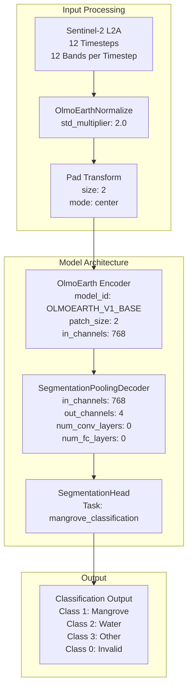
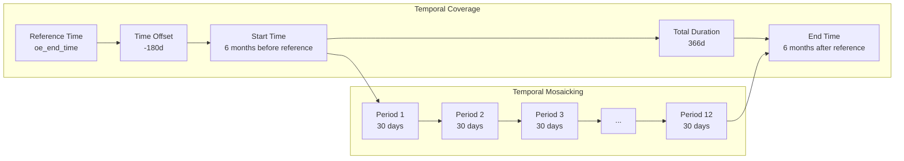
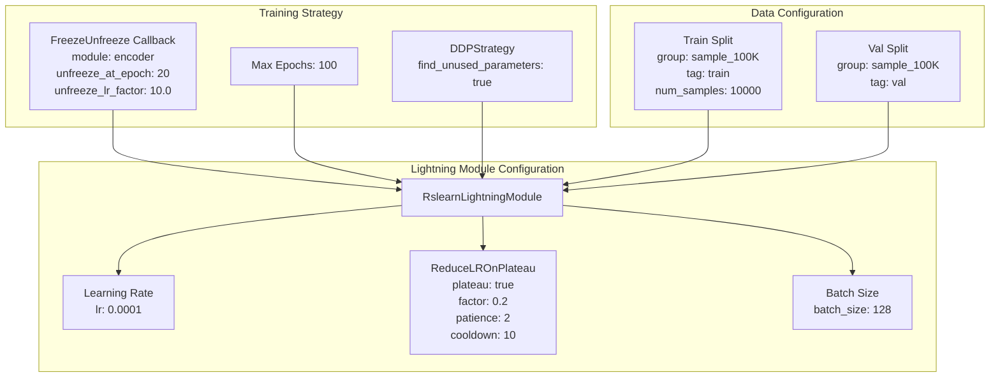
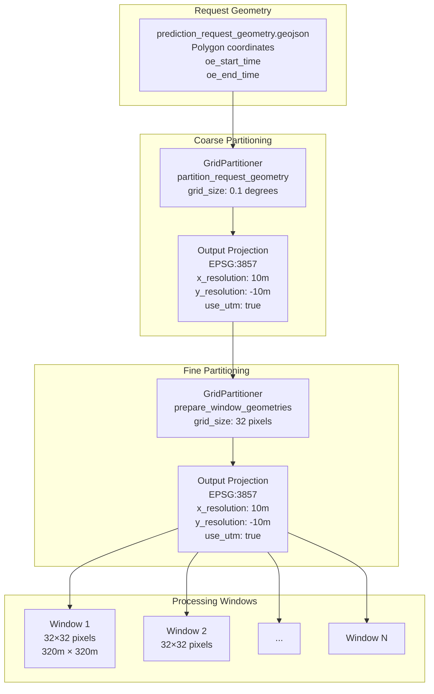
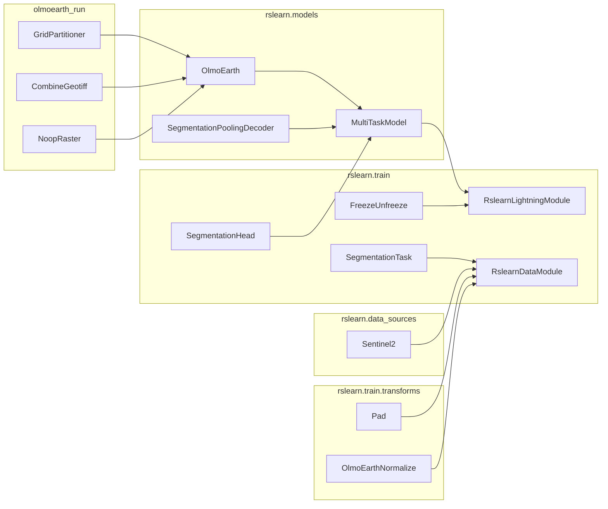

<!-- source: DeepWiki mcp.deepwiki.com · repo allenai/olmoearth_projects · page 6.4 Mangrove Extent Model · fetched 2026-10-26 -->

# Mangrove Extent Model

Relevant source files

The following files were used as context for generating this wiki page:

- [docs/mangrove.md](docs/mangrove.md)
- [olmoearth_run_data/mangrove/dataset.json](olmoearth_run_data/mangrove/dataset.json)
- [olmoearth_run_data/mangrove/model.yaml](olmoearth_run_data/mangrove/model.yaml)
- [olmoearth_run_data/mangrove/olmoearth_run.yaml](olmoearth_run_data/mangrove/olmoearth_run.yaml)

## Overview

The Mangrove Extent Model (`OlmoEarth-v1-FT-Mangrove-Base`) is a fine-tuned classification model that predicts mangrove extent from Sentinel-2 satellite imagery. The model classifies each 2×2 pixel patch into one of three classes: mangrove, water, or other land cover types. It achieves 97.6% overall accuracy on the validation set.

This page documents the model architecture, training configuration, data sources, and inference setup. For general information about model training workflows, see [Model Training](#5). For details on running inference with this model, see [olmoearth_run Pipeline](#7.1).

**Sources:** [docs/mangrove.md:1-37]()

## Model Architecture

The mangrove extent model follows the standard OlmoEarth fine-tuning architecture with an encoder-decoder structure:

**Diagram: Mangrove Model Architecture and Data Flow**

### Encoder Configuration

The encoder uses the pre-trained `OlmoEarth` model with `OLMOEARTH_V1_BASE` initialization. The patch size is set to 2, meaning the model processes 2×2 pixel patches and outputs classification predictions at this resolution.

**Sources:** [olmoearth_run_data/mangrove/model.yaml:9-13]()

### Decoder Configuration

The decoder is a `SegmentationPoolingDecoder` with the following configuration:

| Parameter | Value | Description |
|-----------|-------|-------------|
| `in_channels` | 768 | Input feature dimension from encoder |
| `out_channels` | 4 | Number of output classes |
| `num_conv_layers` | 0 | No additional convolutional layers |
| `num_fc_layers` | 0 | No additional fully connected layers |
| `image_key` | `sentinel2_l2a` | Input image identifier |

The output has 4 channels, where class 0 represents invalid pixels (handled by `zero_is_invalid: true` in the task configuration).

**Sources:** [olmoearth_run_data/mangrove/model.yaml:14-25]()

### Task Configuration

The model uses a `SegmentationTask` for the `mangrove_classification` task with these settings:

- **num_classes**: 4 (including invalid class)
- **zero_is_invalid**: true (class 0 filtered during evaluation)
- **enable_accuracy_metric**: true
- **metric averaging**: micro

**Sources:** [olmoearth_run_data/mangrove/model.yaml:84-145]()

## Input Data Configuration

### Temporal Configuration

The model processes 12 timesteps of Sentinel-2 imagery over a one-year period:

**Diagram: Temporal Configuration for Mangrove Model**

The `time_offset` of `-180d` means that the start time is 6 months before the reference date, and with a duration of `366d`, the imagery spans approximately 6 months before and after the reference date.

**Sources:** [olmoearth_run_data/mangrove/dataset.json:39-52]()

### Sentinel-2 Band Configuration

The model uses all 12 Sentinel-2 L2A bands in a specific order:

| Band | Wavelength Range | Spatial Resolution | Purpose |
|------|------------------|-------------------|---------|
| B02 | Blue (490 nm) | 10m | Visible |
| B03 | Green (560 nm) | 10m | Visible |
| B04 | Red (665 nm) | 10m | Visible |
| B08 | NIR (842 nm) | 10m | Near-infrared |
| B05 | Red Edge 1 (705 nm) | 20m | Vegetation |
| B06 | Red Edge 2 (740 nm) | 20m | Vegetation |
| B07 | Red Edge 3 (783 nm) | 20m | Vegetation |
| B8A | NIR Narrow (865 nm) | 20m | Vegetation |
| B11 | SWIR 1 (1610 nm) | 20m | Moisture |
| B12 | SWIR 2 (2190 nm) | 20m | Moisture |
| B01 | Coastal Aerosol (443 nm) | 60m | Atmospheric |
| B09 | Water Vapor (945 nm) | 60m | Atmospheric |

**Sources:** [olmoearth_run_data/mangrove/model.yaml:59-77](), [olmoearth_run_data/mangrove/dataset.json:20-33]()

### Data Source Configuration

Sentinel-2 data is acquired from Microsoft Planetary Computer with these parameters:

- **cache_dir**: `cache/planetary_computer`
- **harmonize**: true (ensures consistent radiometry across scenes)
- **sort_by**: `eo:cloud_cover` (prioritizes low-cloud imagery)
- **max_matches**: 12 (exactly 12 images required)
- **min_matches**: 12 (no tolerance for missing data)
- **period_duration**: `30d` (one mosaic per 30-day period)
- **space_mode**: `PER_PERIOD_MOSAIC` (temporal compositing within each period)

**Sources:** [olmoearth_run_data/mangrove/dataset.json:37-51]()

## Training Configuration

### Training Loop Parameters

**Diagram: Training Configuration Components**

**Sources:** [olmoearth_run_data/mangrove/model.yaml:35-40](), [olmoearth_run_data/mangrove/model.yaml:249](), [olmoearth_run_data/mangrove/model.yaml:379-391]()

### FreezeUnfreeze Strategy

The training uses a two-phase approach:

**Phase 1 (Epochs 1-19)**: The encoder is frozen, only the decoder is trained with learning rate 0.0001.

**Phase 2 (Epochs 20-100)**: The encoder is unfrozen with a learning rate boost of 10x (0.001), while the decoder continues with its original learning rate.

This strategy enables transfer learning by initially adapting only the task-specific decoder, then fine-tuning the entire model.

**Sources:** [olmoearth_run_data/mangrove/model.yaml:379-386]()

### Data Transforms

The training pipeline applies these transforms:

1. **Pad**: Centers the input to ensure proper patch alignment
   - `size: 2` (matches patch size)
   - `mode: center`
   - Applied to `sentinel2_l2a`, classification targets, and valid mask

2. **OlmoEarthNormalize**: Normalizes Sentinel-2 bands using model-specific statistics
   - `std_multiplier: 2.0`
   - Applied to all 12 bands

**Sources:** [olmoearth_run_data/mangrove/model.yaml:260-286]()

## Evaluation Metrics

The model tracks multiple metrics during training and validation:

### Primary Metrics

- **Overall Accuracy**: Micro-averaged accuracy across all classes (97.6% on validation set)
- **Validation Loss**: Monitored for model checkpointing

**Sources:** [olmoearth_run_data/mangrove/model.yaml:139](), [docs/mangrove.md:20]()

### Per-Class Metrics

The model computes precision and recall for each class:

| Metric | Class | Configuration |
|--------|-------|---------------|
| `mangrove_precision` | Class 1 (Mangrove) | MulticlassPrecision, class_idx: 1 |
| `mangrove_recall` | Class 1 (Mangrove) | MulticlassRecall, class_idx: 1 |
| `water_precision` | Class 2 (Water) | MulticlassPrecision, class_idx: 2 |
| `water_recall` | Class 2 (Water) | MulticlassRecall, class_idx: 2 |
| `other_precision` | Class 3 (Other) | MulticlassPrecision, class_idx: 3 |
| `other_recall` | Class 3 (Other) | MulticlassRecall, class_idx: 3 |

All metrics use:
- `num_classes: 4`
- `top_k: 1`
- `average: null` (per-class outputs)
- `multidim_average: global`
- `zero_division: 0`

**Sources:** [olmoearth_run_data/mangrove/model.yaml:148-238]()

## Training Data

### Data Source

The model is trained on point annotations from [Global Mangrove Watch](https://www.mangrovealliance.org/global-mangrove-watch), available at https://zenodo.org/records/17394267 under the CC BY 4.0 license.

Each training sample specifies:
- Longitude and latitude coordinates
- Start and end time (1 year apart)
- Class label (mangrove, water, or other)

**Sources:** [docs/mangrove.md:23-28]()

### Data Splitting

The dataset uses a hash-based spatial splitting strategy:

- **Train Split**: 87.5% of samples (tag: `train`)
- **Validation Split**: 12.5% of samples (tag: `val`)

The splitting is performed at the 2×2 pixel grid cell level to ensure spatial independence between training and validation sets.

**Sources:** [docs/mangrove.md:30-31]()

### Dataset Groups

The configuration references a `sample_100K` group with 10,000 samples used during training. This suggests the full dataset contains 100,000+ samples with a subset used for training experiments.

**Sources:** [olmoearth_run_data/mangrove/model.yaml:290-303]()

## Inference Configuration

### Partitioning Strategy

The inference pipeline uses a two-level hierarchical partitioning:

**Diagram: Hierarchical Partitioning for Inference**

**Level 1 - Coarse Grid**: Divides the request geometry into tiles of 0.1 degrees (~11 km at the equator).

**Level 2 - Fine Grid**: Each coarse tile is subdivided into 32×32 pixel windows (320m × 320m at 10m resolution).

Both levels use UTM projection when appropriate for accurate distance measurements.

**Sources:** [olmoearth_run_data/mangrove/olmoearth_run.yaml:1-24]()

### Post-processing Pipeline

The inference results are aggregated through three stages:

| Stage | Post-processor | Description |
|-------|----------------|-------------|
| `process_window` | `NoopRaster` | No processing at window level |
| `process_partition` | `CombineGeotiff` | Merge all windows in a partition |
| `process_dataset` | `CombineGeotiff` | Merge all partitions into final output |

**Sources:** [olmoearth_run_data/mangrove/olmoearth_run.yaml:26-34]()

### Output Classification

The final GeoTIFF output contains classification values with associated labels and colors:

| Value | Label | RGB Color | Description |
|-------|-------|-----------|-------------|
| 1 | mangrove | [148, 235, 99] | Mangrove vegetation |
| 2 | water | [99, 216, 235] | Water bodies |
| 3 | other | [235, 169, 99, 200] | Other land cover types |

The `inference_results_config` section defines these mappings for visualization in GIS tools and OlmoEarth Studio.

**Sources:** [olmoearth_run_data/mangrove/olmoearth_run.yaml:37-51]()

### Temporal Alignment

For inference, the `oe_start_time` in the prediction request geometry should be set to 12 months prior to the target classification date. This ensures the model receives the same temporal context as during training (12 timesteps spanning one year centered on the target date).

**Sources:** [docs/mangrove.md:35-36]()

## Model Access and Resources

The following resources are available for the mangrove extent model:

| Resource | Location | Description |
|----------|----------|-------------|
| Model Checkpoint | https://huggingface.co/allenai/OlmoEarth-v1-FT-Mangrove-Base/resolve/main/model.ckpt | Fine-tuned weights |
| Annotation GeoJSONs | https://huggingface.co/allenai/olmoearth_projects_mangrove/blob/main/annotation_features.geojson | Training point locations |
| rslearn Dataset | https://huggingface.co/allenai/olmoearth_projects_mangrove/resolve/main/mangrove.tar | Complete training dataset |
| Model Configuration | [olmoearth_run_data/mangrove/model.yaml]() | Training configuration |
| Dataset Configuration | [olmoearth_run_data/mangrove/dataset.json]() | Data source specification |
| Inference Configuration | [olmoearth_run_data/mangrove/olmoearth_run.yaml]() | Runtime parameters |

**Sources:** [docs/mangrove.md:8-10]()

## Code Entity Reference

Key classes and modules used in the mangrove model:

**Diagram: Code Entity Relationships for Mangrove Model**

**Sources:** [olmoearth_run_data/mangrove/model.yaml:1-394](), [olmoearth_run_data/mangrove/dataset.json:1-57](), [olmoearth_run_data/mangrove/olmoearth_run.yaml:1-52]()

---

