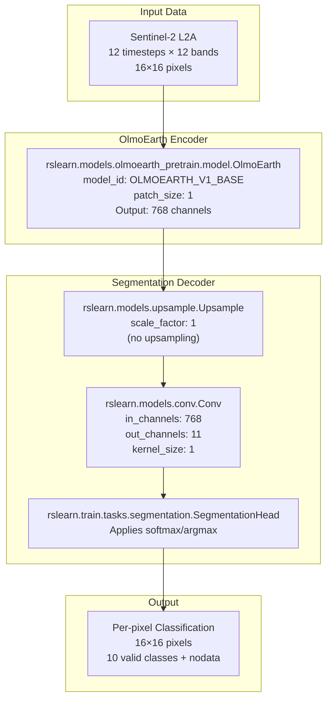
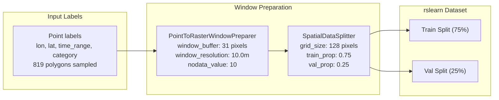
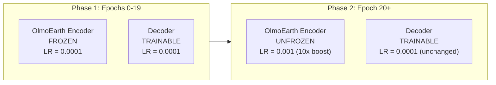
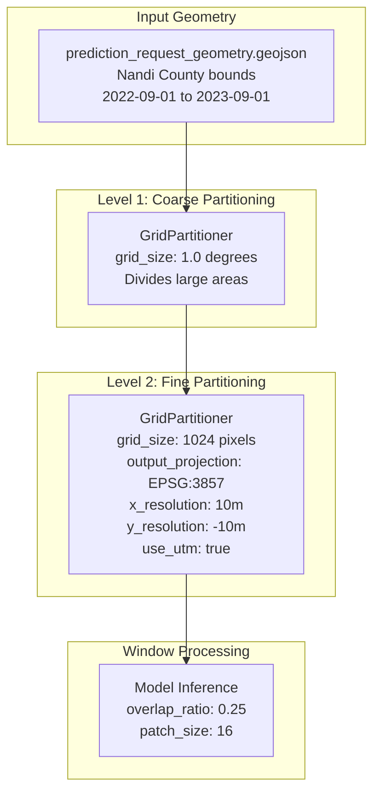
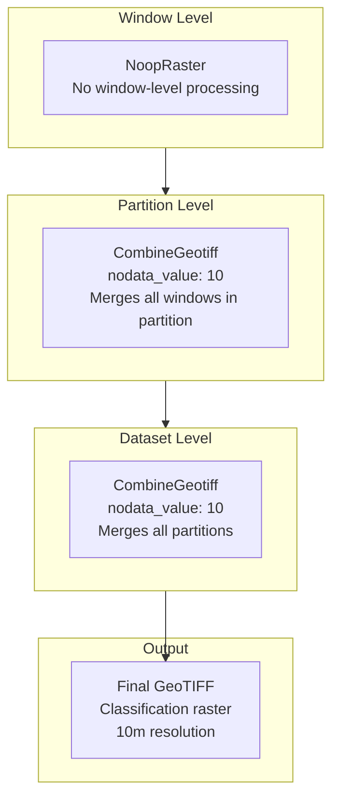

<!-- source: DeepWiki mcp.deepwiki.com · repo allenai/olmoearth_projects · page 6.6 Nandi Crop Classification Model · fetched 2026-10-26 -->

# Nandi Crop Classification Model

<details>
<summary>Relevant source files</summary>

The following files were used as context for generating this wiki page:

- [docs/awf.md](docs/awf.md)
- [docs/nandi.md](docs/nandi.md)
- [olmoearth_run_data/awf/model.yaml](olmoearth_run_data/awf/model.yaml)
- [olmoearth_run_data/awf/olmoearth_run.yaml](olmoearth_run_data/awf/olmoearth_run.yaml)
- [olmoearth_run_data/nandi/model.yaml](olmoearth_run_data/nandi/model.yaml)
- [olmoearth_run_data/nandi/olmoearth_run.yaml](olmoearth_run_data/nandi/olmoearth_run.yaml)
- [olmoearth_run_data/nandi/prediction_request_geometry.geojson](olmoearth_run_data/nandi/prediction_request_geometry.geojson)

</details>


## Purpose and Scope

This page documents OlmoEarth-v1-FT-Nandi-Base, a fine-tuned model for predicting crop and land cover types in Nandi County, Kenya. The model classifies 10 categories including coffee, maize, sugarcane, tea, vegetables, legumes, grassland, trees, water, and built-up areas using Sentinel-2 L2A satellite imagery. The model achieves 87.3% overall accuracy on the validation set.

For information about the general training pipeline, see [Model Training](#5). For inference deployment details, see [Inference and Deployment](#7). For other regional crop classification models, see [Mozambique LULC Models](#6.1) and [AWF Land Cover Model](#6.7).

**Sources:** [docs/nandi.md:1-48]()

## Model Overview

OlmoEarth-v1-FT-Nandi-Base performs per-pixel segmentation to classify crop and land cover types. The model processes twelve timesteps of Sentinel-2 L2A imagery, with one mosaic per 30-day period covering a full year (2022-09 to 2023-09). The model operates on 16×16 pixel input patches and produces class predictions for every pixel within each patch.

**Key Characteristics:**

| Property | Value |
|----------|-------|
| Base Model | OlmoEarth-v1-Base |
| Geographic Region | Nandi County, Kenya |
| Input Data | Sentinel-2 L2A (12 bands) |
| Temporal Coverage | 12 timesteps (30-day periods) |
| Input Patch Size | 16×16 pixels |
| Model Patch Size | 1×1 (no spatial downsampling) |
| Number of Classes | 10 land cover categories |
| Overall Accuracy | 87.3% |
| Spatial Resolution | 10m per pixel |

**Sources:** [docs/nandi.md:1-28](), [olmoearth_run_data/nandi/model.yaml:1-11]()

## Model Architecture

The Nandi model uses a segmentation architecture with the OlmoEarth encoder and a simple decoder head. Unlike other models in this repository that use patch_size 4, this model uses patch_size 1 for finer spatial resolution.



**Architecture Details:**

- **Encoder:** `OlmoEarth` with `patch_size: 1` preserves full spatial resolution throughout the encoder, producing 768-channel feature maps at the original spatial dimensions
- **Decoder:** A minimal decoder consisting of an identity upsampler (scale_factor 1), a 1×1 convolution to map 768 channels to 11 output channels (10 classes + 1 nodata), and a `SegmentationHead` that handles softmax/argmax operations
- **Output Channels:** 11 total channels where class indices 0-9 represent the 10 land cover categories and index 10 is the nodata value

**Sources:** [olmoearth_run_data/nandi/model.yaml:1-24]()

## Training Data

### Data Source and Coverage

The training data originates from ground-truth labels collected by CGIAR/IFPRI, consisting of 819 labeled polygons. To improve class coverage, additional samples were added from ESA WorldCover (for water and built-up classes) and manual annotations in OlmoEarth Studio (for tree samples to correct coffee/forest confusion).

**Class Distribution:**

| Class Index | Category | Description |
|-------------|----------|-------------|
| 0 | Coffee | Coffee plantations |
| 1 | Grassland | Grassland areas |
| 2 | Trees | Natural forest and tree cover |
| 3 | Maize | Maize crops |
| 4 | Sugarcane | Sugarcane plantations |
| 5 | Tea | Tea plantations |
| 6 | Vegetables | Vegetable crops |
| 7 | Legumes | Legume crops |
| 8 | Water | Water bodies |
| 9 | Built-up | Urban and built-up areas |
| 10 (nodata) | Invalid | No data or invalid pixels |

**Sources:** [docs/nandi.md:29-38](), [olmoearth_run_data/nandi/olmoearth_run.yaml:54-91]()

### Dataset Preparation

Training windows are generated by the window preparation pipeline, which converts point labels to raster format and applies spatial splitting:



**Window Preparation Configuration:**

- **Window Buffer:** 31 pixels added around each point location creates a 63×63 pixel window (with the point at center)
- **Resolution:** 10m per pixel matching Sentinel-2 L2A spatial resolution
- **Rasterization:** Point labels are converted to raster format with `INT32` dtype
- **Spatial Splitting:** A 128×128 pixel grid is hashed to assign windows to train (75%) or validation (25%) splits, ensuring spatial separation between splits

**Sources:** [docs/nandi.md:35-37](), [olmoearth_run_data/nandi/olmoearth_run.yaml:1-20]()

### Data Loading and Transforms

The `RslearnDataModule` handles data loading with the following configuration:

**Input Specification:**
- **sentinel2_l2a:** All 12 Sentinel-2 bands (B02, B03, B04, B08, B05, B06, B07, B8A, B11, B12, B01, B09) loaded as FLOAT32, with `load_all_item_groups: true` to load all timesteps
- **label:** Single-band category raster loaded as INT32 target

**Training Transforms (applied in sequence):**
1. `rslearn.train.transforms.pad.Pad` - Pads to size 31 pixels centered on the window
2. `rslearn.train.transforms.crop.Crop` - Crops to final 16×16 patch size
3. `rslearn.train.transforms.flip.Flip` - Random horizontal/vertical flips for augmentation
4. `rslearn.models.olmoearth_pretrain.norm.OlmoEarthNormalize` - Normalizes Sentinel-2 bands using OlmoEarth statistics

**Validation/Test Transforms:**
- Same as training but without the `Flip` augmentation

**Sources:** [olmoearth_run_data/nandi/model.yaml:31-287]()

## Training Configuration

### Optimization Settings

The model training uses the following optimization configuration defined in `RslearnLightningModule`:

| Parameter | Value | Description |
|-----------|-------|-------------|
| Learning Rate | 0.0001 | Initial learning rate |
| Plateau Scheduling | Enabled | Reduces LR on validation plateau |
| Plateau Factor | 0.2 | Multiply LR by 0.2 when plateau detected |
| Plateau Patience | 2 epochs | Wait 2 epochs before reducing LR |
| Plateau Min LR | 0 | No minimum LR threshold |
| Plateau Cooldown | 10 epochs | Wait 10 epochs after LR reduction |
| Batch Size | 4 | Training batch size |
| Max Epochs | 100 | Maximum training epochs |

**Sources:** [olmoearth_run_data/nandi/model.yaml:25-30, 246-303]()

### FreezeUnfreeze Strategy

The model uses a `FreezeUnfreeze` callback to implement progressive unfreezing of the OlmoEarth encoder:



**Configuration:**
- **Module Selector:** `["model", "encoder", 0]` - Targets the OlmoEarth encoder
- **Unfreeze Epoch:** 20 - Encoder unfrozen at epoch 20
- **LR Factor:** 10 - Encoder learning rate boosted 10x upon unfreezing

This strategy allows the decoder to adapt first while the encoder remains fixed, then fine-tunes the entire model with a higher encoder learning rate.

**Sources:** [olmoearth_run_data/nandi/model.yaml:321-325]()

### Task Configuration and Metrics

The model uses `SegmentationTask` with extensive per-class metrics:

**Task Configuration:**
- **Task Type:** `rslearn.train.tasks.segmentation.SegmentationTask`
- **Number of Classes:** 11 (10 valid classes + 1 nodata)
- **Zero Is Invalid:** `false` - Class 0 (coffee) is a valid class
- **Nodata Value:** 10 - Class index 10 represents invalid/nodata pixels
- **Overall Metric:** Micro-averaged accuracy across all valid pixels

**Per-Class Metrics:** For each of the 10 valid classes, the model tracks:
- **Precision:** `torchmetrics.classification.MulticlassPrecision` with `average: null` for per-class values
- **Recall:** `torchmetrics.classification.MulticlassRecall` with `average: null` for per-class values

These metrics are monitored during training via `WandbLogger` and used by `ModelCheckpoint` to save the best model based on `val_segment/accuracy`.

**Sources:** [olmoearth_run_data/nandi/model.yaml:50-242]()

## Model Performance

### Accuracy Results

The Nandi model achieves different performance levels depending on the patch size configuration:

| Window Size | Patch Size | Modalities | Accuracy (%) |
|-------------|------------|------------|--------------|
| 16×16 | 1 | Sentinel-2 | **87.3** |
| 16×16 | 1 | Sentinel-2 + Sentinel-1 | TBD |
| 16×16 | 2 | Sentinel-2 | 86.5 |
| 16×16 | 2 | Sentinel-2 + Sentinel-1 | 86.7 |
| 16×16 | 4 | Sentinel-2 | 81.9 |
| 16×16 | 4 | Sentinel-2 + Sentinel-1 | 82.2 |

**Key Findings:**
- **Patch Size 1 performs best:** The finest spatial resolution (patch_size 1) achieves the highest accuracy at 87.3%
- **Sentinel-2 only is sufficient:** Adding Sentinel-1 radar data provides minimal improvement
- **Spatial resolution matters:** Larger patch sizes (4×4) that downsample spatial features show significantly lower accuracy

The published model uses the best configuration: window size 16×16, patch size 1, Sentinel-2 only.

**Sources:** [docs/nandi.md:18-27]()

## Inference Configuration

### Partitioning Strategy

The inference pipeline uses a hierarchical two-level partitioning approach defined in `olmoearth_run.yaml`:



**Partitioning Details:**

1. **Coarse Grid:** `partition_request_geometry` divides the input geometry into 1.0-degree tiles for parallel processing
2. **Fine Grid:** `prepare_window_geometries` subdivides each coarse tile into 1024×1024 pixel windows
3. **Projection:** Windows are projected to EPSG:3857 (Web Mercator) or UTM when `use_utm: true`, with 10m spatial resolution
4. **Overlap:** Inference uses 25% overlap between patches (4 pixels of a 16-pixel patch) to ensure smooth boundaries

**Sources:** [olmoearth_run_data/nandi/olmoearth_run.yaml:22-38](), [olmoearth_run_data/nandi/model.yaml:292-296]()

### Post-processing Configuration

After inference, results are aggregated at three levels:



- **process_window:** `NoopRaster` - No processing applied at individual window level
- **process_partition:** `CombineGeotiff` with `nodata_value: 10` merges all windows within a 1.0-degree partition
- **process_dataset:** `CombineGeotiff` with `nodata_value: 10` merges all partitions into the final output

**Sources:** [olmoearth_run_data/nandi/olmoearth_run.yaml:40-53]()

## Classification Schema and Visualization

The inference results use the following classification schema with RGB color mappings for visualization:

| Value | Label | Color (RGB) | Hex Color |
|-------|-------|-------------|-----------|
| 0 | coffee | [124, 67, 18] | #7C4312 |
| 1 | grassland | [169, 214, 146] | #A9D692 |
| 2 | trees | [51, 160, 44] | #33A02C |
| 3 | maize | [240, 159, 28] | #F09F1C |
| 4 | sugarcane | [251, 154, 153] | #FB9A99 |
| 5 | tea | [31, 234, 146] | #1FEA92 |
| 6 | vegetables | [166, 206, 227] | #A6CEE3 |
| 7 | legumes | [227, 26, 28] | #E31A1C |
| 8 | water | [31, 120, 180] | #1F78B4 |
| 9 | builtup | [136, 33, 233] | #8821E9 |
| 10 | (nodata) | N/A | N/A |

The `inference_results_config` in `olmoearth_run.yaml` defines this schema with `data_type: RASTER` and a single classification field named "segment" on band index 1.

**Sources:** [olmoearth_run_data/nandi/olmoearth_run.yaml:54-91]()

## Model Access and Usage

### Model Artifacts

The Nandi model and associated datasets are publicly available on HuggingFace:

| Artifact | Location |
|----------|----------|
| Model Checkpoint | https://huggingface.co/allenai/OlmoEarth-v1-FT-Nandi-Base/blob/main/model.ckpt |
| Annotation GeoJSONs | https://huggingface.co/datasets/allenai/olmoearth_projects_nandi/tree/main |
| rslearn Dataset | https://huggingface.co/datasets/allenai/olmoearth_projects_nandi/blob/main/dataset.tar |

**Sources:** [docs/nandi.md:5-10]()

### Inference Requirements

For optimal results, inference should be configured with:

**Temporal Requirements:**
- **Time Range:** One full year of coverage (365 days)
- **Recommended Period:** 2022-09-01 to 2023-09-01 (matching training data)
- **Alternative Periods:** Other one-year periods can be used (e.g., 2018-09-01 to 2019-09-01)
- **Timesteps:** 12 Sentinel-2 L2A mosaics, one per 30-day period

**Spatial Requirements:**
- **Grid Size:** Inference runs on 1024×1024 pixel windows
- **Coverage:** All grid cells intersecting the input geometry are processed
- **Resolution:** 10m per pixel

**Example Output:**

A full inference for Nandi County is available at: https://olmoearth.allenai.org/viewer/6b1e4537-ea68-47f3-9a11-61ca2d468fd0#9.55/0.2218/35.1037

**Sources:** [docs/nandi.md:39-43](), [olmoearth_run_data/nandi/prediction_request_geometry.geojson:1-39]()

### Inference Geometry Format

The `prediction_request_geometry.geojson` file defines the spatial and temporal extent for inference. For the Nandi model:

```json
{
  "features": [
    {
      "geometry": {
        "coordinates": [...],  // Polygon covering Nandi County
        "type": "Polygon"
      },
      "properties": {
        "oe_start_time": "2022-09-01T00:00:00Z",
        "oe_end_time": "2023-09-01T00:00:00Z"
      },
      "type": "Feature"
    }
  ],
  "type": "FeatureCollection"
}
```

The geometry covers approximately:
- **Longitude:** 34.73°E to 35.48°E
- **Latitude:** -0.12°S to 0.57°N
- **Area:** Entire Nandi County administrative boundary

**Sources:** [olmoearth_run_data/nandi/prediction_request_geometry.geojson:1-39]()

## Training and Fine-tuning

For detailed information on training and fine-tuning procedures, refer to the main README. The training process follows the standard workflow documented in [Model Training](#5) with the configurations specified in this page.

**Key Training Files:**
- Model architecture: [olmoearth_run_data/nandi/model.yaml:1-336]()
- Inference configuration: [olmoearth_run_data/nandi/olmoearth_run.yaml:1-92]()
- Prediction geometry: [olmoearth_run_data/nandi/prediction_request_geometry.geojson:1-39]()

**Sources:** [docs/nandi.md:45-47]()

---

