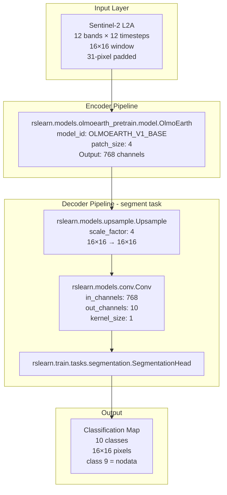
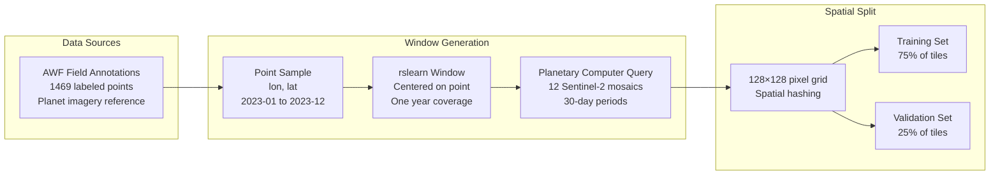
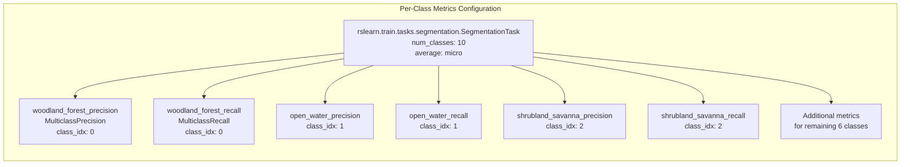
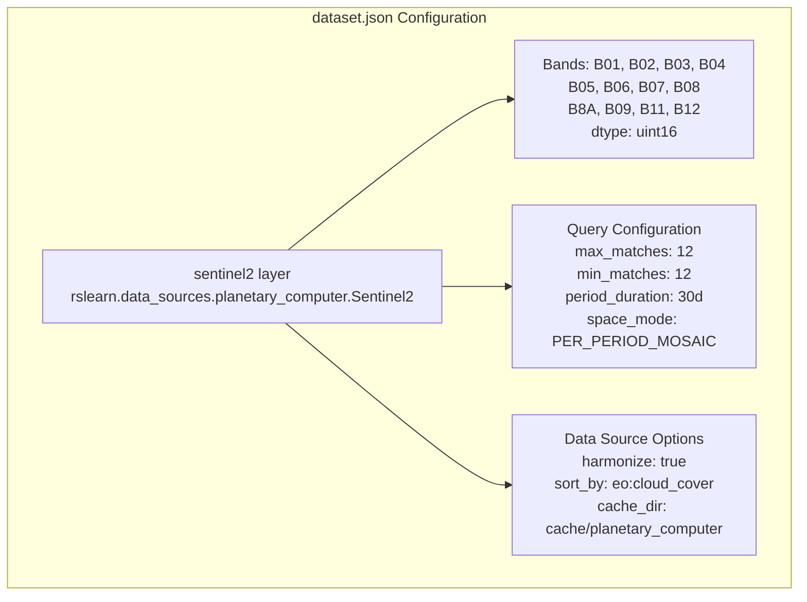
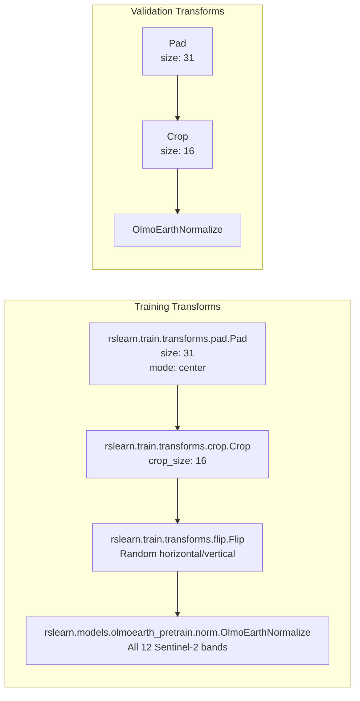
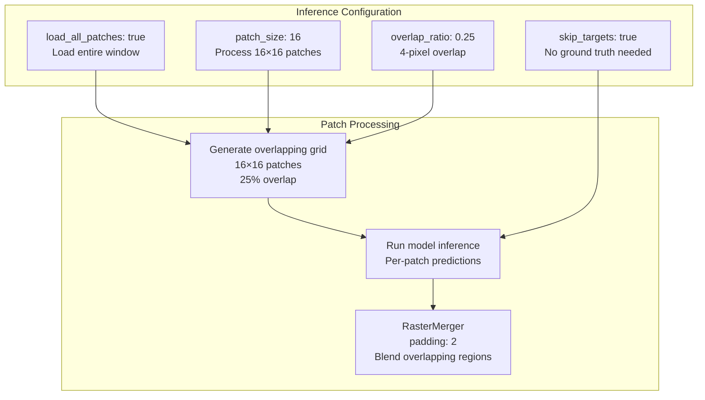

<!-- source: DeepWiki mcp.deepwiki.com · repo allenai/olmoearth_projects · page 6.7 AWF Land Cover Model · fetched 2026-10-26 -->

# AWF Land Cover Model

<details>
<summary>Relevant source files</summary>

The following files were used as context for generating this wiki page:

- [docs/awf.md](docs/awf.md)
- [docs/nandi.md](docs/nandi.md)
- [olmoearth_run_data/awf/dataset.json](olmoearth_run_data/awf/dataset.json)
- [olmoearth_run_data/awf/model.yaml](olmoearth_run_data/awf/model.yaml)
- [olmoearth_run_data/nandi/dataset.json](olmoearth_run_data/nandi/dataset.json)
- [olmoearth_run_data/nandi/model.yaml](olmoearth_run_data/nandi/model.yaml)
- [olmoearth_run_data/nandi/prediction_request_geometry.geojson](olmoearth_run_data/nandi/prediction_request_geometry.geojson)

</details>


## Purpose and Overview

This page documents the AWF (African Wildlife Foundation) Land Cover Model, a fine-tuned variant of OlmoEarth-v1-Base for land use and land cover classification in southern Kenya. The model classifies satellite imagery into 9 land cover categories including various forest types, grasslands, wetlands, and human-modified landscapes.

For general information about the model training pipeline, see [Model Training](#5). For details about running inference, see [Inference and Deployment](#7). For information about other fine-tuned models, see [Available Models](#6).

**Sources:** [docs/awf.md:1-6]()

## Model Architecture

The AWF model uses a hierarchical encoder-decoder architecture built on the OlmoEarth foundation model with task-specific components for land cover segmentation.



**Architecture Details:**

| Component | Class Path | Key Parameters |
|-----------|-----------|----------------|
| Model Wrapper | `rslearn.train.lightning_module.RslearnLightningModule` | lr: 0.0001, plateau scheduling |
| Encoder | `rslearn.models.olmoearth_pretrain.model.OlmoEarth` | model_id: OLMOEARTH_V1_BASE, patch_size: 4 |
| Upsampler | `rslearn.models.upsample.Upsample` | scale_factor: 4 |
| Classifier | `rslearn.models.conv.Conv` | 768 → 10 channels |
| Task Head | `rslearn.train.tasks.segmentation.SegmentationHead` | num_classes: 10 |

**Sources:** [olmoearth_run_data/awf/model.yaml:1-24]()

## Training Data and Data Collection

The model is trained on 1,469 labeled point samples collected by the African Wildlife Foundation across southern Kenya. The training data was annotated using Planet imagery as the primary reference.



The dataset uses spatial splitting to ensure that training and validation samples are geographically separated, preventing spatial autocorrelation bias. This is implemented by hashing a 128×128 pixel grid into train (75%) and validation (25%) splits.

**Sources:** [docs/awf.md:29-35](), [olmoearth_run_data/awf/model.yaml:263-273]()

## Land Cover Classes

The model classifies pixels into 9 distinct land cover types, with a 10th class (index 9) reserved as the nodata value:

| Class Index | Class Name | Description |
|-------------|-----------|-------------|
| 0 | Woodland Forest | Forest with >40% canopy cover |
| 1 | Open Water | Lakes, rivers, permanent water bodies |
| 2 | Shrubland/Savanna | Mixed shrubs and grassland ecosystems |
| 3 | Herbaceous Wetland | Wetland areas with herbaceous vegetation |
| 4 | Grassland/Barren | Grasslands and bare ground |
| 5 | Agriculture/Settlement | Agricultural fields and rural settlements |
| 6 | Montane Forest | High-elevation forest ecosystems |
| 7 | Lava Forest | Forest on volcanic substrates |
| 8 | Urban/Dense Development | Cities and dense built-up areas |
| 9 | Nodata | Invalid or missing data |

**Sources:** [docs/awf.md:31-33](), [olmoearth_run_data/awf/model.yaml:57-59]()

## Model Performance

The model achieves 89.5% overall accuracy on the validation set using window size 16×16 and patch size 4 with Sentinel-2-only input. Multiple configurations were tested:

| Window Size | Patch Size | Input Modalities | Accuracy |
|-------------|------------|------------------|----------|
| 16×16 | 1 | Sentinel-2 | 90.4% |
| 16×16 | 1 | Sentinel-2 + Sentinel-1 | 83.1% |
| **16×16** | **4** | **Sentinel-2** | **89.5%** |
| 16×16 | 4 | Sentinel-2 + Sentinel-1 | 83.1% |
| 32×32 | 4 | Sentinel-2 | 88.5% |
| 32×32 | 4 | Sentinel-2 + Sentinel-1 | 83.1% |

The model using Sentinel-2-only input consistently outperforms configurations that include Sentinel-1 radar data. The selected configuration (bold) balances accuracy with computational efficiency.

**Sources:** [docs/awf.md:18-27]()

## Per-Class Evaluation Metrics

The model configuration includes comprehensive per-class precision and recall tracking for all 9 land cover types:



Each class has dedicated precision and recall metrics using `torchmetrics.classification.MulticlassPrecision` and `torchmetrics.classification.MulticlassRecall` with `average: null` to compute per-class values.

**Sources:** [olmoearth_run_data/awf/model.yaml:62-224]()

## Input Data Configuration

The model uses Sentinel-2 Level 2A (surface reflectance) imagery queried from Microsoft Planetary Computer:



**Key Configuration Parameters:**

| Parameter | Value | Description |
|-----------|-------|-------------|
| `max_matches` / `min_matches` | 12 | Exactly 12 timesteps required |
| `period_duration` | 30d | One mosaic per 30-day period |
| `space_mode` | PER_PERIOD_MOSAIC | Mosaic all images within each period |
| `harmonize` | true | Apply cross-sensor harmonization |
| `sort_by` | eo:cloud_cover | Prioritize low-cloud imagery |

**Sources:** [olmoearth_run_data/awf/dataset.json:25-61]()

## Training Configuration Details

### Data Transforms Pipeline

The training pipeline applies a sequence of transforms to prepare input data:



Training uses additional data augmentation (flip) compared to validation/test splits.

**Sources:** [olmoearth_run_data/awf/model.yaml:245-273]()

### Learning Rate and Optimization

The model uses a plateau-based learning rate scheduler with progressive unfreezing:

| Parameter | Value | Description |
|-----------|-------|-------------|
| Initial LR | 0.0001 | Base learning rate |
| Plateau Factor | 0.2 | Multiply LR by 0.2 on plateau |
| Plateau Patience | 2 | Epochs to wait before reducing |
| Plateau Cooldown | 10 | Epochs between reductions |
| Unfreeze Epoch | 20 | When to unfreeze encoder |
| Unfreeze LR Factor | 10 | Multiply encoder LR by 10 |

The `FreezeUnfreeze` callback initially freezes the OlmoEarth encoder (module selector: `["model", "encoder", 0]`), then unfreezes it at epoch 20 with a 10× learning rate boost for fine-tuning.

**Sources:** [olmoearth_run_data/awf/model.yaml:25-30](), [olmoearth_run_data/awf/model.yaml:303-307]()

## Training and Validation Split

The dataset uses spatial splitting based on a 128×128 pixel grid to ensure geographic separation:

```python
# Configuration in model.yaml
train_config:
  groups: ["spatial_split"]
  tags:
    split: "train"
    
val_config:
  groups: ["spatial_split"]
  tags:
    split: "val"
```

This ensures that training and validation samples are geographically separated, preventing the model from exploiting spatial autocorrelation in the evaluation metrics.

**Sources:** [olmoearth_run_data/awf/model.yaml:263-273]()

## Inference Configuration

### Prediction Window Processing

During inference, the model processes overlapping patches to ensure smooth predictions across tile boundaries:



The 25% overlap (4 pixels out of 16) ensures smooth transitions between adjacent patches. The `RasterMerger` with `padding: 2` blends predictions in overlapping regions.

**Sources:** [olmoearth_run_data/awf/model.yaml:274-283](), [olmoearth_run_data/awf/model.yaml:308-316]()

### Time Range Requirements

For optimal results, inference should use a one-year time range matching the training data:

- **Recommended:** 2023-01-01 to 2023-12-31 (matches training period)
- **Alternative:** Other one-year periods can be used but may have reduced accuracy

The prediction request geometry should specify these dates in the `oe_start_time` and `oe_end_time` properties. See [Prediction Request Geometries](#7.2) for details on creating request files.

**Sources:** [docs/awf.md:37-39]()

## Model Resources and Distribution

### HuggingFace Hub Resources

The AWF model and associated data are distributed through HuggingFace:

| Resource Type | URL |
|--------------|-----|
| Model Checkpoint | https://huggingface.co/allenai/OlmoEarth-v1-FT-AWF-Base/blob/main/model.ckpt |
| Annotation GeoJSONs | https://huggingface.co/datasets/allenai/olmoearth_projects_awf/tree/main |
| rslearn Dataset (tar) | https://huggingface.co/datasets/allenai/olmoearth_projects_awf/blob/main/dataset.tar |

**Sources:** [docs/awf.md:8-10]()

### Example Inference Output

A complete inference run over the Amboseli National Park region is available for interactive visualization:

- **Viewer URL:** https://olmoearth.allenai.org/viewer/d591a8ce-c97d-4a23-a520-a1aa1363ce22#8.76/-2.9277/37.3573
- **Coverage:** Amboseli National Park and surrounding areas
- **Time Range:** 2023-01-01 to 2023-12-31

This demonstrates the model's ability to classify diverse landscapes including protected wildlife areas, agricultural zones, and different forest types in the region.

**Sources:** [docs/awf.md:41-42]()

## File Locations

The AWF model configuration files are located in the repository at:

```
olmoearth_run_data/awf/
├── model.yaml              # Model architecture and training config
├── dataset.json            # Data source and layer definitions
├── olmoearth_run.yaml      # Inference pipeline configuration (see page 7.1)
└── prediction_request_geometry.geojson  # Example request geometry
```

These files define the complete model specification and can be used for both fine-tuning (see [Fine-tuning Process](#5.3)) and inference (see [olmoearth_run Pipeline](#7.1)).

**Sources:** [olmoearth_run_data/awf/model.yaml:1](), [olmoearth_run_data/awf/dataset.json:1]()

---

