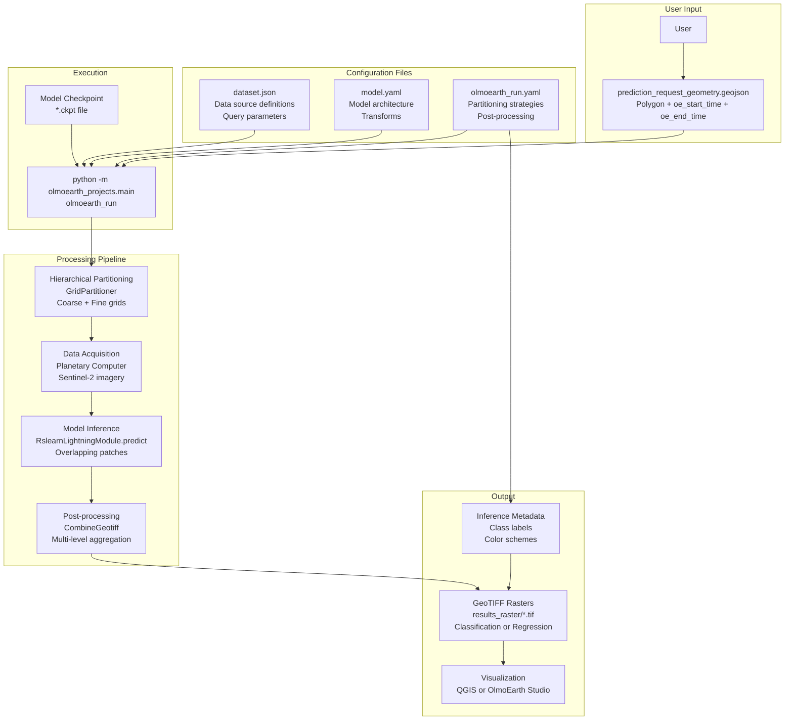
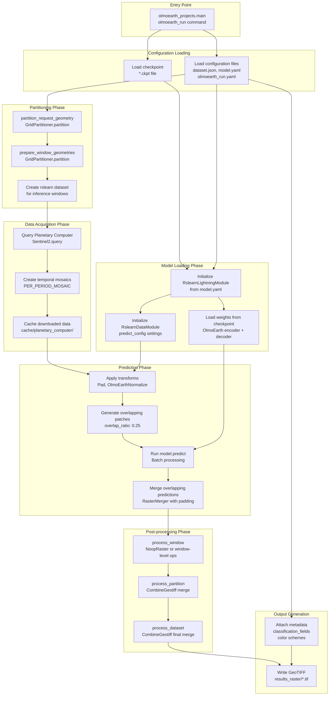

<!-- source: DeepWiki mcp.deepwiki.com · repo allenai/olmoearth_projects · page 7 Inference and Deployment · fetched 2026-10-26 -->

# Inference and Deployment

<details>
<summary>Relevant source files</summary>

The following files were used as context for generating this wiki page:

- [LICENSE](LICENSE)
- [README.md](README.md)
- [olmoearth_run_data/awf/olmoearth_run.yaml](olmoearth_run_data/awf/olmoearth_run.yaml)
- [olmoearth_run_data/mozambique_lulc/dataset.json](olmoearth_run_data/mozambique_lulc/dataset.json)
- [olmoearth_run_data/mozambique_lulc/model.yaml](olmoearth_run_data/mozambique_lulc/model.yaml)
- [olmoearth_run_data/mozambique_lulc/olmoearth_run.yaml](olmoearth_run_data/mozambique_lulc/olmoearth_run.yaml)
- [olmoearth_run_data/nandi/olmoearth_run.yaml](olmoearth_run_data/nandi/olmoearth_run.yaml)

</details>


## Purpose and Scope

This document provides an overview of how trained models in the `olmoearth_projects` repository are applied to new geographic areas and deployed for production use. It covers the configuration-based inference pipeline, model checkpoint management, and deployment strategies including command-line execution and web-based interfaces.

For detailed information about specific components:
- For the `olmoearth_run` pipeline internals, see [olmoearth_run Pipeline](#7.1)
- For creating prediction requests, see [Prediction Request Geometries](#7.2)
- For partitioning strategies, see [Partitioning and Grid Processing](#7.3)
- For output generation, see [Post-processing and Output](#7.4)
- For web deployment, see [OlmoEarth Studio Integration](#7.5)

For model training, see [Model Training](#5). For available models and their specifications, see [Available Models](#6).

**Sources:** [README.md:1-190]()

## Overview

Inference in this repository follows a configuration-driven approach where three types of files control the entire process:

| Configuration File | Purpose | Location |
|-------------------|---------|----------|
| `dataset.json` | Defines satellite data sources and acquisition parameters | `olmoearth_run_data/PROJECT_NAME/` |
| `model.yaml` | Specifies model architecture, loading, and data transforms | `olmoearth_run_data/PROJECT_NAME/` |
| `olmoearth_run.yaml` | Controls partitioning strategies and post-processing | `olmoearth_run_data/PROJECT_NAME/` |

The inference workflow proceeds through these stages:

1. **Request Definition**: User creates a `prediction_request_geometry.geojson` file specifying spatial (polygons) and temporal (start/end dates) extent
2. **Partitioning**: Large geographic areas are divided hierarchically into processable units
3. **Data Acquisition**: Satellite imagery is queried from data sources (typically Microsoft Planetary Computer)
4. **Model Prediction**: The trained model processes each partition with overlap handling
5. **Post-processing**: Results are combined at window, partition, and dataset levels
6. **Output Generation**: Final GeoTIFF rasters are created with metadata and visualization schemes

**Sources:** [README.md:49-140](), [olmoearth_run_data/nandi/olmoearth_run.yaml:1-92]()

## Inference Workflow



**Sources:** [README.md:49-140](), Diagram 4 from high-level architecture

## Configuration Files

### dataset.json

The `dataset.json` file is an rslearn dataset configuration that defines the layers and data sources for inference. It specifies:

- **Layers**: Named data layers with band definitions and data types
- **Data Sources**: Query configurations for satellite imagery providers
- **Query Parameters**: Temporal mosaicking settings, cloud cover sorting, match requirements

Example structure from the Mozambique LULC project:

```json
{
  "layers": {
    "sentinel2": {
      "band_sets": [{
        "bands": ["B01", "B02", "B03", ..., "B12"],
        "dtype": "uint16"
      }],
      "data_source": {
        "class_path": "rslearn.data_sources.planetary_computer.Sentinel2",
        "query_config": {
          "max_matches": 8,
          "period_duration": "30d",
          "space_mode": "PER_PERIOD_MOSAIC"
        }
      }
    }
  }
}
```

**Sources:** [olmoearth_run_data/mozambique_lulc/dataset.json:1-64]()

### model.yaml

The `model.yaml` file defines the model architecture and inference configuration. Key sections include:

- **model**: Specifies encoder (OlmoEarth) and decoder (task-specific heads) architecture
- **data**: Configures `RslearnDataModule` with input mappings and transforms
- **predict_config**: Sets patch size, overlap ratio, and inference-specific transforms

The predict_config section is particularly important for inference:

```yaml
predict_config:
  load_all_patches: true
  patch_size: 16
  overlap_ratio: 0.25  # 4 / 16 pixel overlap
  skip_targets: true
  transforms:
    - class_path: rslearn.models.olmoearth_pretrain.norm.OlmoEarthNormalize
```

**Sources:** [olmoearth_run_data/mozambique_lulc/model.yaml:1-278]()

### olmoearth_run.yaml

The `olmoearth_run.yaml` file controls the inference execution strategy:

| Section | Purpose | Key Parameters |
|---------|---------|----------------|
| `partition_strategies` | Defines hierarchical grid partitioning | `grid_size`, `output_projection`, `use_utm` |
| `postprocessing_strategies` | Specifies result aggregation methods | `CombineGeotiff`, `NoopRaster` |
| `inference_results_config` | Defines output metadata | `classification_fields`, `allowed_values`, colors |

Example partition strategy:

```yaml
partition_strategies:
  partition_request_geometry:
    class_path: olmoearth_run.runner.tools.partitioners.grid_partitioner.GridPartitioner
    init_args:
      grid_size: 0.25  # degrees
  
  prepare_window_geometries:
    class_path: olmoearth_run.runner.tools.partitioners.grid_partitioner.GridPartitioner
    init_args:
      grid_size: 1024  # pixels
      use_utm: true
```

**Sources:** [olmoearth_run_data/mozambique_lulc/olmoearth_run.yaml:1-81](), [olmoearth_run_data/nandi/olmoearth_run.yaml:22-38]()

## Model Checkpoints

Model checkpoints are PyTorch Lightning checkpoint files (`.ckpt`) containing trained model weights and optimizer states. These are loaded during inference via the `--checkpoint_path` argument.

### Checkpoint Sources

Checkpoints are distributed through multiple channels:

- **HuggingFace Hub**: Public model checkpoints under the `allenai` organization (e.g., `allenai/OlmoEarth-v1-FT-LFMC-Base`)
- **Direct Download**: Released via HuggingFace URLs for downloading
- **Local Training**: Generated in `TRAINER_DATA_PATH` during fine-tuning

Example checkpoint download:

```bash
mkdir ./checkpoints
wget https://huggingface.co/allenai/OlmoEarth-v1-FT-LFMC-Base/resolve/main/model.ckpt \
  -O checkpoints/lfmc.ckpt
```

### Checkpoint Loading

During inference, the checkpoint is loaded by `RslearnLightningModule` and the model is reconstructed from the architecture defined in `model.yaml`. The encoder (OlmoEarth) is initialized with the checkpoint path specified in the model configuration at [olmoearth_run_data/mozambique_lulc/model.yaml:10]().

**Sources:** [README.md:109-114](), [olmoearth_run_data/mozambique_lulc/model.yaml:8-12]()

## Execution Methods

### Command-Line Execution

The primary execution method uses the `olmoearth_projects.main` module with the `olmoearth_run` command:

```bash
# Set environment variables
export NUM_WORKERS=32
export WANDB_PROJECT=project_name
export WANDB_NAME=inference_run
export WANDB_ENTITY=your_entity

# Execute inference
python -m olmoearth_projects.main olmoearth_run \
  --config_path $PWD/olmoearth_run_data/PROJECT_NAME/ \
  --checkpoint_path $PWD/checkpoints/model.ckpt \
  --scratch_path project_data/PROJECT_NAME/
```

**Environment Variables:**

| Variable | Purpose | Required |
|----------|---------|----------|
| `NUM_WORKERS` | Number of parallel data loading workers | Yes |
| `WANDB_PROJECT` | Weights & Biases project name for logging | Yes |
| `WANDB_NAME` | Run name for this inference execution | Yes |
| `WANDB_ENTITY` | W&B organization/user entity | Yes |

**Sources:** [README.md:116-130]()

### Output Structure

Inference outputs are organized in the scratch path directory:

```
project_data/PROJECT_NAME/
├── results/
│   └── results_raster/
│       └── *.tif           # Final GeoTIFF outputs
├── dataset/                 # rslearn dataset for inference
└── partitions/              # Intermediate partition results
```

The `results_raster` directory contains one or more GeoTIFF files representing the classification or regression predictions. These files include:

- Georeferencing information (CRS, affine transform)
- Classification labels or regression values
- NoData values for invalid regions
- Color tables for visualization (from `inference_results_config`)

**Sources:** [README.md:133-140]()

## Configuration-to-Component Mapping

```mermaid
graph TB
    subgraph "Configuration Files"
        DATASET_JSON["dataset.json"]
        MODEL_YAML["model.yaml"]
        RUN_YAML["olmoearth_run.yaml"]
        PRED_GEOM["prediction_request_geometry.geojson"]
    end
    
    subgraph "Data Acquisition Components"
        SENTINEL2["rslearn.data_sources.planetary_computer.Sentinel2"]
        QUERY_CFG["query_config<br/>max_matches, period_duration<br/>space_mode"]
        HARMONIZE["harmonize: true<br/>sort_by: eo:cloud_cover"]
    end
    
    subgraph "Model Components"
        OLMOEARTH["rslearn.models.olmoearth_pretrain.model.OlmoEarth"]
        DECODER["Decoders:<br/>Upsample + Conv + SegmentationHead"]
        LIGHTNING["rslearn.train.lightning_module.RslearnLightningModule"]
        DATAMODULE["rslearn.train.data_module.RslearnDataModule"]
    end
    
    subgraph "Transform Pipeline"
        PAD["rslearn.train.transforms.pad.Pad"]
        NORM["rslearn.models.olmoearth_pretrain.norm.OlmoEarthNormalize"]
        PATCH["patch_size: 16<br/>overlap_ratio: 0.25"]
    end
    
    subgraph "Partitioning Components"
        GRID_PART["olmoearth_run.runner.tools.partitioners.grid_partitioner.GridPartitioner"]
        COARSE["partition_request_geometry<br/>grid_size: 0.1-1.0 degrees"]
        FINE["prepare_window_geometries<br/>grid_size: 32-1024 pixels"]
        PROJ["output_projection<br/>Projection with CRS + resolution<br/>use_utm: true"]
    end
    
    subgraph "Post-processing Components"
        COMBINE["olmoearth_run.runner.tools.postprocessors.combine_geotiff.CombineGeotiff"]
        NOOP["olmoearth_run.runner.tools.postprocessors.noop_raster.NoopRaster"]
        WINDOW_PP["process_window"]
        PARTITION_PP["process_partition"]
        DATASET_PP["process_dataset"]
    end
    
    subgraph "Metadata Components"
        RESULTS_CFG["inference_results_config"]
        CLASS_FIELDS["classification_fields<br/>property_name, band_index"]
        ALLOWED_VALS["allowed_values<br/>value, label, color"]
    end
    
    DATASET_JSON --> SENTINEL2
    DATASET_JSON --> QUERY_CFG
    DATASET_JSON --> HARMONIZE
    
    MODEL_YAML --> OLMOEARTH
    MODEL_YAML --> DECODER
    MODEL_YAML --> LIGHTNING
    MODEL_YAML --> DATAMODULE
    MODEL_YAML --> PAD
    MODEL_YAML --> NORM
    MODEL_YAML --> PATCH
    
    RUN_YAML --> GRID_PART
    GRID_PART --> COARSE
    GRID_PART --> FINE
    RUN_YAML --> PROJ
    RUN_YAML --> COMBINE
    RUN_YAML --> NOOP
    COMBINE --> WINDOW_PP
    COMBINE --> PARTITION_PP
    COMBINE --> DATASET_PP
    
    RUN_YAML --> RESULTS_CFG
    RESULTS_CFG --> CLASS_FIELDS
    RESULTS_CFG --> ALLOWED_VALS
    
    PRED_GEOM -.->|"oe_start_time<br/>oe_end_time"| QUERY_CFG
```



**Sources:** [olmoearth_run_data/mozambique_lulc/dataset.json:1-64](), [olmoearth_run_data/mozambique_lulc/model.yaml:1-278](), [olmoearth_run_data/mozambique_lulc/olmoearth_run.yaml:1-81](), [olmoearth_run_data/nandi/olmoearth_run.yaml:1-92]()

## Inference Pipeline Code Flow



**Sources:** [README.md:49-140](), [olmoearth_run_data/mozambique_lulc/model.yaml:236-245](), [olmoearth_run_data/nandi/olmoearth_run.yaml:22-52]()

## Deployment to OlmoEarth Studio

While command-line execution is the primary documented method, models can be deployed to the OlmoEarth Studio web interface at `olmoearth.allenai.org` for interactive inference. This provides:

- **Interactive Map Interface**: Users can draw polygons and select time ranges visually
- **Real-time Prediction**: On-demand inference for user-defined regions
- **Visualization**: Integrated map viewer with classification overlays
- **Multi-model Support**: Access to all published fine-tuned models

The studio integration uses the same configuration files (`model.yaml`, `dataset.json`, `olmoearth_run.yaml`) and model checkpoints, ensuring consistency between command-line and web-based inference.

**Sources:** Diagram 1 and Diagram 3 from high-level architecture, [README.md:4-6]()

## Prediction Request Geometry Format

The `prediction_request_geometry.geojson` file defines the spatial and temporal extent for inference. It follows standard GeoJSON format with additional temporal properties:

```json
{
  "type": "FeatureCollection",
  "features": [
    {
      "type": "Feature",
      "geometry": {
        "type": "Polygon",
        "coordinates": [...]
      },
      "properties": {
        "oe_start_time": "2024-01-01T00:00:00+00:00",
        "oe_end_time": "2024-02-01T00:00:00+00:00"
      }
    }
  ]
}
```

**Temporal Properties:**

| Property | Format | Purpose |
|----------|--------|---------|
| `oe_start_time` | ISO 8601 datetime with timezone | Start of temporal query window |
| `oe_end_time` | ISO 8601 datetime with timezone | End of temporal query window |

The time range determines which satellite images are queried based on the `period_duration` and mosaic settings in `dataset.json`. Different models have different temporal requirements (e.g., 6-12 timesteps over several months).

Users can create prediction geometries using [geojson.io](https://geojson.io/) for the spatial component, then manually add the temporal properties.

**Sources:** [README.md:75-104]()

## Output Visualization

The GeoTIFF outputs in `results_raster/` can be visualized using:

### QGIS

```bash
qgis project_data/PROJECT_NAME/results/results_raster/*.tif
```

QGIS automatically reads the embedded color tables and classification metadata from the `inference_results_config` section of `olmoearth_run.yaml`.

### OlmoEarth Studio

Upload results to the web interface for interactive exploration with basemap overlays and multi-temporal comparison.

### Custom Applications

The GeoTIFF format is compatible with standard geospatial libraries:

- **Python**: `rasterio`, `xarray`, `rioxarray`
- **R**: `terra`, `raster`, `sf`
- **JavaScript**: `geotiff.js`, `Leaflet`, `OpenLayers`

**Sources:** [README.md:133-140](), [olmoearth_run_data/mozambique_lulc/olmoearth_run.yaml:1-28]()

---

