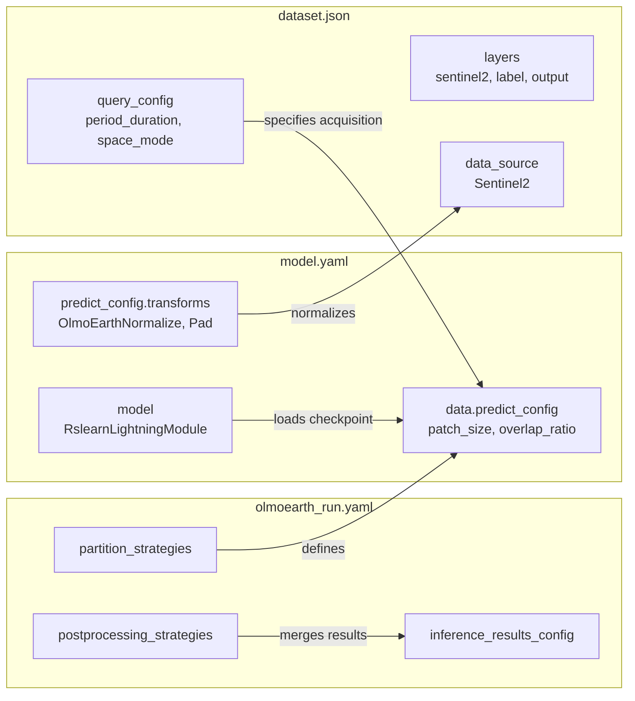
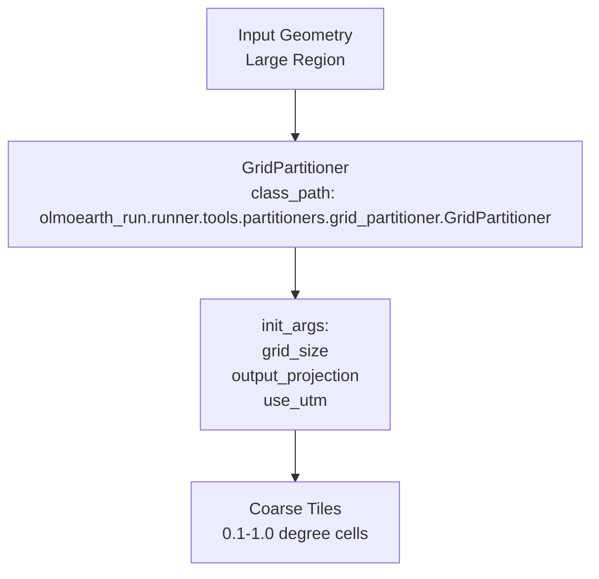
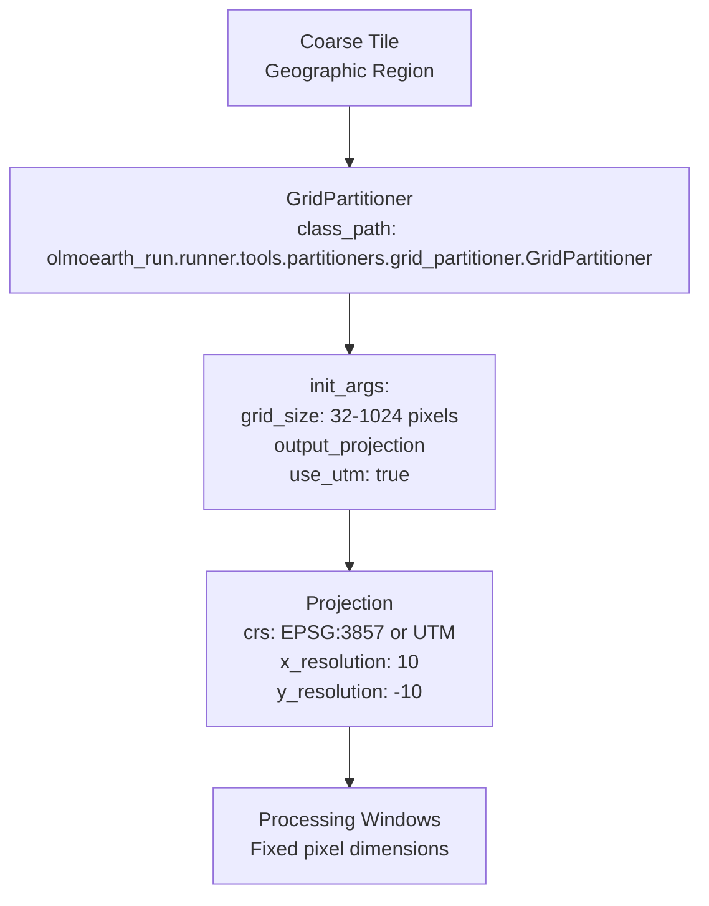
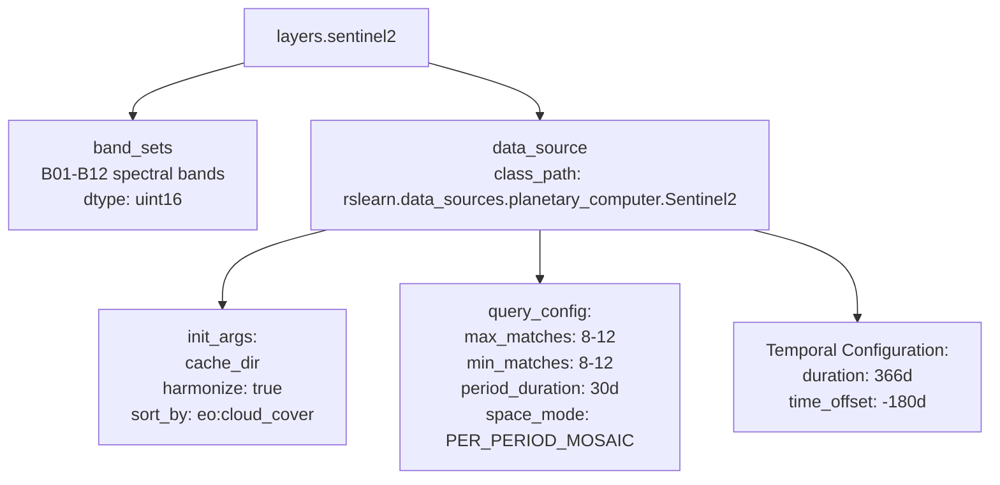
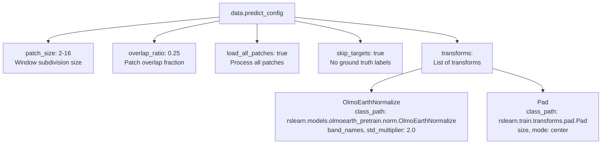
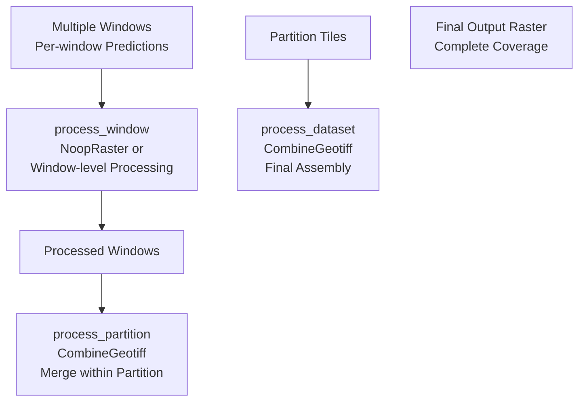
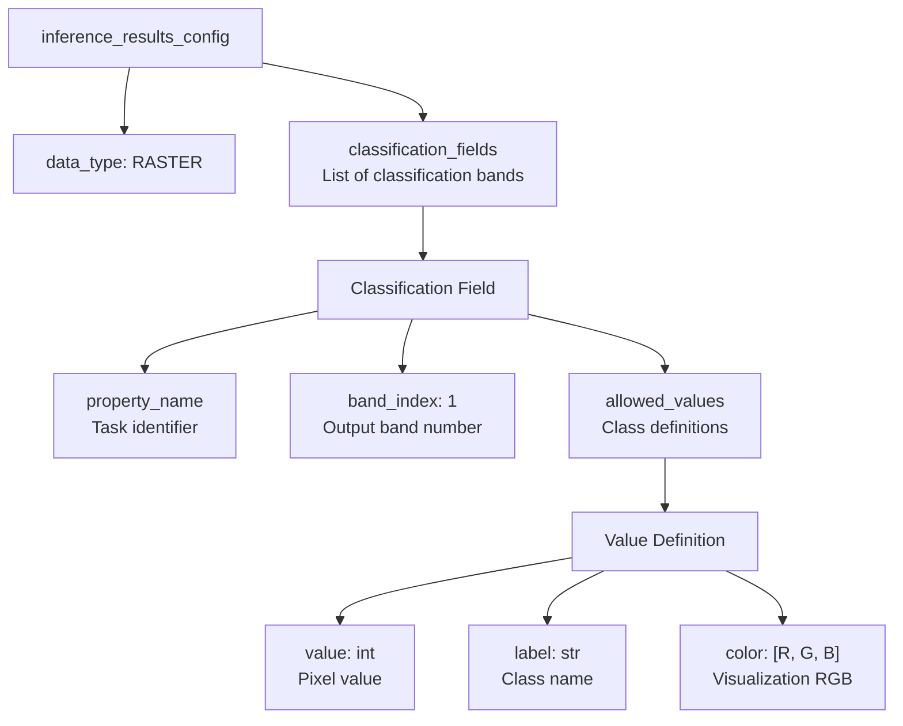
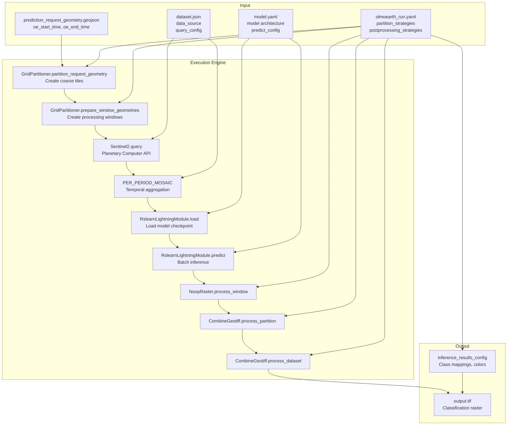

<!-- source: DeepWiki mcp.deepwiki.com · repo allenai/olmoearth_projects · page 7.1 olmoearth_run Pipeline · fetched 2026-10-26 -->

# olmoearth_run Pipeline

<details>
<summary>Relevant source files</summary>

The following files were used as context for generating this wiki page:

- [olmoearth_run_data/awf/olmoearth_run.yaml](olmoearth_run_data/awf/olmoearth_run.yaml)
- [olmoearth_run_data/mangrove/dataset.json](olmoearth_run_data/mangrove/dataset.json)
- [olmoearth_run_data/mangrove/model.yaml](olmoearth_run_data/mangrove/model.yaml)
- [olmoearth_run_data/mangrove/olmoearth_run.yaml](olmoearth_run_data/mangrove/olmoearth_run.yaml)
- [olmoearth_run_data/mozambique_lulc/dataset.json](olmoearth_run_data/mozambique_lulc/dataset.json)
- [olmoearth_run_data/mozambique_lulc/model.yaml](olmoearth_run_data/mozambique_lulc/model.yaml)
- [olmoearth_run_data/mozambique_lulc/olmoearth_run.yaml](olmoearth_run_data/mozambique_lulc/olmoearth_run.yaml)
- [olmoearth_run_data/nandi/olmoearth_run.yaml](olmoearth_run_data/nandi/olmoearth_run.yaml)

</details>


## Purpose and Scope

The `olmoearth_run` pipeline is the inference execution system that processes geographic regions through trained OlmoEarth models to generate classification or regression outputs. This pipeline handles the complete workflow from receiving a spatial request to producing final GeoTIFF rasters with prediction results.

This document covers the inference pipeline configuration and execution process. For information about model training, see [Model Training](#5). For details on creating prediction request geometries, see [Prediction Request Geometries](#7.2). For post-processing strategies, see [Post-processing and Output](#7.4).

## Pipeline Architecture

The `olmoearth_run` pipeline processes inference requests through five sequential stages, each configured through `olmoearth_run.yaml` and `model.yaml` files.

```mermaid
graph TB
    subgraph "Stage 1: Request Partitioning"
        REQ["prediction_request_geometry.geojson<br/>User-defined polygon"]
        PART_REQ["partition_request_geometry<br/>GridPartitioner<br/>grid_size: 0.1-1.0 degrees"]
        COARSE["Coarse Geographic Tiles"]
    end
    
    subgraph "Stage 2: Window Preparation"
        PART_WIN["prepare_window_geometries<br/>GridPartitioner<br/>grid_size: 32-1024 pixels"]
        PROJ["output_projection<br/>Projection<br/>crs, x_resolution, y_resolution"]
        WINDOWS["Processing Windows<br/>UTM or EPSG:3857"]
    end
    
    subgraph "Stage 3: Data Acquisition"
        DATASRC["data_source<br/>Sentinel2<br/>Planetary Computer"]
        QUERY["query_config<br/>period_duration, max_matches<br/>space_mode: PER_PERIOD_MOSAIC"]
        IMAGERY["Satellite Imagery<br/>Multi-temporal Bands"]
    end
    
    subgraph "Stage 4: Model Inference"
        PREDCFG["predict_config<br/>patch_size, overlap_ratio<br/>transforms"]
        MODEL["RslearnLightningModule<br/>OlmoEarth encoder<br/>Task decoder"]
        PREDS["Raw Predictions<br/>Per-window Results"]
    end
    
    subgraph "Stage 5: Post-processing"
        PROC_WIN["process_window<br/>NoopRaster"]
        PROC_PART["process_partition<br/>CombineGeotiff"]
        PROC_DS["process_dataset<br/>CombineGeotiff"]
        OUTPUT["Final GeoTIFF<br/>inference_results_config"]
    end
    
    REQ --> PART_REQ
    PART_REQ --> COARSE
    COARSE --> PART_WIN
    PART_WIN --> PROJ
    PROJ --> WINDOWS
    
    WINDOWS --> DATASRC
    DATASRC --> QUERY
    QUERY --> IMAGERY
    
    IMAGERY --> PREDCFG
    PREDCFG --> MODEL
    MODEL --> PREDS
    
    PREDS --> PROC_WIN
    PROC_WIN --> PROC_PART
    PROC_PART --> PROC_DS
    PROC_DS --> OUTPUT
```



**Sources:** [olmoearth_run_data/nandi/olmoearth_run.yaml:1-92](), [olmoearth_run_data/mangrove/model.yaml:312-339](), [olmoearth_run_data/mozambique_lulc/dataset.json:45-59]()

## Configuration Files

The pipeline requires three configuration files that work together to define the complete inference process:

| Configuration File | Purpose | Key Components |
|-------------------|---------|----------------|
| `olmoearth_run.yaml` | Pipeline execution strategy | `partition_strategies`, `postprocessing_strategies`, `inference_results_config` |
| `model.yaml` | Model architecture and inference settings | `model`, `data.predict_config`, `trainer` |
| `dataset.json` | Data source specifications | `layers`, `data_source`, `query_config` |

### Configuration File Relationships



**Sources:** [olmoearth_run_data/nandi/olmoearth_run.yaml:1-92](), [olmoearth_run_data/mangrove/model.yaml:1-394](), [olmoearth_run_data/mozambique_lulc/dataset.json:1-63]()

## Partition Strategies

The pipeline uses hierarchical partitioning to process large geographic areas efficiently. Partitioning is configured in the `partition_strategies` section of `olmoearth_run.yaml`.

### partition_request_geometry

The first-level partitioning divides the input geometry into coarse geographic tiles.



**Configuration Parameters:**

| Parameter | Type | Example Values | Description |
|-----------|------|----------------|-------------|
| `grid_size` | float | 0.1, 0.25, 1.0 | Grid cell size in degrees (lat/lon) |
| `output_projection` | Projection | EPSG:3857 | Target coordinate system |
| `use_utm` | bool | true | Use UTM projection for local accuracy |

**Example Configuration:**

[olmoearth_run_data/nandi/olmoearth_run.yaml:23-26]()
```yaml
partition_request_geometry:
  class_path: olmoearth_run.runner.tools.partitioners.grid_partitioner.GridPartitioner
  init_args:
    grid_size: 1.0
```

**Sources:** [olmoearth_run_data/nandi/olmoearth_run.yaml:22-26](), [olmoearth_run_data/awf/olmoearth_run.yaml:22-26](), [olmoearth_run_data/mozambique_lulc/olmoearth_run.yaml:50-54](), [olmoearth_run_data/mangrove/olmoearth_run.yaml:1-12]()

### prepare_window_geometries

The second-level partitioning subdivides each coarse tile into processing windows aligned to pixel boundaries.



**Configuration Parameters:**

| Parameter | Type | Example Values | Description |
|-----------|------|----------------|-------------|
| `grid_size` | int | 32, 512, 1024 | Window size in pixels |
| `output_projection.crs` | str | EPSG:3857 | Coordinate reference system |
| `output_projection.x_resolution` | float | 10 | Pixel width in meters |
| `output_projection.y_resolution` | float | -10 | Pixel height in meters (negative for north-up) |
| `use_utm` | bool | true | Auto-select appropriate UTM zone |

**Example Configuration:**

[olmoearth_run_data/nandi/olmoearth_run.yaml:28-38]()
```yaml
prepare_window_geometries:
  class_path: olmoearth_run.runner.tools.partitioners.grid_partitioner.GridPartitioner
  init_args:
    grid_size: 1024
    output_projection:
      class_path: rslearn.utils.geometry.Projection
      init_args:
        crs: EPSG:3857
        x_resolution: 10
        y_resolution: -10
    use_utm: true
```

**Sources:** [olmoearth_run_data/nandi/olmoearth_run.yaml:28-38](), [olmoearth_run_data/awf/olmoearth_run.yaml:28-38](), [olmoearth_run_data/mozambique_lulc/olmoearth_run.yaml:56-66](), [olmoearth_run_data/mangrove/olmoearth_run.yaml:14-24]()

## Data Acquisition Configuration

Data acquisition is specified in `dataset.json` and defines how satellite imagery is queried and processed for each window.

### Sentinel-2 Data Source

The pipeline queries Sentinel-2 Level 2A surface reflectance data from Microsoft Planetary Computer.



**Query Configuration Parameters:**

| Parameter | Type | Example | Description |
|-----------|------|---------|-------------|
| `max_matches` | int | 8, 12 | Maximum images per time period |
| `min_matches` | int | 8, 12 | Minimum required images |
| `period_duration` | str | "30d" | Temporal window for mosaicking |
| `space_mode` | str | "PER_PERIOD_MOSAIC" | Mosaic images within each period |
| `duration` | str | "366d" | Total time range for image collection |
| `time_offset` | str | "-180d" | Temporal offset (start before request time) |

**Example Mangrove Configuration:**

[olmoearth_run_data/mangrove/dataset.json:37-52]()
```json
"data_source": {
  "class_path": "rslearn.data_sources.planetary_computer.Sentinel2",
  "duration": "366d",
  "ingest": false,
  "init_args": {
    "cache_dir": "cache/planetary_computer",
    "harmonize": true,
    "sort_by": "eo:cloud_cover"
  },
  "query_config": {
    "max_matches": 12,
    "min_matches": 12,
    "period_duration": "30d",
    "space_mode": "PER_PERIOD_MOSAIC"
  },
  "time_offset": "-180d"
}
```

**Sources:** [olmoearth_run_data/mangrove/dataset.json:17-56](), [olmoearth_run_data/mozambique_lulc/dataset.json:25-61]()

## Model Inference Configuration

Model inference is configured in the `predict_config` section of `model.yaml` under `data.predict_config`.

### Prediction Configuration Structure



**Prediction Configuration Parameters:**

| Parameter | Type | Default | Description |
|-----------|------|---------|-------------|
| `patch_size` | int | 2, 16 | Subdivision size for processing windows |
| `overlap_ratio` | float | 0.25, null | Overlap between adjacent patches (0.25 = 25%) |
| `load_all_patches` | bool | true | Load and process all patches in window |
| `skip_targets` | bool | true | Skip loading target labels during inference |
| `transforms` | list | - | Data transformation pipeline |

### Transform Pipeline

The transform pipeline normalizes and prepares data for model input:

**OlmoEarthNormalize Configuration:**

[olmoearth_run_data/mangrove/model.yaml:318-333]()
```yaml
- class_path: rslearn.models.olmoearth_pretrain.norm.OlmoEarthNormalize
  init_args:
    band_names:
      sentinel2_l2a:
      - B02
      - B03
      - B04
      - B08
      - B05
      - B06
      - B07
      - B8A
      - B11
      - B12
      - B01
      - B09
```

**Pad Configuration:**

[olmoearth_run_data/mangrove/model.yaml:334-338]()
```yaml
- class_path: rslearn.train.transforms.pad.Pad
  init_args:
    size: 2
    mode: "center"
    image_selectors: ["sentinel2_l2a"]
```

**Complete Predict Config Example:**

[olmoearth_run_data/mozambique_lulc/model.yaml:236-245]()
```yaml
predict_config:
  load_all_patches: true
  patch_size: 16
  overlap_ratio: 0.25  # 4 / 16
  skip_targets: true
  transforms:
    - class_path: rslearn.models.olmoearth_pretrain.norm.OlmoEarthNormalize
      init_args:
        band_names:
          sentinel2_l2a: ["B02", "B03", "B04", "B08", "B05", "B06", "B07", "B8A", "B11", "B12", "B01", "B09"]
```

**Sources:** [olmoearth_run_data/mangrove/model.yaml:312-339](), [olmoearth_run_data/mozambique_lulc/model.yaml:236-245]()

## Post-processing Strategies

Post-processing aggregates predictions from individual windows into cohesive output rasters. The pipeline executes three post-processing levels configured in `postprocessing_strategies`.

### Post-processing Levels



### Process Window

Window-level processing operates on individual prediction windows before aggregation. Most configurations use `NoopRaster` which performs no modification.

**Configuration:**

[olmoearth_run_data/nandi/olmoearth_run.yaml:51-52]()
```yaml
process_window:
  class_path: olmoearth_run.runner.tools.postprocessors.noop_raster.NoopRaster
```

### Process Partition

Partition-level processing combines windows within a single coarse partition tile using `CombineGeotiff`.

**Configuration:**

[olmoearth_run_data/nandi/olmoearth_run.yaml:46-49]()
```yaml
process_partition:
  class_path: olmoearth_run.runner.tools.postprocessors.combine_geotiff.CombineGeotiff
  init_args:
    nodata_value: 10
```

### Process Dataset

Dataset-level processing merges all partition tiles into the final output raster.

**Configuration:**

[olmoearth_run_data/nandi/olmoearth_run.yaml:41-44]()
```yaml
process_dataset:
  class_path: olmoearth_run.runner.tools.postprocessors.combine_geotiff.CombineGeotiff
  init_args:
    nodata_value: 10
```

**NoData Value by Model:**

| Model | NoData Value | Purpose |
|-------|--------------|---------|
| Nandi | 10 | Class index reserved for no-data |
| AWF | 9 | Class index reserved for no-data |
| Mozambique LULC | 255 | Maximum uint8 value for no-data |
| Mangrove | Not specified | Uses default CombineGeotiff behavior |

**Sources:** [olmoearth_run_data/nandi/olmoearth_run.yaml:40-52](), [olmoearth_run_data/awf/olmoearth_run.yaml:40-52](), [olmoearth_run_data/mozambique_lulc/olmoearth_run.yaml:68-80](), [olmoearth_run_data/mangrove/olmoearth_run.yaml:26-34]()

## Inference Results Configuration

The `inference_results_config` section defines how prediction outputs are structured and visualized in the final GeoTIFF.

### Classification Fields

Classification fields map integer pixel values to semantic labels with visualization colors.



### Example: Mangrove Classification

[olmoearth_run_data/mangrove/olmoearth_run.yaml:37-51]()
```yaml
inference_results_config:
  data_type: RASTER
  classification_fields:
    - property_name: classification
      band_index: 1
      allowed_values:
        - value: 1
          label: mangrove
          color: [148,235,99]
        - value: 2
          label: water
          color: [99,216,235]
        - value: 3
          label: other
          color: [235,169,99,200]
```

### Example: Multi-class Land Cover

[olmoearth_run_data/nandi/olmoearth_run.yaml:54-89]()
```yaml
inference_results_config:
  data_type: RASTER
  classification_fields:
    - property_name: segment
      band_index: 1
      allowed_values:
        - value: 0
          label: coffee
          color: [124, 67, 18]
        - value: 1
          label: grassland
          color: [169, 214, 146]
        - value: 2
          label: trees
          color: [51, 160, 44]
        # ... additional classes
```

**Classification Field Schema:**

| Field | Type | Required | Description |
|-------|------|----------|-------------|
| `property_name` | str | Yes | Task identifier from model output |
| `band_index` | int | Yes | Band number in output raster (1-indexed) |
| `allowed_values` | list | Yes | List of class definitions |
| `allowed_values[].value` | int | Yes | Integer pixel value |
| `allowed_values[].label` | str | Yes | Human-readable class name |
| `allowed_values[].color` | list | Yes | RGB(A) color tuple for visualization |

**Sources:** [olmoearth_run_data/mangrove/olmoearth_run.yaml:37-51](), [olmoearth_run_data/nandi/olmoearth_run.yaml:54-89](), [olmoearth_run_data/awf/olmoearth_run.yaml:54-88](), [olmoearth_run_data/mozambique_lulc/olmoearth_run.yaml:1-27]()

## Pipeline Execution Flow

The complete inference pipeline executes through these integrated components:



**Key Processing Classes:**

| Class | Module | Purpose |
|-------|--------|---------|
| `GridPartitioner` | `olmoearth_run.runner.tools.partitioners.grid_partitioner` | Spatial partitioning of regions |
| `Sentinel2` | `rslearn.data_sources.planetary_computer` | Satellite data acquisition |
| `RslearnLightningModule` | `rslearn.train.lightning_module` | Model loading and inference |
| `OlmoEarthNormalize` | `rslearn.models.olmoearth_pretrain.norm` | Data normalization |
| `NoopRaster` | `olmoearth_run.runner.tools.postprocessors.noop_raster` | Pass-through window processing |
| `CombineGeotiff` | `olmoearth_run.runner.tools.postprocessors.combine_geotiff` | Raster merging and mosaicking |

**Sources:** [olmoearth_run_data/nandi/olmoearth_run.yaml:1-92](), [olmoearth_run_data/mangrove/model.yaml:1-394](), [olmoearth_run_data/mozambique_lulc/dataset.json:1-63]()

## Configuration Examples by Model

### Mangrove Model Configuration

**Partitioning Strategy:**
- Coarse partitioning: 0.1 degree grid
- Fine partitioning: 32 pixel windows
- Projection: EPSG:3857, 10m resolution, UTM

**Data Acquisition:**
- Duration: 366 days
- Time offset: -180 days (6 months before request)
- Period duration: 30 days
- Images per period: 12

**Model Inference:**
- Patch size: 2
- Overlap ratio: Not specified
- Transforms: OlmoEarthNormalize, Pad (size 2)

**Sources:** [olmoearth_run_data/mangrove/olmoearth_run.yaml:1-51](), [olmoearth_run_data/mangrove/model.yaml:312-339](), [olmoearth_run_data/mangrove/dataset.json:37-56]()

### Mozambique LULC Configuration

**Partitioning Strategy:**
- Coarse partitioning: 0.25 degree grid
- Fine partitioning: 1024 pixel windows
- Projection: EPSG:3857, 10m resolution, UTM

**Data Acquisition:**
- Period duration: 30 days
- Images per period: 8
- Space mode: PER_PERIOD_MOSAIC

**Model Inference:**
- Patch size: 16
- Overlap ratio: 0.25 (4 pixel overlap)
- Transforms: OlmoEarthNormalize

**Post-processing:**
- NoData value: 255
- All levels: CombineGeotiff

**Sources:** [olmoearth_run_data/mozambique_lulc/olmoearth_run.yaml:1-81](), [olmoearth_run_data/mozambique_lulc/model.yaml:236-245](), [olmoearth_run_data/mozambique_lulc/dataset.json:45-59]()

### Nandi Crop Classification Configuration

**Partitioning Strategy:**
- Coarse partitioning: 1.0 degree grid
- Fine partitioning: 1024 pixel windows
- Projection: EPSG:3857, 10m resolution, UTM

**Post-processing:**
- NoData value: 10
- All levels use CombineGeotiff
- Window level: NoopRaster

**Classification Output:**
- 10 classes: coffee, grassland, trees, maize, sugarcane, tea, vegetables, legumes, water, builtup
- RGB colors for each class
- Property name: "segment"

**Sources:** [olmoearth_run_data/nandi/olmoearth_run.yaml:1-92]()

---

