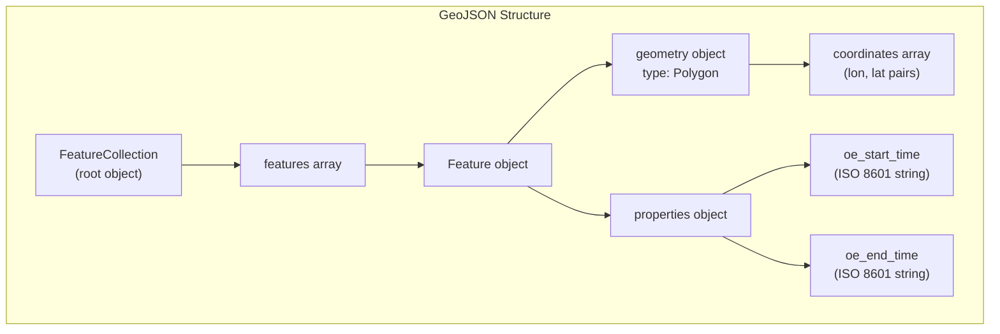
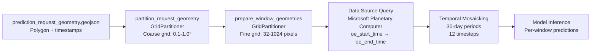
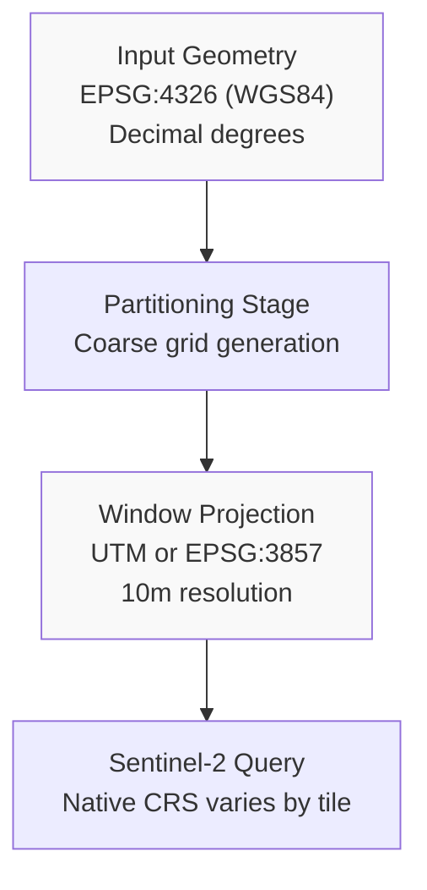

<!-- source: DeepWiki mcp.deepwiki.com · repo allenai/olmoearth_projects · page 7.2 Prediction Request Geometries · fetched 2026-10-26 -->

# Prediction Request Geometries

<details>
<summary>Relevant source files</summary>

The following files were used as context for generating this wiki page:

- [docs/awf.md](docs/awf.md)
- [docs/nandi.md](docs/nandi.md)
- [olmoearth_projects/projects/mozambique_lulc/__init__.py](olmoearth_projects/projects/mozambique_lulc/__init__.py)
- [olmoearth_projects/projects/mozambique_lulc/create_label_raster.py](olmoearth_projects/projects/mozambique_lulc/create_label_raster.py)
- [olmoearth_projects/projects/mozambique_lulc/create_windows_for_lulc.py](olmoearth_projects/projects/mozambique_lulc/create_windows_for_lulc.py)
- [olmoearth_projects/projects/mozambique_lulc/update_train_test_split.py](olmoearth_projects/projects/mozambique_lulc/update_train_test_split.py)
- [olmoearth_run_data/mozambique_lulc/prediction_request_geometry.geojson](olmoearth_run_data/mozambique_lulc/prediction_request_geometry.geojson)
- [olmoearth_run_data/nandi/prediction_request_geometry.geojson](olmoearth_run_data/nandi/prediction_request_geometry.geojson)

</details>


## Purpose and Scope

This document explains the structure and usage of prediction request geometries, which are GeoJSON files that define the spatial and temporal extent for running inference with trained OlmoEarth models. These files serve as the primary input to the olmoearth_run inference pipeline and specify both where and when to generate predictions.

For information about the overall inference pipeline that consumes these geometries, see [olmoearth_run Pipeline](#7.1). For details on how these geometries are partitioned into processing units, see [Partitioning and Grid Processing](#7.3).

**Sources:** [olmoearth_run_data/mozambique_lulc/prediction_request_geometry.geojson:1-39](), [olmoearth_run_data/nandi/prediction_request_geometry.geojson:1-39]()

## GeoJSON File Structure

Prediction request geometries follow the GeoJSON specification with additional OlmoEarth-specific properties. Each file contains a `FeatureCollection` with one or more `Feature` objects that define spatial polygons and their associated temporal properties.



**Sources:** [olmoearth_run_data/mozambique_lulc/prediction_request_geometry.geojson:1-39](), [olmoearth_run_data/nandi/prediction_request_geometry.geojson:1-39]()

### Spatial Component

The spatial extent is defined by a GeoJSON `Polygon` geometry with coordinates in WGS84 (EPSG:4326) projection. Coordinates are specified as `[longitude, latitude]` pairs forming a closed polygon.

| Field | Type | Description |
|-------|------|-------------|
| `type` | string | Must be `"Polygon"` |
| `coordinates` | array | Array of linear rings, where first ring is exterior boundary |
| Coordinate format | `[number, number]` | `[longitude, latitude]` in decimal degrees |

**Example from Mozambique LULC:**
```json
"geometry": {
  "coordinates": [
    [
      [33.66473812697805, -25.14037394430332],
      [33.66473812697805, -25.145788014726122],
      [33.67009152455876, -25.145788014726122],
      [33.67009152455876, -25.14037394430332],
      [33.66473812697805, -25.14037394430332]
    ]
  ],
  "type": "Polygon"
}
```

**Sources:** [olmoearth_run_data/mozambique_lulc/prediction_request_geometry.geojson:4-29]()

### Temporal Component

The temporal extent is specified through two required properties that define the start and end times for data acquisition.

| Property | Format | Description |
|----------|--------|-------------|
| `oe_start_time` | ISO 8601 string | Start of temporal window (UTC) |
| `oe_end_time` | ISO 8601 string | End of temporal window (UTC) |

Both timestamps must be in ISO 8601 format with timezone specification (typically UTC). The time range determines which satellite imagery timesteps will be queried and mosaicked during inference.

**Example temporal properties:**
```json
"properties": {
  "oe_start_time": "2024-10-23T00:00:00+00:00",
  "oe_end_time": "2025-05-07T00:00:00+00:00"
}
```

**Sources:** [olmoearth_run_data/mozambique_lulc/prediction_request_geometry.geojson:31-34](), [olmoearth_run_data/nandi/prediction_request_geometry.geojson:31-34]()

## Temporal Ranges by Model

Different models are trained on specific temporal configurations and require appropriate time ranges for optimal inference results. The following table summarizes recommended temporal ranges for each model type:

| Model | Training Period | Recommended Range Duration | Example Period |
|-------|----------------|---------------------------|----------------|
| Mozambique LULC | 2024-10 to 2025-06 | ~7 months (seasonal) | 2024-10-23 to 2025-06-20 |
| Mozambique Crop Type | 2024-10 to 2025-06 | ~7 months (seasonal) | 2024-10-23 to 2025-06-20 |
| Nandi Crop | 2022-09 to 2023-09 | 12 months (annual) | Any 12-month period |
| AWF Land Cover | 2023-01 to 2023-12 | 12 months (annual) | 2023-01-01 to 2023-12-31 |

The temporal ranges defined during training are stored in project-specific constants. For example, the Mozambique LULC project defines per-province temporal coverage in the `GROUP_TIME` dictionary:

```python
GROUP_TIME = {
    "gaza": (
        datetime(2024, 10, 23, tzinfo=UTC),
        datetime(2025, 6, 20, tzinfo=UTC),
    ),
    "manica": (
        datetime(2024, 10, 23, tzinfo=UTC),
        datetime(2025, 6, 20, tzinfo=UTC),
    ),
    "zambezia": (
        datetime(2024, 10, 23, tzinfo=UTC),
        datetime(2025, 6, 20, tzinfo=UTC),
    ),
}
```

**Sources:** [olmoearth_projects/projects/mozambique_lulc/create_windows_for_lulc.py:53-74](), [docs/nandi.md:41](), [docs/awf.md:38]()

## Complete File Examples

### Mozambique LULC Example

The Mozambique LULC prediction request geometry defines a small area in Gaza province with seasonal temporal coverage:

```json
{
  "features": [
    {
      "geometry": {
        "coordinates": [
          [
            [33.66473812697805, -25.14037394430332],
            [33.66473812697805, -25.145788014726122],
            [33.67009152455876, -25.145788014726122],
            [33.67009152455876, -25.14037394430332],
            [33.66473812697805, -25.14037394430332]
          ]
        ],
        "type": "Polygon"
      },
      "properties": {
        "oe_end_time": "2025-05-07T00:00:00+00:00",
        "oe_start_time": "2024-10-23T00:00:00+00:00"
      },
      "type": "Feature"
    }
  ],
  "type": "FeatureCollection"
}
```

This geometry covers approximately 0.0054 degrees longitude by 0.0054 degrees latitude (~600m × 600m at this latitude).

**Sources:** [olmoearth_run_data/mozambique_lulc/prediction_request_geometry.geojson:1-39]()

### Nandi County Example

The Nandi prediction request geometry covers the entire county with annual temporal coverage:

```json
{
  "features": [
    {
      "geometry": {
        "coordinates": [
          [
            [34.725547461183425, 0.5677064073714604],
            [34.725547461183425, -0.1240714566526151],
            [35.481933382330055, -0.1240714566526151],
            [35.481933382330055, 0.5677064073714604],
            [34.725547461183425, 0.5677064073714604]
          ]
        ],
        "type": "Polygon"
      },
      "properties": {
        "oe_end_time": "2022-09-01T00:00:00Z",
        "oe_start_time": "2023-09-01T00:00:00Z"
      },
      "type": "Feature"
    }
  ],
  "type": "FeatureCollection"
}
```

This geometry covers approximately 0.76 degrees longitude by 0.69 degrees latitude (~84 km × 77 km), encompassing the full county area.

**Sources:** [olmoearth_run_data/nandi/prediction_request_geometry.geojson:1-39]()

## Integration with Inference Pipeline

Prediction request geometries serve as the entry point to the olmoearth_run inference pipeline. The pipeline processes these geometries through several stages:



**Sources:** [olmoearth_run_data/mozambique_lulc/prediction_request_geometry.geojson:1-39](), [olmoearth_run_data/nandi/prediction_request_geometry.geojson:1-39]()

### Partitioning Process

The inference pipeline reads the prediction request geometry and partitions it hierarchically:

1. **Coarse Partitioning**: The polygon is divided into coarse grid cells (0.1-1.0 degrees) using `partition_request_geometry`
2. **Fine Partitioning**: Each coarse partition is subdivided into processing windows (32-1024 pixels) using `prepare_window_geometries`
3. **Projection Selection**: Windows are projected to UTM or EPSG:3857 at 10m resolution for processing

The temporal properties (`oe_start_time` and `oe_end_time`) are preserved through all partitioning stages and used to query satellite data for each processing window.

**Sources:** [olmoearth_run_data/mozambique_lulc/prediction_request_geometry.geojson:31-34]()

### Data Acquisition

The temporal extent defined in the prediction request geometry determines which satellite imagery is retrieved:

1. **Query Period**: Data sources are queried for the period from `oe_start_time` to `oe_end_time`
2. **Temporal Mosaicking**: Imagery is aggregated into 30-day periods, creating 6-12 timesteps depending on the total duration
3. **Data Source**: Sentinel-2 L2A imagery is retrieved from Microsoft Planetary Computer

For example, a geometry with 12-month temporal range (`2022-09-01` to `2023-09-01`) results in 12 monthly mosaics, each representing one 30-day period.

**Sources:** [docs/nandi.md:14](), [docs/nandi.md:35](), [docs/awf.md:14](), [docs/awf.md:33]()

## Creating Prediction Request Geometries

### Manual Creation

Prediction request geometries can be created manually using any GeoJSON editor or programmatically. The minimal required structure is:

1. Define a polygon in WGS84 coordinates
2. Add `oe_start_time` property in ISO 8601 format with timezone
3. Add `oe_end_time` property in ISO 8601 format with timezone
4. Wrap in a FeatureCollection structure

### Coordinate System Requirements



All prediction request geometries must use WGS84 (EPSG:4326) projection with longitude/latitude coordinates. The inference pipeline handles projection transformations internally when creating processing windows.

**Sources:** [olmoearth_projects/projects/mozambique_lulc/create_windows_for_lulc.py:171-175]()

### Validation Checklist

Before using a prediction request geometry for inference, verify:

| Check | Requirement |
|-------|------------|
| Valid GeoJSON | Parseable as GeoJSON FeatureCollection |
| Geometry type | Polygon with closed ring |
| Coordinate order | `[longitude, latitude]` not `[latitude, longitude]` |
| Coordinate range | Longitude: -180 to 180, Latitude: -90 to 90 |
| Temporal format | ISO 8601 with timezone (e.g., `+00:00` or `Z`) |
| Temporal order | `oe_start_time` < `oe_end_time` |
| Property names | Exactly `oe_start_time` and `oe_end_time` (case-sensitive) |

**Sources:** [olmoearth_run_data/mozambique_lulc/prediction_request_geometry.geojson:1-39](), [olmoearth_run_data/nandi/prediction_request_geometry.geojson:1-39]()

## File Location and Naming Convention

Prediction request geometries are stored in the `olmoearth_run_data/` directory hierarchy, organized by project:

```
olmoearth_run_data/
├── mozambique_lulc/
│   └── prediction_request_geometry.geojson
├── nandi/
│   └── prediction_request_geometry.geojson
└── awf/
    └── prediction_request_geometry.geojson
```

The standard filename is `prediction_request_geometry.geojson`, placed in the project-specific subdirectory alongside other inference configuration files like `olmoearth_run.yaml`.

**Sources:** [olmoearth_run_data/mozambique_lulc/prediction_request_geometry.geojson:1](), [olmoearth_run_data/nandi/prediction_request_geometry.geojson:1]()

---

