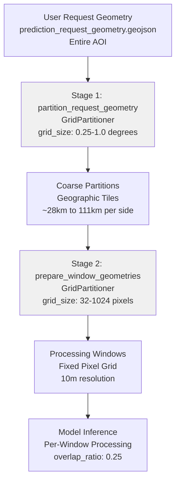
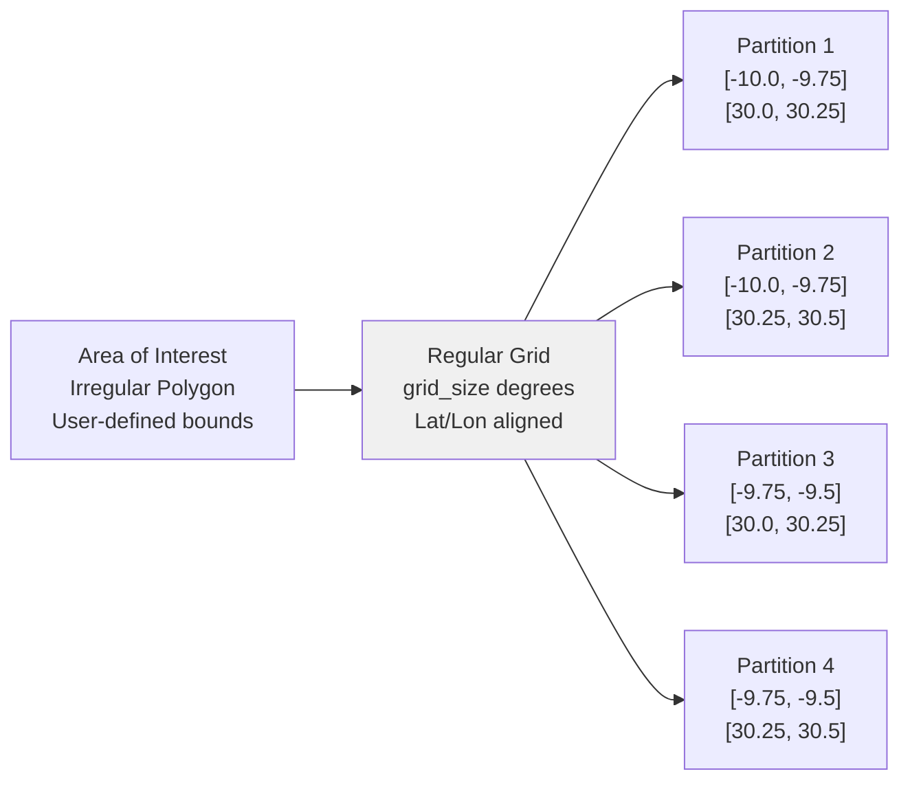
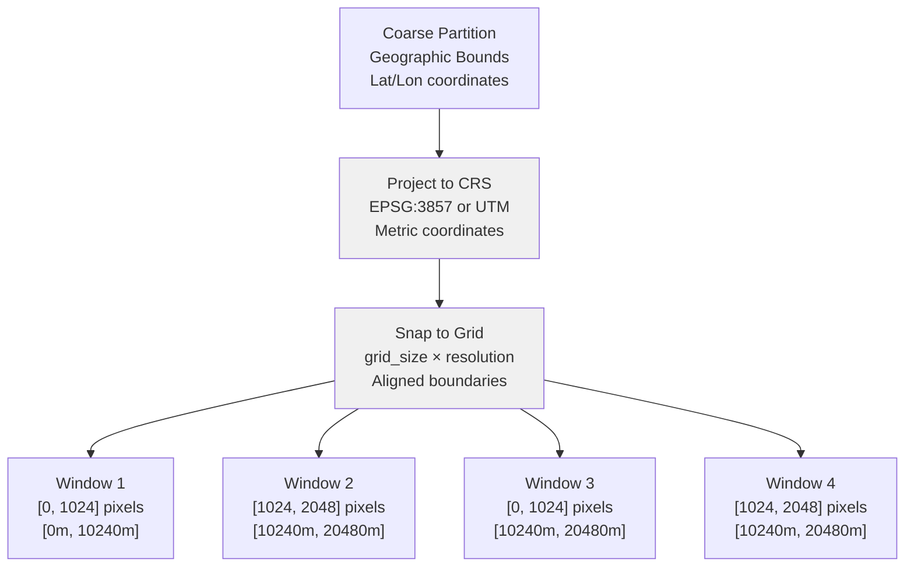
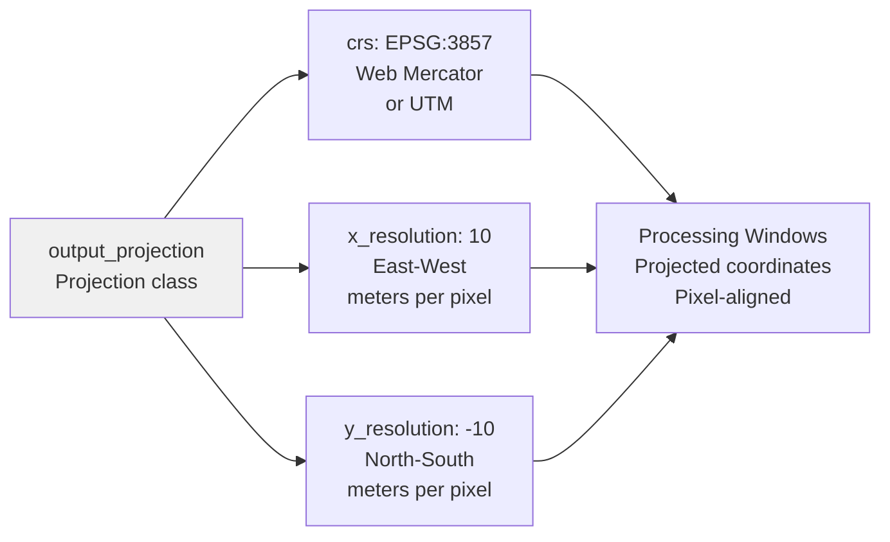
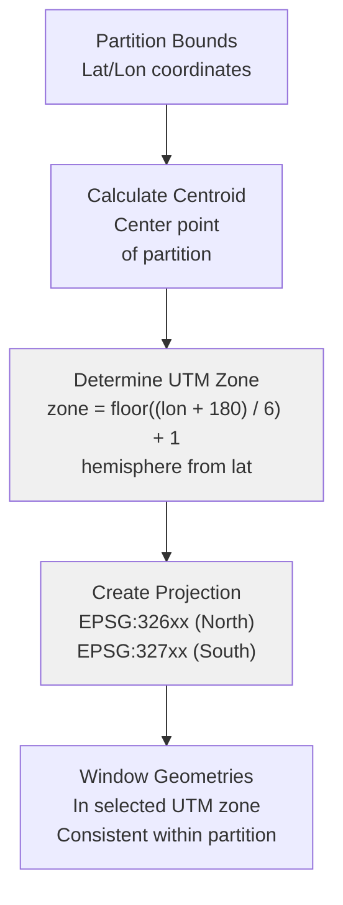
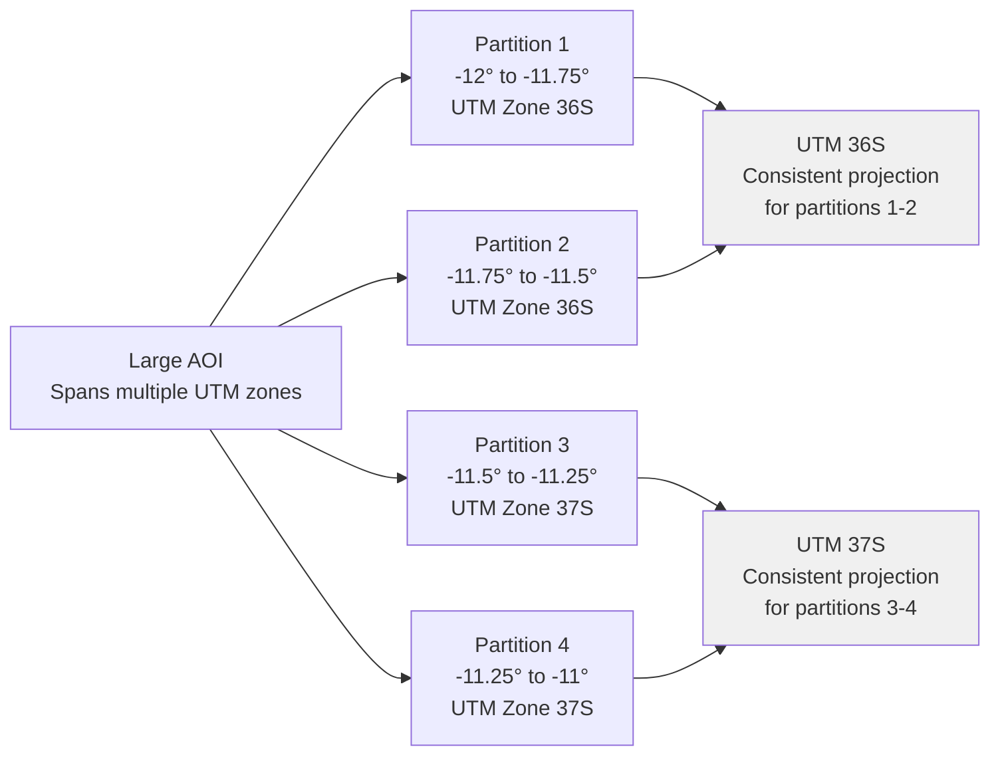
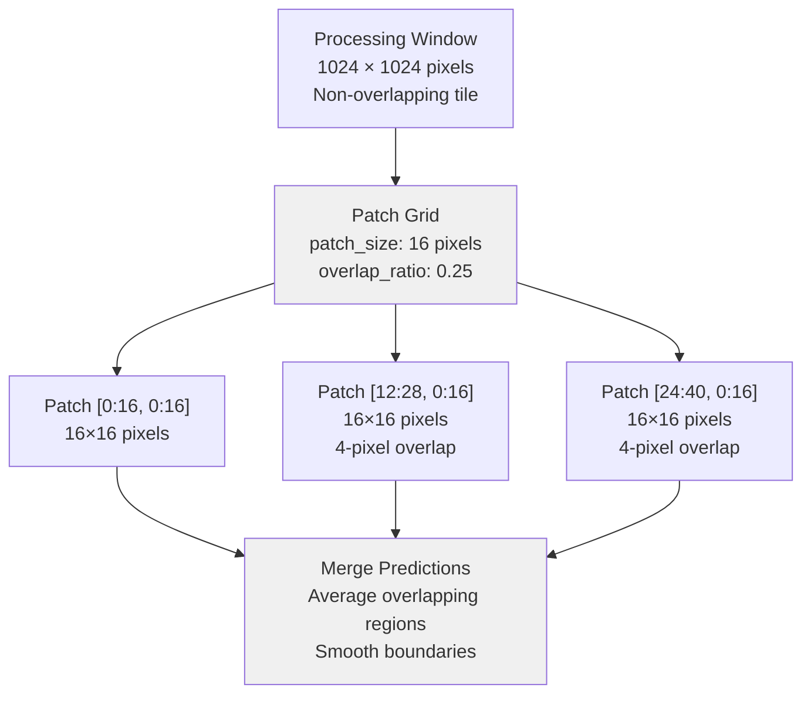
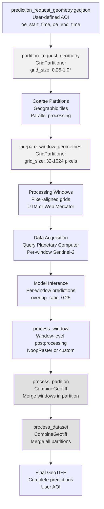

<!-- source: DeepWiki mcp.deepwiki.com · repo allenai/olmoearth_projects · page 7.3 Partitioning and Grid Processing · fetched 2026-10-26 -->

# Partitioning and Grid Processing

<details>
<summary>Relevant source files</summary>

The following files were used as context for generating this wiki page:

- [olmoearth_run_data/awf/olmoearth_run.yaml](olmoearth_run_data/awf/olmoearth_run.yaml)
- [olmoearth_run_data/mozambique_lulc/dataset.json](olmoearth_run_data/mozambique_lulc/dataset.json)
- [olmoearth_run_data/mozambique_lulc/model.yaml](olmoearth_run_data/mozambique_lulc/model.yaml)
- [olmoearth_run_data/mozambique_lulc/olmoearth_run.yaml](olmoearth_run_data/mozambique_lulc/olmoearth_run.yaml)
- [olmoearth_run_data/nandi/olmoearth_run.yaml](olmoearth_run_data/nandi/olmoearth_run.yaml)

</details>


This document explains the hierarchical partitioning strategies used by the olmoearth_run inference pipeline to divide large geographic areas into manageable processing units. The system uses a two-stage approach: coarse geographic partitioning followed by fine-grained window-level processing grids. This enables efficient parallel processing of predictions over large regions while managing memory constraints and data access patterns.

For information about the overall inference pipeline, see [olmoearth_run Pipeline](#7.1). For details about post-processing and result aggregation, see [Post-processing and Output](#7.4).

## Overview of Hierarchical Partitioning

The olmoearth_run pipeline uses a hierarchical partitioning strategy to decompose large prediction requests into smaller, processable units. This two-stage approach balances computational efficiency, memory usage, and data locality.



**Diagram: Two-Stage Hierarchical Partitioning Flow**

The first stage divides the request geometry into coarse geographic tiles (partitions) using latitude/longitude coordinates. The second stage subdivides each partition into pixel-aligned processing windows in a projected coordinate system. This hierarchy enables:

- **Parallel Processing**: Each partition can be processed independently
- **Memory Management**: Window sizes are bounded to fit in GPU/CPU memory
- **Data Locality**: Coarse partitions group spatially adjacent windows for efficient data access
- **Overlap Handling**: Window-level overlaps ensure seamless boundaries in final outputs

**Sources:** [olmoearth_run_data/nandi/olmoearth_run.yaml:22-38](), [olmoearth_run_data/mozambique_lulc/olmoearth_run.yaml:50-66]()

## Stage 1: Coarse Geographic Partitioning

The first partitioning stage uses `partition_request_geometry` to divide the user's area of interest into coarse geographic tiles using latitude/longitude coordinates.

### GridPartitioner Configuration

The coarse partitioning is controlled by the `partition_strategies.partition_request_geometry` section in `olmoearth_run.yaml`:

```yaml
partition_strategies:
  partition_request_geometry:
    class_path: olmoearth_run.runner.tools.partitioners.grid_partitioner.GridPartitioner
    init_args:
      grid_size: 0.25  # to 1.0 degrees
```

| Parameter | Description | Typical Values | Purpose |
|-----------|-------------|----------------|---------|
| `grid_size` | Size of partition tiles in degrees | 0.25, 0.5, 1.0 | Controls partition granularity |
| `class_path` | GridPartitioner implementation | `grid_partitioner.GridPartitioner` | Provides regular grid partitioning |

**Sources:** [olmoearth_run_data/mozambique_lulc/olmoearth_run.yaml:51-54](), [olmoearth_run_data/nandi/olmoearth_run.yaml:23-26](), [olmoearth_run_data/awf/olmoearth_run.yaml:23-26]()

### Grid Size Selection

The choice of `grid_size` depends on the geographic extent and processing requirements:

| grid_size | Approximate Width | Use Case |
|-----------|------------------|----------|
| 0.25° | ~28 km at equator | Small areas, high-resolution outputs |
| 0.5° | ~56 km at equator | Medium areas, balanced processing |
| 1.0° | ~111 km at equator | Large areas, continent-scale inference |

Smaller grid sizes create more partitions, enabling finer-grained parallelism but increasing coordination overhead. Larger grid sizes reduce the number of partitions but may increase memory requirements per partition.

**Sources:** [olmoearth_run_data/mozambique_lulc/olmoearth_run.yaml:54](), [olmoearth_run_data/nandi/olmoearth_run.yaml:26](), [olmoearth_run_data/awf/olmoearth_run.yaml:26]()

### Partition Geometry



**Diagram: Geographic Grid Partitioning Example (grid_size=0.25)**

The `GridPartitioner` creates a regular grid aligned to latitude/longitude coordinates. Each partition is bounded by `[lat_min, lat_max]` and `[lon_min, lon_max]`. Partitions that intersect the user's area of interest are included in processing.

**Sources:** [olmoearth_run_data/nandi/olmoearth_run.yaml:23-26]()

## Stage 2: Window-Level Processing Grid

The second partitioning stage uses `prepare_window_geometries` to subdivide each coarse partition into pixel-aligned processing windows in a projected coordinate system.

### Window Grid Configuration

The window-level partitioning is controlled by the `partition_strategies.prepare_window_geometries` section:

```yaml
partition_strategies:
  prepare_window_geometries:
    class_path: olmoearth_run.runner.tools.partitioners.grid_partitioner.GridPartitioner
    init_args:
      grid_size: 1024  # pixels
      output_projection:
        class_path: rslearn.utils.geometry.Projection
        init_args:
          crs: EPSG:3857  # Web Mercator
          x_resolution: 10  # meters
          y_resolution: -10  # meters (negative = north-up)
      use_utm: true
```

| Parameter | Description | Values |
|-----------|-------------|--------|
| `grid_size` | Window size in pixels | 32, 64, 128, 256, 512, 1024 |
| `crs` | Coordinate reference system | EPSG:3857 (Web Mercator), or UTM |
| `x_resolution` | East-west pixel size in meters | 10 |
| `y_resolution` | North-south pixel size in meters | -10 (negative for north-up) |
| `use_utm` | Enable automatic UTM zone selection | true/false |

**Sources:** [olmoearth_run_data/nandi/olmoearth_run.yaml:28-38](), [olmoearth_run_data/mozambique_lulc/olmoearth_run.yaml:56-66](), [olmoearth_run_data/awf/olmoearth_run.yaml:28-38]()

### Window Size Selection

The `grid_size` parameter determines the processing window dimensions:

| grid_size (pixels) | Physical Size at 10m | Memory Footprint | Use Case |
|-------------------|---------------------|------------------|----------|
| 32 | 320m × 320m | ~6 MB per window | Testing, small models |
| 64 | 640m × 640m | ~24 MB per window | Memory-constrained environments |
| 128 | 1.28km × 1.28km | ~98 MB per window | Standard processing |
| 256 | 2.56km × 2.56km | ~393 MB per window | GPU-accelerated inference |
| 512 | 5.12km × 5.12km | ~1.6 GB per window | High-memory systems |
| 1024 | 10.24km × 10.24km | ~6.3 GB per window | Maximum efficiency |

Memory footprint assumes 12 Sentinel-2 bands × 8 timesteps × 2 bytes (uint16) per pixel. Actual memory usage includes model activations and temporary buffers.

**Sources:** [olmoearth_run_data/nandi/olmoearth_run.yaml:31](), [olmoearth_run_data/mozambique_lulc/olmoearth_run.yaml:59]()

### Window Grid Alignment



**Diagram: Window Grid Creation from Partition**

Windows are created by:
1. Projecting the partition bounds to the output CRS
2. Snapping to a regular grid aligned to `grid_size × resolution`
3. Creating non-overlapping windows that tile the partition
4. Storing window geometries for data acquisition and inference

**Sources:** [olmoearth_run_data/nandi/olmoearth_run.yaml:28-38]()

## Output Projection and Resolution

### Projection Configuration

The `output_projection` defines the coordinate reference system and spatial resolution for processing windows:



**Diagram: Output Projection Configuration**

**Sources:** [olmoearth_run_data/nandi/olmoearth_run.yaml:32-37](), [olmoearth_run_data/mozambique_lulc/olmoearth_run.yaml:60-65]()

### Coordinate Reference Systems

Two projection strategies are supported:

#### EPSG:3857 (Web Mercator)

Used when `use_utm: false` or not specified:
- Global coverage without zone boundaries
- Compatible with web mapping libraries
- Distortion increases away from equator
- Suitable for near-equatorial regions

#### Automatic UTM Selection

Used when `use_utm: true`:
- Selects appropriate UTM zone based on partition centroid
- Minimal distortion within each zone
- Preserves distances and areas accurately
- Recommended for high-accuracy applications

**Sources:** [olmoearth_run_data/nandi/olmoearth_run.yaml:38](), [olmoearth_run_data/mozambique_lulc/olmoearth_run.yaml:66]()

### Resolution Parameters

The resolution defines the physical size of each pixel:

| Parameter | Value | Interpretation |
|-----------|-------|----------------|
| `x_resolution` | 10 | 10 meters east-west per pixel |
| `y_resolution` | -10 | 10 meters north-south per pixel (negative = north-up) |

The negative `y_resolution` ensures north-up orientation, matching standard GIS conventions. All models in this repository use 10-meter resolution to align with Sentinel-2 bands.

**Sources:** [olmoearth_run_data/nandi/olmoearth_run.yaml:35-37](), [olmoearth_run_data/mozambique_lulc/olmoearth_run.yaml:63-65]()

## UTM Zone Selection

When `use_utm: true`, the system automatically selects the appropriate UTM zone for each partition.

### UTM Zone Selection Process



**Diagram: Automatic UTM Zone Selection**

### UTM Zone Properties

UTM zones provide:
- **Accurate Measurements**: Distances and areas are preserved within each zone
- **6-Degree Zones**: Each zone covers 6 degrees of longitude
- **North/South Variants**: Separate EPSG codes for northern (326xx) and southern (327xx) hemispheres
- **Consistent Within Partition**: All windows in a partition use the same UTM zone

### Zone Boundaries



**Diagram: UTM Zone Assignment Across Partitions**

When an area of interest spans multiple UTM zones, the coarse partitioning ensures each partition falls predominantly within a single zone. This avoids projection distortion at zone boundaries.

**Sources:** [olmoearth_run_data/nandi/olmoearth_run.yaml:38](), [olmoearth_run_data/mozambique_lulc/olmoearth_run.yaml:66]()

## Window Overlap for Inference

While window grids are created as non-overlapping tiles, the model inference stage processes windows with overlap to ensure smooth boundaries in predictions.

### Overlap Configuration

The overlap is configured in the model's `predict_config` section:

| Parameter | Value | Effect |
|-----------|-------|--------|
| `patch_size` | 16 | Each inference patch is 16×16 pixels |
| `overlap_ratio` | 0.25 | 25% overlap between patches (4 pixels) |



**Diagram: Patch-Level Overlap Within Windows**

The overlap ensures:
- **Smooth Boundaries**: Predictions are averaged at patch edges
- **Context Preservation**: Border pixels have full receptive field coverage
- **Quality Consistency**: No discontinuities at window boundaries

**Sources:** [olmoearth_run_data/mozambique_lulc/model.yaml:237-239]()

## Configuration Examples

### Example 1: Small Area, High Resolution

For detailed mapping of a small region (e.g., 10km × 10km):

```yaml
partition_strategies:
  partition_request_geometry:
    class_path: olmoearth_run.runner.tools.partitioners.grid_partitioner.GridPartitioner
    init_args:
      grid_size: 0.25  # Small partitions for fine control
      
  prepare_window_geometries:
    class_path: olmoearth_run.runner.tools.partitioners.grid_partitioner.GridPartitioner
    init_args:
      grid_size: 256  # Smaller windows for detailed processing
      output_projection:
        class_path: rslearn.utils.geometry.Projection
        init_args:
          crs: EPSG:3857
          x_resolution: 10
          y_resolution: -10
      use_utm: true
```

**Sources:** [olmoearth_run_data/mozambique_lulc/olmoearth_run.yaml:50-66]()

### Example 2: Large Area, Efficient Processing

For continental-scale inference (e.g., 500km × 500km):

```yaml
partition_strategies:
  partition_request_geometry:
    class_path: olmoearth_run.runner.tools.partitioners.grid_partitioner.GridPartitioner
    init_args:
      grid_size: 1.0  # Large partitions for fewer tiles
      
  prepare_window_geometries:
    class_path: olmoearth_run.runner.tools.partitioners.grid_partitioner.GridPartitioner
    init_args:
      grid_size: 1024  # Large windows for GPU efficiency
      output_projection:
        class_path: rslearn.utils.geometry.Projection
        init_args:
          crs: EPSG:3857
          x_resolution: 10
          y_resolution: -10
      use_utm: true
```

**Sources:** [olmoearth_run_data/nandi/olmoearth_run.yaml:22-38]()

## Integration with Pipeline Stages

The partitioning system integrates with other pipeline stages:



**Diagram: Partitioning Integration in Complete Pipeline**

The hierarchical partitioning:
1. **Enables Parallelism**: Partitions process independently
2. **Manages Memory**: Windows fit in available GPU/CPU memory
3. **Optimizes Data Access**: Spatial locality reduces redundant queries
4. **Facilitates Aggregation**: Hierarchical merge reduces I/O operations

For details on post-processing and result aggregation, see [Post-processing and Output](#7.4).

**Sources:** [olmoearth_run_data/nandi/olmoearth_run.yaml:22-52](), [olmoearth_run_data/mozambique_lulc/olmoearth_run.yaml:50-80]()

## Summary

The olmoearth_run partitioning system uses a two-stage hierarchical approach:

1. **Coarse Geographic Partitioning**: Divides large areas into manageable tiles using lat/lon coordinates
2. **Fine Window-Level Processing**: Subdivides partitions into pixel-aligned grids in projected coordinates

Key configuration parameters:

| Stage | Component | Parameter | Typical Values |
|-------|-----------|-----------|----------------|
| Coarse | `partition_request_geometry` | `grid_size` | 0.25-1.0 degrees |
| Fine | `prepare_window_geometries` | `grid_size` | 32-1024 pixels |
| Fine | `output_projection` | `crs` | EPSG:3857 or UTM |
| Fine | `output_projection` | `x_resolution` / `y_resolution` | 10 / -10 meters |
| Fine | `prepare_window_geometries` | `use_utm` | true/false |
| Inference | `predict_config` | `patch_size` | 16 pixels |
| Inference | `predict_config` | `overlap_ratio` | 0.25 |

The system automatically handles:
- UTM zone selection for accurate geographic measurements
- Window grid alignment to projection boundaries
- Patch-level overlap for seamless predictions
- Hierarchical aggregation of results

**Sources:** [olmoearth_run_data/nandi/olmoearth_run.yaml:22-52](), [olmoearth_run_data/mozambique_lulc/olmoearth_run.yaml:50-80](), [olmoearth_run_data/awf/olmoearth_run.yaml:22-52](), [olmoearth_run_data/mozambique_lulc/model.yaml:236-240]()

---

