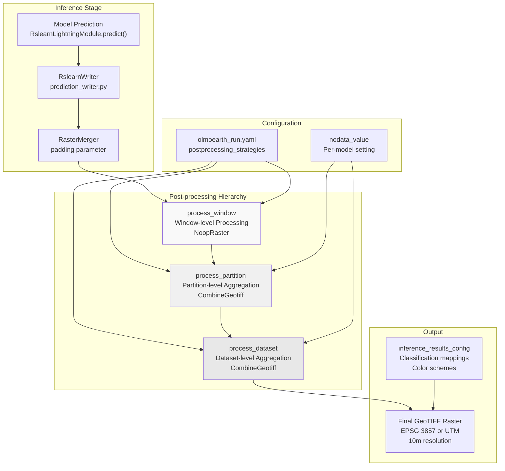
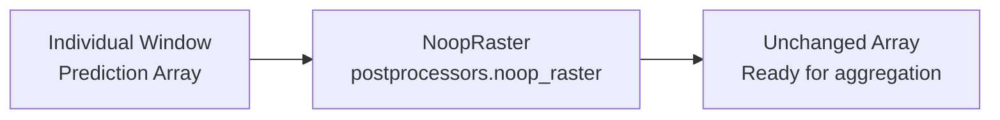
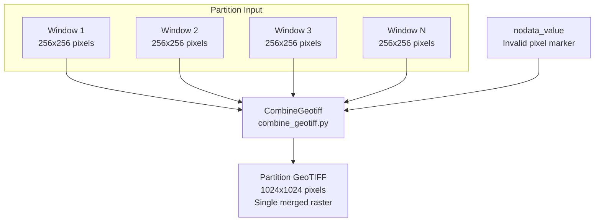
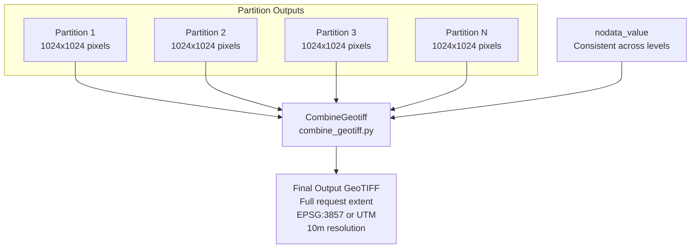
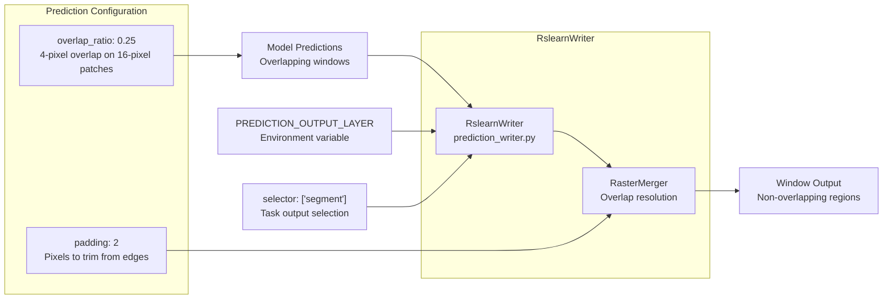
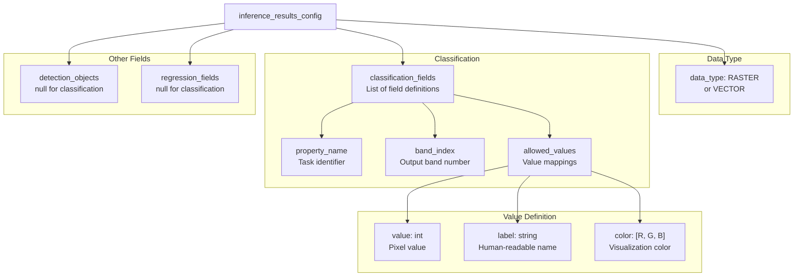
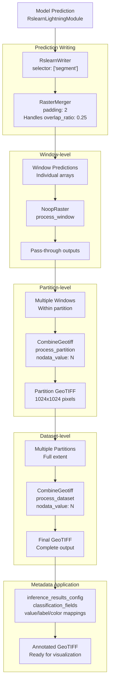

<!-- source: DeepWiki mcp.deepwiki.com · repo allenai/olmoearth_projects · page 7.4 Post-processing and Output · fetched 2026-10-26 -->

# Post-processing and Output

<details>
<summary>Relevant source files</summary>

The following files were used as context for generating this wiki page:

- [olmoearth_run_data/awf/olmoearth_run.yaml](olmoearth_run_data/awf/olmoearth_run.yaml)
- [olmoearth_run_data/mozambique_lulc/dataset.json](olmoearth_run_data/mozambique_lulc/dataset.json)
- [olmoearth_run_data/mozambique_lulc/model.yaml](olmoearth_run_data/mozambique_lulc/model.yaml)
- [olmoearth_run_data/mozambique_lulc/olmoearth_run.yaml](olmoearth_run_data/mozambique_lulc/olmoearth_run.yaml)
- [olmoearth_run_data/nandi/olmoearth_run.yaml](olmoearth_run_data/nandi/olmoearth_run.yaml)

</details>


## Purpose and Scope

This document describes the post-processing strategies and output formatting applied during inference in the olmoearth_run pipeline. Post-processing occurs at three hierarchical levels (window, partition, dataset) to aggregate model predictions into final GeoTIFF rasters. This page also documents the inference results configuration system that defines output metadata, including classification value mappings, color schemes, and data types.

For information about the overall inference pipeline, see [olmoearth_run Pipeline](#7.1). For details on partitioning strategies that precede post-processing, see [Partitioning and Grid Processing](#7.3).

---

## Post-processing Architecture

The olmoearth_run pipeline implements a three-level hierarchical post-processing architecture that progressively aggregates model predictions from individual inference windows into complete geographic outputs.



**Sources:** [olmoearth_run_data/nandi/olmoearth_run.yaml:40-52](), [olmoearth_run_data/awf/olmoearth_run.yaml:40-52](), [olmoearth_run_data/mozambique_lulc/olmoearth_run.yaml:68-80]()

---

## Post-processing Strategies

### Window-level Processing

Window-level post-processing occurs immediately after model prediction for each inference window. In most configurations, this stage uses `NoopRaster`, which performs no transformations and simply passes predictions through to the next stage.



**Configuration Example:**

```yaml
postprocessing_strategies:
  process_window:
    class_path: olmoearth_run.runner.tools.postprocessors.noop_raster.NoopRaster
```

The `NoopRaster` strategy is used when no window-specific transformations are needed, deferring all aggregation to higher levels.

**Sources:** [olmoearth_run_data/nandi/olmoearth_run.yaml:51-52](), [olmoearth_run_data/awf/olmoearth_run.yaml:51-52](), [olmoearth_run_data/mozambique_lulc/olmoearth_run.yaml:79-80]()

### Partition-level Processing

Partition-level post-processing combines predictions from multiple windows within a single geographic partition (typically 1024x1024 pixels) into a unified raster. This stage uses `CombineGeotiff` to merge overlapping predictions and handle nodata regions.



**Configuration Example:**

```yaml
postprocessing_strategies:
  process_partition:
    class_path: olmoearth_run.runner.tools.postprocessors.combine_geotiff.CombineGeotiff
    init_args:
      nodata_value: 10
```

The `nodata_value` parameter identifies pixels that should be excluded from the output, typically corresponding to invalid or missing predictions.

**Sources:** [olmoearth_run_data/nandi/olmoearth_run.yaml:46-49](), [olmoearth_run_data/awf/olmoearth_run.yaml:46-49](), [olmoearth_run_data/mozambique_lulc/olmoearth_run.yaml:74-77]()

### Dataset-level Processing

Dataset-level post-processing performs the final aggregation, combining all partition GeoTIFFs into a single output raster covering the entire prediction request geometry. This stage also uses `CombineGeotiff` with the same nodata handling.



**Configuration Example:**

```yaml
postprocessing_strategies:
  process_dataset:
    class_path: olmoearth_run.runner.tools.postprocessors.combine_geotiff.CombineGeotiff
    init_args:
      nodata_value: 10
```

The `nodata_value` must be consistent across partition-level and dataset-level processing to ensure proper masking of invalid regions throughout the aggregation hierarchy.

**Sources:** [olmoearth_run_data/nandi/olmoearth_run.yaml:41-44](), [olmoearth_run_data/awf/olmoearth_run.yaml:41-44](), [olmoearth_run_data/mozambique_lulc/olmoearth_run.yaml:69-72]()

---

## RasterMerger During Prediction

Before post-processing strategies are applied, the `RslearnWriter` callback in the training configuration handles prediction merging during inference. The `RasterMerger` manages overlapping predictions from the sliding window approach.



**Configuration in model.yaml:**

The `RslearnWriter` callback configuration appears in [olmoearth_run_data/mozambique_lulc/model.yaml:269-277]():

```yaml
- class_path: rslearn.train.prediction_writer.RslearnWriter
  init_args:
    path: placeholder
    output_layer: ${PREDICTION_OUTPUT_LAYER}
    selector: ["segment"]
    merger:
      class_path: rslearn.train.prediction_writer.RasterMerger
      init_args:
        padding: 2
```

The `padding: 2` parameter removes 2 pixels from each edge of predictions, eliminating potential boundary artifacts from the model's receptive field constraints.

**Overlap Resolution:**

The predict configuration in [olmoearth_run_data/mozambique_lulc/model.yaml:236-245]() defines the overlap strategy:

```yaml
predict_config:
  load_all_patches: true
  patch_size: 16
  overlap_ratio: 0.25  # 4 / 16
  skip_targets: true
```

With `overlap_ratio: 0.25`, adjacent 16x16 patches overlap by 4 pixels. The `RasterMerger` averages predictions in overlapping regions, creating smooth transitions between windows.

**Sources:** [olmoearth_run_data/mozambique_lulc/model.yaml:236-277]()

---

## Output Format and Structure

The final output from the post-processing pipeline is a GeoTIFF raster file with specific format characteristics and georeferencing.

### GeoTIFF Specifications

| Property | Value | Notes |
|----------|-------|-------|
| **Format** | GeoTIFF | Cloud-Optimized GeoTIFF (COG) compatible |
| **Coordinate System** | EPSG:3857 or UTM | UTM selected automatically if `use_utm: true` |
| **Resolution** | 10m x 10m | Consistent with Sentinel-2 native resolution |
| **Data Type** | Depends on task | INT32 for classification, FLOAT32 for regression |
| **Bands** | 1 (typically) | Single-band for classification/regression |
| **Compression** | LZW (typical) | Reduces file size while preserving data |
| **Nodata Value** | Model-specific | 9, 10, 255, etc. depending on model |

### Coordinate Reference Systems

The output projection is configured in the `prepare_window_geometries` partitioner:

```yaml
prepare_window_geometries:
  class_path: olmoearth_run.runner.tools.partitioners.grid_partitioner.GridPartitioner
  init_args:
    grid_size: 1024
    output_projection:
      class_path: rslearn.utils.geometry.Projection
      init_args:
        crs: EPSG:3857
        x_resolution: 10
        y_resolution: -10
    use_utm: true
```

When `use_utm: true` is set, the system automatically selects the appropriate UTM zone based on the request geometry's centroid, providing locally accurate metric coordinates. If `use_utm: false`, EPSG:3857 (Web Mercator) is used globally.

**Sources:** [olmoearth_run_data/nandi/olmoearth_run.yaml:28-38](), [olmoearth_run_data/awf/olmoearth_run.yaml:28-38](), [olmoearth_run_data/mozambique_lulc/olmoearth_run.yaml:56-66]()

---

## Inference Results Configuration

The `inference_results_config` section in `olmoearth_run.yaml` defines metadata that describes the output raster, including classification value mappings, color schemes, and data types. This configuration enables visualization tools and downstream applications to interpret the numeric pixel values.



**Sources:** [olmoearth_run_data/nandi/olmoearth_run.yaml:54-91](), [olmoearth_run_data/awf/olmoearth_run.yaml:54-88](), [olmoearth_run_data/mozambique_lulc/olmoearth_run.yaml:1-27]()

### Classification Fields

Classification fields define the mapping between numeric pixel values in the output raster and their semantic meanings. Each classification field represents a prediction task output.

**Structure:**

```yaml
inference_results_config:
  data_type: RASTER
  classification_fields:
    - property_name: segment
      band_index: 1
      allowed_values:
        - value: 0
          label: coffee
          color: [124, 67, 18]
        - value: 1
          label: grassland
          color: [169, 214, 146]
```

| Field | Type | Description |
|-------|------|-------------|
| `property_name` | string | Task identifier matching model output (e.g., "segment", "crop_type_classification") |
| `band_index` | integer | Band number in output GeoTIFF (1-indexed) |
| `allowed_values` | list | List of value mappings defining each class |

**Allowed Values Structure:**

Each entry in `allowed_values` defines a single classification category:

| Field | Type | Description |
|-------|------|-------------|
| `value` | integer | Numeric pixel value in output raster |
| `label` | string | Human-readable class name (e.g., "coffee", "grassland") |
| `color` | [int, int, int] | RGB color values (0-255) for visualization |

**Example: Nandi Crop Classification**

From [olmoearth_run_data/nandi/olmoearth_run.yaml:54-91]():

```yaml
classification_fields:
  - property_name: segment
    band_index: 1
    allowed_values:
      - value: 0
        label: coffee
        color: [124, 67, 18]
      - value: 1
        label: grassland
        color: [169, 214, 146]
      - value: 2
        label: trees
        color: [51, 160, 44]
      - value: 3
        label: maize
        color: [240, 159, 28]
      - value: 4
        label: sugarcane
        color: [251, 154, 153]
      - value: 5
        label: tea
        color: [31, 234, 146]
      - value: 6
        label: vegetables
        color: [166, 206, 227]
      - value: 7
        label: legumes
        color: [227, 26, 28]
      - value: 8
        label: water
        color: [31, 120, 180]
      - value: 9
        label: builtup
        color: [136, 33, 233]
```

This configuration maps pixel values 0-9 to 10 land cover and crop type classes with associated visualization colors.

**Sources:** [olmoearth_run_data/nandi/olmoearth_run.yaml:54-91]()

### Regression Fields

For regression tasks (e.g., Live Fuel Moisture Content), the `regression_fields` configuration would define continuous value outputs instead of discrete classifications. In classification models, this field is set to `null`.

```yaml
inference_results_config:
  data_type: RASTER
  classification_fields: null
  regression_fields:
    - property_name: lfmc
      band_index: 1
      units: "percent"
      min_value: 0.0
      max_value: 300.0
  detection_objects: null
```

**Sources:** [olmoearth_run_data/nandi/olmoearth_run.yaml:91](), [olmoearth_run_data/awf/olmoearth_run.yaml:88]()

### Detection Objects

For object detection tasks, the `detection_objects` configuration would define bounding box outputs. In the current classification models, this field is set to `null`.

```yaml
inference_results_config:
  data_type: RASTER
  classification_fields: [...]
  detection_objects: null
  regression_fields: null
```

**Sources:** [olmoearth_run_data/nandi/olmoearth_run.yaml:90](), [olmoearth_run_data/awf/olmoearth_run.yaml:87]()

---

## Output Examples by Model Type

Different models produce outputs with varying nodata values and classification schemes based on their specific applications.

### Nandi Crop Classification

| Parameter | Value |
|-----------|-------|
| **nodata_value** | 10 |
| **num_classes** | 10 (values 0-9) |
| **property_name** | segment |
| **Classes** | coffee, grassland, trees, maize, sugarcane, tea, vegetables, legumes, water, builtup |

**Sources:** [olmoearth_run_data/nandi/olmoearth_run.yaml:1-91]()

### AWF Land Cover

| Parameter | Value |
|-----------|-------|
| **nodata_value** | 9 |
| **num_classes** | 9 (values 0-8) |
| **property_name** | segment |
| **Classes** | woodland_forest, open_water, shrubland_savanna, herbaceous_wetland, grassland_barren, agriculture_settlement, montane_forest, lava_forest, urban_dense_development |

**Sources:** [olmoearth_run_data/awf/olmoearth_run.yaml:1-88]()

### Mozambique LULC

| Parameter | Value |
|-----------|-------|
| **nodata_value** | 255 |
| **num_classes** | 7 (values 1-7) |
| **property_name** | crop_type_classification |
| **Classes** | Water, Bare Ground, Rangeland, Flooded Vegetation, Trees, Cropland, Buildings |

Note: Mozambique LULC uses 1-indexed classes (1-7) instead of 0-indexed, with nodata_value of 255.

**Sources:** [olmoearth_run_data/mozambique_lulc/olmoearth_run.yaml:1-81]()

---

## Post-processing Data Flow

The complete data flow from model prediction through post-processing to final output follows this sequence:



**Key Processing Steps:**

1. **Prediction**: Model generates overlapping window predictions
2. **RasterMerger**: Resolves overlaps using padding and averaging
3. **Window Processing**: NoopRaster passes predictions unchanged
4. **Partition Aggregation**: CombineGeotiff merges windows into partition rasters
5. **Dataset Aggregation**: CombineGeotiff combines partitions into final output
6. **Metadata Application**: Classification mappings and colors applied to output

**Sources:** [olmoearth_run_data/mozambique_lulc/model.yaml:236-277](), [olmoearth_run_data/nandi/olmoearth_run.yaml:40-91](), [olmoearth_run_data/awf/olmoearth_run.yaml:40-88](), [olmoearth_run_data/mozambique_lulc/olmoearth_run.yaml:68-81]()

---

