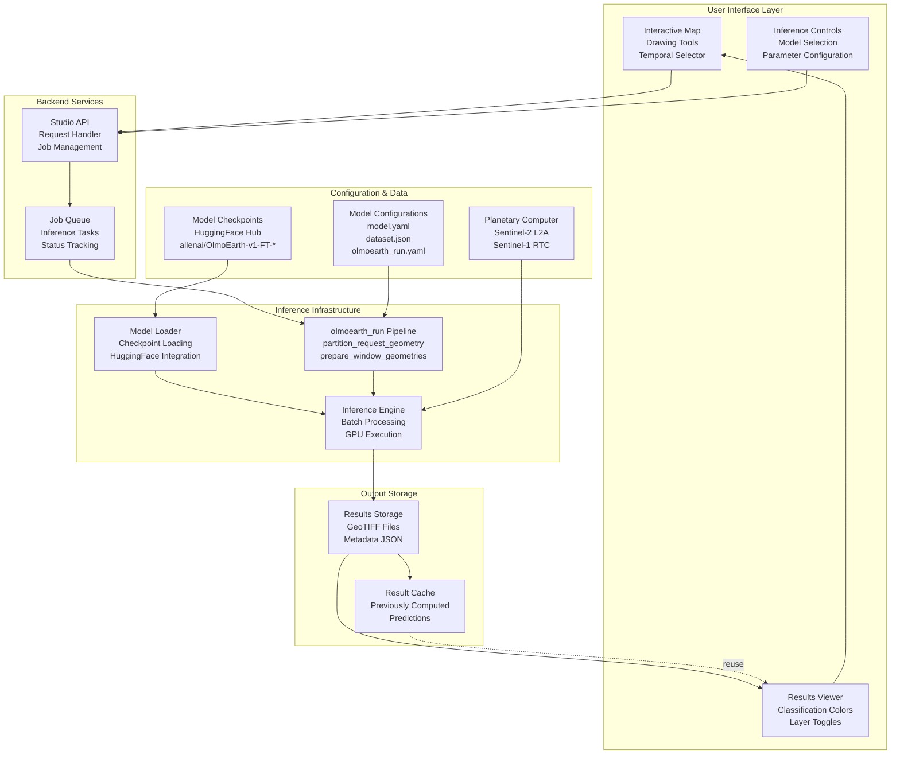
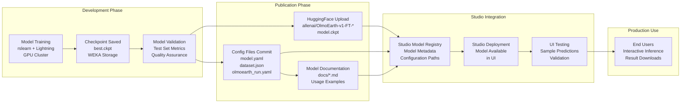
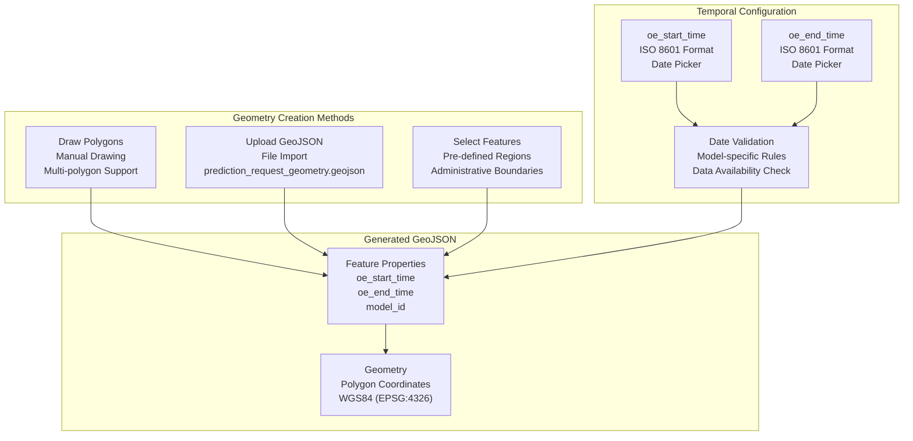
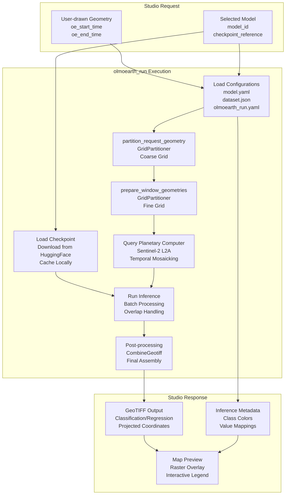
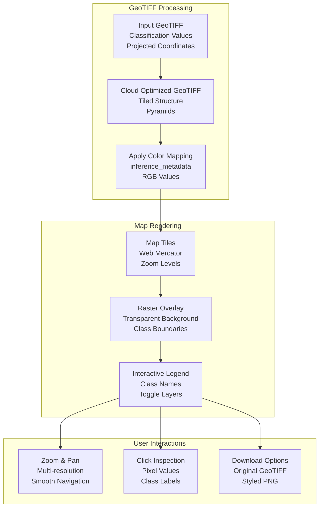

<!-- source: DeepWiki mcp.deepwiki.com · repo allenai/olmoearth_projects · page 7.5 OlmoEarth Studio Integration · fetched 2026-10-26 -->

# OlmoEarth Studio Integration

Relevant source files

The following files were used as context for generating this wiki page:

- [LICENSE](LICENSE)
- [README.md](README.md)
- [olmoearth_run_data/mozambique_lulc/README.md](olmoearth_run_data/mozambique_lulc/README.md)
- [olmoearth_run_data/mozambique_lulc/config.json](olmoearth_run_data/mozambique_lulc/config.json)

## Purpose and Scope

This page documents how fine-tuned models from the `olmoearth_projects` repository are deployed to **OlmoEarth Studio** for interactive inference and visualization. OlmoEarth Studio provides a web-based interface for applying trained models to user-defined geographic regions without requiring local infrastructure or command-line expertise.

For information about running inference locally using the command-line interface, see [olmoearth_run Pipeline](#7.1). For details about model training and fine-tuning, see [Model Training](#5). For specifics about output formats and post-processing, see [Post-processing and Output](#7.4).

## Overview

**OlmoEarth Studio** is a web application hosted at `https://olmoearth.allenai.org/` that provides an interactive map interface for running inference with OlmoEarth models. The Studio enables users to:

- Draw prediction request geometries directly on a map
- Select temporal ranges for satellite imagery
- Execute model inference without local compute resources
- Visualize classification and regression results interactively
- Download results as GeoTIFF files

The Studio uses the same core infrastructure as local inference pipelines, including the `olmoearth_run` system, configuration files from this repository, and model checkpoints hosted on HuggingFace.

**Sources:** [README.md:1-190](), [olmoearth_run_data/mozambique_lulc/README.md:135]()

## Studio Architecture

**Diagram: OlmoEarth Studio system architecture showing the flow from user interaction to inference results**

**Sources:** [README.md:49-140](), [olmoearth_run_data/mozambique_lulc/README.md:135]()

## Model Deployment Workflow

The deployment of models from `olmoearth_projects` to OlmoEarth Studio follows a structured workflow:

**Diagram: Model deployment workflow from training to Studio availability**

**Sources:** [README.md:142-185](), [olmoearth_run_data/mozambique_lulc/README.md:117-124]()

### Deployment Requirements

For a model to be integrated into OlmoEarth Studio, the following artifacts must be available:

| Artifact | Location | Purpose |
|----------|----------|---------|
| Model Checkpoint | HuggingFace Hub: `allenai/OlmoEarth-v1-FT-{TASK}-Base` | Pre-trained weights for inference |
| `model.yaml` | `olmoearth_run_data/{PROJECT}/model.yaml` | Model architecture and hyperparameters |
| `dataset.json` | `olmoearth_run_data/{PROJECT}/dataset.json` | Data source configuration |
| `olmoearth_run.yaml` | `olmoearth_run_data/{PROJECT}/olmoearth_run.yaml` | Partitioning and post-processing |
| Model Documentation | `docs/{PROJECT}.md` | Usage instructions and performance metrics |

**Sources:** [README.md:62-74]()

## Studio Capabilities

### Interactive Geometry Definition

Users can define prediction request geometries directly in the Studio interface:

**Diagram: Interactive geometry definition workflow in OlmoEarth Studio**

The Studio automatically generates a `prediction_request_geometry.geojson` file matching the format expected by `olmoearth_run`. For example, Mozambique LULC inference uses polygons manually drawn around provinces in the Studio interface.

**Sources:** [README.md:75-104](), [olmoearth_run_data/mozambique_lulc/README.md:135]()

### Model Selection and Configuration

The Studio presents available models with their metadata:

| Model Information | Source | Display |
|-------------------|--------|---------|
| Model Name | Documentation (`docs/*.md`) | User-friendly name |
| Task Type | `model.yaml` → `task.name` | Classification, Regression, Segmentation |
| Input Requirements | `dataset.json` → `layers` | Sentinel-1, Sentinel-2, bands |
| Temporal Configuration | `dataset.json` → `query_config` | Number of timesteps, period duration |
| Output Classes | `olmoearth_run.yaml` → `inference_metadata` | Class names, value mappings |
| Performance Metrics | Model documentation | Accuracy, F1 scores per class |

**Sources:** [README.md:8-23](), [olmoearth_run_data/mozambique_lulc/config.json:1-70]()

## Integration with olmoearth_run

The Studio backend executes inference using the same `olmoearth_run` pipeline as command-line users. The key components are:

**Diagram: Studio integration with olmoearth_run pipeline components**

**Sources:** [README.md:106-140]()

### Configuration File Usage

The Studio reads the same configuration files stored in `olmoearth_run_data/{PROJECT}/`:

**`model.yaml`** [olmoearth_run_data/{PROJECT}/model.yaml]():
- Defines the OlmoEarth encoder and task-specific decoder
- Specifies data normalization transforms
- Configures inference batch size and overlap handling

**`dataset.json`** [olmoearth_run_data/{PROJECT}/dataset.json]():
- Configures Planetary Computer query parameters
- Defines temporal mosaicking strategy (`PER_PERIOD_MOSAIC`)
- Specifies harmonization settings for Sentinel-2

**`olmoearth_run.yaml`** [olmoearth_run_data/{PROJECT}/olmoearth_run.yaml]():
- Defines partitioning strategy (grid sizes, overlap ratios)
- Configures post-processing operations (`CombineGeotiff`)
- Specifies output projection (`use_utm: true`, resolution)

**Sources:** [README.md:62-74](), [olmoearth_run_data/mozambique_lulc/config.json:1-70]()

## Studio vs Local Inference

Users can choose between Studio-based inference and local command-line execution:

| Aspect | OlmoEarth Studio | Local olmoearth_run |
|--------|------------------|---------------------|
| **Access** | Web browser at `olmoearth.allenai.org` | Command line with Python environment |
| **Geometry Input** | Interactive map drawing | GeoJSON file creation |
| **Compute Resources** | Studio-managed GPU infrastructure | User-provided GPU/CPU |
| **Installation** | None required | `uv sync`, dependencies, model downloads |
| **Job Management** | Automatic queuing and status tracking | Manual execution and monitoring |
| **Result Delivery** | Download link + map preview | Local directory with GeoTIFFs |
| **Use Case** | Quick exploration, small to medium areas | Large-scale processing, custom workflows |
| **Customization** | Limited to Studio-supported models | Full control over all parameters |
| **Data Access** | Planetary Computer (Studio-configured) | Any data source (configurable) |

**Sources:** [README.md:49-140]()

## Model-Specific Studio Configurations

Each model in the repository has specific considerations for Studio deployment:

### Mozambique LULC Models

The Mozambique land cover models demonstrate typical Studio integration:

**Inference Configuration:**
- User draws polygons around provinces (Gaza, Manica, Zambezia)
- Studio automatically uses 8 months of Sentinel-2 imagery
- Results show 7 LULC classes or 7 crop types
- Classification colors defined in `olmoearth_run.yaml`

**Studio Workflow:**
1. User selects "Mozambique LULC" or "Mozambique Crop Type" model
2. Draws polygon around target province
3. Studio uses fixed temporal configuration (year-long, aligned dates)
4. Results displayed with per-class colors and legend

**Sources:** [olmoearth_run_data/mozambique_lulc/README.md:1-136]()

## Output Visualization

The Studio provides interactive visualization of inference results:

**Diagram: Studio output visualization pipeline**

**Sources:** [README.md:132-140]()

### Classification Display

For classification tasks (LULC, crop types, mangroves, ecosystems), the Studio:
- Maps integer class values to RGB colors
- Displays class names in the legend
- Allows toggling individual classes on/off
- Supports opacity adjustment for overlays

### Regression Display

For regression tasks (LFMC), the Studio:
- Uses continuous color gradients (e.g., blue to red)
- Displays value range in the legend
- Shows precise values on pixel inspection
- Supports custom color ramp configuration

**Sources:** [README.md:8-17]()

## Deployment Checklist

To deploy a new model to OlmoEarth Studio, ensure:

1. **Model Checkpoint:** Uploaded to HuggingFace Hub under `allenai` organization
2. **Configuration Files:** Committed to `olmoearth_run_data/{PROJECT}/`
   - `model.yaml` with OlmoEarth encoder and decoder
   - `dataset.json` with Planetary Computer configuration
   - `olmoearth_run.yaml` with partitioning and output settings
3. **Documentation:** Created at `docs/{PROJECT}.md` with:
   - Model description and use case
   - Training data sources and splits
   - Performance metrics (accuracy, F1 scores)
   - Usage instructions
4. **Inference Metadata:** Defined in `olmoearth_run.yaml`:
   - Classification fields with class names
   - Value mappings (integer to class)
   - Color schemes for visualization
5. **Validation:** Test inference locally using `olmoearth_run` before Studio deployment
6. **README Update:** Add model to main repository README.md

**Sources:** [README.md:1-190](), [olmoearth_run_data/mozambique_lulc/README.md:1-136]()

---

