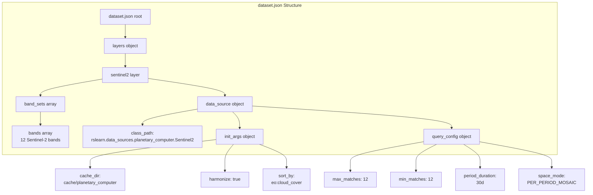
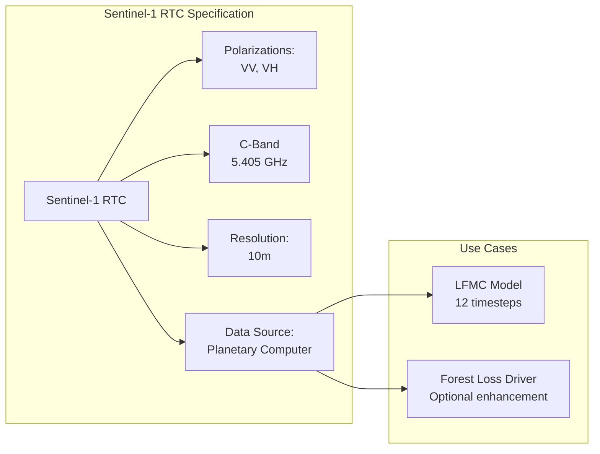
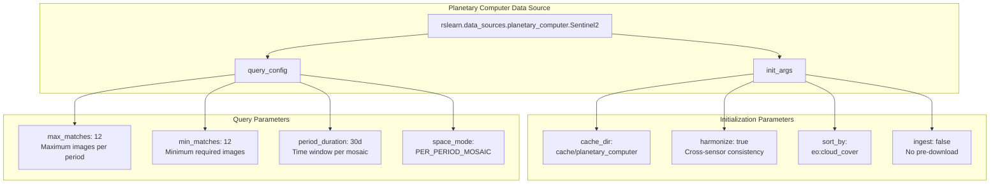
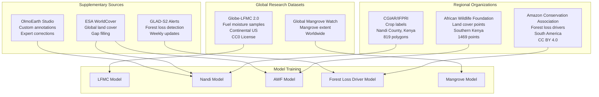
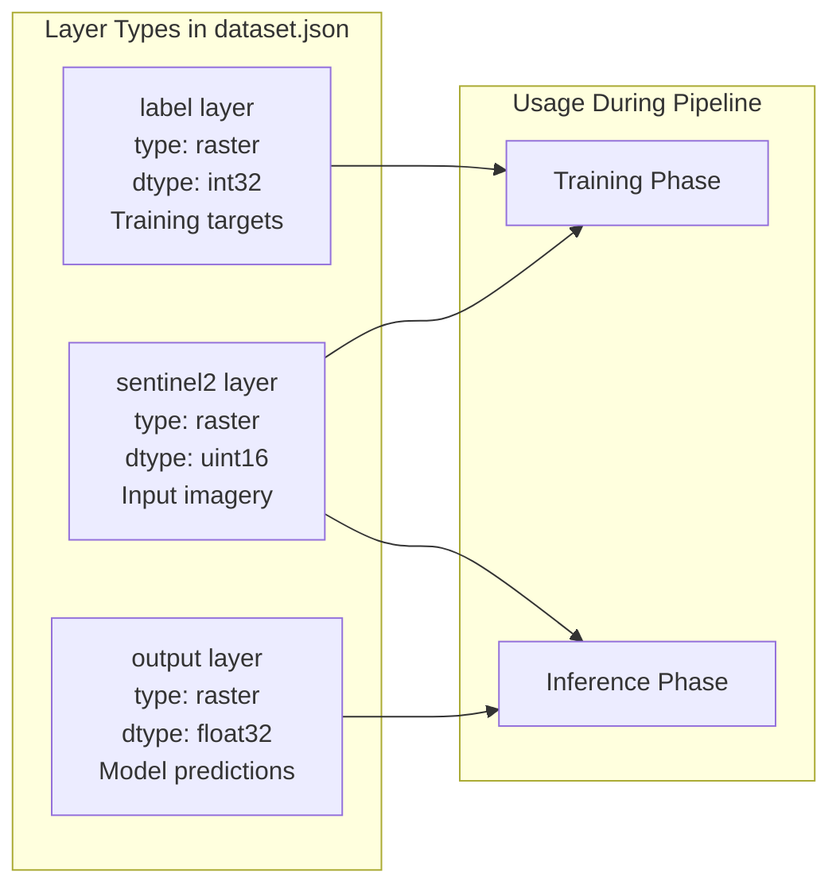

<!-- source: DeepWiki mcp.deepwiki.com · repo allenai/olmoearth_projects · page 8 Data Sources and Formats · fetched 2026-10-26 -->

# Data Sources and Formats

<details>
<summary>Relevant source files</summary>

The following files were used as context for generating this wiki page:

- [docs/awf.md](docs/awf.md)
- [docs/forest_loss_driver.md](docs/forest_loss_driver.md)
- [docs/lfmc.md](docs/lfmc.md)
- [docs/nandi.md](docs/nandi.md)
- [olmoearth_run_data/awf/dataset.json](olmoearth_run_data/awf/dataset.json)
- [olmoearth_run_data/forest_loss_driver/model.yaml](olmoearth_run_data/forest_loss_driver/model.yaml)
- [olmoearth_run_data/nandi/dataset.json](olmoearth_run_data/nandi/dataset.json)
- [olmoearth_run_data/nandi/prediction_request_geometry.geojson](olmoearth_run_data/nandi/prediction_request_geometry.geojson)

</details>


This document describes the satellite imagery and training label data sources used throughout the olmoearth_projects repository, along with their configuration formats and specifications. It covers Sentinel-2 and Sentinel-1 data acquisition through Microsoft's Planetary Computer, query configurations, band specifications, and training label sources. For information about how to set up and run inference pipelines, see [Inference and Deployment](#7). For details on dataset organization and splitting, see [Data Splitting and Organization](#4.3).

## Overview

All models in this repository utilize satellite imagery from the European Space Agency's Copernicus program, accessed through Microsoft's Planetary Computer STAC API. The primary data source is **Sentinel-2 L2A** (Level 2A atmospherically corrected surface reflectance), with some models also incorporating **Sentinel-1 RTC** (Radiometric Terrain Corrected) radar data. Training labels come from various authoritative sources including research institutions, conservation organizations, and field surveys.

Data sources are configured in `dataset.json` files located in each project's `olmoearth_run_data/{project}/` directory. These JSON files specify the layers, bands, data types, and query parameters used during both training and inference.

## Satellite Imagery Data Sources

### Sentinel-2 Level 2A

Sentinel-2 L2A provides multispectral optical imagery at 10-20 meter resolution with atmospheric correction already applied. This is the primary data source for all models in the repository.

**Dataset.json Configuration Structure:**



**Sources:** [olmoearth_run_data/awf/dataset.json:25-61](), [olmoearth_run_data/nandi/dataset.json:25-61]()

### Band Specifications

Sentinel-2 L2A provides 12 spectral bands that are used across all models:

| Band | Name | Wavelength (nm) | Resolution (m) | Description |
|------|------|-----------------|----------------|-------------|
| B01 | Coastal aerosol | 443 | 60 | Atmospheric correction |
| B02 | Blue | 490 | 10 | Visible blue |
| B03 | Green | 560 | 10 | Visible green |
| B04 | Red | 665 | 10 | Visible red |
| B05 | Red Edge 1 | 705 | 20 | Vegetation monitoring |
| B06 | Red Edge 2 | 740 | 20 | Vegetation monitoring |
| B07 | Red Edge 3 | 783 | 20 | Vegetation monitoring |
| B08 | NIR | 842 | 10 | Near-infrared |
| B8A | NIR Narrow | 865 | 20 | Narrow near-infrared |
| B09 | Water vapor | 945 | 60 | Atmospheric correction |
| B11 | SWIR 1 | 1610 | 20 | Moisture content |
| B12 | SWIR 2 | 2190 | 20 | Moisture content |

All bands are stored as `uint16` data type with digital numbers that can be converted to surface reflectance values. The band order in `dataset.json` configurations is:

```json
["B01", "B02", "B03", "B04", "B05", "B06", "B07", "B08", "B8A", "B09", "B11", "B12"]
```

**Sources:** [olmoearth_run_data/awf/dataset.json:28-41](), [olmoearth_run_data/nandi/dataset.json:28-41]()

### Sentinel-1 RTC (Radar Data)

Some models, particularly the LFMC (Live Fuel Moisture Content) model, incorporate Sentinel-1 Radiometric Terrain Corrected SAR data. Sentinel-1 provides C-band synthetic aperture radar imagery with VV and VH polarizations, which penetrates clouds and provides complementary information to optical imagery.



**Sources:** [docs/lfmc.md:16-20]()

## Planetary Computer Integration

All satellite data is accessed through Microsoft's Planetary Computer, which provides a STAC (SpatioTemporal Asset Catalog) API for querying and retrieving satellite imagery. The integration is handled by the `rslearn.data_sources.planetary_computer.Sentinel2` class.

### Data Source Configuration



**Sources:** [olmoearth_run_data/awf/dataset.json:45-58](), [olmoearth_run_data/nandi/dataset.json:45-58]()

### Key Configuration Parameters

| Parameter | Value | Purpose |
|-----------|-------|---------|
| `cache_dir` | `"cache/planetary_computer"` | Local cache directory for downloaded imagery tiles |
| `harmonize` | `true` | Apply harmonization to ensure cross-sensor consistency across Sentinel-2A and Sentinel-2B |
| `sort_by` | `"eo:cloud_cover"` | Prioritize scenes with lowest cloud cover |
| `ingest` | `false` | Do not pre-download data; fetch on-demand during training/inference |
| `max_matches` | `12` | Maximum number of images to retrieve per time period |
| `min_matches` | `12` | Minimum required images (will fail if insufficient coverage) |
| `period_duration` | `"30d"` | Duration of each time period for temporal mosaicking |
| `space_mode` | `"PER_PERIOD_MOSAIC"` | Create one cloud-free mosaic per time period |

**Sources:** [olmoearth_run_data/awf/dataset.json:48-58]()

### Temporal Mosaicking Strategy

The `PER_PERIOD_MOSAIC` space mode creates temporal composites by selecting the best pixels from multiple Sentinel-2 scenes within each 30-day period. This approach:

1. Divides the total time range into 30-day periods
2. Queries all available Sentinel-2 scenes within each period
3. Sorts scenes by cloud cover (lowest first)
4. Creates a mosaic by selecting cloud-free pixels from available scenes
5. Results in 12 timesteps for a one-year time range (360 days ÷ 30 days)

Different projects may use different period durations:
- **Standard models** (Nandi, AWF, Mozambique): 30-day periods → 12 timesteps per year
- **LFMC model**: 14-day periods → 12 timesteps for 168 days

**Sources:** [docs/nandi.md:14-15](), [docs/awf.md:14-15](), [docs/lfmc.md:16-20]()

## Training Label Sources

Training labels come from various authoritative sources depending on the application domain:

### Label Source Inventory



**Sources:** [docs/lfmc.md:27-40](), [docs/nandi.md:29-37](), [docs/awf.md:29-35](), [docs/forest_loss_driver.md:54-63]()

### Label Format by Source

| Source | Format | Geometry Type | Attributes | License |
|--------|--------|---------------|------------|---------|
| Globe-LFMC 2.0 | GeoJSON/CSV | Point | lon, lat, timestamp, fuel_type, LFMC value | CC0 |
| CGIAR/IFPRI | GPKG | Polygon | crop_type, survey_date | Proprietary |
| AWF | GeoJSON | Point | lon, lat, time_range, land_cover_type | Proprietary |
| Amazon Conservation | GeoJSON | Polygon | GLAD alert geometry, timestamp, driver_category | CC BY 4.0 |
| ESA WorldCover | Raster (GeoTIFF) | N/A | Land cover class (10m resolution) | CC BY 4.0 |
| GLAD-S2 | Raster (GeoTIFF) | N/A | Forest loss alerts (10m resolution) | Public |

**Sources:** [docs/lfmc.md:27-40](), [docs/nandi.md:29-37](), [docs/awf.md:29-35](), [docs/forest_loss_driver.md:54-63]()

### Data Augmentation from Multiple Sources

The Nandi model demonstrates a common pattern of combining multiple label sources:

1. **Primary source**: CGIAR/IFPRI field survey data (819 polygons)
2. **Gap filling**: ESA WorldCover for Water and Built-up classes (underrepresented in primary source)
3. **Expert correction**: OlmoEarth Studio annotations to correct Coffee/Tree misclassifications

This multi-source approach ensures balanced class representation and corrects systematic labeling errors.

**Sources:** [docs/nandi.md:29-33]()

## Data Formats

### GeoJSON for Annotations

Training annotations are stored in GeoJSON format with specific properties:

```json
{
  "type": "FeatureCollection",
  "features": [
    {
      "type": "Feature",
      "geometry": {
        "type": "Point" | "Polygon",
        "coordinates": [...]
      },
      "properties": {
        "category": "...",
        "timestamp": "...",
        "other_domain_specific_fields": "..."
      }
    }
  ]
}
```

**Inference Request Format:**

For inference, `prediction_request_geometry.geojson` specifies the spatial and temporal extent:

```json
{
  "type": "FeatureCollection",
  "features": [
    {
      "type": "Feature",
      "geometry": {
        "type": "Polygon",
        "coordinates": [[[lon1, lat1], [lon2, lat2], ...]]
      },
      "properties": {
        "oe_start_time": "2022-09-01T00:00:00Z",
        "oe_end_time": "2023-09-01T00:00:00Z"
      }
    }
  ]
}
```

**Sources:** [olmoearth_run_data/nandi/prediction_request_geometry.geojson:1-39]()

### GeoPackage (GPKG) for Raw Data

Field survey data and raw annotations are often provided in GeoPackage format, which is a SQLite-based geospatial data format. These are processed by scripts in the data processing pipeline to create training windows.

**Sources:** [docs/nandi.md:31-32]()

### GeoTIFF for Outputs

Model predictions and reference data are stored as GeoTIFF rasters:
- **Data type**: Varies by task (int32 for classification, float32 for regression)
- **Projection**: EPSG:3857 (Web Mercator) or local UTM zones
- **Resolution**: 10 meters per pixel
- **Bands**: Single band for most models, multiple bands for probability outputs

### rslearn Dataset Archives

Training datasets are packaged as `.tar` archives containing:
- `dataset.json` - Layer and data source specifications
- `windows.db` - SQLite database of training window metadata
- Rasterized label files (when labels are ingested)

These archives are distributed via HuggingFace Datasets and Google Cloud Storage.

**Sources:** [docs/nandi.md:10](), [docs/awf.md:10](), [docs/lfmc.md:12]()

## Dataset.json Layer Configuration

The `dataset.json` file defines three types of layers:



**Sources:** [olmoearth_run_data/awf/dataset.json:1-63](), [olmoearth_run_data/nandi/dataset.json:1-63]()

### Label Layer

Stores training labels (ground truth):
- **Band**: `category` (integer class indices)
- **Data type**: `int32`
- **Type**: `raster`

### Output Layer

Stores model predictions during inference:
- **Band**: `output` (predicted class or regression value)
- **Data type**: `float32`
- **Type**: `raster`

### Sentinel2 Layer

Defines the satellite imagery input:
- **Bands**: All 12 Sentinel-2 bands (B01-B12)
- **Data type**: `uint16` (digital numbers)
- **Type**: `raster`
- **Data source**: `rslearn.data_sources.planetary_computer.Sentinel2`

This layer is the most complex, containing the full Planetary Computer integration configuration including query parameters and harmonization settings.

**Sources:** [olmoearth_run_data/awf/dataset.json:25-61](), [olmoearth_run_data/nandi/dataset.json:25-61]()

## Time Series Configuration

Models use different temporal configurations depending on their application:

| Model | Time Period | Timesteps | Total Duration | Period Duration |
|-------|-------------|-----------|----------------|-----------------|
| Nandi | 2022-09 to 2023-09 | 12 | 1 year | 30 days |
| AWF | 2023-01 to 2023-12 | 12 | 1 year | 30 days |
| LFMC | 168 days ending at sample timestamp | 12 | 168 days | 14 days |
| Forest Loss Driver | Pre/post forest loss | 8 (4+4) | Variable | Variable |
| Mangrove | 1 year | 12 | 1 year | 30 days |

The Forest Loss Driver model uses a unique configuration with separate pre- and post-forest-loss time series:

```yaml
# From model.yaml
inputs:
  sentinel2_l2a:
    layers: [
      "pre_sentinel2", "pre_sentinel2.1", "pre_sentinel2.2", "pre_sentinel2.3",
      "post_sentinel2", "post_sentinel2.1", "post_sentinel2.2", "post_sentinel2.3"
    ]
```

**Sources:** [docs/nandi.md:35](), [docs/awf.md:33](), [docs/lfmc.md:35](), [olmoearth_run_data/forest_loss_driver/model.yaml:47]()

## Data Normalization

All input imagery is normalized using the `OlmoEarthNormalize` transform, which applies sensor-specific normalization based on statistics computed from the OlmoEarth pre-training dataset. This ensures consistency between pre-training and fine-tuning.

```yaml
# Standard normalization configuration
- class_path: rslearn.models.olmoearth_pretrain.norm.OlmoEarthNormalize
  init_args:
    band_names:
      sentinel2_l2a: ["B02", "B03", "B04", "B08", "B05", "B06", "B07", "B8A", "B11", "B12", "B01", "B09"]
```

**Sources:** [olmoearth_run_data/forest_loss_driver/model.yaml:75-78]()

---

