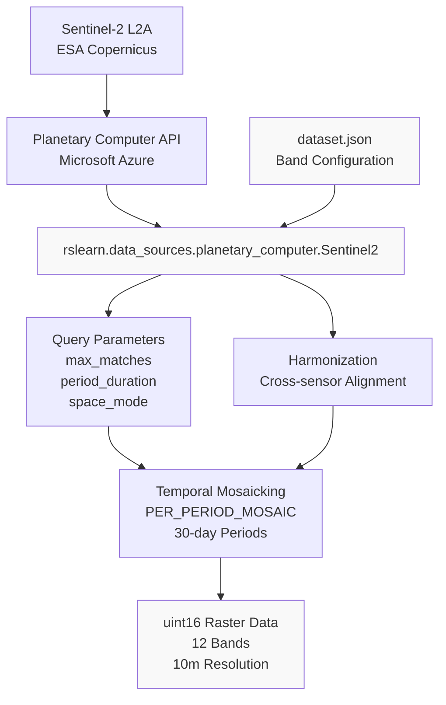
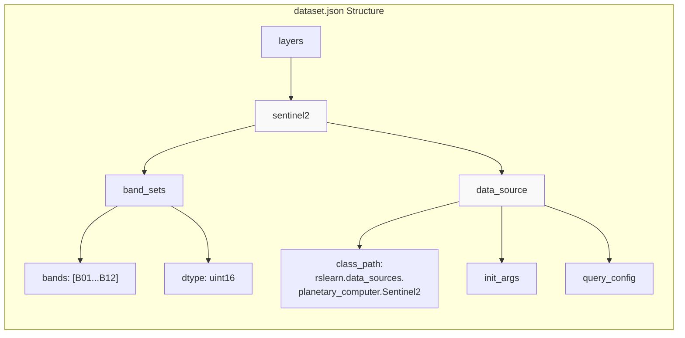
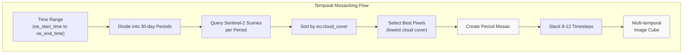
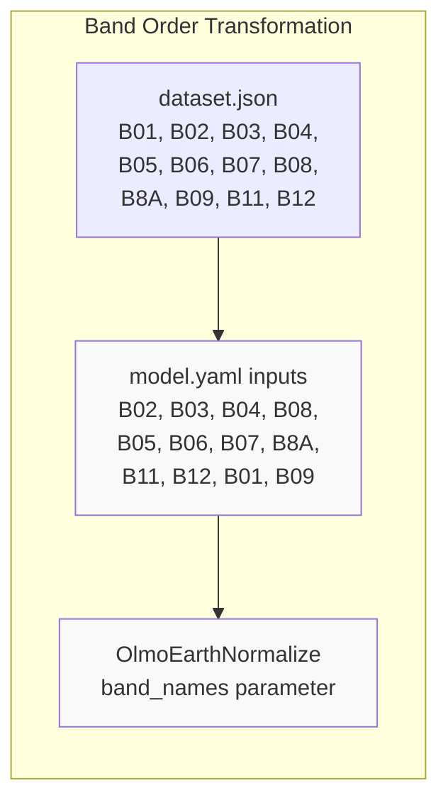
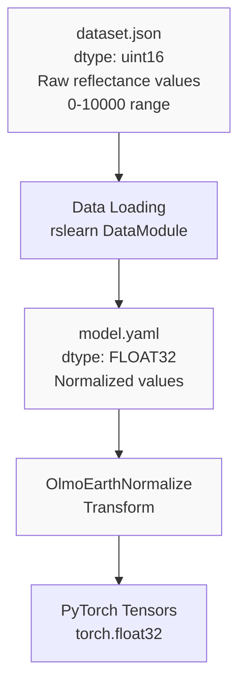
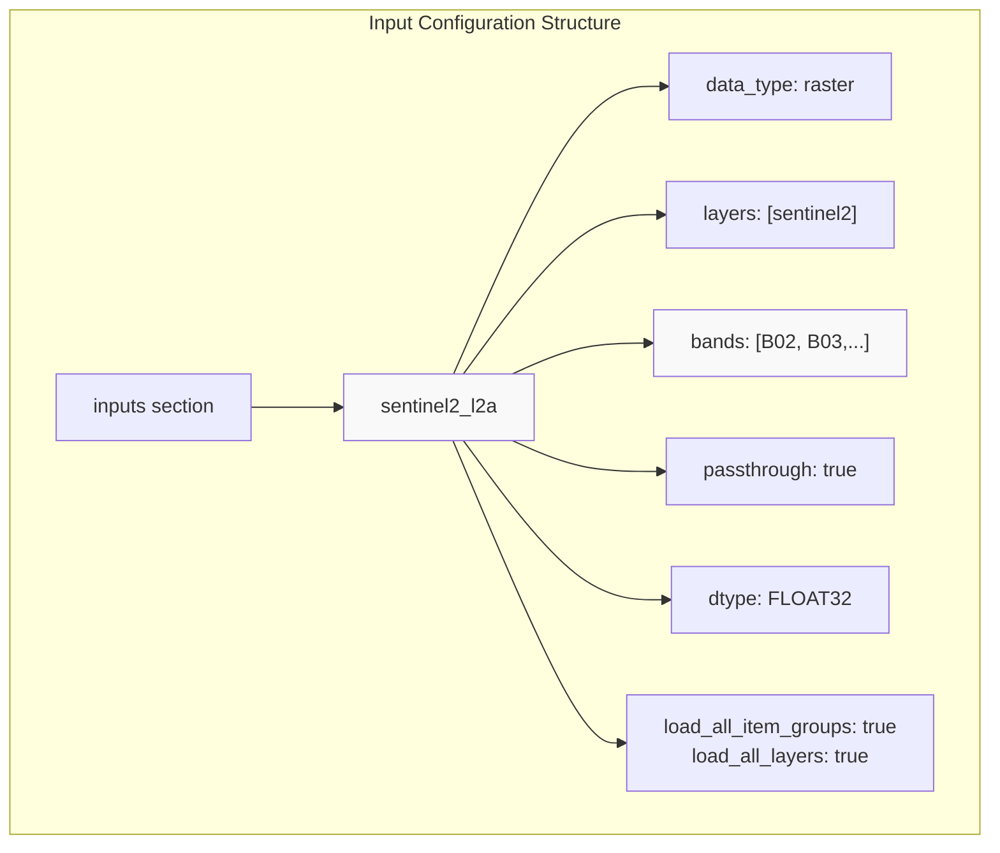

<!-- source: DeepWiki mcp.deepwiki.com · repo allenai/olmoearth_projects · page 8.1 Sentinel-2 L2A Data · fetched 2026-10-26 -->

# Sentinel-2 L2A Data

<details>
<summary>Relevant source files</summary>

The following files were used as context for generating this wiki page:

- [olmoearth_run_data/awf/dataset.json](olmoearth_run_data/awf/dataset.json)
- [olmoearth_run_data/mozambique_lulc/dataset.json](olmoearth_run_data/mozambique_lulc/dataset.json)
- [olmoearth_run_data/mozambique_lulc/model.yaml](olmoearth_run_data/mozambique_lulc/model.yaml)
- [olmoearth_run_data/mozambique_lulc/olmoearth_run.yaml](olmoearth_run_data/mozambique_lulc/olmoearth_run.yaml)
- [olmoearth_run_data/nandi/dataset.json](olmoearth_run_data/nandi/dataset.json)

</details>


## Purpose and Scope

This page documents the Sentinel-2 Level 2A (L2A) atmospheric correction data used as the primary optical imagery source across all models in the olmoearth_projects repository. It covers band specifications, query configurations, harmonization settings, temporal mosaicking strategies, and data type handling. For information about the Planetary Computer API used to access this data, see [Planetary Computer Integration](#8.2).

## Overview

Sentinel-2 L2A provides bottom-of-atmosphere reflectance imagery from the European Space Agency's Copernicus program. All models in this repository use a standardized 12-band configuration accessed via Microsoft's Planetary Computer, with consistent harmonization and temporal mosaicking applied.



**Sources:** [olmoearth_run_data/mozambique_lulc/dataset.json](), [olmoearth_run_data/awf/dataset.json](), [olmoearth_run_data/nandi/dataset.json]()

## Band Specifications

Sentinel-2 L2A data includes 13 spectral bands, but this repository uses a standardized subset of 12 bands across all models. The following table describes each band's characteristics:

| Band ID | Resolution | Wavelength (nm) | Description | Usage |
|---------|------------|-----------------|-------------|-------|
| B01 | 60m | 443 | Coastal aerosol | Atmospheric correction, water vapor |
| B02 | 10m | 490 | Blue | Visible spectrum, water bodies |
| B03 | 10m | 560 | Green | Visible spectrum, vegetation |
| B04 | 10m | 665 | Red | Visible spectrum, vegetation stress |
| B05 | 20m | 705 | Red Edge 1 | Vegetation classification |
| B06 | 20m | 740 | Red Edge 2 | Vegetation health |
| B07 | 20m | 783 | Red Edge 3 | Vegetation moisture |
| B08 | 10m | 842 | NIR | Near-infrared, biomass |
| B8A | 20m | 865 | Narrow NIR | Vegetation indices |
| B09 | 60m | 945 | Water vapor | Atmospheric correction |
| B11 | 20m | 1610 | SWIR 1 | Moisture content, soil |
| B12 | 20m | 2190 | SWIR 2 | Geology, land cover |

**Note:** Band B10 (1375nm, cirrus detection) is not used in this repository's models.

**Sources:** [olmoearth_run_data/mozambique_lulc/dataset.json:28-41](), [olmoearth_run_data/awf/dataset.json:28-41]()

## Data Source Configuration

Sentinel-2 data is configured in `dataset.json` files using the `rslearn.data_sources.planetary_computer.Sentinel2` class. The configuration defines band sets, data types, and access parameters.



**Sources:** [olmoearth_run_data/mozambique_lulc/dataset.json:25-61]()

### Standard Configuration Template

All Sentinel-2 layers in `dataset.json` follow this structure:

```json
"sentinel2": {
  "band_sets": [{
    "bands": ["B01", "B02", "B03", "B04", "B05", "B06", "B07", 
              "B08", "B8A", "B09", "B11", "B12"],
    "dtype": "uint16"
  }],
  "data_source": {
    "class_path": "rslearn.data_sources.planetary_computer.Sentinel2",
    "ingest": false,
    "init_args": {
      "cache_dir": "cache/planetary_computer",
      "harmonize": true,
      "sort_by": "eo:cloud_cover"
    },
    "query_config": {
      "max_matches": 8-12,
      "min_matches": 8-12,
      "period_duration": "30d",
      "space_mode": "PER_PERIOD_MOSAIC"
    }
  },
  "type": "raster"
}
```

**Sources:** [olmoearth_run_data/mozambique_lulc/dataset.json:25-61](), [olmoearth_run_data/awf/dataset.json:25-61]()

## Query Configuration Parameters

The `query_config` section controls how Sentinel-2 imagery is queried and aggregated over time and space:

| Parameter | Type | Values | Description |
|-----------|------|--------|-------------|
| `max_matches` | int | 8, 12 | Maximum number of timesteps to retrieve |
| `min_matches` | int | 8, 12 | Minimum required timesteps for valid data |
| `period_duration` | str | "30d" | Duration of each temporal period |
| `space_mode` | str | "PER_PERIOD_MOSAIC" | Spatial aggregation strategy |

### Temporal Mosaicking Strategy

The `PER_PERIOD_MOSAIC` mode creates composite images for each 30-day period by selecting the best pixels from all available scenes:



**Sources:** [olmoearth_run_data/mozambique_lulc/dataset.json:53-58]()

### Model-Specific Configurations

Different models use different numbers of timesteps based on their temporal requirements:

| Model | max_matches | min_matches | Purpose |
|-------|-------------|-------------|---------|
| Mozambique LULC | 8 | 8 | Single growing season coverage |
| AWF Land Cover | 12 | 12 | Full annual cycle |
| Nandi Crop Type | 12 | 12 | Complete crop phenology |

**Sources:** [olmoearth_run_data/mozambique_lulc/dataset.json:54-55](), [olmoearth_run_data/awf/dataset.json:54-55](), [olmoearth_run_data/nandi/dataset.json:54-55]()

## Harmonization

The `harmonize: true` setting in `init_args` enables cross-sensor radiometric consistency by applying the harmonization algorithm described in the Sentinel-2 documentation. This corrects for systematic differences between Sentinel-2A and Sentinel-2B satellites, ensuring consistent reflectance values across the time series.

**Harmonization Effects:**
- Adjusts Sentinel-2B band values to match Sentinel-2A reference
- Applies correction factors to visible and NIR bands
- Ensures temporal consistency when both satellites contribute to the same mosaic

**Sources:** [olmoearth_run_data/mozambique_lulc/dataset.json:50](), [olmoearth_run_data/awf/dataset.json:50]()

## Band Ordering in Model Inputs

While `dataset.json` defines bands in numerical order (B01-B12), the model inputs reorder bands for optimal processing. The `model.yaml` configuration specifies the exact band order used during training and inference:



**Standard Band Order in Model Inputs:**
```
["B02", "B03", "B04", "B08", "B05", "B06", "B07", "B8A", "B11", "B12", "B01", "B09"]
```

This ordering groups visible bands first (B02-B04), followed by NIR (B08), red edge bands (B05-B07, B8A), SWIR bands (B11-B12), and finally atmospheric bands (B01, B09).

**Sources:** [olmoearth_run_data/mozambique_lulc/model.yaml:40](), [olmoearth_run_data/mozambique_lulc/model.yaml:204]()

## Data Types and Conversions

Sentinel-2 data undergoes data type conversions at different stages of the pipeline:



### Data Type Specifications

| Stage | Data Type | Range | Location |
|-------|-----------|-------|----------|
| Storage | `uint16` | 0-10000 | dataset.json band_sets |
| Model Input | `FLOAT32` | 0.0-1.0 (after norm) | model.yaml inputs |
| Processing | `torch.float32` | Normalized | PyTorch tensors |

**Sources:** [olmoearth_run_data/mozambique_lulc/dataset.json:42](), [olmoearth_run_data/mozambique_lulc/model.yaml:42]()

## Input Configuration in model.yaml

The `model.yaml` file defines how Sentinel-2 data is consumed by the training and inference pipelines:



### Key Input Parameters

| Parameter | Value | Purpose |
|-----------|-------|---------|
| `data_type` | "raster" | Identifies as raster data |
| `layers` | ["sentinel2"] | References dataset.json layer name |
| `bands` | 12-element list | Specifies band order for model |
| `passthrough` | true | Passes data directly without modifications |
| `dtype` | FLOAT32 | Target data type for model processing |
| `load_all_item_groups` | true | Loads all temporal groups |
| `load_all_layers` | true | Loads all spatial layers |

**Sources:** [olmoearth_run_data/mozambique_lulc/model.yaml:36-44]()

## Normalization Transform

The `OlmoEarthNormalize` transform applies standardized normalization to Sentinel-2 bands:

```yaml
- class_path: rslearn.models.olmoearth_pretrain.norm.OlmoEarthNormalize
  init_args:
    band_names:
      sentinel2_l2a: ["B02", "B03", "B04", "B08", "B05", "B06", "B07", 
                      "B8A", "B11", "B12", "B01", "B09"]
```

This transform is applied in three contexts:
1. **Training transforms** - with augmentations (lines 219-222)
2. **Default config transforms** - for validation/test (lines 201-204)
3. **Predict config transforms** - for inference (lines 242-245)

**Sources:** [olmoearth_run_data/mozambique_lulc/model.yaml:201-204](), [olmoearth_run_data/mozambique_lulc/model.yaml:219-222](), [olmoearth_run_data/mozambique_lulc/model.yaml:242-245]()

## Caching and Performance

The Sentinel-2 data source configuration includes caching to improve performance:

```json
"init_args": {
  "cache_dir": "cache/planetary_computer",
  "harmonize": true,
  "sort_by": "eo:cloud_cover"
}
```

- **cache_dir**: Local directory for caching downloaded imagery tiles
- **sort_by**: Prioritizes scenes with lowest cloud cover
- **ingest**: Set to `false`, indicating data is queried on-demand rather than pre-ingested

**Sources:** [olmoearth_run_data/mozambique_lulc/dataset.json:49-51]()

## Resolution and Resampling

Sentinel-2 bands have native resolutions of 10m, 20m, or 60m. The system handles multi-resolution data by:

1. **Target Resolution**: All bands are resampled to 10m resolution as specified in `olmoearth_run.yaml`:
   ```yaml
   output_projection:
     class_path: rslearn.utils.geometry.Projection
     init_args:
       crs: EPSG:3857
       x_resolution: 10
       y_resolution: -10
   ```

2. **Resampling Method**: Planetary Computer's Sentinel-2 interface handles resampling automatically using bilinear interpolation for 20m and 60m bands.

**Sources:** [olmoearth_run_data/mozambique_lulc/olmoearth_run.yaml:60-65]()

---

