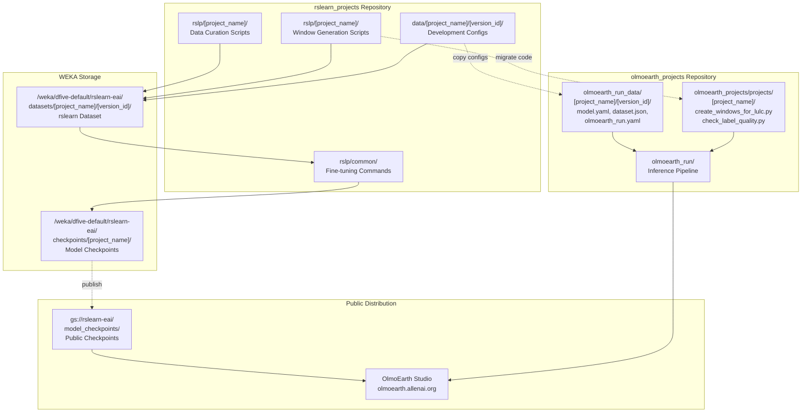
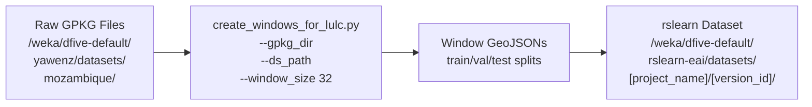
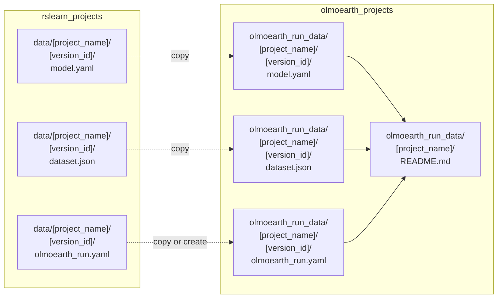
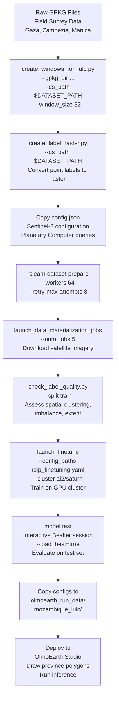

<!-- source: DeepWiki mcp.deepwiki.com · repo allenai/olmoearth_projects · page 9.1 Development Workflow · fetched 2026-10-26 -->

# Development Workflow

<details>
<summary>Relevant source files</summary>

The following files were used as context for generating this wiki page:

- [docs/internal.md](docs/internal.md)
- [olmoearth_run_data/mozambique_lulc/README.md](olmoearth_run_data/mozambique_lulc/README.md)
- [olmoearth_run_data/mozambique_lulc/config.json](olmoearth_run_data/mozambique_lulc/config.json)
- [olmoearth_run_data/sample/model.yaml](olmoearth_run_data/sample/model.yaml)
- [olmoearth_run_data/satlas_solar_farm/model.yaml](olmoearth_run_data/satlas_solar_farm/model.yaml)
- [tests/integration/olmoearth_run/test_olmoearth_run.py](tests/integration/olmoearth_run/test_olmoearth_run.py)

</details>


This document explains the bifurcated development workflow used in the olmoearth_projects ecosystem. The workflow separates research and experimentation activities (conducted in the `rslearn_projects` repository) from deployment and inference activities (conducted in this repository). This separation enables clean organization of experimental code while maintaining production-ready configurations and inference pipelines.

For information about model training configuration details, see [Training Configuration Files](#5.1). For details about the inference pipeline, see [olmoearth_run Pipeline](#7.1). For CI/CD processes, see [CI/CD Pipeline](#9.2).

## Repository Structure Overview

The development workflow spans two repositories with distinct purposes:

| Repository | Purpose | Key Contents |
|------------|---------|--------------|
| `rslearn_projects` | Research and development | Data curation scripts, programmatic window creation, experimental configs, fine-tuning job management |
| `olmoearth_projects` | Deployment and production | Production configs, inference scripts, supporting utilities, documentation |

This bifurcated structure enables:
- **Rapid experimentation** in `rslearn_projects` without affecting production systems
- **Clean production code** in `olmoearth_projects` with only deployment-relevant files
- **Version control** with separate commit histories for research vs. production
- **Clear handoff** from research to production stages



**Sources:** [docs/internal.md:1-29]()

## Development Phase

The development phase occurs in the `rslearn_projects` repository and focuses on data preparation, experimentation, and model training.

### Step 1: Data Curation

Data curation scripts are added to `rslp/[project_name]/` in `rslearn_projects`. These scripts typically:
- Process raw geospatial data (GPKG files, shapefiles)
- Generate training windows
- Create label rasters
- Perform spatial data splitting

Example location for Mozambique LULC:
- `rslp/mozambique_lulc/create_windows_for_lulc.py`
- `rslp/mozambique_lulc/create_label_raster.py`
- `rslp/mozambique_lulc/update_train_test_split.py`

**Sources:** [docs/internal.md:8-9](), [olmoearth_run_data/mozambique_lulc/README.md:14-37]()

### Step 2: Window Creation

Training windows are created from raw data using project-specific scripts:



The window creation process:
1. Reads point or polygon labels from GPKG files
2. Creates fixed-size windows (typically 32-1024 pixels)
3. Applies spatial data splitting using `SpatialDataSplitter`
4. Writes output windows as GeoJSON features

**Sources:** [olmoearth_run_data/mozambique_lulc/README.md:16-21]()

### Step 3: Configuration and Dataset Preparation

After window creation, configurations are added and the dataset is prepared:

1. **Copy `config.json`** to the dataset root at `/weka/dfive-default/rslearn-eai/datasets/[project_name]/[version_id]/config.json`
   - Defines data layers (Sentinel-2, labels, etc.)
   - Specifies data source configurations (Planetary Computer queries)
   - Sets tile storage parameters

2. **Run `rslearn dataset prepare`** to prepare the dataset:
   ```bash
   rslearn dataset prepare --root $DATASET_PATH --workers 64 \
     --no-use-initial-job --retry-max-attempts 8 --retry-backoff-seconds 60
   ```

3. **Launch data materialization jobs** to download satellite imagery:
   ```bash
   python -m rslp.main common launch_data_materialization_jobs \
     --image yawenzzzz/rslp20251112h --ds_path $DATASET_PATH \
     --clusters+=ai2/neptune-cirrascale --num_jobs 5
   ```

**Sources:** [olmoearth_run_data/mozambique_lulc/README.md:22-32](), [olmoearth_run_data/mozambique_lulc/config.json:1-69]()

### Step 4: Label Quality Assessment

Before training, label quality is assessed using utility scripts. These scripts should be added to the deployment repository for reusability:

```bash
python olmoearth_projects/projects/mozambique_lulc/check_label_quality.py \
  --ds_path /weka/dfive-default/rslearn-eai/datasets/crop/mozambique_lulc/20251202 \
  --split train
```

Quality metrics computed:
- **Label Imbalance**: Class distribution (should be balanced)
- **Spatial Clustering F1**: Measure of spatial autocorrelation
- **Spatial Extent**: Geographic coverage per class

**Sources:** [olmoearth_run_data/mozambique_lulc/README.md:51-115]()

### Step 5: Fine-tuning

Fine-tuning jobs are launched from `rslearn_projects` using the `rslp` command-line interface:

```bash
python -m rslp.main olmoearth_pretrain launch_finetune \
  --image_name yawenzzzz/rslp20251112h \
  --config_paths+=olmoearth_run_data/mozambique_lulc/rslp_finetuning.yaml \
  --cluster+=ai2/saturn \
  --rslp_project <MY_RSLP_PROJECT_NAME> \
  --experiment_id <MY_EXPERIMENT_ID>
```

Training configuration includes:
- **`model.yaml`**: Defines encoder (OlmoEarth), decoder, tasks
- **`rslp_finetuning.yaml`**: Specifies training parameters, callbacks, data paths
- Training runs on Beaker clusters (Saturn, Neptune-Cirrascale)
- Checkpoints saved to `/weka/dfive-default/rslearn-eai/checkpoints/`

**Sources:** [olmoearth_run_data/mozambique_lulc/README.md:117-123]()

### Step 6: Testing

Model testing is performed interactively on Beaker:

```bash
# Start interactive session with GPU
beaker session create --remote --bare --budget ai2/es-platform \
  --cluster ai2/saturn \
  --mount src=weka,ref=dfive-default,dst=/weka/dfive-default \
  --image beaker://yawenzzzz/rslp20251112h --gpus 1

# Navigate to working directory
cd /weka/dfive-default/gabrielt/olmoearth_projects

# Set environment variable
export RSLP_PREFIX=/weka/dfive-default/rslearn-eai

# Run test
python -m rslp.rslearn_main model test \
  --config olmoearth_run_data/mozambique_lulc/rslp_finetuning.yaml \
  --rslp_experiment <MY_EXPERIMENT_ID> \
  --rslp_project <MY_RSLP_PROJECT_NAME> \
  --force_log=true --load_best=true --verbose true
```

**Sources:** [olmoearth_run_data/mozambique_lulc/README.md:125-131]()

## Deployment Phase

Once model training is complete and validated, configurations and supporting code are migrated to `olmoearth_projects` for deployment.

### Step 1: Configuration Migration



Configuration files to copy:
- **`model.yaml`**: Contains `RslearnLightningModule` configuration with encoder/decoder definitions
- **`dataset.json`**: Defines data layers, query configurations, tile storage
- **`olmoearth_run.yaml`**: Specifies inference-specific settings like partitioning strategies

Each project directory should include a `README.md` documenting:
- Source of configurations
- Version history
- Dataset locations on WEKA
- Special notes about `olmoearth_run.yaml` settings

**Sources:** [docs/internal.md:18-26]()

### Step 2: Supporting Code Migration

Supporting code used during development may be migrated if needed for deployment:

```
olmoearth_projects/projects/[project_name]/
├── create_windows_for_lulc.py       # Window generation
├── check_label_quality.py           # Quality assessment
├── create_label_raster.py           # Label processing
└── update_train_test_split.py       # Data splitting
```

This code enables:
- Regenerating datasets with updated parameters
- Assessing label quality for new data
- Creating additional training windows
- CI/CD integration for quality checks

**Sources:** [docs/internal.md:22-23]()

### Step 3: Checkpoint Publication

For inference-only deployments (not requiring direct WEKA access):

```bash
# Copy from WEKA to Google Cloud Storage
gsutil cp /weka/dfive-default/rslearn-eai/checkpoints/[project_name]/[version].ckpt \
  gs://rslearn-eai/model_checkpoints/[project_name]/[version].ckpt
```

Checkpoint locations:
- **WEKA**: `/weka/dfive-default/rslearn-eai/checkpoints/[project_name]/`
- **GCS**: `gs://rslearn-eai/model_checkpoints/[project_name]/`
- **HuggingFace**: `allenai/OlmoEarth-v1-FT-[TaskName]-Base`

**Sources:** [docs/internal.md:24-26]()

### Step 4: OlmoEarth Studio Deployment

Models deployed to OlmoEarth Studio require:
- Checkpoint accessible from GCS
- Configuration files in `olmoearth_run_data/[project_name]/`
- `prediction_request_geometry.geojson` for spatial/temporal extent
- Metadata defining class mappings and visualization

**Sources:** [olmoearth_run_data/mozambique_lulc/README.md:133-135]()

## Practical Example: Mozambique LULC

The following diagram shows the complete workflow for the Mozambique LULC project:



**Key commands executed:**

```bash
# 1. Window creation
export DATASET_PATH=/weka/dfive-default/rslearn-eai/datasets/crop/mozambique_lulc/20251113
python create_windows_for_lulc.py --gpkg_dir /weka/dfive-default/yawenz/datasets/mozambique/train_test_samples \
  --ds_path $DATASET_PATH --window_size 32

# 2. Label rasterization
python create_label_raster.py --ds_path $DATASET_PATH

# 3. Dataset preparation
rslearn dataset prepare --root $DATASET_PATH --workers 64

# 4. Quality assessment
python check_label_quality.py --ds_path $DATASET_PATH --split train

# 5. Fine-tuning
python -m rslp.main olmoearth_pretrain launch_finetune \
  --config_paths+=olmoearth_run_data/mozambique_lulc/rslp_finetuning.yaml \
  --cluster+=ai2/saturn

# 6. Testing
python -m rslp.rslearn_main model test --config olmoearth_run_data/mozambique_lulc/rslp_finetuning.yaml
```

**Sources:** [olmoearth_run_data/mozambique_lulc/README.md:1-136]()

## Version Management

Dataset versions are tracked on WEKA with systematic naming:

```
/weka/dfive-default/rslearn-eai/datasets/[project_name]/[YYYYMMDD]/
```

Example from Mozambique LULC showing version evolution:

| Version | Changes | Location |
|---------|---------|----------|
| `20251023` | Initial version with train/test split from GPKG | `/weka/.../mozambique_lulc/20251023` |
| `20251113` | Added spatial validation split (val_ratio=0.2) | `/weka/.../mozambique_lulc/20251113` |
| `20251114` | Aligned dates across all provinces | `/weka/.../mozambique_lulc/20251114` |
| `20251202` | Aligned 8-month temporal coverage, updated val_ratio=0.1 | `/weka/.../mozambique_lulc/20251202` |

Each version directory contains:
- `config.json`: Data layer and source configuration
- `tiles/`: Materialized satellite imagery tiles
- `windows/`: Training window GeoJSON files organized by split
- `cache/`: Downloaded raw data cache

Version history should be documented in `data/[project_name]/README.md` in `rslearn_projects` and `olmoearth_run_data/[project_name]/README.md` in `olmoearth_projects`.

**Sources:** [olmoearth_run_data/mozambique_lulc/README.md:39-49](), [docs/internal.md:31-56]()

## Configuration Files Reference

The three key configuration files used across development and deployment:

### model.yaml Structure

Defines the model architecture and training parameters:

```yaml
trainer:
  callbacks:
    - class_path: lightning.pytorch.callbacks.ModelCheckpoint
    - class_path: rslearn.train.callbacks.freeze_unfreeze.FreezeUnfreeze
      init_args:
        module_selector: ["model", "encoder", 0]
        unfreeze_at_epoch: 20
        unfreeze_lr_factor: 10.0
  max_epochs: 500
  
model:
  class_path: rslearn.train.lightning_module.RslearnLightningModule
  init_args:
    model:
      class_path: rslearn.models.multitask.MultiTaskModel
      init_args:
        encoder:
          - class_path: rslearn.models.olmoearth_pretrain.model.OlmoEarth
            init_args:
              model_id: OLMOEARTH_V1_BASE
              patch_size: 8
        decoders:
          class:
            - class_path: rslearn.models.unet.UNetDecoder
            - class_path: rslearn.train.tasks.segmentation.SegmentationHead
    
data:
  class_path: rslearn.train.data_module.RslearnDataModule
  init_args:
    path: ${DATASET_PATH}
    batch_size: 8
    inputs:
      sentinel2_l2a:
        data_type: raster
        layers: ["sentinel2", "sentinel2.1", "sentinel2.2", "sentinel2.3"]
    task:
      class_path: rslearn.train.tasks.multi_task.MultiTask
```

**Sources:** [olmoearth_run_data/satlas_solar_farm/model.yaml:1-166]()

### dataset.json Structure

Defines data layers and acquisition configuration:

```json
{
  "layers": {
    "sentinel2": {
      "type": "raster",
      "data_source": {
        "name": "rslearn.data_sources.planetary_computer.Sentinel2",
        "harmonize": true,
        "query_config": {
          "max_matches": 8,
          "min_matches": 8,
          "period_duration": "30d",
          "space_mode": "PER_PERIOD_MOSAIC"
        }
      },
      "band_sets": [
        {
          "bands": ["B02", "B03", "B04", "B08"],
          "dtype": "uint16"
        }
      ]
    }
  },
  "tile_store": {
    "name": "file",
    "root_dir": "tiles"
  }
}
```

**Sources:** [olmoearth_run_data/mozambique_lulc/config.json:1-69]()

### olmoearth_run.yaml Structure

Defines inference-specific configuration (created during deployment phase):

```yaml
partition_strategies:
  partition_request_geometry:
    class_path: olmoearth_run.runner.tools.partitioners.grid_partitioner.GridPartitioner
    init_args:
      grid_size: 0.5
      
  prepare_window_geometries:
    class_path: olmoearth_run.runner.tools.partitioners.grid_partitioner.GridPartitioner
    init_args:
      grid_size: 256
      output_projection:
        x_resolution: 10
        y_resolution: -10
        
post_processing:
  process_window:
    class_path: olmoearth_run.runner.tools.post_processors.noop_raster.NoopRaster
  process_partition:
    class_path: olmoearth_run.runner.tools.post_processors.combine_geotiff.CombineGeotiff
```

**Sources:** [tests/integration/olmoearth_run/test_olmoearth_run.py:67-87]()

## Testing in Development Workflow

### Unit Testing

Quality assessment utilities are tested in CI:

```python
# tests/projects/mozambique_lulc/test_label_quality.py
def test_spatial_clustering():
    """Test spatial clustering metric computation."""
    
def test_label_imbalance():
    """Test label distribution calculation."""
    
def test_spatial_extent():
    """Test geographic coverage metrics."""
```

**Sources:** Reference to testing framework from [CI/CD Pipeline](#9.2)

### Integration Testing

End-to-end inference pipeline testing:

```python
# tests/integration/olmoearth_run/test_olmoearth_run.py
def test_olmoearth_run_solar_farm(tmp_path, monkeypatch):
    """Test olmoearth_run pipeline on small request geometry."""
    checkpoint_path = "gs://ai2-rslearn-projects-data/projects/..."
    
    # Customize configuration files
    config_dir = tmp_path / "config"
    # Copy dataset.json, create prediction_request_geometry.geojson
    # Modify model.yaml for smaller batch size
    
    # Run inference
    olmoearth_run(
        config_path=config_dir,
        scratch_path=scratch_dir,
        checkpoint_path=checkpoint_path,
    )
    
    # Verify output
    result_fname = result_dir / "*.tif"
    assert result_fname.exists()
```

**Sources:** [tests/integration/olmoearth_run/test_olmoearth_run.py:21-119]()

## Summary

The development workflow follows a clear progression:

1. **Development Phase** (in `rslearn_projects`)
   - Create data curation scripts
   - Generate training windows
   - Prepare datasets with `rslearn dataset prepare`
   - Assess label quality
   - Launch fine-tuning jobs on Beaker
   - Test models interactively

2. **Deployment Phase** (in `olmoearth_projects`)
   - Copy configuration files to `olmoearth_run_data/`
   - Migrate supporting code to `olmoearth_projects/projects/`
   - Publish checkpoints to GCS
   - Deploy to OlmoEarth Studio

3. **Version Control**
   - Track datasets on WEKA with date-based versions
   - Document version history in README files
   - Maintain separate commit histories for research vs. production

This bifurcated approach enables rapid experimentation while maintaining production stability and clear handoff between research and deployment stages.

**Sources:** [docs/internal.md:1-56](), [olmoearth_run_data/mozambique_lulc/README.md:1-136]()

---

