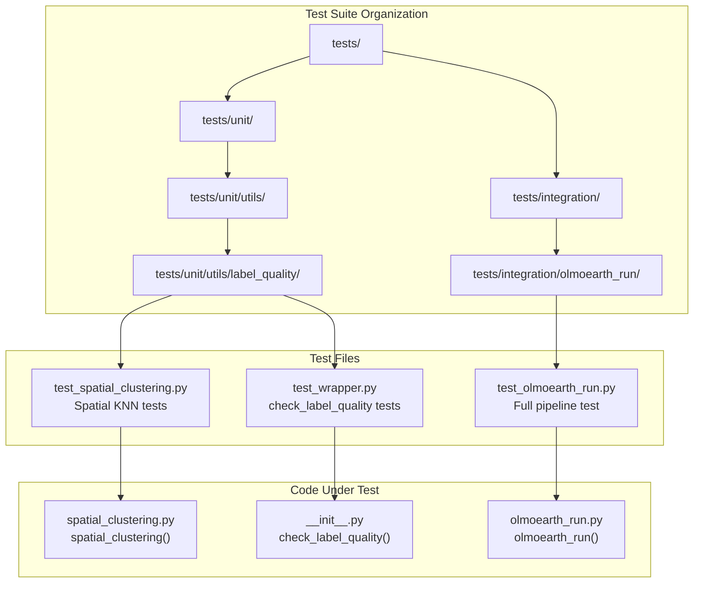
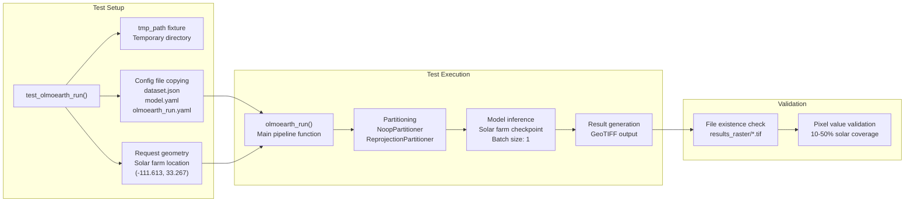
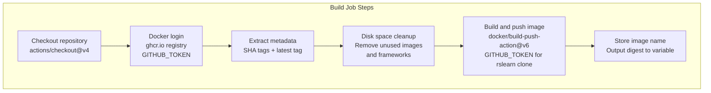
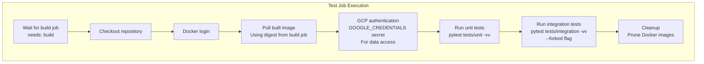

<!-- source: DeepWiki mcp.deepwiki.com · repo allenai/olmoearth_projects · page 9.3 Testing · fetched 2026-10-26 -->

# Testing

<details>
<summary>Relevant source files</summary>

The following files were used as context for generating this wiki page:

- [.github/workflows/build-test.yml](.github/workflows/build-test.yml)
- [docs/internal.md](docs/internal.md)
- [olmoearth_projects/utils/label_quality/__init__.py](olmoearth_projects/utils/label_quality/__init__.py)
- [olmoearth_projects/utils/label_quality/spatial_clustering.py](olmoearth_projects/utils/label_quality/spatial_clustering.py)
- [olmoearth_run_data/sample/model.yaml](olmoearth_run_data/sample/model.yaml)
- [olmoearth_run_data/satlas_solar_farm/model.yaml](olmoearth_run_data/satlas_solar_farm/model.yaml)
- [tests/integration/olmoearth_run/test_olmoearth_run.py](tests/integration/olmoearth_run/test_olmoearth_run.py)
- [tests/unit/utils/__init__.py](tests/unit/utils/__init__.py)
- [tests/unit/utils/label_quality/__init__.py](tests/unit/utils/label_quality/__init__.py)
- [tests/unit/utils/label_quality/test_spatial_clustering.py](tests/unit/utils/label_quality/test_spatial_clustering.py)
- [tests/unit/utils/label_quality/test_wrapper.py](tests/unit/utils/label_quality/test_wrapper.py)

</details>


This document describes the testing infrastructure in the olmoearth_projects repository, including unit tests for label quality utilities, integration tests for the inference pipeline, and the CI/CD workflow that executes tests automatically. For information about the CI/CD pipeline configuration and Docker environment, see [CI/CD Pipeline](#9.2) and [Docker Environment](#9.4). For details about the label quality assessment tools being tested, see [Label Quality Assessment](#4.2).

## Test Organization

The testing infrastructure is organized into two primary categories: unit tests and integration tests, executed through a GitHub Actions CI/CD pipeline.



**Sources**: [tests/unit/utils/label_quality/test_spatial_clustering.py:1-51](), [tests/unit/utils/label_quality/test_wrapper.py:1-23](), [tests/integration/olmoearth_run/test_olmoearth_run.py:1-119]()

## Unit Tests for Label Quality Utilities

Unit tests validate the label quality assessment functions that evaluate spatial clustering, label imbalance, and spatial extent. These utilities are critical for assessing the quality of training data before model fine-tuning.

### Spatial Clustering Tests

The `test_spatial_clustering.py` module contains tests for the `spatial_clustering()` function, which performs spatial K-nearest neighbors analysis to detect whether labels are spatially clustered.

#### Classification Tests

The function `test_spatial_clustering_classification()` validates the spatial clustering metric for classification tasks:

| Test Scenario | Input Labels | Expected F1 Score | Description |
|--------------|--------------|-------------------|-------------|
| Highly clustered | `["South", "South", "South", "North", "North"]` | `1.0` per class | Labels match geographic clustering |
| No clustering | `["Random", "Labels", "Totally", "Mixed", "Up"]` | `0.0` per class | Labels completely spatially mixed |

The test uses a synthetic dataset of South American cities where labels initially match their geographic regions (high clustering), then are randomized (no clustering). The function [tests/unit/utils/label_quality/test_spatial_clustering.py:7-29]() validates that F1 scores correctly reflect spatial clustering patterns.

#### Regression Tests

The function `test_spatial_clustering_regression()` validates the spatial clustering metric for regression tasks using mean squared error (MSE):

| Test Scenario | Input Values | Expected MSE | Description |
|--------------|--------------|--------------|-------------|
| Highly clustered | `[0.5, 0.5, 0.5, 1.5, 1.5]` | `0.0` | Values match geographic clustering |
| No clustering | `[1.5, 0.5, 2.5, 0.5, 1.5]` | `1.0` | Values spatially mixed |

The test [tests/unit/utils/label_quality/test_spatial_clustering.py:32-51]() creates a GeoDataFrame with point geometries and validates that MSE increases when labels are less spatially clustered.

**Implementation Details**: The `spatial_clustering()` function [olmoearth_projects/utils/label_quality/spatial_clustering.py:30-89]() implements spatial KNN using the Haversine distance formula [olmoearth_projects/utils/label_quality/spatial_clustering.py:10-27]() to compute great circle distances between points on Earth.

**Sources**: [tests/unit/utils/label_quality/test_spatial_clustering.py:1-51](), [olmoearth_projects/utils/label_quality/spatial_clustering.py:1-90]()

### Wrapper Function Tests

The `test_wrapper.py` module tests the `check_label_quality()` function, which provides a unified interface for running all label quality checks and displaying results in a formatted table.

The test function `test_label_quality_wrapper()` [tests/unit/utils/label_quality/test_wrapper.py:7-23]() validates:
- The function executes without errors when given valid input
- The `checks_to_run` parameter correctly filters which checks are executed
- The GeoDataFrame input validation works correctly

The `check_label_quality()` function [olmoearth_projects/utils/label_quality/__init__.py:14-61]() validates that input DataFrames contain required columns (`geometry` and `label`) and uses the Rich library to display results in a formatted console table [olmoearth_projects/utils/label_quality/__init__.py:46-60]().

**Sources**: [tests/unit/utils/label_quality/test_wrapper.py:1-23](), [olmoearth_projects/utils/label_quality/__init__.py:1-61]()

## Integration Tests for olmoearth_run Pipeline

Integration tests validate the complete inference pipeline, from request geometry definition through final output generation. These tests ensure that all components work together correctly in a production-like environment.

### Pipeline Test Architecture



**Sources**: [tests/integration/olmoearth_run/test_olmoearth_run.py:1-119]()

### Solar Farm Integration Test

The function `test_olmoearth_run_solar_farm()` [tests/integration/olmoearth_run/test_olmoearth_run.py:21-119]() validates the complete olmoearth_run pipeline using the solar farm segmentation model. The test performs the following operations:

#### Configuration Preparation

The test customizes configuration files for the test environment:

1. **Dataset Configuration**: Copies `dataset.json` without modification [tests/integration/olmoearth_run/test_olmoearth_run.py:36-40]()

2. **Request Geometry**: Creates a custom prediction request centered on a known solar farm location at coordinates `(-111.613, 33.267)` with a bounding box extending 0.01 degrees in each direction [tests/integration/olmoearth_run/test_olmoearth_run.py:43-64]()

3. **Partitioning Configuration**: Modifies `olmoearth_run.yaml` to use `NoopPartitioner` for the request geometry (treating the entire area as one partition) and `ReprojectionPartitioner` for window geometries with EPSG:3857 projection and 10m resolution [tests/integration/olmoearth_run/test_olmoearth_run.py:69-87]()

4. **Model Configuration**: Adjusts `model.yaml` to use batch size 1 to accommodate CI environment memory constraints [tests/integration/olmoearth_run/test_olmoearth_run.py:90-98]()

#### Pipeline Execution

The test executes the pipeline [tests/integration/olmoearth_run/test_olmoearth_run.py:104-108]() with:
- Config path pointing to the temporary directory with customized configurations
- Scratch path for intermediate and final outputs
- Checkpoint path to the trained solar farm model on Google Cloud Storage

#### Validation

The test validates output correctness [tests/integration/olmoearth_run/test_olmoearth_run.py:110-118]():
1. Verifies the results directory exists at `scratch/results/results_raster`
2. Confirms exactly one GeoTIFF file is generated
3. Reads the raster output using `rasterio`
4. Validates that solar farm pixels (value `1`) constitute between 10% and 50% of the total area

This range validation ensures the model is detecting the solar farm (>10% coverage) but not over-classifying (≤50% coverage) for this specific test location.

**Sources**: [tests/integration/olmoearth_run/test_olmoearth_run.py:21-119]()

## CI/CD Testing Pipeline

The GitHub Actions workflow automates testing on every push to `main` and on all pull requests. The pipeline consists of two jobs: `build` and `test`.

### Build Job



The build job [.github/workflows/build-test.yml:19-74]() performs these operations:

1. **Container Registry Login**: Authenticates to GitHub Container Registry using `GITHUB_TOKEN` [.github/workflows/build-test.yml:30-35]()

2. **Metadata Extraction**: Generates Docker image tags including SHA-based tags (long and short) and `latest` for the default branch [.github/workflows/build-test.yml:37-46]()

3. **Disk Space Cleanup**: Removes unused Docker images and system frameworks to prevent disk space issues during build [.github/workflows/build-test.yml:48-54]()

4. **Image Build and Push**: Builds the Docker image and pushes to `ghcr.io/allenai/olmoearth_projects` with `CLONE_GITHUB_TOKEN` passed as a build arg for accessing private rslearn repository [.github/workflows/build-test.yml:56-65]()

5. **Image Name Storage**: Saves the full image digest to job outputs for use in the test job [.github/workflows/build-test.yml:67-74]()

**Sources**: [.github/workflows/build-test.yml:19-74]()

### Test Job

The test job runs on `ubuntu-latest-m` (medium-sized runner) and executes both unit and integration tests inside the Docker container:



#### Test Execution Commands

**Unit Tests** [.github/workflows/build-test.yml:99-105]():
```bash
docker run --rm \
  -e CI="true" \
  ${{ needs.build.outputs.ghcr_docker_image }} \
  pytest tests/unit -vv
```

**Integration Tests** [.github/workflows/build-test.yml:107-115]():
```bash
docker run --rm \
  -e CI="true" \
  -v ${{env.GOOGLE_GHA_CREDS_PATH}}:/tmp/gcp-credentials.json:ro \
  -e GOOGLE_APPLICATION_CREDENTIALS=/tmp/gcp-credentials.json \
  ${{ needs.build.outputs.ghcr_docker_image }} \
  pytest tests/integration -vv --forked
```

Key differences for integration tests:
- **Volume Mount**: Mounts GCP credentials JSON file into the container [.github/workflows/build-test.yml:112]()
- **Environment Variable**: Sets `GOOGLE_APPLICATION_CREDENTIALS` to enable access to Google Cloud Storage for model checkpoints and test data [.github/workflows/build-test.yml:113]()
- **Forked Execution**: Uses `--forked` flag to run tests in separate processes, providing isolation for resource-intensive tests [.github/workflows/build-test.yml:115]()

**Sources**: [.github/workflows/build-test.yml:76-122]()

## Running Tests Locally

### Unit Tests

To run unit tests locally with the same environment as CI:

```bash
# Build the Docker image
docker build -t olmoearth_projects .

# Run unit tests
docker run --rm olmoearth_projects pytest tests/unit -vv
```

For development without Docker, install dependencies and run directly:

```bash
# Install dependencies using uv
uv sync

# Run unit tests
uv run pytest tests/unit -vv

# Run specific test module
uv run pytest tests/unit/utils/label_quality/test_spatial_clustering.py -vv
```

### Integration Tests

Integration tests require GCP credentials to access model checkpoints and satellite data:

```bash
# Set GCP credentials path
export GOOGLE_APPLICATION_CREDENTIALS=/path/to/credentials.json

# Run integration tests with Docker
docker run --rm \
  -v $GOOGLE_APPLICATION_CREDENTIALS:/tmp/gcp-credentials.json:ro \
  -e GOOGLE_APPLICATION_CREDENTIALS=/tmp/gcp-credentials.json \
  olmoearth_projects pytest tests/integration -vv --forked

# Or run directly with uv
uv run pytest tests/integration -vv --forked
```

**Sources**: Derived from [.github/workflows/build-test.yml:99-115]()

## Test Configuration and Dependencies

### pytest Configuration

The repository uses `pytest` as the test framework with the following key features:

| Feature | Purpose | Implementation |
|---------|---------|----------------|
| Fixtures | Temporary directories for test isolation | `tmp_path` fixture in integration tests |
| Parametrization | Test multiple scenarios with one function | Not currently used but available |
| Verbose output | Detailed test execution logs | `-vv` flag in CI and local runs |
| Forked execution | Process isolation for integration tests | `--forked` flag with `pytest-forked` plugin |
| Monkeypatching | Environment variable mocking | Used to disable W&B in tests |

### Test Dependencies

Tests require several external dependencies:

- **Core Testing**: `pytest`, `pytest-forked` for test execution
- **Geospatial**: `geopandas`, `rasterio`, `shapely` for geospatial data validation
- **ML/Data**: `numpy`, `pandas`, `torch` for numerical validation
- **Infrastructure**: `upath` for universal path handling, `pyyaml` for config manipulation

The test environment also requires access to:
- **Google Cloud Storage**: For model checkpoints (e.g., `gs://ai2-rslearn-projects-data/projects/`)
- **Planetary Computer**: For satellite imagery access during integration tests

**Sources**: [tests/integration/olmoearth_run/test_olmoearth_run.py:1-19](), [tests/unit/utils/label_quality/test_spatial_clustering.py:1-5](), [.github/workflows/build-test.yml:94-115]()

## Test Coverage and Gaps

### Current Coverage

The test suite currently covers:

1. **Label Quality Utilities** (High Coverage):
   - Spatial clustering for classification and regression
   - Wrapper function execution and parameter filtering
   - GeoDataFrame input validation

2. **olmoearth_run Pipeline** (Moderate Coverage):
   - Complete pipeline execution for solar farm model
   - Configuration file customization
   - Output validation for classification tasks

### Known Gaps

Areas that could benefit from additional test coverage:

| Component | Current Status | Recommendation |
|-----------|---------------|----------------|
| Label imbalance checks | No dedicated tests | Add tests to validate imbalance metrics |
| Spatial extent checks | No dedicated tests | Add tests for extent calculation |
| Multiple partitioning strategies | Only Noop/Reprojection tested | Test GridPartitioner variants |
| Post-processing operations | Indirectly tested | Add explicit tests for CombineGeotiff |
| Error handling | Limited coverage | Add tests for invalid inputs and edge cases |
| Regression models | Not integration tested | Add test for LFMC or similar model |

**Sources**: Inferred from [tests/unit/utils/label_quality/]() and [tests/integration/olmoearth_run/test_olmoearth_run.py:1-119]()

---

