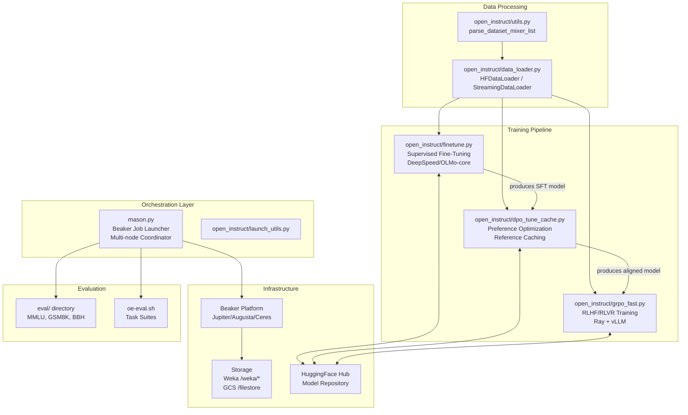
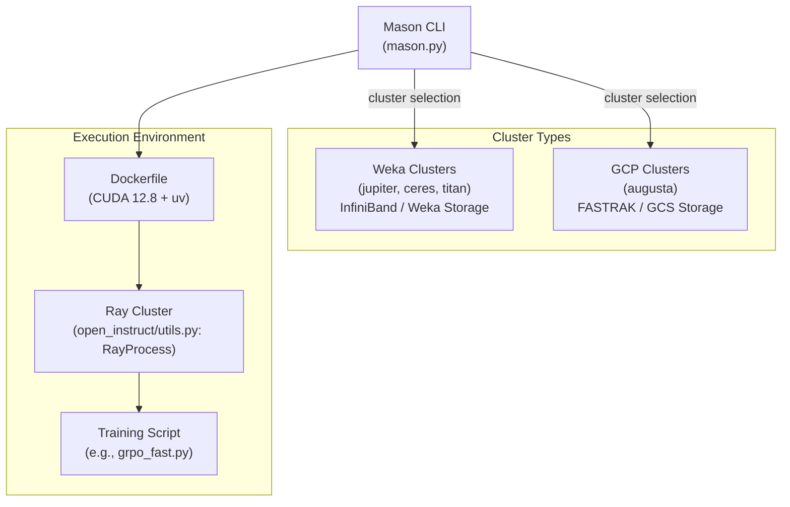

<!-- source: DeepWiki mcp.deepwiki.com · repo allenai/open-instruct · page 1 Overview · fetched 2026-10-26 -->

# Overview

Relevant source files

The following files were used as context for generating this wiki page:

- [CHANGELOG.md](CHANGELOG.md)
- [CLAUDE.md](CLAUDE.md)
- [CONTRIBUTING.md](CONTRIBUTING.md)
- [Dockerfile](Dockerfile)
- [README.md](README.md)
- [mason.py](mason.py)
- [open_instruct/benchmark_generators.py](open_instruct/benchmark_generators.py)
- [open_instruct/data_loader.py](open_instruct/data_loader.py)
- [open_instruct/data_types.py](open_instruct/data_types.py)
- [open_instruct/grpo_fast.py](open_instruct/grpo_fast.py)
- [open_instruct/test_grpo_fast.py](open_instruct/test_grpo_fast.py)
- [open_instruct/test_vllm_utils.py](open_instruct/test_vllm_utils.py)
- [open_instruct/vllm_utils.py](open_instruct/vllm_utils.py)
- [pyproject.toml](pyproject.toml)
- [requirements.txt](requirements.txt)
- [test_mason.py](test_mason.py)
- [uv.lock](uv.lock)

## Purpose and Scope

Open Instruct is a research codebase for training instruction-following language models through a multi-stage pipeline combining supervised fine-tuning (SFT), preference alignment (DPO), and reinforcement learning (RLHF/RLVR). The repository provides production-ready implementations of training methods, along with infrastructure for distributed training on Beaker clusters and comprehensive evaluation systems.

The codebase is designed to support the development of models like **TÜLU 3**, focusing on open post-training techniques including GRPO for reinforcement learning with verifiable rewards [README.md:3-17]().

This overview introduces the core architecture, training stages, and infrastructure components. For detailed information on specific topics:
- Installation and environment setup: see [Installation and Setup](#1.1)
- Individual training methods: see [Core Training Systems](#2)
- Job submission and cluster management: see [Job Orchestration and Infrastructure](#5)
- Evaluation workflows: see [Evaluation System](#6)

**Sources:** [pyproject.toml:1-4](), [README.md:3-17](), [open_instruct/grpo_fast.py:83-100]()

---

## High-Level Architecture

The repository is organized around a training pipeline where each stage builds on the previous one. The architecture consists of training systems, orchestration infrastructure, data processing pipelines, and evaluation frameworks, all coordinated through Beaker cluster management via `mason.py`.

### System Components and Data Flow

**Sources:** [mason.py:27-33](), [README.md:7-13](), [open_instruct/data_loader.py:72-100](), [CHANGELOG.md:16-17]()

---

## Three-Stage Training Pipeline

### Stage 1: Supervised Fine-Tuning (SFT)

The first stage adapts a base language model to follow instructions. The primary script is `open_instruct/finetune.py`. Additionally, `olmo_core_finetune.py` provides a specialized path for OLMo-core models using FSDP2 [CHANGELOG.md:27-28]().

**Key Features:**
- DeepSpeed ZeRO-2/ZeRO-3 optimization for memory efficiency [mason.py:41-46]().
- Support for LoRA and QLoRA via `peft` integration [README.md:40]().
- Efficient dataset conversion to numpy artifacts for OLMo-core paths [CHANGELOG.md:33]().

**Sources:** [open_instruct/finetune.py:1-50](), [CHANGELOG.md:27-33]()

### Stage 2: Direct Preference Optimization (DPO)

The second stage aligns the model with human preferences using paired data. The implementation in `open_instruct/dpo_tune_cache.py` optimizes memory by caching reference model logprobs [mason.py:32]().

**Key Features:**
- Reference model caching strategy to reduce compute during preference optimization.
- Support for multiple loss variants including DPO, SimPO, and WPO [CHANGELOG.md:8-11]().
- Integration with FSDP/TP for large-scale preference tuning.

**Sources:** [mason.py:29-36](), [CHANGELOG.md:8-11]()

### Stage 3: Reinforcement Learning (RLHF/RLVR)

The final stage uses reinforcement learning to optimize for verifiable rewards (RLVR). The primary implementation is `open_instruct/grpo_fast.py`, which utilizes Ray for distributed coordination and vLLM for high-throughput generation [open_instruct/grpo_fast.py:65-83]().

**Key Features:**
- **GRPO (Group Relative Policy Optimization)**: Efficient RL that computes rewards relative to a group of samples, eliminating the need for a separate value function [CHANGELOG.md:8-11]().
- **vLLM Integration**: High-performance generation using `vllm_utils.py` and native weight transfer via `NCCLWeightTransferEngine` [open_instruct/vllm_utils.py:45-48](), [CHANGELOG.md:36]().
- **Verifiable Rewards**: Built-in verifiers for math and code execution via `ground_truth_utils.py` [open_instruct/grpo_fast.py:100-101]().

**Sources:** [open_instruct/grpo_fast.py:1-130](), [open_instruct/vllm_utils.py:1-125](), [CHANGELOG.md:12-15]()

---

## Infrastructure and Cluster Management

### Beaker Integration via Mason

The repository uses Beaker as the primary job orchestration platform, managed through `mason.py`. It handles cluster selection, environment configuration, and multi-node setup.

**Key Orchestration Features:**
- **Resumable Jobs**: `mason.py` tracks resumable commands like `grpo_fast.py` to handle preemptions [mason.py:38]().
- **Resource Planning**: `grpo_fast_resource_plan.py` manages GPU allocation between trainers and vLLM inference engines [open_instruct/grpo_fast.py:83-84]().
- **Storage Management**: Automated paths for Weka and GCS checkpointing [mason.py:165-176]().

**Sources:** [mason.py:1-188](), [open_instruct/grpo_fast.py:160-187](), [CHANGELOG.md:17-18]()

### Docker Environment

Training jobs run in containerized environments built from the repository's `Dockerfile`.

**Key Components:**
- **Base**: `nvidia/cuda:12.8.1-devel-ubuntu22.04` [Dockerfile:1]().
- **Drivers**: DOCA OFED user-space drivers for InfiniBand networking [Dockerfile:23-38]().
- **Package Manager**: `uv` for fast, reproducible dependency resolution [Dockerfile:61](), [pyproject.toml:105-117]().
- **Cloud Tools**: Google Cloud CLI and Beaker CLI [Dockerfile:40-59]().

**Sources:** [Dockerfile:1-89](), [pyproject.toml:1-48]()

---

## Data Processing Pipeline

The pipeline handles dataset loading, mixing, tokenization, and caching.

**Data Loading Components:**
- `HFDataLoader`: Wraps HuggingFace datasets for `olmo-core` compatibility [open_instruct/data_loader.py:72-100]().
- `StreamingDataLoader`: Handles asynchronous data preparation for RL training [open_instruct/data_loader.py:38-46]().
- `parse_dataset_mixer_list`: Shared utility for parsing proportional dataset mixtures [CHANGELOG.md:16]().

**Sources:** [open_instruct/data_loader.py:1-158](), [CHANGELOG.md:16-25]()

---

## Repository Structure

The codebase is organized into functional directories:

- `open_instruct/`: Core training logic, model utilities, and dataset transformation [open_instruct/grpo_fast.py](), [open_instruct/vllm_utils.py]().
- `scripts/`: Entry points for training, data preparation, and benchmarking [CHANGELOG.md:12]().
- `configs/`: YAML configurations for DeepSpeed and specific training runs [Dockerfile:77]().
- `eval/`: Implementation of standard benchmarks (MMLU, GSM8K, etc.) [Dockerfile:81]().
- `docs/`: Technical documentation and case studies [README.md:13-17]().
- `decontamination/`: Tools for detecting train/test overlap.

**Sources:** [Dockerfile:76-81](), [README.md:11-17](), [pyproject.toml:54-55]()

---

## Next Steps

For detailed information on specific components:
- **Environment Setup**: See [Installation and Setup](#1.1) for dependency installation and configuration.
- **Training Methods**: See [Core Training Systems](#2) for detailed documentation of SFT, DPO, and RLHF.
- **Job Orchestration**: See [Mason: Beaker Job Launcher](#5.1) for cluster configuration and job submission.
- **Data Processing**: See [Dataset Transformation and Tokenization](#4.1) for data pipeline details.
- **Evaluation**: See [Evaluation Orchestration](#6.1) for evaluation system usage.

---

