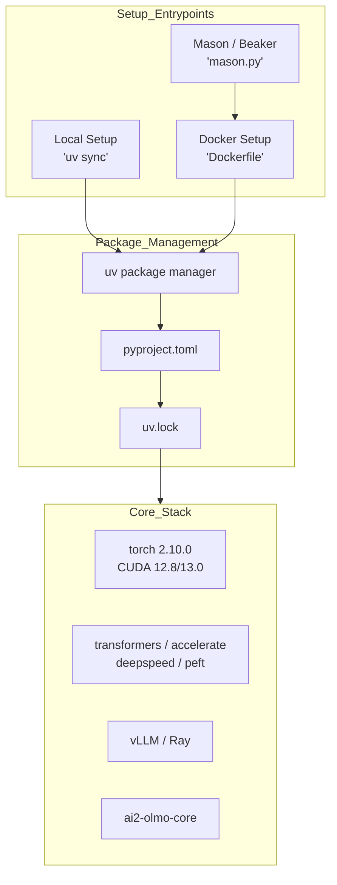
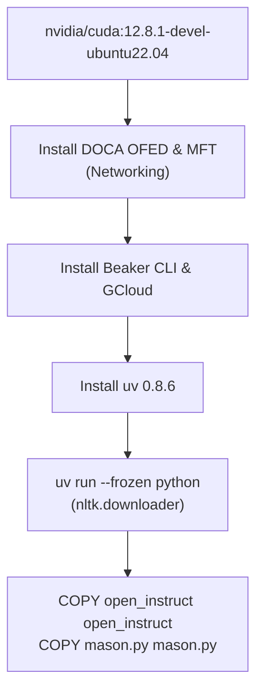
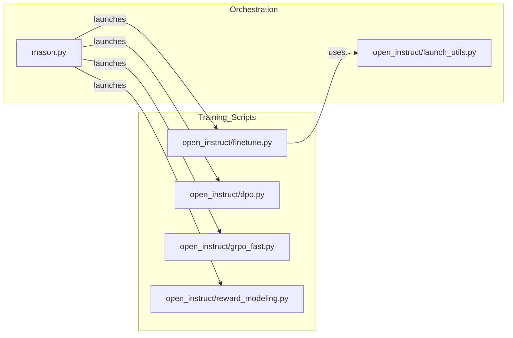

<!-- source: DeepWiki mcp.deepwiki.com · repo allenai/open-instruct · page 1.1 Installation and Setup · fetched 2026-10-26 -->

# Installation and Setup

<details>
<summary>Relevant source files</summary>

The following files were used as context for generating this wiki page:

- [.claude/commands/run-gpu-tests.md](.claude/commands/run-gpu-tests.md)
- [.pre-commit-config.yaml](.pre-commit-config.yaml)
- [Dockerfile](Dockerfile)
- [README.md](README.md)
- [mason.py](mason.py)
- [pyproject.toml](pyproject.toml)
- [requirements.txt](requirements.txt)
- [test_mason.py](test_mason.py)
- [uv.lock](uv.lock)

</details>


This document provides comprehensive guidance for setting up the `open-instruct` development environment, covering dependency management via `uv`, containerization with Docker, and environment configuration for training instruction-following language models.

The `open-instruct` framework integrates several high-performance ML libraries including PyTorch, Hugging Face Transformers, vLLM, and Ray. Due to the complexity of these dependencies and their hardware requirements (specifically CUDA), this page details the recommended paths for local and containerized setup.

## Installation Overview

The repository uses `uv` as its primary package manager to ensure reproducible environments across different platforms. The setup process involves resolving Python dependencies, configuring CUDA support for GPU-accelerated training, and setting up development tools for linting and testing.

### Training Pipeline Flow
The installation supports a multi-stage training pipeline from Supervised Fine-Tuning (SFT) to Direct Preference Optimization (DPO) and Reinforcement Learning from Human Feedback (RLHF/GRPO).



**Installation Method Selection:**
- **Local Installation**: Best for code exploration and lightweight testing.
- **Docker Installation**: Recommended for consistent training environments across clusters.
- **Mason/Beaker**: Used for large-scale distributed training at AI2, automating image building and job submission [mason.py:112-155]().

Sources: [pyproject.toml:1-48](), [Dockerfile:61-73](), [mason.py:29-36]()

## Prerequisites

### System Requirements

| Component | Requirement | Notes |
|-----------|-------------|-------|
| **Python** | `==3.12.*` | Strict versioning enforced in [pyproject.toml:6](). |
| **CUDA** | 12.8 or 13.0 | Required for GPU training; see [pyproject.toml:79-87](). |
| **Platform** | Linux / macOS | Linux (x86_64/aarch64) is required for `vllm` and `flash-attn` [pyproject.toml:32-41](). |

### Key Dependencies

The project relies on a specific set of libraries for its training pipeline:
- **Accelerate & DeepSpeed**: For distributed training and memory optimization [pyproject.toml:8-14]().
- **vLLM & Ray**: Used for fast inference and distributed resource management during RLHF/GRPO loops [pyproject.toml:27-32]().
- **ai2-olmo-core**: Integration for OLMo-specific training modules and FSDP2 support [pyproject.toml:21](), [pyproject.toml:70]().
- **Flash Attention**: Optimized attention kernels (v2, v3, and v4) for Linux systems [pyproject.toml:36-40]().

Sources: [pyproject.toml:1-48](), [requirements.txt:5-10]()

## Local Installation with uv

`uv` is the required tool for managing the virtual environment and dependencies.

### 1. Install uv
If not already installed, follow the [official instructions](https://github.com/astral-sh/uv):
```bash
curl -LsSf https://astral.sh/uv/install.sh | sh
```

### 2. Setup Environment
Clone the repository and synchronize the environment. `uv` will automatically download the correct Python version (3.12) and install dependencies into a `.venv` directory.

```bash
git clone https://github.com/allenai/open-instruct.git
cd open-instruct
uv sync --all-extras
```

The synchronization process respects the `uv.lock` file, ensuring every developer uses the same package versions across different architectures [uv.lock:1-13]().

### 3. Verification
Verify that the environment is correctly set up with GPU support:
```bash
uv run python -c "import torch; print(torch.cuda.is_available())"
```

Sources: [pyproject.toml:6-7](), [uv.lock:1-13](), [README.md:48-54]()

## Docker Installation

The `Dockerfile` provides a production-ready environment based on Ubuntu 22.04 and CUDA 12.8 [Dockerfile:1]().

### Docker Build Logic

The build process includes several optimizations for high-performance networking and AI2 infrastructure:
- **Driver Support**: Installs DOCA OFED user-space drivers for InfiniBand networking [Dockerfile:23-38]().
- **Tooling**: Includes `beaker` CLI and `google-cloud-sdk` for job management and data access [Dockerfile:40-59]().
- **Dependency Caching**: Uses Docker build mounts to cache the `UV_CACHE_DIR`, significantly speeding up subsequent builds [Dockerfile:71-74]().

### Natural Language to Code Entity Mapping: Docker Build



Sources: [Dockerfile:1-89](), [pyproject.toml:105-116]()

## Environment Variables

The codebase and orchestration scripts utilize several environment variables to control behavior:

| Variable | Default | Purpose |
|----------|---------|---------|
| `HF_HUB_ENABLE_HF_TRANSFER` | `1` | Enables fast downloads via `hf-transfer` [Dockerfile:66](). |
| `VLLM_DISABLE_COMPILE_CACHE` | `1` | Disables vLLM compilation cache to avoid corruption in multi-node setups [mason.py:103](). |
| `NCCL_DEBUG` | `ERROR` | Controls NCCL logging verbosity [mason.py:104](). |
| `RAY_CGRAPH_get_timeout` | `300` | Timeout for Ray Compiled Graph initialization [mason.py:102](). |

Sources: [mason.py:101-107](), [Dockerfile:65-68]()

## Development Workflow

### Code Quality and Linting
The project uses `ruff` for linting and formatting, with configurations defined in `pyproject.toml` [pyproject.toml:143-182](). Pre-commit hooks are also configured to enforce these standards before commits [ .pre-commit-config.yaml:1-44]().

```bash
# Run linting
uv run ruff check open_instruct/

# Run formatting
uv run ruff format open_instruct/
```

### Testing
Tests are managed via `pytest`. Some tests are ignored by default (e.g., internal evaluation suites) [pyproject.toml:131-136](). GPU tests can be launched manually on Beaker using specialized scripts [.claude/commands/run-gpu-tests.md:1-3]().

```bash
uv run pytest
```

Sources: [pyproject.toml:118-129](), [pyproject.toml:143-148](), [.pre-commit-config.yaml:20-29]()

## Getting Started with Training

Once installed, you can launch training jobs. The primary entry points for training are located in the `open_instruct/` directory and are tracked by the `mason` launcher [mason.py:29-36]().

### Command Mapping: Script to Entity



### Basic Training Commands

**Supervised Fine-Tuning (SFT):**
```bash
uv run python open_instruct/finetune.py \
    --model_name_or_path meta-llama/Llama-3.1-8B \
    --dataset_name allenai/tulu-3-sft-mixture \
    --output_dir ./output/sft_model \
    --with_tracking
```

**Direct Preference Optimization (DPO):**
```bash
uv run python open_instruct/dpo.py \
    --model_name_or_path ./output/sft_model \
    --dataset_name allenai/tulu-3-preference-mixture \
    --output_dir ./output/dpo_model
```

For large-scale jobs on Beaker, the `mason.py` script is used to wrap these commands and handle cluster-specific requirements like Weka mounting, multi-node setup, and resumability [mason.py:112-191]().

Sources: [mason.py:29-36](), [README.md:73-85](), [test_mason.py:45-61]()

---

