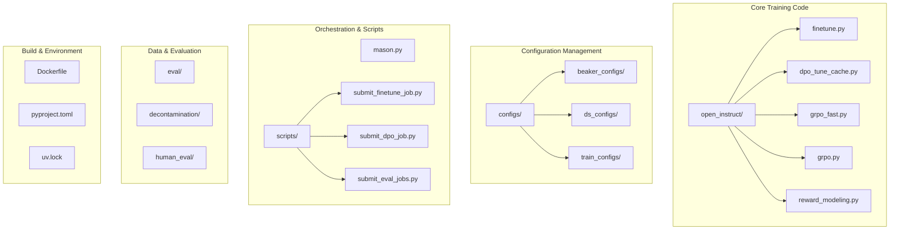
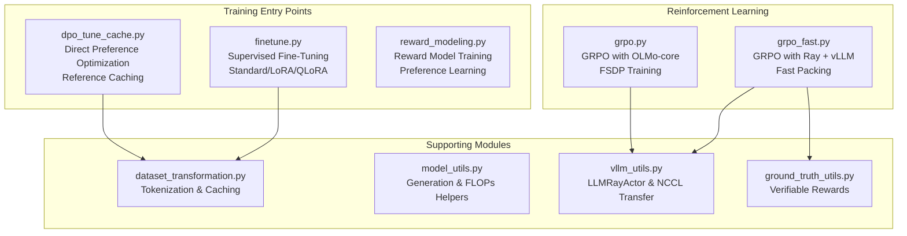
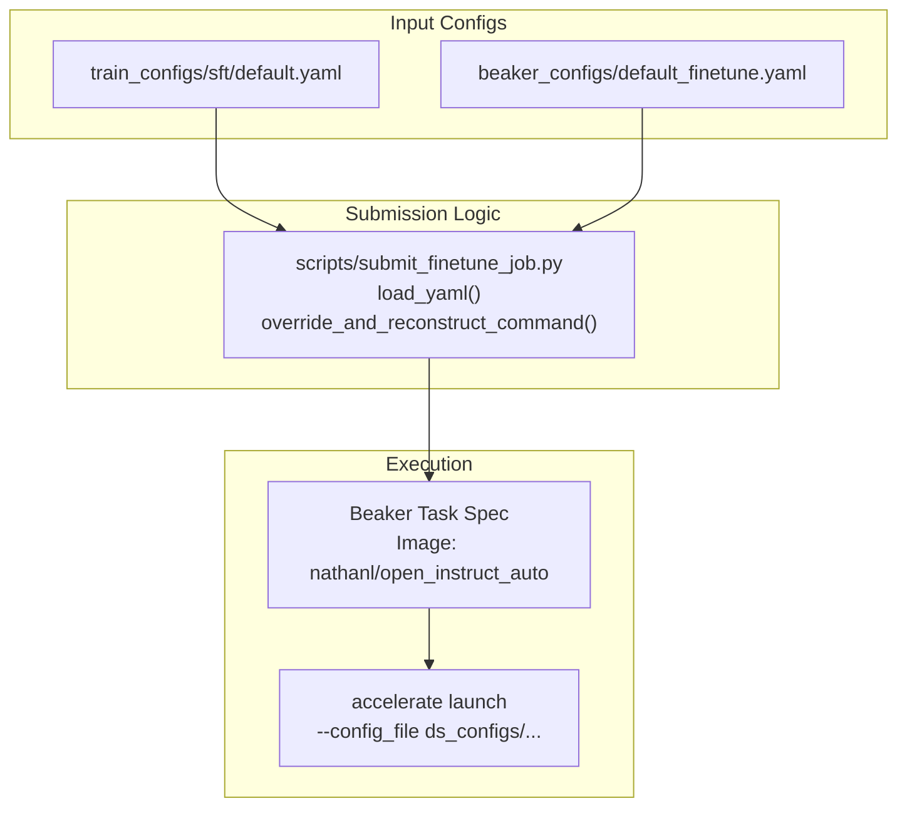

<!-- source: DeepWiki mcp.deepwiki.com · repo allenai/open-instruct · page 1.2 Repository Structure · fetched 2026-10-26 -->

# Repository Structure

Relevant source files

The following files were used as context for generating this wiki page:

- [Dockerfile](Dockerfile)
- [README.md](README.md)
- [configs/beaker_configs/default_dpo_multinode.yaml](configs/beaker_configs/default_dpo_multinode.yaml)
- [configs/train_configs/sft/tulu3_L3.1_70b_preview_mix_v3.3.yaml](configs/train_configs/sft/tulu3_L3.1_70b_preview_mix_v3.3.yaml)
- [docs/algorithms/dpo.md](docs/algorithms/dpo.md)
- [docs/algorithms/finetune.md](docs/algorithms/finetune.md)
- [docs/algorithms/grpo.md](docs/algorithms/grpo.md)
- [docs/algorithms/olmo_core_sharding.md](docs/algorithms/olmo_core_sharding.md)
- [mason.py](mason.py)
- [mkdocs.yml](mkdocs.yml)
- [open_instruct/test_olmo_core_finetune.py](open_instruct/test_olmo_core_finetune.py)
- [pyproject.toml](pyproject.toml)
- [requirements.txt](requirements.txt)
- [scripts/README.md](scripts/README.md)
- [scripts/submit_dpo_job.py](scripts/submit_dpo_job.py)
- [scripts/submit_finetune_job.py](scripts/submit_finetune_job.py)
- [test_mason.py](test_mason.py)
- [uv.lock](uv.lock)

This document explains the organization of the open-instruct codebase, detailing the purpose of each directory, key files, and how different components interact.

## Top-Level Directory Organization

The open-instruct repository follows a flat module structure for core functionality, with separate directories for configuration, scripts, evaluation, and supporting utilities.

**Directory Structure Overview**

**Directory Purposes:**

| Directory | Purpose | Key Files |
|-----------|---------|-----------|
| `open_instruct/` | Core training implementations and utilities | `finetune.py`, `dpo_tune_cache.py`, `grpo_fast.py`, `reward_modeling.py` |
| `configs/` | Training and infrastructure configuration | `train_configs/sft/*.yaml`, `beaker_configs/*.yaml`, `ds_configs/*.conf` |
| `scripts/` | Job submission, data preparation, and evaluation orchestration | `submit_finetune_job.py`, `submit_eval_jobs.py`, `data/prepare_train_data.sh` |
| `eval/` | Evaluation harness and benchmark implementations | MMLU, GSM8K, BBH, etc. |
| `decontamination/` | Train-test overlap detection | N-gram and embedding matching scripts |
| `human_eval/` | Annotation interface for human evaluation | Web-based annotation tools |

**Sources:** [README.md:3-11](), [scripts/README.md:1-8](), [Dockerfile:75-81](), [pyproject.toml:191-194]()

## Core Source Code: `open_instruct/` Directory

The `open_instruct/` directory contains the primary training logic. It uses a flat module structure to simplify distributed execution and imports.

**Primary Training Modules**

**Key Module Responsibilities:**

| Module | Implementation Detail | Purpose |
|--------|-----------------------|---------|
| `finetune.py` | Standard HF SFT | Supervised fine-tuning with support for DeepSpeed and LoRA [scripts/README.md:15-17](). |
| `dpo_tune_cache.py` | Reference Caching | DPO training that caches reference model logprobs to save VRAM [scripts/README.md:132-132](). |
| `grpo_fast.py` | `PolicyTrainerRayProcess` | RL training using Grouped Relative Policy Optimization with Ray and vLLM [docs/algorithms/grpo.md:86-92](). |
| `grpo.py` | OLMo-core Trainer | GRPO implementation built on the OLMo-core FSDP infrastructure [docs/algorithms/grpo.md:13-14](). |
| `vllm_utils.py` | `LLMRayActor` | Manages distributed vLLM engines for fast generation during RL [docs/algorithms/grpo.md:9-10](). |
| `ground_truth_utils.py` | Verifiable Rewards | Utilities for code and math verification used in RLVR [README.md:8-8](). |

**Sources:** [open_instruct/grpo.py:14-41](), [scripts/README.md:29-36](), [docs/algorithms/grpo.md:9-14]()

## Configuration Management: `configs/` Directory

Configurations are categorized by their role in the training pipeline:

| Directory | Purpose | Example Parameters |
|-----------|---------|-------------------|
| `beaker_configs/` | Infrastructure specs | `gpuCount`, `replicas`, `cluster`, `preemptible` [scripts/submit_finetune_job.py:75-80](). |
| `ds_configs/` | DeepSpeed optimization | `zero_stage`, `gradient_accumulation_steps` [configs/beaker_configs/default_dpo_multinode.yaml:25-27](). |
| `train_configs/` | ML hyperparameters | `learning_rate`, `dataset_mixer`, `model_name_or_path` [scripts/README.md:17-23](). |

**Configuration Flow**

**Sources:** [scripts/submit_finetune_job.py:13-24](), [scripts/submit_finetune_job.py:90-119](), [scripts/README.md:75-82]()

## Scripts and Orchestration

The `scripts/` directory and `mason.py` are the primary interfaces for AI2 engineers.

### Beaker Submission Scripts
* `submit_finetune_job.py`: Core script for launching SFT jobs. It reconstructs the `accelerate launch` command based on YAML configs and CLI overrides [scripts/submit_finetune_job.py:90-151]().
* `submit_dpo_job.py`: Similar to SFT, but handles preference datasets and the `dpo_tune_cache.py` entry point [scripts/submit_dpo_job.py:132-159]().
* `submit_eval_jobs.py`: Automates the evaluation of checkpoints across various benchmarks like MMLU and GSM8K [scripts/README.md:61-64]().

### `mason.py`: Docker-less Execution
`mason.py` allows running jobs on Beaker using an existing Python environment on NFS, bypassing the need to build and push Docker images for every change [scripts/README.md:106-112]().

**Mason Task Creation**

**Sources:** [mason.py:29-36](), [mason.py:156-158](), [scripts/README.md:106-117]()

## Build System and Dependencies

The repository uses `uv` for dependency management and Python 3.12 [pyproject.toml:6-7]().

* **Dockerfile**: Builds a CUDA 12.8 environment with `uv` and installs necessary drivers for AI2 clusters (DOCA OFED, MFT) [Dockerfile:1-38]().
* **pyproject.toml**: Defines core dependencies including `torch`, `transformers`, `vllm`, `ray`, and `ai2-olmo-core` [pyproject.toml:7-48]().
* **uv.lock**: Ensures reproducible builds across different machines [uv.lock:1-8]().

**Sources:** [Dockerfile:1-61](), [pyproject.toml:1-48](), [uv.lock:1-13]()

---

