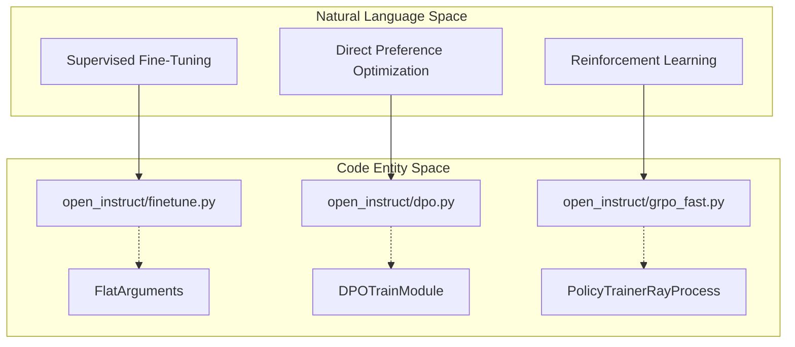
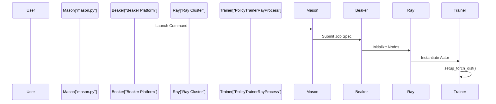

<!-- source: DeepWiki mcp.deepwiki.com · repo allenai/open-instruct · page 10 Glossary · fetched 2026-10-26 -->

# Glossary

Relevant source files

The following files were used as context for generating this wiki page:

- [CHANGELOG.md](CHANGELOG.md)
- [Dockerfile](Dockerfile)
- [README.md](README.md)
- [configs/beaker_configs/default_eval.yaml](configs/beaker_configs/default_eval.yaml)
- [mason.py](mason.py)
- [open_instruct/benchmark_generators.py](open_instruct/benchmark_generators.py)
- [open_instruct/context_window_checker.py](open_instruct/context_window_checker.py)
- [open_instruct/data_loader.py](open_instruct/data_loader.py)
- [open_instruct/data_types.py](open_instruct/data_types.py)
- [open_instruct/dataset_transformation.py](open_instruct/dataset_transformation.py)
- [open_instruct/dpo.py](open_instruct/dpo.py)
- [open_instruct/dpo_tune_cache.py](open_instruct/dpo_tune_cache.py)
- [open_instruct/dpo_utils.py](open_instruct/dpo_utils.py)
- [open_instruct/finetune.py](open_instruct/finetune.py)
- [open_instruct/ground_truth_utils.py](open_instruct/ground_truth_utils.py)
- [open_instruct/grpo.py](open_instruct/grpo.py)
- [open_instruct/grpo_callbacks.py](open_instruct/grpo_callbacks.py)
- [open_instruct/grpo_fast.py](open_instruct/grpo_fast.py)
- [open_instruct/grpo_olmo_core_actor.py](open_instruct/grpo_olmo_core_actor.py)
- [open_instruct/grpo_utils.py](open_instruct/grpo_utils.py)
- [open_instruct/judge_utils.py](open_instruct/judge_utils.py)
- [open_instruct/launch_utils.py](open_instruct/launch_utils.py)
- [open_instruct/model_utils.py](open_instruct/model_utils.py)
- [open_instruct/olmo_core_train_modules.py](open_instruct/olmo_core_train_modules.py)
- [open_instruct/olmo_core_utils.py](open_instruct/olmo_core_utils.py)
- [open_instruct/rubrics/__init__.py](open_instruct/rubrics/__init__.py)
- [open_instruct/rubrics/evolving_rubric_step.py](open_instruct/rubrics/evolving_rubric_step.py)
- [open_instruct/rubrics/metrics.py](open_instruct/rubrics/metrics.py)
- [open_instruct/rubrics/prompts.py](open_instruct/rubrics/prompts.py)
- [open_instruct/rubrics/rubric_utils.py](open_instruct/rubrics/rubric_utils.py)
- [open_instruct/rubrics/run_utils.py](open_instruct/rubrics/run_utils.py)
- [open_instruct/rubrics/test_rubrics.py](open_instruct/rubrics/test_rubrics.py)
- [open_instruct/test_ground_truth_utils.py](open_instruct/test_ground_truth_utils.py)
- [open_instruct/test_grpo_fast.py](open_instruct/test_grpo_fast.py)
- [open_instruct/test_if_functions.py](open_instruct/test_if_functions.py)
- [open_instruct/test_model_utils.py](open_instruct/test_model_utils.py)
- [open_instruct/test_utils.py](open_instruct/test_utils.py)
- [open_instruct/test_vllm_utils.py](open_instruct/test_vllm_utils.py)
- [open_instruct/test_vllm_utils_gpu.py](open_instruct/test_vllm_utils_gpu.py)
- [open_instruct/utils.py](open_instruct/utils.py)
- [open_instruct/vllm_utils.py](open_instruct/vllm_utils.py)
- [pyproject.toml](pyproject.toml)
- [requirements.txt](requirements.txt)
- [scripts/collect_eval_results.py](scripts/collect_eval_results.py)
- [scripts/eval/oe-eval.sh](scripts/eval/oe-eval.sh)
- [scripts/eval/truthfulqa.sh](scripts/eval/truthfulqa.sh)
- [scripts/eval/tulu3_baselines.sh](scripts/eval/tulu3_baselines.sh)
- [scripts/submit_eval_jobs.py](scripts/submit_eval_jobs.py)
- [scripts/submit_eval_jobs_old.py](scripts/submit_eval_jobs_old.py)
- [scripts/train/debug/evolving_rubric_mini_test.sh](scripts/train/debug/evolving_rubric_mini_test.sh)
- [scripts/train/debug/judge.sh](scripts/train/debug/judge.sh)
- [scripts/wait_beaker_dataset_model_upload_then_evaluate_model.py](scripts/wait_beaker_dataset_model_upload_then_evaluate_model.py)
- [test_mason.py](test_mason.py)
- [uv.lock](uv.lock)

This page provides definitions and technical implementation details for codebase-specific terms, infrastructure components, and domain concepts used in the `open-instruct` repository.

## Purpose and Scope

This glossary serves as a reference for onboarding engineers to understand the jargon, abbreviations, and specific architectural entities within the `open-instruct` ecosystem. It covers the transition from high-level machine learning concepts to specific Python classes and file implementations.

---

## 1. Training Paradigms & Algorithms

### SFT (Supervised Fine-Tuning)
The first stage of instruction tuning where a base model is trained on (instruction, response) pairs.
*   **Implementation**: Traditionally handled by `finetune.py`. It uses the `FlatArguments` dataclass for configuration [open_instruct/finetune.py:76-80]().
*   **Modern Path**: The `olmo_core_finetune.py` script provides a high-performance path using `FSDP2` and `ulysses` sequence parallelism [CHANGELOG.md:27-27]().

### DPO (Direct Preference Optimization)
A stable alternative to RLHF that optimizes the model directly on preference pairs (chosen vs. rejected) without training a separate reward model.
*   **Key File**: `open_instruct/dpo.py` (OLMo-core variant) and `open_instruct/dpo_tune_cache.py`.
*   **Caching**: Uses a reference logprob caching strategy to speed up training by avoiding redundant forward passes through the frozen reference model [open_instruct/dpo_tune_cache.py:1-5]().
*   **Variants**: Supports loss variants like SimPO, WPO, DAPO, and CISPO [CHANGELOG.md:8-8]().

### GRPO (Group Relative Policy Optimization)
An RL algorithm that eliminates the need for a critic model by normalizing rewards within a group of samples generated from the same prompt.
*   **Implementation**: Primarily implemented in `open_instruct/grpo_fast.py`.
*   **Architecture**: Uses a queue-based system with Ray to coordinate between `PolicyTrainerRayProcess` (Trainer) and `vLLM` (Rollout) actors [open_instruct/grpo_fast.py:65-84]().
*   **OLMo-core Actor**: A specialized variant `grpo_olmo_core_actor.py` supports FSDP2 for high-performance distributed training [CHANGELOG.md:11-11]().

### RLVR (Reinforcement Learning with Verifiable Rewards)
A subset of RLHF where rewards are derived from objective "ground truth" (e.g., code execution results or math answer matching) rather than a subjective neural reward model.
*   **Logic**: Defined in `open_instruct/ground_truth_utils.py` and utilized in GRPO rollouts [open_instruct/grpo_fast.py:100-100]().

**Diagram: Algorithm to Code Mapping**

Sources: [open_instruct/finetune.py:76-80](), [open_instruct/grpo_fast.py:65-100](), [CHANGELOG.md:8-29]()

---

## 2. Infrastructure & Orchestration

### Beaker
The AI2 internal experiment platform used for scheduling jobs on GPU clusters (Jupiter, Saturn, etc.).
*   **Configuration**: Managed via `configs/beaker_configs/default_eval.yaml`.
*   **Runtime**: Handled by the `BeakerRuntimeConfig` utility in `utils.py` [open_instruct/utils.py:123-123]().

### Mason
A specialized job launcher script (`mason.py`) that wraps Beaker job submission.
*   **Features**: Handles automatic dataset mounting, cluster selection, and command construction [mason.py:111-153]().
*   **Command Filtering**: Includes logic to remove specific arguments (like tracking flags) when generating cache keys for job resumes via `build_command_without_args` [mason.py:51-77]().

### Ray
A distributed execution framework used in GRPO to manage multiple actors (Policy, vLLM, Reward Model).
*   **RayProcess**: A base class in `utils.py` that handles the boilerplate for setting up distributed torch process groups within Ray actors [open_instruct/utils.py:113-113]().

### vLLM Integration
The codebase uses `vLLM` for fast inference during RL rollouts and evaluation.
*   **Weight Sync**: To keep the vLLM inference engine updated with the latest weights from the Trainer, the system uses `NCCLWeightTransferEngine` or `IPCWeightTransferEngine` [open_instruct/vllm_utils.py:47-48]().
*   **Factory**: Engines are created using the `create_vllm_engines` factory function [open_instruct/vllm_utils.py:100-123]().

**Diagram: Job Orchestration Flow**

Sources: [mason.py:111-153](), [open_instruct/grpo_fast.py:65-84](), [open_instruct/utils.py:113-123]()

---

## 3. Data Pipeline Concepts

### Dataset Mixer
A system for combining multiple datasets with specific proportions or absolute sample counts.
*   **Logic**: Defined in `dataset_transformation.py`. It uses `parse_dataset_mixer_list` to handle CLI inputs [CHANGELOG.md:16-16]().

### Chat Templates
Jinja2 templates used to format raw message lists into specific string formats.
*   **Registry**: Located in `open_instruct/dataset_transformation.py` as `CHAT_TEMPLATES`. Supports `tulu`, `olmo`, `zephyr`, and `thinker` variants [open_instruct/dataset_transformation.py:152-178]().

### Padding-Free Collator
A performance optimization that flattens batches to remove padding tokens, significantly increasing throughput.
*   **Class**: `TensorDataCollatorWithFlattening` [open_instruct/finetune.py:58-58]().

---

## 4. Evaluation Concepts

### OI Evals (Open Instruct Evals)
The internal evaluation suite for benchmarks like GSM8K, MMLU, and IFEval.
*   **Script**: `scripts/submit_eval_jobs.py` handles the orchestration of these benchmarks on Beaker [scripts/submit_eval_jobs.py:58-111]().

### OE Eval (OLMES / AI2 Eval)
The newer evaluation track using the `olmo-eval` tool (internal repository `olmo-eval-internal`).
*   **Implementation**: Jobs are submitted via `submit_eval_jobs.py` which clones the repo and runs the harness [scripts/submit_eval_jobs.py:41-54]().

### Verifiers
Functions or LLM-based judges that determine if a model's output is correct.
*   **Verifiable Rewards**: Implemented via `build_all_verifiers` in `ground_truth_utils.py` [open_instruct/ground_truth_utils.py:100-100]().

---

## 5. Technical Abbreviations

| Abbreviation | Full Term | Description | Code Pointer |
| :--- | :--- | :--- | :--- |
| **FSDP2** | Fully Sharded Data Parallel v2 | Advanced sharding for large models in OLMo-core. | [CHANGELOG.md:27-27]() |
| **Ulysses SP** | DeepSpeed Ulysses | Sequence parallelism for training on long contexts. | [open_instruct/grpo_fast.py:40-40]() |
| **GRPO** | Group Relative Policy Optimization | RL algorithm used for Tulu 3 training. | [open_instruct/grpo_fast.py:1-15]() |
| **LoRA** | Low-Rank Adaptation | Parameter-efficient fine-tuning method. | [open_instruct/finetune.py:42-42]() |
| **MCP** | Model Context Protocol | Protocol for tool/environment integration. | [open_instruct/grpo_fast.py:98-98]() |
| **RLVR** | RL with Verifiable Rewards | RL training using objective ground truth. | [open_instruct/grpo_fast.py:12-12]() |

Sources: [open_instruct/grpo_fast.py:12-100](), [open_instruct/finetune.py:42-80](), [CHANGELOG.md:8-27](), [scripts/submit_eval_jobs.py:41-111]()