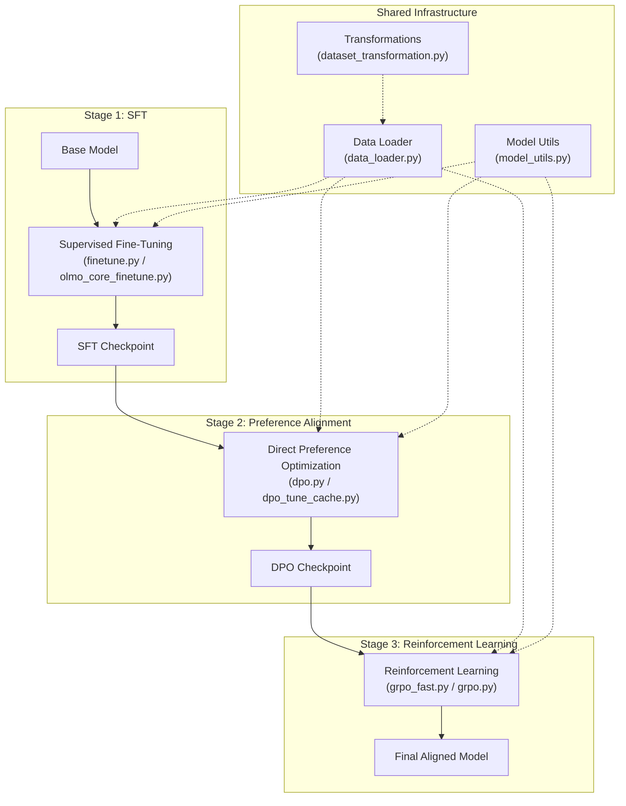
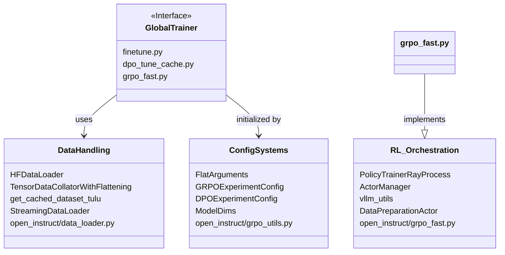

<!-- source: DeepWiki mcp.deepwiki.com · repo allenai/open-instruct · page 2 Core Training Systems · fetched 2026-10-26 -->

# Core Training Systems

Relevant source files

The following files were used as context for generating this wiki page:

- [CHANGELOG.md](CHANGELOG.md)
- [open_instruct/benchmark_generators.py](open_instruct/benchmark_generators.py)
- [open_instruct/data_loader.py](open_instruct/data_loader.py)
- [open_instruct/data_types.py](open_instruct/data_types.py)
- [open_instruct/dataset_transformation.py](open_instruct/dataset_transformation.py)
- [open_instruct/dpo.py](open_instruct/dpo.py)
- [open_instruct/dpo_tune_cache.py](open_instruct/dpo_tune_cache.py)
- [open_instruct/dpo_utils.py](open_instruct/dpo_utils.py)
- [open_instruct/finetune.py](open_instruct/finetune.py)
- [open_instruct/grpo.py](open_instruct/grpo.py)
- [open_instruct/grpo_callbacks.py](open_instruct/grpo_callbacks.py)
- [open_instruct/grpo_fast.py](open_instruct/grpo_fast.py)
- [open_instruct/grpo_olmo_core_actor.py](open_instruct/grpo_olmo_core_actor.py)
- [open_instruct/grpo_utils.py](open_instruct/grpo_utils.py)
- [open_instruct/model_utils.py](open_instruct/model_utils.py)
- [open_instruct/olmo_core_train_modules.py](open_instruct/olmo_core_train_modules.py)
- [open_instruct/olmo_core_utils.py](open_instruct/olmo_core_utils.py)
- [open_instruct/test_grpo_fast.py](open_instruct/test_grpo_fast.py)
- [open_instruct/test_model_utils.py](open_instruct/test_model_utils.py)
- [open_instruct/test_utils.py](open_instruct/test_utils.py)
- [open_instruct/test_vllm_utils.py](open_instruct/test_vllm_utils.py)
- [open_instruct/test_vllm_utils_gpu.py](open_instruct/test_vllm_utils_gpu.py)
- [open_instruct/utils.py](open_instruct/utils.py)
- [open_instruct/vllm_utils.py](open_instruct/vllm_utils.py)

This page provides a high-level overview of the three primary training paradigms supported by the `open-instruct` repository: Supervised Fine-Tuning (SFT), Direct Preference Optimization (DPO), and Reinforcement Learning (RLHF). These systems form a progressive pipeline designed to transform base language models into aligned, instruction-following agents.

## Training Pipeline Overview

The standard model development lifecycle in this repository typically follows a three-stage progression. Each stage builds upon the artifacts of the previous one, sharing a common infrastructure for data loading, model utilities, and distributed orchestration.

**Sources:** [open_instruct/finetune.py:88-150](), [open_instruct/dpo_tune_cache.py:15-17](), [open_instruct/grpo_fast.py:83-108](), [CHANGELOG.md:12-12]()

---

## 1. Supervised Fine-Tuning (SFT)
SFT is the foundational step where a base model is trained on (Instruction, Response) pairs. The repository provides two main paths for SFT:
*   **HuggingFace/Accelerate Path**: The `finetune.py` script uses `accelerate` and `deepspeed` for standard fine-tuning. It supports LoRA, QLoRA, and full parameter tuning [open_instruct/finetune.py:42-46]().
*   **OLMo-core Path**: The `olmo_core_finetune.py` script provides more robust FSDP2 support and utilizes numpy-based dataset conversion for high-performance training [CHANGELOG.md:27-33]().

**Key Components:**
*   **`FlatArguments`**: A centralized dataclass for managing all hyperparameters, from LoRA rank to dataset mixing ratios [open_instruct/finetune.py:76-180]().
*   **Dataset Mixing**: Supports proportional mixing of multiple datasets via `dataset_mixer_list` [open_instruct/finetune.py:126-127]().
*   **Ulysses Sequence Parallelism**: Enables training on extremely long contexts by sharding sequences across GPUs, now the default CP strategy in the OLMo-core path [CHANGELOG.md:27-27]().

For details, see **[Supervised Fine-Tuning (SFT)](#2.1)**.

---

## 2. Direct Preference Optimization (DPO)
DPO aligns models with human preferences using (Prompt, Chosen, Rejected) triplets. The system supports several loss variants and performance optimizations.

**Key Components:**
*   **Loss Variants**: Supports `DPO`, `DPO_NORM`, `SimPO`, `WPO`, and new variants like `DAPO` and `CISPO` [open_instruct/dpo_utils.py:76-81](), [open_instruct/grpo_utils.py:69-72]().
*   **Reference Caching**: `dpo_tune_cache.py` pre-computes and caches reference model logprobs to save memory and compute during training [open_instruct/dpo_tune_cache.py:191-193]().
*   **DPOTrainModule**: A specialized module for DPO training using FSDP and Tensor Parallelism (TP) for large-scale models [open_instruct/dpo_utils.py:129-131]().

For details, see **[Direct Preference Optimization (DPO)](#2.2)**.

---

## 3. Reinforcement Learning (RLHF)
The RLHF subsystem has transitioned to focus on **Group Relative Policy Optimization (GRPO)**, particularly for training on "Verifiable Rewards" (math/code). Traditional PPO scripts have been deprecated [CHANGELOG.md:12-12]().

**Core Implementations:**
*   **GRPO (grpo_fast.py)**: A memory-efficient RL algorithm that eliminates the critic model by computing advantages relative to a group of sampled responses [open_instruct/grpo_utils.py:102-145]().
*   **Distributed Orchestration**: Utilizes Ray for managing `PolicyTrainerRayProcess` actors and `vLLM` engines for high-throughput rollout generation [open_instruct/grpo_fast.py:65-83]().
*   **Weight Synchronization**: Features a native weight transfer API (`NCCLWeightTransferEngine`) for low-latency synchronization between the training policy and inference engines [open_instruct/grpo_fast.py:80-81](), [CHANGELOG.md:36-36]().

For details, see **[Reinforcement Learning (RLHF)](#2.3)**.

---

## 4. Reward Modeling
Reward Modeling is used to train models that can score completions based on preference data, often serving as a signal for RL or for rejection sampling.

**Key Components:**
*   **`reward_modeling.py`**: A script for training a reward head on top of a transformer.
*   **Preference Data**: Uses tokenized preference keys such as `chosen_input_ids` and `rejected_input_ids` [open_instruct/dpo_utils.py:42-47]().

For details, see **[Reward Modeling](#2.4)**.

---

## Code Entity Map: Training Orchestration

This diagram maps the high-level training concepts to the specific classes and files that implement them in the `open-instruct` codebase.

**Sources:** [open_instruct/data_loader.py:72-80](), [open_instruct/grpo_fast.py:134-163](), [open_instruct/grpo_utils.py:74-80](), [open_instruct/finetune.py:76-88](), [open_instruct/vllm_utils.py:100-123]()

---

## System Comparison Table

| Feature | SFT | DPO | RLHF (GRPO) |
| :--- | :--- | :--- | :--- |
| **Primary Script** | `finetune.py` | `dpo.py` / `dpo_tune_cache.py` | `grpo_fast.py` / `grpo.py` |
| **Data Format** | Instruction/Response | Chosen/Rejected Pairs | Prompts + Verifiers/RM |
| **Distributed Engine** | DeepSpeed / FSDP2 | FSDP / TP | Ray + vLLM + FSDP2 |
| **Key Optimization** | Ulysses SP | Logprob Caching | Group-based Advantage |
| **Weight Sync** | N/A | N/A | `NCCLWeightTransferEngine` |

**Sources:** [open_instruct/finetune.py:130-135](), [open_instruct/dpo_utils.py:96-114](), [open_instruct/grpo_utils.py:102-155](), [CHANGELOG.md:12-36]()

---

