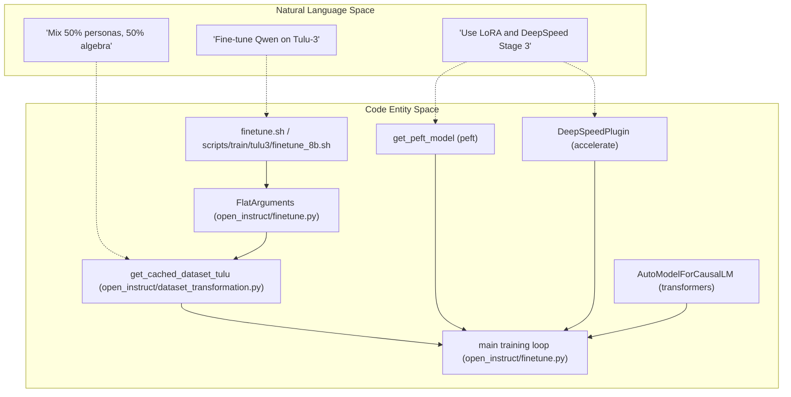
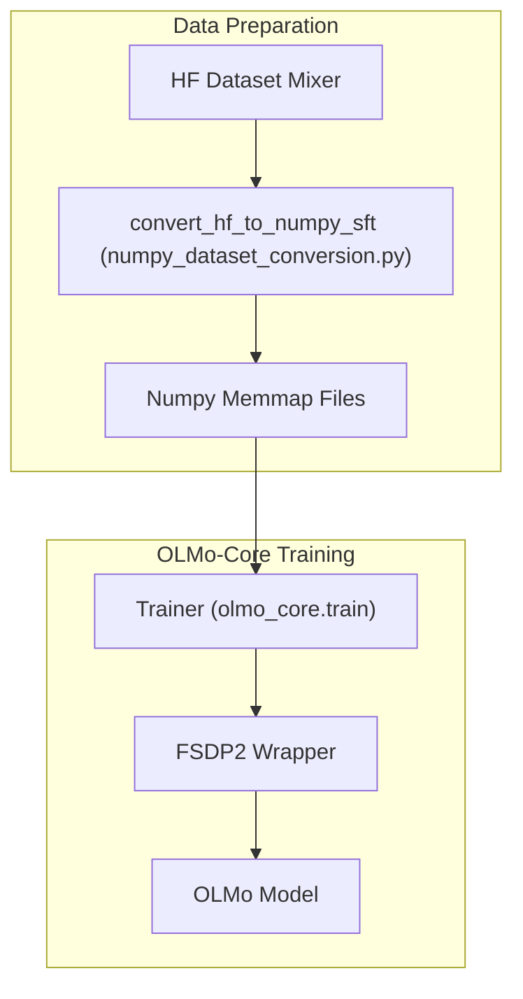

<!-- source: DeepWiki mcp.deepwiki.com · repo allenai/open-instruct · page 2.1 Supervised Fine-Tuning (SFT) · fetched 2026-10-26 -->

# Supervised Fine-Tuning (SFT)

Relevant source files

The following files were used as context for generating this wiki page:

- [docs/verify-tokenization.md](docs/verify-tokenization.md)
- [open_instruct/dataset_transformation.py](open_instruct/dataset_transformation.py)
- [open_instruct/dpo_tune_cache.py](open_instruct/dpo_tune_cache.py)
- [open_instruct/finetune.py](open_instruct/finetune.py)
- [open_instruct/model_utils.py](open_instruct/model_utils.py)
- [open_instruct/numpy_dataset_conversion.py](open_instruct/numpy_dataset_conversion.py)
- [open_instruct/olmo_core_finetune.py](open_instruct/olmo_core_finetune.py)
- [open_instruct/test_model_utils.py](open_instruct/test_model_utils.py)
- [open_instruct/test_numpy_dataset_conversion.py](open_instruct/test_numpy_dataset_conversion.py)
- [open_instruct/test_utils.py](open_instruct/test_utils.py)
- [open_instruct/utils.py](open_instruct/utils.py)
- [scripts/data/convert_sft_data_for_olmocore.py](scripts/data/convert_sft_data_for_olmocore.py)
- [scripts/data/rlvr_code/verify_qwq.py](scripts/data/rlvr_code/verify_qwq.py)
- [scripts/slurm/sft/README.md](scripts/slurm/sft/README.md)
- [scripts/slurm/sft/prepare_dolci_instruct_data.sh](scripts/slurm/sft/prepare_dolci_instruct_data.sh)
- [scripts/slurm/sft/prepare_dolci_think_data.sh](scripts/slurm/sft/prepare_dolci_think_data.sh)
- [scripts/slurm/sft/train_dolci_instruct.sh](scripts/slurm/sft/train_dolci_instruct.sh)
- [scripts/slurm/sft/train_dolci_think.sh](scripts/slurm/sft/train_dolci_think.sh)
- [scripts/train/convert_olmo_core_to_hf.py](scripts/train/convert_olmo_core_to_hf.py)
- [scripts/train/debug/finetune.sh](scripts/train/debug/finetune.sh)
- [scripts/train/debug/oc_sft.sh](scripts/train/debug/oc_sft.sh)
- [scripts/train/debug/oc_sft_cache.sh](scripts/train/debug/oc_sft_cache.sh)
- [scripts/train/debug/oc_sft_multinode.sh](scripts/train/debug/oc_sft_multinode.sh)
- [scripts/train/debug/oc_sft_olmo3_7b_full.sh](scripts/train/debug/oc_sft_olmo3_7b_full.sh)
- [scripts/train/olmo2/finetune_13b.sh](scripts/train/olmo2/finetune_13b.sh)
- [scripts/train/olmo2/finetune_32b.sh](scripts/train/olmo2/finetune_32b.sh)
- [scripts/train/olmo2/finetune_7b.sh](scripts/train/olmo2/finetune_7b.sh)
- [scripts/train/qwen/finetune_7b.sh](scripts/train/qwen/finetune_7b.sh)
- [scripts/train/tulu3/finetune_8b.sh](scripts/train/tulu3/finetune_8b.sh)

## Purpose and Scope

Supervised Fine-Tuning (SFT) is the first stage in the open-instruct training pipeline. It adapts a pre-trained base language model to follow instructions by training on supervised instruction-response pairs. The output is an instruction-following model that serves as the foundation for subsequent preference alignment stages like DPO or RLHF.

This page documents the primary `finetune.py` script and the specialized `olmo_core_finetune.py` path designed for OLMo-core models with FSDP2 support. It also covers the `numpy_dataset_conversion.py` utilities used to prepare high-throughput datasets for the OLMo-core path. [open_instruct/finetune.py:1-20](), [open_instruct/olmo_core_finetune.py:16-26]()

## System Architecture

The SFT system consists of two distinct implementation paths:
1.  **HuggingFace-based (`finetune.py`)**: The standard path using `transformers`, `accelerate`, and `deepspeed`.
2.  **OLMo-core-based (`olmo_core_finetune.py`)**: A high-performance path using `olmo-core` for FSDP2 training and numpy memory-mapped datasets.

### SFT Logic Flow: Natural Language to Code Entities
This diagram maps high-level training concepts to the specific code entities that implement them.

**Sources:** [open_instruct/finetune.py:77-110](), [open_instruct/dataset_transformation.py:152-172](), [scripts/train/tulu3/finetune_8b.sh:1-25]()

## Entry Point and Configuration (finetune.py)

### Main Script
The primary entry point `finetune.py` implements a standard supervised fine-tuning loop using HuggingFace Accelerate for distributed training coordination. [open_instruct/finetune.py:360-380]()

### Configuration Classes
Training is configured through the `FlatArguments` dataclass. [open_instruct/finetune.py:77-358]()

| Configuration Group | Key Parameters | Purpose |
|-------------------|---------------|---------|
| **Model** | `model_name_or_path`, `low_cpu_mem_usage` | Model loading and architecture initialization. [open_instruct/finetune.py:93-120]() |
| **Dataset** | `dataset_mixer_list`, `dataset_transform_fn` | Data mixing proportions and transformation sequence. [open_instruct/finetune.py:127-134]() |
| **Training** | `learning_rate`, `num_train_epochs`, `gradient_accumulation_steps` | Optimization hyperparameters. [open_instruct/finetune.py:179-206]() |
| **LoRA/QLoRA** | `use_lora`, `lora_rank`, `lora_alpha` | Parameter-efficient fine-tuning settings. [open_instruct/finetune.py:270-286]() |

**Sources:** [open_instruct/finetune.py:77-358]()

## Dataset Processing Pipeline

### Data Flow and Transformation

**Sources:** [open_instruct/dataset_transformation.py:152-180](), [open_instruct/padding_free_collator.py:58](), [open_instruct/utils.py:65]()

### Data Collation Strategies
SFT supports two primary collation strategies:
1.  **Standard Collation**: Uses `DataCollatorForSeq2Seq` for standard padding. [open_instruct/finetune.py:46]()
2.  **Padding-free (Packing)**: Uses `TensorDataCollatorWithFlattening` to concatenate sequences into a single tensor, removing padding tokens and improving throughput. [open_instruct/padding_free_collator.py:58]()

## Model Initialization and Optimization

### Loading Strategies
The system supports multiple loading strategies based on memory constraints:
-   **Standard**: `AutoModelForCausalLM.from_pretrained`. [open_instruct/finetune.py:560-569]()
-   **QLoRA**: 4-bit quantized loading via `BitsAndBytesConfig`. [open_instruct/finetune.py:522-541]()
-   **Liger Kernel**: Optimized fused kernels for cross-entropy. [open_instruct/finetune.py:542-558]()

### DeepSpeed Integration
DeepSpeed ZeRO-2 and ZeRO-3 are integrated via the Accelerate `DeepSpeedPlugin`. [open_instruct/finetune.py:37-40]() The configuration typically disables offloading for maximum speed on high-bandwidth clusters. [open_instruct/dpo_tune_cache.py:76-114]()

## OLMo-Core SFT Path

The `olmo_core_finetune.py` script is designed for training OLMo-2 and OLMo-3 models using `olmo-core`'s `Trainer`. This path is optimized for multi-node FSDP2 training and requires pre-tokenized numpy datasets. [open_instruct/olmo_core_finetune.py:16-26]()

### Numpy Dataset Conversion
Before training with OLMo-core, datasets must be converted to numpy memory-mapped format using `scripts/data/convert_sft_data_for_olmocore.py`. [scripts/data/convert_sft_data_for_olmocore.py:15-29]()

The conversion process creates:
-   `token_ids_part_XXXX.npy`: The raw token IDs. [open_instruct/numpy_dataset_conversion.py:4]()
-   `labels_mask_part_XXXX.npy`: Boolean mask indicating trainable tokens (responses). [open_instruct/numpy_dataset_conversion.py:5]()
-   `token_ids_part_XXXX.csv.gz`: Document boundaries (start/end indices). [open_instruct/numpy_dataset_conversion.py:6]()

### OLMo-Core Training Logic
The training loop is managed by `olmo_core.train.Trainer`. Key functions include:
-   `_tokenize_to_numpy_dir`: Handles on-the-fly tokenization if pre-tokenized data is missing. [open_instruct/olmo_core_finetune.py:85-110]()
-   `olmo_core_utils.setup_distributed_env`: Initializes the process group and seeds. [open_instruct/olmo_core_finetune.py:170-172]()

**Sources:** [open_instruct/olmo_core_finetune.py:93-109](), [open_instruct/numpy_dataset_conversion.py:1-9](), [scripts/data/convert_sft_data_for_olmocore.py:133-165]()

## Model Saving and Evaluation

### Checkpointing
In `finetune.py`, checkpoints are saved using `save_with_accelerate`, which unwraps the model and handles distributed state saving. [open_instruct/model_utils.py:57](), [open_instruct/finetune.py:896-924]()

### Automatic Evaluation
After training, the script can automatically trigger evaluation jobs on the Beaker platform using `launch_ai2_evals_on_weka` or `submit_eval_jobs.py` integration. [open_instruct/finetune.py:944-952](), [open_instruct/utils.py:66]()

**Sources:** [open_instruct/finetune.py:896-954](), [open_instruct/model_utils.py:57](), [open_instruct/utils.py:60-71]()

---

