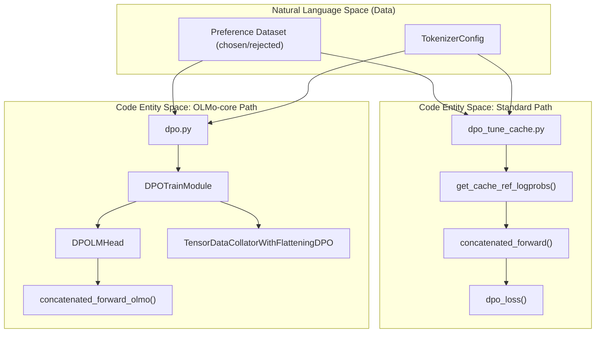
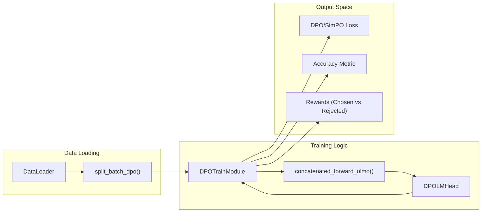

<!-- source: DeepWiki mcp.deepwiki.com · repo allenai/open-instruct · page 2.2 Direct Preference Optimization (DPO) · fetched 2026-10-26 -->

# Direct Preference Optimization (DPO)

Relevant source files

The following files were used as context for generating this wiki page:

- [open_instruct/dataset_transformation.py](open_instruct/dataset_transformation.py)
- [open_instruct/dpo.py](open_instruct/dpo.py)
- [open_instruct/dpo_tune_cache.py](open_instruct/dpo_tune_cache.py)
- [open_instruct/dpo_utils.py](open_instruct/dpo_utils.py)
- [open_instruct/finetune.py](open_instruct/finetune.py)
- [open_instruct/grpo.py](open_instruct/grpo.py)
- [open_instruct/grpo_callbacks.py](open_instruct/grpo_callbacks.py)
- [open_instruct/grpo_olmo_core_actor.py](open_instruct/grpo_olmo_core_actor.py)
- [open_instruct/grpo_utils.py](open_instruct/grpo_utils.py)
- [open_instruct/model_utils.py](open_instruct/model_utils.py)
- [open_instruct/olmo_core_callbacks.py](open_instruct/olmo_core_callbacks.py)
- [open_instruct/olmo_core_train_modules.py](open_instruct/olmo_core_train_modules.py)
- [open_instruct/olmo_core_utils.py](open_instruct/olmo_core_utils.py)
- [open_instruct/padding_free_collator.py](open_instruct/padding_free_collator.py)
- [open_instruct/test_data_loader_gpu.py](open_instruct/test_data_loader_gpu.py)
- [open_instruct/test_model_utils.py](open_instruct/test_model_utils.py)
- [open_instruct/test_utils.py](open_instruct/test_utils.py)
- [open_instruct/test_vllm_utils_gpu.py](open_instruct/test_vllm_utils_gpu.py)
- [open_instruct/utils.py](open_instruct/utils.py)
- [scripts/benchmarking/launch_benchmark_single_gpu.sh](scripts/benchmarking/launch_benchmark_single_gpu.sh)
- [scripts/benchmarking/launch_benchmark_single_node.sh](scripts/benchmarking/launch_benchmark_single_node.sh)
- [scripts/dpo_train_with_accelerate.sh](scripts/dpo_train_with_accelerate.sh)
- [scripts/dpo_train_with_accelerate_config.sh](scripts/dpo_train_with_accelerate_config.sh)
- [scripts/dpo_train_with_qlora.sh](scripts/dpo_train_with_qlora.sh)
- [scripts/train/debug/dpo/7b_instruct_dpo_olmo_core.sh](scripts/train/debug/dpo/7b_instruct_dpo_olmo_core.sh)
- [scripts/train/debug/dpo/checkpoint_integration_test.sh](scripts/train/debug/dpo/checkpoint_integration_test.sh)
- [scripts/train/debug/dpo/local.sh](scripts/train/debug/dpo/local.sh)
- [scripts/train/debug/dpo/multi_node.sh](scripts/train/debug/dpo/multi_node.sh)
- [scripts/train/debug/dpo/multi_node_cache.sh](scripts/train/debug/dpo/multi_node_cache.sh)
- [scripts/train/debug/dpo/single_gpu.sh](scripts/train/debug/dpo/single_gpu.sh)
- [scripts/train/debug/dpo_integration_test.sh](scripts/train/debug/dpo_integration_test.sh)
- [scripts/train/olmo2/dpo_13b.sh](scripts/train/olmo2/dpo_13b.sh)
- [scripts/train/olmo2/dpo_7b.sh](scripts/train/olmo2/dpo_7b.sh)
- [scripts/train/olmo3/7b_instruct_dpo_olmocore.sh](scripts/train/olmo3/7b_instruct_dpo_olmocore.sh)
- [scripts/train/tulu3/dpo_8b.sh](scripts/train/tulu3/dpo_8b.sh)

## Purpose and Scope

This document covers the Direct Preference Optimization (DPO) training systems within the `open-instruct` repository. It explains the standard implementation in [open_instruct/dpo_tune_cache.py]() and the high-performance OLMo-core variant in [open_instruct/dpo.py](). DPO is a preference alignment method that trains models to prefer "chosen" responses over "rejected" responses using a contrastive loss, typically bypassing the need for a separate reward model during the optimization phase.

**Sources:** [open_instruct/dpo_tune_cache.py:15-17](), [open_instruct/dpo.py:1-6]()

---

## DPO Training Architectures

The repository provides two primary paths for DPO training:

1.  **Standard (HF/Accelerate):** Uses `dpo_tune_cache.py` with Hugging Face `transformers` and `accelerate`. It features a reference caching strategy to save memory and supports LoRA/QLoRA.
2.  **OLMo-core (FSDP2/TP):** Uses `dpo.py` and the `DPOTrainModule`. This is optimized for large-scale training with native support for Fully Sharded Data Parallel (FSDP) and Tensor Parallelism (TP) via `olmo-core`.

### System Component Mapping

**Sources:** [open_instruct/dpo_tune_cache.py:117-147](), [open_instruct/dpo.py:25-30](), [open_instruct/olmo_core_train_modules.py:103-113](), [open_instruct/dpo_utils.py:111-114]()

---

## Reference Caching Strategy

To avoid running two models (Policy and Reference) simultaneously in GPU memory—which effectively doubles the VRAM requirement—the standard DPO script employs a caching strategy.

1.  **Initialization:** The script calls `get_cache_ref_logprobs()` [open_instruct/dpo_tune_cache.py:380]().
2.  **Execution:** It iterates through the dataset once using the base model. If using LoRA, it disables the adapters via `model.disable_adapter()` to represent the reference state [open_instruct/dpo_tune_cache.py:403]().
3.  **Storage:** Log probabilities for both chosen and rejected sequences are computed and stored as CPU tensors in a `TensorCache` [open_instruct/model_utils.py:98-111]().
4.  **Training:** During the actual optimization loop, these cached values are retrieved by index, eliminating the need for reference model forward passes [open_instruct/dpo_tune_cache.py:859-885]().

**Sources:** [open_instruct/dpo_tune_cache.py:380-418](), [open_instruct/model_utils.py:98-122]()

---

## Loss Variants and Algorithms

The `dpo_utils.py` module defines several preference optimization loss variants and the `DAPO`/`CISPO` variants used in RL contexts:

| Loss Variant | Description | Implementation Detail |
| :--- | :--- | :--- |
| `dpo` | Standard DPO with KL penalty. | Requires reference logprobs. |
| `dpo_norm` | DPO with length-normalized logprobs. | Reduces length bias in preference. |
| `simpo` | Simple Preference Optimization. | Reference-free; uses target reward margin `gamma`. |
| `wpo` | Weighted Preference Optimization. | Weights examples by reward differences. |
| `dapo` | Direct Alignment from Preference Optimization. | Used in GRPO context [open_instruct/grpo_utils.py:70](). |
| `cispo` | Contrastive Iterative Soft Preference Optimization. | Iterative variant [open_instruct/grpo_utils.py:71](). |

The `DPOLossType` enum manages these variants and tracks properties like whether they require a reference model [open_instruct/dpo_utils.py:76-93]().

**Sources:** [open_instruct/dpo_utils.py:76-93](), [open_instruct/grpo_utils.py:69-71]()

---

## OLMo-core DPO (High Performance)

The `DPOTrainModule` [open_instruct/olmo_core_train_modules.py:103]() integrates DPO into the `olmo-core` trainer. This version is designed for massive scale and utilizes specialized components for FSDP and TP.

### The DPOLMHead
The `DPOLMHead` [open_instruct/olmo_core_train_modules.py:38]() is a custom layer that replaces the standard language modeling head.
- It calculates per-token log-probabilities internally using `calculate_per_token_logps` [open_instruct/olmo_core_train_modules.py:75]().
- It is compatible with `torch.compile` and handles `DTensor` sharding for Tensor Parallelism (TP) by redistributing logprobs across the TP mesh [open_instruct/olmo_core_train_modules.py:76-81]().

### Concatenated Forward Pass
Both implementations support `concatenated_forward`. This combines the chosen and rejected sequences into a single batch for the model, effectively halving the number of forward passes required.
- **Standard:** Controlled by `DPOConfig.concatenated_forward` [open_instruct/dpo_utils.py:111]().
- **OLMo-core:** Implemented via `concatenated_forward_olmo` or `separate_forward_olmo` logic in the training module [open_instruct/olmo_core_train_modules.py:170-174]().

### Data Flow in DPOTrainModule

**Sources:** [open_instruct/olmo_core_train_modules.py:38-85](), [open_instruct/olmo_core_train_modules.py:87-101](), [open_instruct/olmo_core_train_modules.py:163-174]()

---

## Training Configuration

### Experiment Configuration
DPO training is governed by the `DPOExperimentConfig` dataclass [open_instruct/dpo_utils.py:199](). Key hyperparameters include:
- `beta`: Controls the strength of the KL penalty (default 5.0) [open_instruct/dpo_utils.py:99]().
- `loss_type`: Selection of DPO/SimPO/WPO [open_instruct/dpo_utils.py:101]().
- `packing`: Whether to use padding-free collation [open_instruct/dpo_utils.py:113]().

### Distributed Support
The OLMo-core variant supports advanced distributed features:
- **FSDP Sharding:** Controlled via `fsdp_shard_degree` [open_instruct/dpo_utils.py:135]().
- **Tensor Parallelism:** Configured via `tensor_parallel_degree` [open_instruct/dpo_utils.py:129]().
- **Optimizer Options:** Supports `muon` or `adamw` optimizers [open_instruct/dpo_utils.py:125]().

**Sources:** [open_instruct/dpo_utils.py:96-140](), [open_instruct/dpo_utils.py:199-206]()

---

## Data Preparation and Collation

DPO requires a specific collator to handle pairs of sequences (chosen and rejected).

- **Standard Collation:** Uses `DataCollatorForSeq2Seq` modified for preference pairs.
- **Padding-Free Collation:** `TensorDataCollatorWithFlatteningDPO` [open_instruct/padding_free_collator.py]() is used when `packing=True`. This flattens the batch to remove padding tokens, significantly increasing throughput on sequences of varying lengths [open_instruct/olmo_core_train_modules.py:134-138]().

The dataset is typically processed using `get_cached_dataset_tulu` with the `preference_tulu_tokenize_and_truncate_v1` transform function to ensure correct formatting of chosen/rejected pairs [open_instruct/dpo_tune_cache.py:537-542]().

**Sources:** [open_instruct/dpo_tune_cache.py:57](), [open_instruct/olmo_core_train_modules.py:134-138](), [open_instruct/dpo_utils.py:42-47]()

---

