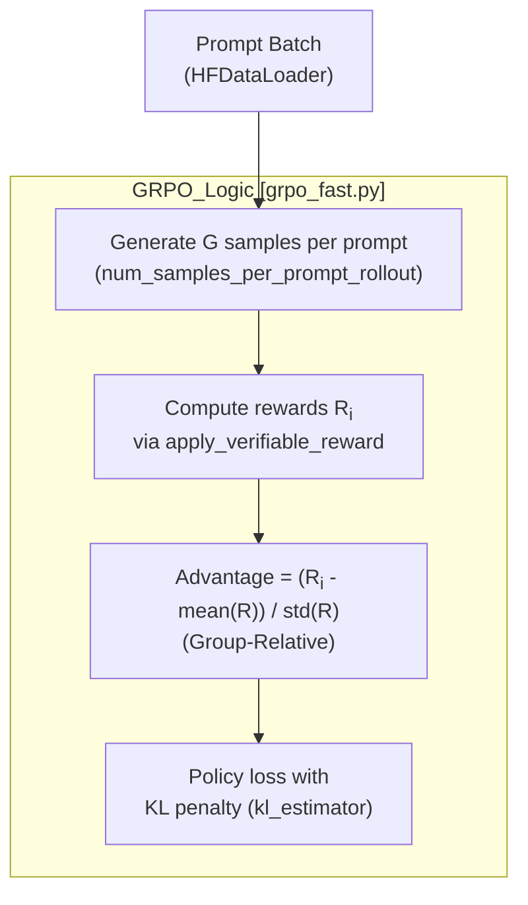
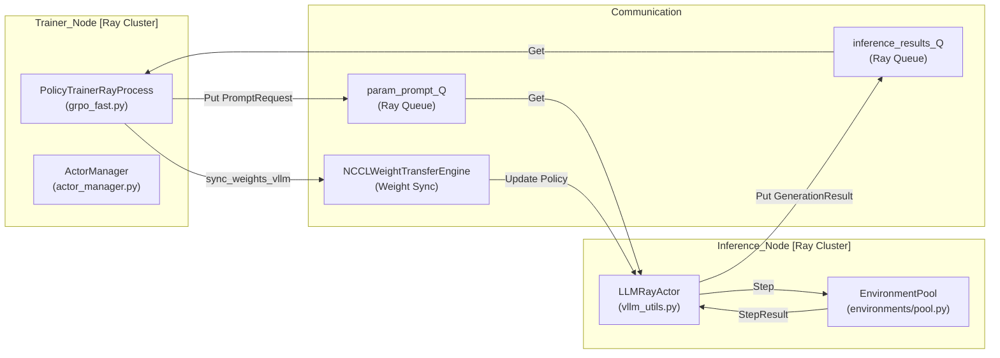
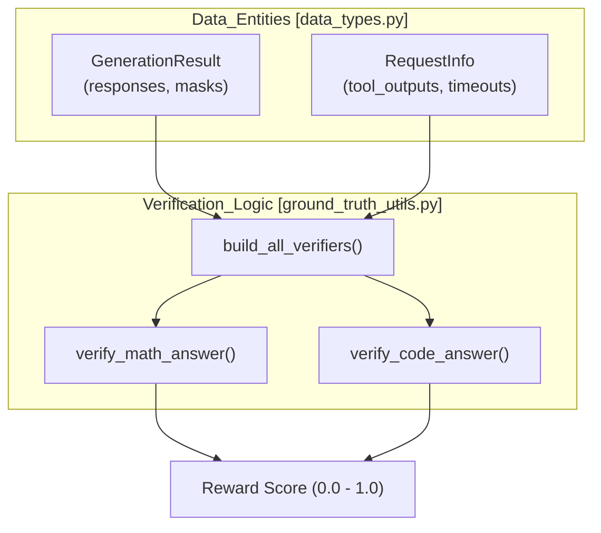

<!-- source: DeepWiki mcp.deepwiki.com · repo allenai/open-instruct · page 2.3 Reinforcement Learning (RLHF) · fetched 2026-10-26 -->

# Reinforcement Learning (RLHF)

Relevant source files

The following files were used as context for generating this wiki page:

- [CHANGELOG.md](CHANGELOG.md)
- [open_instruct/benchmark_generators.py](open_instruct/benchmark_generators.py)
- [open_instruct/data_loader.py](open_instruct/data_loader.py)
- [open_instruct/data_types.py](open_instruct/data_types.py)
- [open_instruct/dpo.py](open_instruct/dpo.py)
- [open_instruct/dpo_utils.py](open_instruct/dpo_utils.py)
- [open_instruct/grpo.py](open_instruct/grpo.py)
- [open_instruct/grpo_callbacks.py](open_instruct/grpo_callbacks.py)
- [open_instruct/grpo_fast.py](open_instruct/grpo_fast.py)
- [open_instruct/grpo_olmo_core_actor.py](open_instruct/grpo_olmo_core_actor.py)
- [open_instruct/grpo_utils.py](open_instruct/grpo_utils.py)
- [open_instruct/olmo_core_train_modules.py](open_instruct/olmo_core_train_modules.py)
- [open_instruct/olmo_core_utils.py](open_instruct/olmo_core_utils.py)
- [open_instruct/rl_utils.py](open_instruct/rl_utils.py)
- [open_instruct/test_dataset_processor.py](open_instruct/test_dataset_processor.py)
- [open_instruct/test_grpo_fast.py](open_instruct/test_grpo_fast.py)
- [open_instruct/test_rl_utils.py](open_instruct/test_rl_utils.py)
- [open_instruct/test_vllm_utils.py](open_instruct/test_vllm_utils.py)
- [open_instruct/test_vllm_utils_gpu.py](open_instruct/test_vllm_utils_gpu.py)
- [open_instruct/vllm_utils.py](open_instruct/vllm_utils.py)

## Purpose and Scope

This page provides an overview of Reinforcement Learning from Human Feedback (RLHF) training methods in the `open-instruct` repository. The codebase primarily focuses on **GRPO (Group Relative Policy Optimization)**, which has become the standard RL algorithm in this repository following the removal of legacy PPO scripts [CHANGELOG.md:12](). Both methods leverage verifiable rewards (code execution, math verification, LLM judges) to train instruction-following models, significantly reducing reliance on static human preference data.

For detailed implementation specifics:
- **GRPO Implementation**: see [GRPO Implementation](#2.3.1) for `grpo_fast.py`, queue-based architecture, and OLMo-core FSDP2 support.
- **Verifiable Rewards and Ground Truth**: see [Verifiable Rewards and Ground Truth](#2.3.2) for `ground_truth_utils.py` and reward computation.
- **Tool-Augmented Training**: see [Tool-Augmented Training](#2.3.3) for RL environments and tool integration.

## RLHF Training Paradigm

The RLHF systems are designed for high-throughput training using **vLLM** for generation and **DeepSpeed** or **OLMo-core (FSDP2)** for policy optimization. The primary algorithm, GRPO, eliminates the need for a separate value model, reducing VRAM requirements while maintaining performance through group-relative advantage estimation [grpo_utils.py:101-110]().

### Algorithm Logic: GRPO

| Aspect | GRPO (`grpo_fast.py`) | PPO (Legacy) |
|--------|------|-----|
| **Advantage Estimation** | Group-relative (within prompt group) | GAE using Value Function |
| **Value Function** | Not required (lower VRAM) | Required (Removed) |
| **Samples per Prompt** | Multiple (G ≥ 2) required | Single sample supported |
| **KL Penalty** | Integrated in Policy Loss [grpo_utils.py:104-105]() | Added to Reward or Loss |
| **Status** | **Primary RL Algorithm** | **Removed from Codebase** [CHANGELOG.md:12]() |

**Sources:** [open_instruct/grpo_fast.py:1-40](), [open_instruct/grpo_utils.py:101-110](), [CHANGELOG.md:12]()

## Async Training Architecture

The repository utilizes an asynchronous architecture to overlap generation and training. This is coordinated via **Ray** and specialized actor classes that communicate through distributed queues.

### System Entity Mapping

This diagram maps the logical RLHF components to specific code entities and their communication channels.

**Key Coordination Components:**
- **`PolicyTrainerRayProcess`**: Manages the training loop, gradient updates, and checkpointing [open_instruct/grpo_fast.py:1013-1040]().
- **`LLMRayActor`**: Wraps the vLLM engine to process `PromptRequest` objects from a queue [open_instruct/vllm_utils.py:532-550]().
- **`NCCLWeightTransferEngine`**: Migrated from custom code to vLLM's native weight transfer API for efficient trainer-to-inference synchronization [CHANGELOG.md:36](), [open_instruct/vllm_utils.py:48-50]().

**Sources:** [open_instruct/grpo_fast.py:1013-1040](), [open_instruct/vllm_utils.py:532-550](), [CHANGELOG.md:36](), [open_instruct/data_types.py:47-61]()

## Verifiable Rewards

A distinguishing feature of this RL framework is the verifiable reward system. Instead of relying solely on a Reward Model (RM), the system evaluates model outputs against ground truth data using programmatic verifiers.

### Reward Flow and Data Entities

**Reward Configuration:**
- **Verifiable Reward**: Scalar rewards derived from `ground_truth_utils.py` verifiers [open_instruct/grpo_fast.py:100-105]().
- **Format Reward**: Rewards for adhering to specific tag-based reasoning formats (e.g., R1-style XML tags) [open_instruct/grpo_fast.py:47-48]().
- **Rho Correction**: Unified interface for `use_rho_correction` (clamping and masking) to handle train/infer engine mismatch in GRPO loss [CHANGELOG.md:20](), [grpo_utils.py:110-120]().

**Sources:** [open_instruct/grpo_fast.py:47-105](), [open_instruct/ground_truth_utils.py:100-110](), [CHANGELOG.md:20](), [open_instruct/grpo_utils.py:110-120]()

## Implementation Variants

| Implementation | Description | File |
|----------------|-------------|------|
| **GRPO Fast** | High-performance, async, queue-based GRPO using DeepSpeed ZeRO-3. | `open_instruct/grpo_fast.py` |
| **OLMo-core GRPO** | Variant using OLMo-core for FSDP2 training, supporting universal checkpointing. | `open_instruct/grpo_olmo_core_actor.py` |
| **GRPO Utils** | Shared utilities for loss computation (DAPO/CISPO), metrics, and resource planning. | `open_instruct/grpo_utils.py` |

**Sources:** [open_instruct/grpo_fast.py:1-40](), [open_instruct/grpo_olmo_core_actor.py:1-10](), [open_instruct/grpo_utils.py:1-30]()

---

**Next Steps:**
- For detailed GRPO implementation and queue mechanics: see [GRPO Implementation](#2.3.1)
- For verifier setup and reward computation: see [Verifiable Rewards and Ground Truth](#2.3.2)
- For tool-augmented training details: see [Tool-Augmented Training](#2.3.3)

---

