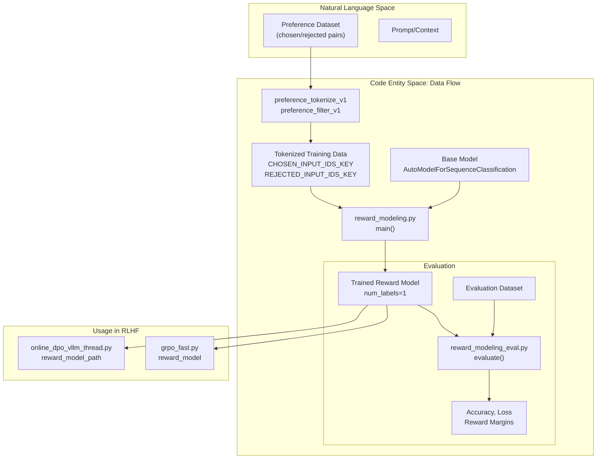
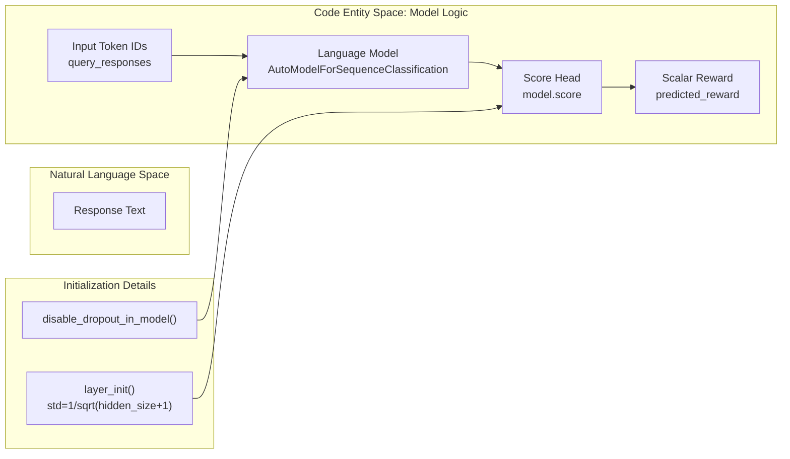
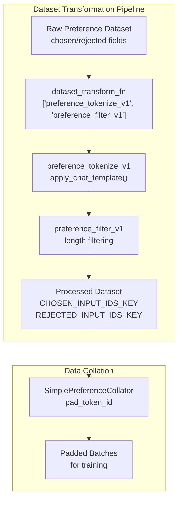

<!-- source: DeepWiki mcp.deepwiki.com · repo allenai/open-instruct · page 2.4 Reward Modeling · fetched 2026-10-26 -->

# Reward Modeling

<details>
<summary>Relevant source files</summary>

The following files were used as context for generating this wiki page:

- [configs/ds_configs/deepspeed_zero2.yaml](configs/ds_configs/deepspeed_zero2.yaml)
- [configs/ds_configs/deepspeed_zero3.yaml](configs/ds_configs/deepspeed_zero3.yaml)
- [docs/algorithms/online_dpo.md](docs/algorithms/online_dpo.md)
- [docs/algorithms/reward_modeling.md](docs/algorithms/reward_modeling.md)
- [docs/algorithms/reward_modeling_colored_tokens.png](docs/algorithms/reward_modeling_colored_tokens.png)
- [docs/algorithms/reward_modeling_ds.png](docs/algorithms/reward_modeling_ds.png)
- [docs/algorithms/reward_modeling_hf_repo.png](docs/algorithms/reward_modeling_hf_repo.png)
- [docs/algorithms/reward_modeling_hf_viz.png](docs/algorithms/reward_modeling_hf_viz.png)
- [docs/algorithms/reward_modeling_preference_sample_texts.png](docs/algorithms/reward_modeling_preference_sample_texts.png)
- [docs/algorithms/reward_modeling_token.png](docs/algorithms/reward_modeling_token.png)
- [docs/algorithms/reward_modeling_token_wandb.png](docs/algorithms/reward_modeling_token_wandb.png)
- [open_instruct/dataset_processor.py](open_instruct/dataset_processor.py)
- [open_instruct/environments/generic_sandbox.py](open_instruct/environments/generic_sandbox.py)
- [open_instruct/environments/tools/servers/python_server/tool_server.py](open_instruct/environments/tools/servers/python_server/tool_server.py)
- [open_instruct/if_functions.py](open_instruct/if_functions.py)
- [open_instruct/olmo_adapter/__init__.py](open_instruct/olmo_adapter/__init__.py)
- [open_instruct/rejection_sampling/synthetic_preference_dataset.py](open_instruct/rejection_sampling/synthetic_preference_dataset.py)
- [open_instruct/reward_modeling.py](open_instruct/reward_modeling.py)
- [open_instruct/reward_modeling_eval.py](open_instruct/reward_modeling_eval.py)

</details>


This page documents the reward modeling system in `open-instruct`, which trains neural networks to score the quality of language model responses. Reward models are essential components for reinforcement learning from human feedback (RLHF) and preference optimization methods like GRPO and Online DPO.

## Overview

The reward modeling system trains sequence classification models to predict scalar reward scores for language model responses. These models learn to distinguish between preferred ("chosen") and non-preferred ("rejected") responses in human preference datasets, enabling automated quality assessment during reinforcement learning training.



**Sources:** [open_instruct/reward_modeling.py:1-42](), [open_instruct/reward_modeling_eval.py:33-42](), [open_instruct/dataset_transformation.py:24-32]()

## Core Training System

The reward modeling training is orchestrated by the `main()` function in `reward_modeling.py`, which implements a Bradley-Terry preference learning objective.

### Training Configuration

The training process is configured through the `Args` dataclass [open_instruct/reward_modeling.py:56-158](), which specifies dataset mixing, model parameters, and training hyperparameters:

| Parameter | Type | Default | Description |
|-----------|------|---------|-------------|
| `dataset_mixer_list` | `list[str]` | `["allenai/tulu-3-wildchat-reused-on-policy-8b", "1.0"]` | Training datasets and mixing ratios |
| `max_token_length` | `int` | `512` | Maximum sequence length for responses |
| `max_prompt_token_length` | `int` | `256` | Maximum length for prompt portion |
| `learning_rate` | `float` | `2e-5` | AdamW optimizer learning rate |
| `per_device_train_batch_size` | `int` | `1` | Batch size per GPU device |
| `gradient_accumulation_steps` | `int` | `8` | Steps to accumulate gradients |

**Sources:** [open_instruct/reward_modeling.py:56-158]()

### Model Architecture and Initialization

The reward model uses `AutoModelForSequenceClassification` with a single output head (`num_labels=1`) to produce scalar reward scores. Specific OLMo adapters are registered for sequence classification to support `Olmo2` and `Olmoe` architectures [open_instruct/reward_modeling.py:166-167]().



Key implementation details for stability:
1. **Layer Initialization**: The score head weights are initialized using `layer_init()` with `std=1 / np.sqrt(model.config.hidden_size + 1)` [open_instruct/reward_modeling.py:160-162]().
2. **Dropout**: Dropout is disabled throughout the model using `disable_dropout_in_model()` to ensure deterministic reward scoring [open_instruct/reward_modeling.py:305]().
3. **Padding**: The tokenizer pads from the right [docs/algorithms/reward_modeling.md:22-22]().
4. **OLMo Support**: Custom classes `Olmo2ForSequenceClassification` and `OlmoeForSequenceClassification` provide the classification head and pooling logic for OLMo-based reward models [open_instruct/olmo_adapter/__init__.py:9-110]().

**Sources:** [open_instruct/reward_modeling.py:160-167](), [open_instruct/reward_modeling.py:305-320](), [docs/algorithms/reward_modeling.md:20-25](), [open_instruct/olmo_adapter/__init__.py:9-110]()

### Training Loop and Loss Function

The training implements pairwise preference learning using the Bradley-Terry model with logsigmoid loss:

```python
# Logic used in main() training loop
query_responses = torch.cat((data[CHOSEN_INPUT_IDS_KEY], data[REJECTED_INPUT_IDS_KEY]), dim=0)
_, predicted_reward, _ = get_reward(model, query_responses, tokenizer.pad_token_id, 0)
chosen_rewards = predicted_reward[: data[CHOSEN_INPUT_IDS_KEY].shape[0]]
rejected_rewards = predicted_reward[data[CHOSEN_INPUT_IDS_KEY].shape[0] :]
loss = -F.logsigmoid(chosen_rewards - rejected_rewards).mean()
accuracy = (chosen_rewards > rejected_rewards).float().mean()
```

The training loop processes batches of chosen/rejected response pairs, computing rewards for both and optimizing the model to maximize the margin between them [open_instruct/reward_modeling.py:358-375]().

**Sources:** [open_instruct/reward_modeling.py:358-375](), [open_instruct/reward_modeling_eval.py:48-53]()

## Dataset Processing Pipeline

Preference datasets are processed through a specialized pipeline that tokenizes chosen/rejected pairs and applies filtering based on length constraints.



The system uses `get_cached_dataset_tulu` to handle loading and transformation [open_instruct/reward_modeling.py:246-260](). The `SimplePreferenceCollator` handles batch padding for the dual-input structure [open_instruct/dataset_transformation.py:28-29]().

**Sources:** [open_instruct/reward_modeling.py:24-32](), [open_instruct/dataset_transformation.py:41-62](), [open_instruct/dataset_processor.py:41-62]()

## Evaluation Framework

Reward model evaluation is handled by `reward_modeling_eval.py`, which assesses performance on held-out preference pairs.

### Evaluation Metrics

The `evaluate()` function [open_instruct/reward_modeling_eval.py:33-98]() computes:
* `eval/rm/accuracy`: Percentage of pairs where `chosen_reward > rejected_reward`.
* `eval/rm/loss`: The logsigmoid loss on the evaluation set.
* `eval/rm/chosen_rewards` & `eval/rm/rejected_rewards`: Mean scalar scores for each category.
* `eval/rm/reward_margin`: The mean difference (`chosen - rejected`).

### Qualitative Analysis
The evaluation script also identifies "shared prompt text" [open_instruct/reward_modeling_eval.py:24-30]() to isolate the model's response-specific scoring and prints a rich table of sampled predictions including correct/incorrect predictions and reward values [open_instruct/reward_modeling_eval.py:61-90]().

**Sources:** [open_instruct/reward_modeling_eval.py:33-98](), [open_instruct/reward_modeling.py:405-424]()

## Integration with RLHF Training

Trained reward models are integrated into reinforcement learning workflows (GRPO) or Online DPO.

* **Scoring Generation**: In RLHF, the reward model provides the scalar signal for policy updates.
* **Online DPO**: In `online_dpo_vllm_thread.py`, the reward model scores model generations to create on-policy preference data [docs/algorithms/online_dpo.md:39-39]().
* **Verifiable Rewards**: While `reward_modeling.py` trains neural rewards, the codebase also supports verifiable rewards (e.g., IFEval taxonomy) via `if_functions.py` for tasks like keyword frequency or word count constraints [open_instruct/if_functions.py:1-220]().

**Sources:** [docs/algorithms/online_dpo.md:31-42](), [open_instruct/if_functions.py:1-220](), [open_instruct/reward_modeling.py:33-41]()

---

