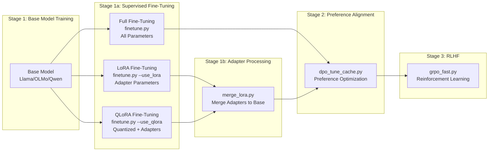
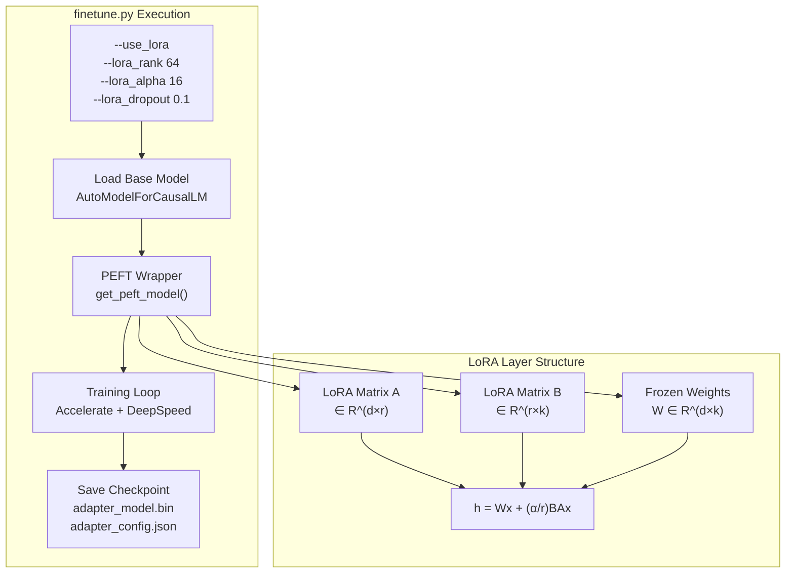
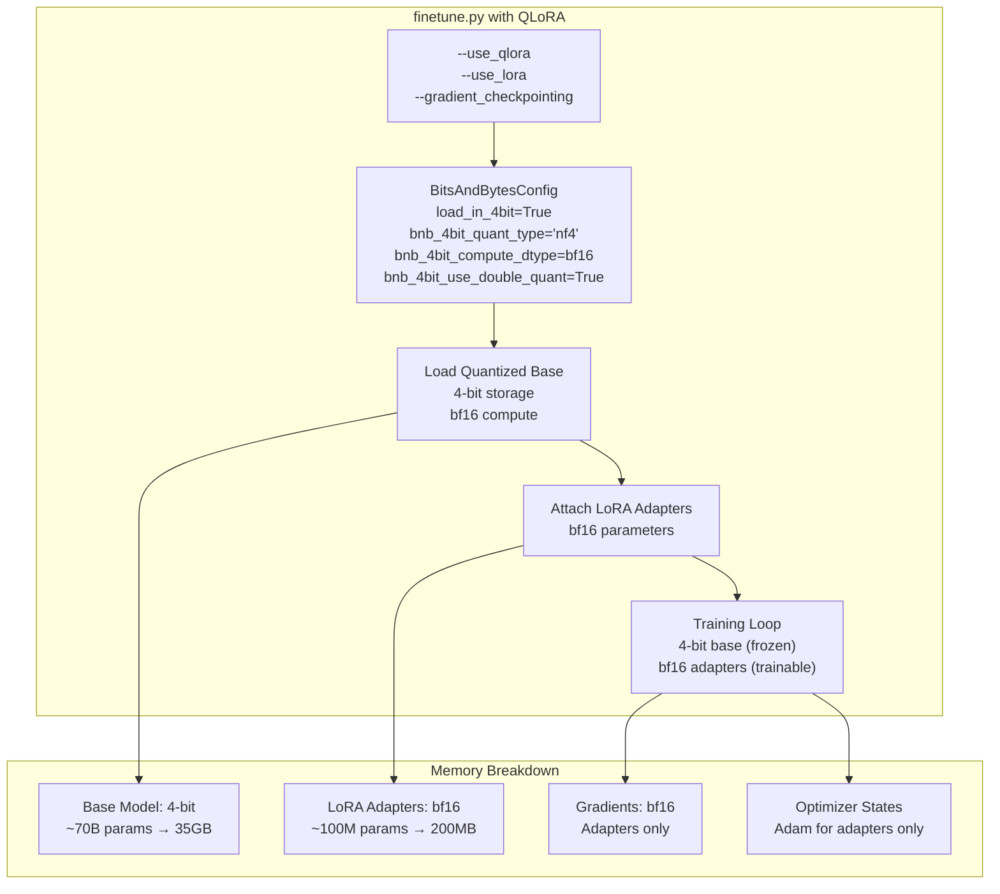
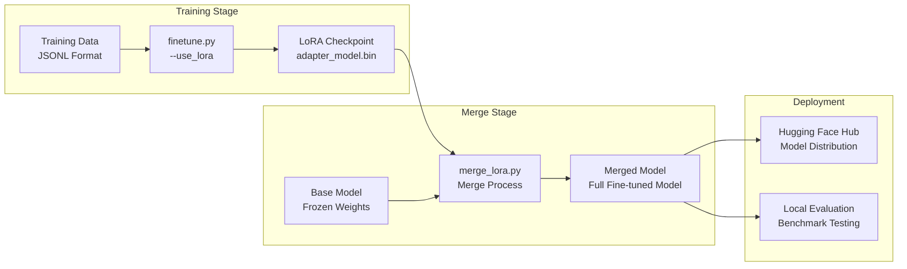

<!-- source: DeepWiki mcp.deepwiki.com · repo allenai/open-instruct · page 3 Parameter-Efficient Fine-Tuning · fetched 2026-10-26 -->

# Parameter-Efficient Fine-Tuning

Relevant source files

The following files were used as context for generating this wiki page:

- [Makefile](Makefile)
- [configs/beaker_configs/run_weight_diff.sh](configs/beaker_configs/run_weight_diff.sh)
- [open_instruct/merge_lora.py](open_instruct/merge_lora.py)
- [scripts/finetune_lora_with_accelerate.sh](scripts/finetune_lora_with_accelerate.sh)
- [scripts/finetune_qlora_with_accelerate.sh](scripts/finetune_qlora_with_accelerate.sh)
- [scripts/finetune_with_accelerate.sh](scripts/finetune_with_accelerate.sh)

This page provides an overview of parameter-efficient fine-tuning (PEFT) capabilities in the open-instruct framework. PEFT techniques enable fine-tuning large language models with significantly reduced memory requirements by training only a small subset of parameters while keeping the majority of pretrained weights frozen.

The framework implements two primary PEFT approaches:
- **LoRA (Low-Rank Adaptation)**: Trainable low-rank matrices added to transformer layers.
- **QLoRA (Quantized LoRA)**: LoRA combined with 4-bit quantization of the base model.

Both methods integrate with the standard supervised fine-tuning pipeline through `finetune.py` [open_instruct/finetune.py:18-18]() and support merging adapters back into the base model via `merge_lora.py` [open_instruct/merge_lora.py:1-100]().

**Related Pages:**
- [LoRA and QLoRA Training](#3.1) — Detailed training configuration and scripts.
- [Adapter Merging](#3.2) — Merging adapters with base models and model merging via mergekit.

## PEFT in the Training Pipeline

Parameter-efficient fine-tuning occupies the same position in the training pipeline as standard supervised fine-tuning (SFT), serving as the first stage in the multi-stage training workflow. The key difference is the dramatically reduced memory footprint and number of trainable parameters.

**PEFT Position in Overall Training Flow**

**Sources:** [scripts/finetune_lora_with_accelerate.sh:11-47](), [scripts/finetune_qlora_with_accelerate.sh:11-46](), [scripts/finetune_with_accelerate.sh:13-36]()

## Memory Efficiency Comparison

PEFT methods achieve significant memory savings by reducing the number of trainable parameters and employing quantization techniques.

| Method | Trainable Parameters | Memory Optimization | Typical Use Case |
|--------|---------------------|---------------------|------------------|
| Full Fine-Tuning | 100% of model | None | Models up to 13B on multi-GPU |
| LoRA | ~0.1-1% of model | Low-rank adapters | Models up to 70B on multi-GPU |
| QLoRA | ~0.1-1% of model | 4-bit quantization + adapters | 70B+ models on limited GPUs |

**Memory Reduction Mechanisms**

```mermaid
graph TB
    subgraph "Full Fine-Tuning"
        FullParams["All Parameters<br/>Trainable"]
        FullGrad["Full Gradient<br/>Storage"]
        FullOpt["Optimizer States<br/>All Parameters"]
    end
    
    subgraph "LoRA"
        FrozenBase["Base Model<br/>Frozen (bf16)"]
        LoRAParams["LoRA Adapters<br/>Trainable"]
        LoRAGrad["Gradient Storage<br/>Adapters Only"]
        LoRAOpt["Optimizer States<br/>Adapters Only"]
    end
    
    subgraph "QLoRA"
        QuantBase["Base Model<br/>Frozen (4-bit)"]
        QLoRAParams["LoRA Adapters<br/>Trainable (bf16)"]
        QLoRAGrad["Gradient Storage<br/>Adapters Only"]
        QLoRAOpt["Optimizer States<br/>Adapters Only"]
    end
    
    FullParams --> FullGrad
    FullGrad --> FullOpt
    
    FrozenBase --> LoRAParams
    LoRAParams --> LoRAGrad
    LoRAGrad --> LoRAOpt
    
    QuantBase --> QLoRAParams
    QLoRAParams --> QLoRAGrad
    QLoRAGrad --> QLoRAOpt
```

**Sources:** [scripts/finetune_lora_with_accelerate.sh:11-40](), [scripts/finetune_qlora_with_accelerate.sh:11-38]()

## LoRA Overview

LoRA (Low-Rank Adaptation) injects trainable low-rank decomposition matrices into transformer layers while keeping the base model frozen. This approach dramatically reduces the number of trainable parameters from billions to millions.

**LoRA Architecture and Training Flow**

**Key LoRA Parameters:**

The training script `finetune_lora_with_accelerate.sh` defines standard hyperparameters for LoRA:

| Parameter | Typical Value | Function |
|-----------|---------------|----------|
| `lora_rank` | 64 | Bottleneck dimension (r) of low-rank matrices [scripts/finetune_lora_with_accelerate.sh:21-21]() |
| `lora_alpha` | 16 | Scaling factor (α) for LoRA updates [scripts/finetune_lora_with_accelerate.sh:22-22]() |
| `lora_dropout` | 0.1 | Dropout probability on LoRA layers [scripts/finetune_lora_with_accelerate.sh:23-23]() |

The effective LoRA scaling is `α/r`. For detailed training configuration and scripts, see [LoRA and QLoRA Training](#3.1).

**Sources:** [scripts/finetune_lora_with_accelerate.sh:20-23](), [open_instruct/merge_lora.py:115-115]()

## QLoRA Overview

QLoRA combines LoRA with 4-bit quantization of the base model, enabling fine-tuning of 70B+ parameter models on consumer hardware. The base model is stored in 4-bit NormalFloat (NF4) format while LoRA adapters remain in `bfloat16`.

**QLoRA Memory Architecture**

**Quantization Configuration:**

The `BitsAndBytesConfig` in `merge_lora.py` specifies:
- `load_in_4bit=True`: Store weights in 4-bit format [open_instruct/merge_lora.py:119-119]()
- `bnb_4bit_compute_dtype=torch.bfloat16`: Compute in bf16 precision [open_instruct/merge_lora.py:120-120]()
- `bnb_4bit_use_double_quant=True`: Quantize quantization constants [open_instruct/merge_lora.py:121-121]()
- `bnb_4bit_quant_type="nf4"`: Use NormalFloat 4-bit data type [open_instruct/merge_lora.py:122-122]()

For detailed QLoRA training and resource requirements, see [LoRA and QLoRA Training](#3.1).

**Sources:** [scripts/finetune_qlora_with_accelerate.sh:17-22](), [open_instruct/merge_lora.py:118-123]()

## Adapter Merging

After training, LoRA adapters must be merged back into the base model to create a standard deployable model. The `merge_lora.py` utility handles this process for both LoRA and QLoRA checkpoints.

**Merge Process Overview**

```mermaid
graph LR
    subgraph "Inputs"
        LoRACheckpoint["LoRA Checkpoint<br/>adapter_model.bin<br/>adapter_config.json"]
        BaseModel["Base Model<br/>Original Weights"]
    end
    
    subgraph "merge_lora.py"
        LoadConfig["PeftConfig.from_pretrained()"]
        LoadBase["AutoModelForCausalLM.from_pretrained()"]
        
        QuantCheck{"--qlora flag?"}
        Dequant["dequantize_model()<br/>4-bit → bf16"]
        
        LoadAdapters["PeftModel.from_pretrained()"]
        MergeOp["lora_model.merge_and_unload()"]
        
        ResizeEmbed["resize_token_embeddings()<br/>if vocab expanded"]
        
        Save["merged_model.save_pretrained()"]
    end
    
    subgraph "Output"
        MergedModel["Merged Model<br/>Full bf16 weights<br/>No adapters"]
    end
    
    LoRACheckpoint --> LoadConfig
    BaseModel --> LoadBase
    
    LoadConfig --> LoadBase
    LoadBase --> QuantCheck
    
    QuantCheck -->|Yes| Dequant
    QuantCheck -->|No| LoadAdapters
    Dequant --> LoadAdapters
    
    LoadAdapters --> MergeOp
    MergeOp --> ResizeEmbed
    ResizeEmbed --> Save
    Save --> MergedModel
```

**Key Operations:**

1. **Dequantization** (QLoRA only): The `dequantize_model()` function converts 4-bit `bnb.nn.Linear4bit` layers back to standard `torch.nn.Linear` layers using `dequantize_4bit()` from `bitsandbytes` [open_instruct/merge_lora.py:32-62]().
2. **Adapter Loading**: `PeftConfig.from_pretrained()` loads adapter weights and configuration [open_instruct/merge_lora.py:115-115]().
3. **Merging**: The logic involves loading the `PeftModel` and calling `merge_and_unload()` (implied by the standard PEFT workflow integrated in the script) [open_instruct/merge_lora.py:113-136]().
4. **Vocabulary Handling**: `resize_token_embeddings()` adjusts embedding layers if the tokenizer vocabulary was expanded during training [open_instruct/merge_lora.py:160-160]().

For detailed merge configuration and usage, see [Adapter Merging](#3.2).

**Sources:** [open_instruct/merge_lora.py:32-62](), [open_instruct/merge_lora.py:115-161]()

## Integration with Training Pipeline

### End-to-End Workflow

**Sources:** [scripts/finetune_lora_with_accelerate.sh:42-46](), [scripts/finetune_qlora_with_accelerate.sh:40-45]()

### Training Script Integration

Both LoRA and QLoRA training scripts follow the same pattern:

1. **Training Phase**: Execute `finetune.py` with PEFT-specific flags like `--use_lora` [scripts/finetune_lora_with_accelerate.sh:20-20]() or `--use_qlora` [scripts/finetune_qlora_with_accelerate.sh:18-18]().
2. **Merge Phase**: Call `merge_lora.py` to create a deployable model [scripts/finetune_lora_with_accelerate.sh:42-46]().
3. **Output**: A full fine-tuned model ready for evaluation or deployment.

The merge step is typically automated within the training scripts, ensuring a complete end-to-end workflow from raw adapters to deployable models.

**Sources:** [scripts/finetune_lora_with_accelerate.sh:11-47](), [scripts/finetune_qlora_with_accelerate.sh:11-46]()

---

