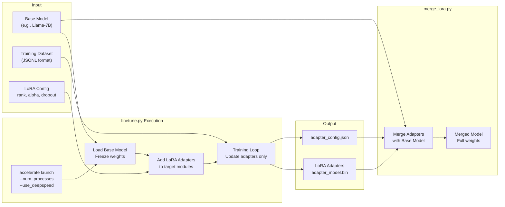
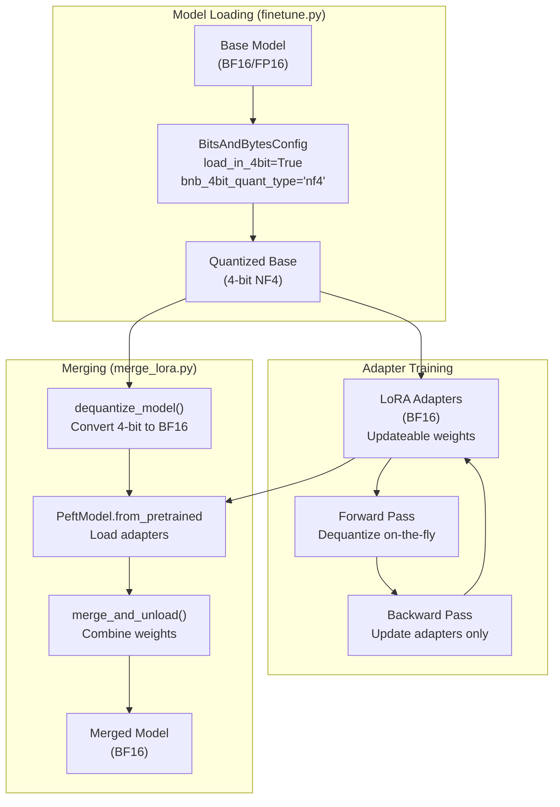
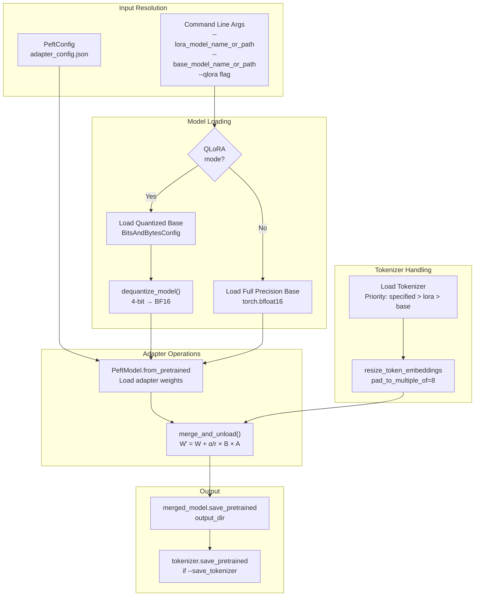

<!-- source: DeepWiki mcp.deepwiki.com · repo allenai/open-instruct · page 3.1 LoRA and QLoRA Training · fetched 2026-10-26 -->

# LoRA and QLoRA Training

<details>
<summary>Relevant source files</summary>

The following files were used as context for generating this wiki page:

- [configs/beaker_configs/alpaca_7B.yaml](configs/beaker_configs/alpaca_7B.yaml)
- [configs/beaker_configs/alpaca_7B_lora.yaml](configs/beaker_configs/alpaca_7B_lora.yaml)
- [configs/beaker_configs/default_finetune_lora_multinode.yaml](configs/beaker_configs/default_finetune_lora_multinode.yaml)
- [configs/beaker_configs/default_finetune_multinode.yaml](configs/beaker_configs/default_finetune_multinode.yaml)
- [configs/beaker_configs/default_finetune_qlora_multinode.yaml](configs/beaker_configs/default_finetune_qlora_multinode.yaml)
- [configs/beaker_configs/run_weight_diff.sh](configs/beaker_configs/run_weight_diff.sh)
- [scripts/finetune_lora_with_accelerate.sh](scripts/finetune_lora_with_accelerate.sh)
- [scripts/finetune_qlora_with_accelerate.sh](scripts/finetune_qlora_with_accelerate.sh)
- [scripts/finetune_with_accelerate.sh](scripts/finetune_with_accelerate.sh)

</details>


## Purpose and Scope

This document covers parameter-efficient fine-tuning (PEFT) methods using Low-Rank Adaptation (LoRA) and Quantized LoRA (QLoRA) in the `open-instruct` repository. These techniques enable training of large language models with significantly reduced memory requirements by training only a small set of adapter parameters. This page focuses on the training scripts, hyperparameter configuration, and adapter merging process. For the general supervised fine-tuning pipeline, see [Supervised Fine-Tuning (SFT)](2.1). For adapter merging specifically, see [Adapter Merging](3.2).

---

## Overview

LoRA and QLoRA reduce training memory requirements by freezing the base model weights and training low-rank decomposition matrices instead of updating all parameters. The repository implements both techniques through the `open_instruct/finetune.py` script with specific flags and configurations [open_instruct/finetune.py:18-45]().

### Training Approaches

| Approach | Base Model Precision | Trainable Parameters | Memory Usage | Training Speed |
|----------|---------------------|---------------------|--------------|----------------|
| Standard | BF16 | All parameters | ~7GB per 1B params | Fastest |
| LoRA | BF16 | Low-rank adapters | ~4GB per 1B params | Fast |
| QLoRA | 4-bit NF4 | Low-rank adapters | ~1GB per 1B params | Slower |

**When to use LoRA**: Training models up to 13B on limited GPU resources, or when full fine-tuning is unnecessary.

**When to use QLoRA**: Training very large models (70B+) on consumer hardware, or maximizing batch size on limited memory.

Sources: [scripts/finetune_lora_with_accelerate.sh:1-47](), [scripts/finetune_qlora_with_accelerate.sh:1-46]()

---

## LoRA Training Configuration

### Training Flow



**Diagram: LoRA Training and Merging Pipeline**

Sources: [scripts/finetune_lora_with_accelerate.sh:11-40](), [scripts/finetune_lora_with_accelerate.sh:42-46]()

### Script Execution

The primary LoRA training script demonstrates the key configuration:

[scripts/finetune_lora_with_accelerate.sh:11-40]()

Key components:
- **Accelerate launcher**: Manages multi-GPU distribution with `--num_processes $NUM_GPUS` [scripts/finetune_lora_with_accelerate.sh:15]().
- **DeepSpeed integration**: Uses `stage3_no_offloading_accelerate.conf` for memory optimization [scripts/finetune_lora_with_accelerate.sh:17]().
- **LoRA flags**: `--use_lora` enables adapter training [scripts/finetune_lora_with_accelerate.sh:20]().
- **LoRA hyperparameters**: `--lora_rank`, `--lora_alpha`, `--lora_dropout` [scripts/finetune_lora_with_accelerate.sh:21-23]().

### LoRA Hyperparameters

| Parameter | Purpose | Typical Values | Example Value |
|-----------|---------|----------------|---------------|
| `lora_rank` | Rank of decomposition matrices | 8, 16, 32, 64 | 64 |
| `lora_alpha` | Scaling factor (α/r controls magnitude) | 8, 16, 32, 64 | 16 |
| `lora_dropout` | Dropout probability for adapters | 0.0, 0.05, 0.1 | 0.1 |

**Rank selection**: Higher rank = more expressive but more parameters. The script uses rank 64 with alpha 16, giving a scaling factor of 16/64 = 0.25 [scripts/finetune_lora_with_accelerate.sh:21-22](). In some multinode configs, alpha is set to 64 to match the rank [configs/beaker_configs/default_finetune_lora_multinode.yaml:33-34]().

Sources: [scripts/finetune_lora_with_accelerate.sh:20-23](), [configs/beaker_configs/default_finetune_lora_multinode.yaml:32-35]()

### Training Configuration

The LoRA script uses specific training hyperparameters optimized for adapter training:

| Setting | Value | Rationale |
|---------|-------|-----------|
| `learning_rate` | 1e-4 | Higher than full fine-tuning (2e-5) due to adapter initialization [scripts/finetune_lora_with_accelerate.sh:32]() |
| `num_train_epochs` | 5 | More epochs compensate for limited adapter capacity [scripts/finetune_lora_with_accelerate.sh:36]() |
| `warmup_ratio` | 0.03 | Standard warmup for stability [scripts/finetune_lora_with_accelerate.sh:34]() |
| `weight_decay` | 0.0 | No regularization on adapters [scripts/finetune_lora_with_accelerate.sh:35]() |
| `max_seq_length` | 4096 | Context length for training [scripts/finetune_lora_with_accelerate.sh:27]() |

Sources: [scripts/finetune_lora_with_accelerate.sh:27-36]()

### DeepSpeed Integration

LoRA training often uses DeepSpeed ZeRO Stage 3 without offloading for optimal performance:

[configs/beaker_configs/default_finetune_lora_multinode.yaml:24-26]()

The configuration enables:
- **ZeRO Stage 3**: Parameter partitioning across GPUs [configs/ds_configs/stage3_no_offloading_accelerate.conf]().
- **BF16 mixed precision**: Via `--mixed_precision bf16` [scripts/finetune_lora_with_accelerate.sh:13]().
- **No offloading**: Keeps all data on GPU for speed [scripts/finetune_lora_with_accelerate.sh:17]().

Sources: [scripts/finetune_lora_with_accelerate.sh:13-18](), [configs/beaker_configs/default_finetune_lora_multinode.yaml:24-26]()

---

## QLoRA Training Configuration

### Quantization Setup

QLoRA extends LoRA by quantizing the base model to 4-bit precision using the NF4 (Normal Float 4) quantization scheme:



**Diagram: QLoRA Quantization and Training Flow**

Sources: [open_instruct/merge_lora.py:118-123](), [open_instruct/merge_lora.py:32-62]()

### Script Execution

The QLoRA script has subtle but important differences from LoRA:

[scripts/finetune_qlora_with_accelerate.sh:11-38]()

**Key differences**:
1. **No DeepSpeed**: QLoRA scripts typically avoid `--use_deepspeed` in the launcher because quantization often conflicts with DeepSpeed ZeRO stages [scripts/finetune_qlora_with_accelerate.sh:12-15]().
2. **Both flags required**: `--use_qlora` and `--use_lora` must both be set [scripts/finetune_qlora_with_accelerate.sh:18-19]().
3. **Gradient checkpointing**: `--gradient_checkpointing` is essential for large models (e.g., 70B) to save memory [scripts/finetune_qlora_with_accelerate.sh:17]().
4. **No mixed precision flag**: BitsAndBytes handles precision internally via `bnb_4bit_compute_dtype` [open_instruct/merge_lora.py:120]().

Sources: [scripts/finetune_qlora_with_accelerate.sh:11-19](), [open_instruct/merge_lora.py:120]()

### Quantization Configuration

QLoRA uses the `BitsAndBytesConfig` with these quantization settings:

| Setting | Value | Purpose |
|---------|-------|---------|
| `load_in_4bit` | True | Enable 4-bit quantization [open_instruct/merge_lora.py:119]() |
| `bnb_4bit_compute_dtype` | torch.bfloat16 | Compute precision for dequantized values [open_instruct/merge_lora.py:120]() |
| `bnb_4bit_use_double_quant` | True | Quantize quantization constants (saves ~0.4 bits/param) [open_instruct/merge_lora.py:121]() |
| `bnb_4bit_quant_type` | "nf4" | Normal Float 4-bit quantization scheme [open_instruct/merge_lora.py:122]() |

The configuration is automatically created when `--use_qlora` is passed to `finetune.py`.

Sources: [open_instruct/merge_lora.py:118-123]()

---

## Hyperparameter Selection

### Recommended Configurations

Different model sizes and use cases benefit from different LoRA configurations:

| Use Case | Model Size | Rank | Alpha | Dropout | Learning Rate | Epochs |
|----------|------------|------|-------|---------|---------------|--------|
| Quick adaptation | 7B | 8 | 8 | 0.0 | 2e-4 | 3 |
| Standard training | 7B-13B | 64 | 16 | 0.1 | 1e-4 | 5 |
| Large model (QLoRA) | 70B | 64 | 64 | 0.1 | 2e-5 | 5 |

Sources: [scripts/finetune_lora_with_accelerate.sh:21-36](), [configs/beaker_configs/default_finetune_qlora_multinode.yaml:31-43]()

### Rank vs. Parameter Count

The number of trainable parameters scales with rank. Higher ranks allow more expressiveness but increase training time and memory. In `open-instruct`, rank 64 is a common default for robust instruction tuning [scripts/finetune_lora_with_accelerate.sh:21]().

---

## Adapter Merging Process

### merge_lora.py Functionality

The `open_instruct/merge_lora.py` script combines trained LoRA adapters with the base model to produce a standard model checkpoint:



**Diagram: merge_lora.py Execution Flow**

Sources: [open_instruct/merge_lora.py:85-195]()

### Command-Line Usage

**Standard LoRA merge**:
```bash
python open_instruct/merge_lora.py \
    --base_model_name_or_path ../hf_llama2_models/7B \
    --lora_model_name_or_path output/tulu_v2_7B_lora/ \
    --output_dir output/tulu_v2_7B_lora_merged/ \
    --save_tokenizer
```

**QLoRA merge**:
```bash
python open_instruct/merge_lora.py \
    --base_model_name_or_path ../hf_llama2_models/70B \
    --lora_model_name_or_path output/tulu_v2_70B_qlora/ \
    --output_dir output/tulu_v2_70B_qlora_merged/ \
    --qlora \
    --save_tokenizer
```

Sources: [scripts/finetune_lora_with_accelerate.sh:42-46](), [scripts/finetune_qlora_with_accelerate.sh:40-45]()

### Dequantization Process

For QLoRA models, the dequantization process converts 4-bit weights back to BF16:

**Key implementation details** [open_instruct/merge_lora.py:32-62]():

1. **Iterate through Linear4bit modules**: Find all quantized layers using `bnb.nn.Linear4bit` [open_instruct/merge_lora.py:38-40]().
2. **Extract quant_state**: Contains quantization parameters (scales, offsets) [open_instruct/merge_lora.py:43]().
3. **Call dequantize_4bit**: Converts 4-bit data to full precision [open_instruct/merge_lora.py:51]().
4. **Replace modules**: Swap `Linear4bit` with standard `torch.nn.Linear` [open_instruct/merge_lora.py:53-58]().
5. **Unset quantization flag**: Set `model.is_loaded_in_4bit = False` [open_instruct/merge_lora.py:60]().

The dequantization happens on CPU (`device="cpu"`) to avoid GPU memory spikes during the merge [open_instruct/merge_lora.py:131]().

Sources: [open_instruct/merge_lora.py:32-62](), [open_instruct/merge_lora.py:131]()

### Tokenizer Handling

The script handles tokenizer resolution with fallback logic:
1. `--tokenizer_name_or_path` (if specified) [open_instruct/merge_lora.py:140-142]().
2. Tokenizer in `lora_model_name_or_path` [open_instruct/merge_lora.py:146]().
3. Tokenizer in `base_model_name_or_path` [open_instruct/merge_lora.py:151]().

If the tokenizer vocabulary is larger than the model's embedding layer, the script resizes embeddings using `resize_token_embeddings` with `pad_to_multiple_of=8` [open_instruct/merge_lora.py:153-161]().

Sources: [open_instruct/merge_lora.py:140-161]()

---

## Resource Requirements

### Training Resources

| Configuration | Model Size | GPUs | Memory/GPU | Training Speed |
|---------------|------------|------|------------|----------------|
| LoRA + DS ZeRO-3 | 7B | 4×A100 (40GB) | ~20 GB | 1× baseline |
| QLoRA | 70B | 8×A100 (40GB) | ~35 GB | 0.7× baseline |

Sources: [scripts/finetune_lora_with_accelerate.sh:1-9](), [scripts/finetune_qlora_with_accelerate.sh:1-9]()

### Batch Size Calculation

Both scripts use the same batch size calculation pattern:

```bash
TOTAL_BATCH_SIZE=128
BATCH_SIZE_PER_GPU=1
GRADIENT_ACC_STEPS=$(($TOTAL_BATCH_SIZE/$NUM_GPUS/$BATCH_SIZE_PER_GPU))
```

For 8 GPUs: `GRADIENT_ACC_STEPS = 128 / 8 / 1 = 16` [scripts/finetune_qlora_with_accelerate.sh:8]().

Sources: [scripts/finetune_lora_with_accelerate.sh:5-8](), [scripts/finetune_qlora_with_accelerate.sh:5-8]()

---

