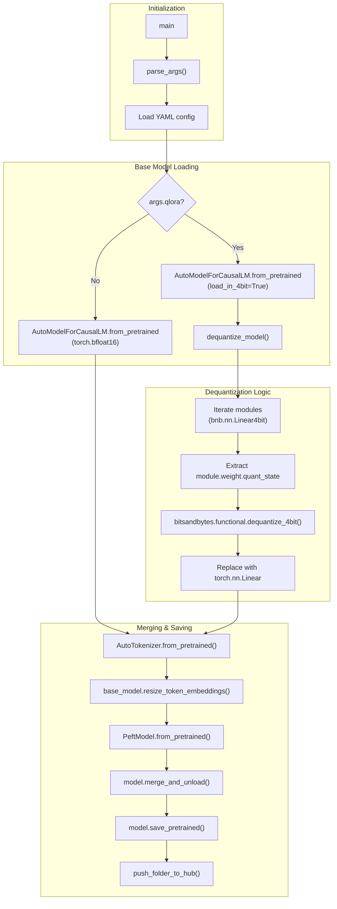
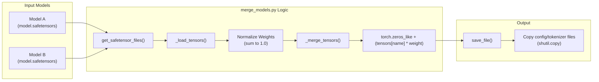

<!-- source: DeepWiki mcp.deepwiki.com · repo allenai/open-instruct · page 3.2 Adapter Merging · fetched 2026-10-26 -->

# Adapter Merging

<details>
<summary>Relevant source files</summary>

The following files were used as context for generating this wiki page:

- [Makefile](Makefile)
- [open_instruct/merge_lora.py](open_instruct/merge_lora.py)
- [open_instruct/merge_models.py](open_instruct/merge_models.py)
- [scripts/merge/README.md](scripts/merge/README.md)
- [scripts/merge/direct_merge.sh](scripts/merge/direct_merge.sh)
- [scripts/merge/mergekit_merge.sh](scripts/merge/mergekit_merge.sh)
- [tests/test_merge_models.py](tests/test_merge_models.py)

</details>


This page documents the processes for merging trained LoRA/QLoRA adapters with base models, as well as merging multiple full models using linear averaging or advanced merging techniques. These operations are critical for producing unified model checkpoints for deployment, evaluation, or subsequent training stages.

## Overview

The `open-instruct` repository provides two primary paths for model merging:
1.  **Adapter Merging (`merge_lora.py`)**: Folds low-rank adapter weights into a base model. It includes specialized logic for dequantizing 4-bit QLoRA models into full precision.
2.  **Model Merging (`merge_models.py` and `mergekit`)**: Combines multiple full model checkpoints. This supports simple linear averaging (architecture-agnostic) or advanced methods like SLERP and TIES via `mergekit`.

## 1. Adapter Merging (`merge_lora.py`)

The `merge_lora.py` script is the standard tool for converting a PEFT-trained model into a standalone HuggingFace model.

### Logic Flow and Implementation

The following diagram illustrates the internal execution flow of `merge_lora.py`, specifically highlighting the dequantization path required for QLoRA.


**Sources:** [open_instruct/merge_lora.py:32-62](), [open_instruct/merge_lora.py:101-194]()

### Key Functions

| Function | Role | File Reference |
| :--- | :--- | :--- |
| `dequantize_model` | Iterates through `Linear4bit` layers, converts weights to `bfloat16` using `dequantize_4bit`, and replaces modules with standard `torch.nn.Linear`. | [open_instruct/merge_lora.py:32-62]() |
| `push_folder_to_hub` | Uses `HfApi` to create repositories/branches and upload the merged model folder to HuggingFace. | [open_instruct/merge_lora.py:65-83]() |
| `parse_args` | Defines CLI arguments for paths, QLoRA flags, tokenizer settings, and Hub integration. | [open_instruct/merge_lora.py:85-98]() |

### Dequantization for QLoRA
When merging QLoRA adapters, the base model must be loaded in 4-bit but converted to `bfloat16` before the adapter weights can be added. The script uses `bitsandbytes` to perform this conversion. While the base model is loaded on GPU if available, the dequantization results in standard linear layers [open_instruct/merge_lora.py:117-132]().

## 2. Model Merging (`merge_models.py`)

For merging multiple full checkpoints (e.g., merging two different SFT runs or a DPO model with an SFT model), the repository uses `merge_models.py`.

### Linear Weight Averaging
`merge_models.py` performs a simple weighted average of `safetensors` files. This is architecture-agnostic because it operates directly on tensor keys rather than high-level model objects [open_instruct/merge_models.py:4-6]().


**Sources:** [open_instruct/merge_models.py:39-129]()

### Implementation Details
- **Weight Normalization**: Weights are normalized so they sum to 1.0. For example, weights `[1.0, 1.0]` result in a 50/50 merge [open_instruct/merge_models.py:81-84]().
- **Safety Checks**: The script verifies that all models have identical sets of `safetensors` files before proceeding [open_instruct/merge_models.py:91-95]().
- **Memory Efficiency**: Tensors are loaded to CPU during the merge to avoid OOM on GPUs [open_instruct/merge_models.py:49]().
- **Metadata Preservation**: The script copies essential configuration (`config.json`, `generation_config.json`) and tokenizer files from the first model in the list [open_instruct/merge_models.py:105-127]().

## 3. Beaker Orchestration for Merging

Merging large models (e.g., 70B+) is often performed on Beaker using specialized shell scripts that wrap `mason.py`.

### Comparison of Merging Scripts

| Script | Method | Best For |
| :--- | :--- | :--- |
| `mergekit_merge.sh` | [mergekit](https://github.com/arcee-ai/mergekit) | Standard architectures (Llama, OLMo3) requiring advanced methods (linear, slerp, ties, dare_ties). [scripts/merge/mergekit_merge.sh:37-38]() |
| `direct_merge.sh` | `merge_models.py` | New or hybrid architectures (e.g., `Olmo3_5Hybrid`) not yet supported by mergekit. [scripts/merge/direct_merge.sh:5-7]() |

**Sources:** [scripts/merge/README.md:12-19]()

### Beaker Execution Pattern
Both scripts use a "Base64 encoding" pattern to pass the merge logic to Beaker. The script or YAML config is encoded into a string, passed via `mason.py`, and decoded inside the container to avoid shell escaping issues [scripts/merge/README.md:49-55]().

- **`direct_merge.sh`**: Encodes the entire `open_instruct/merge_models.py` file [scripts/merge/direct_merge.sh:47-58]().
- **`mergekit_merge.sh`**: Encodes a generated YAML configuration for `mergekit-yaml` [scripts/merge/mergekit_merge.sh:41-71]().

**Example Launch Command (Direct Merge):**
```bash
./scripts/merge/direct_merge.sh \
    /weka/output/path \
    /weka/model1_path \
    /weka/model2_path
```
**Sources:** [scripts/merge/direct_merge.sh:8-13]()

## 4. Testing and Validation

The merging logic is validated through unit tests in `tests/test_merge_models.py`. These tests cover:
- Finding safetensor files [tests/test_merge_models.py:44-54]().
- Weighted averaging accuracy (e.g., 2-model and 3-model merges) [tests/test_merge_models.py:71-98]().
- Error handling for mismatched weights or file sets [tests/test_merge_models.py:126-159]().
- Preservation of config and tokenizer files [tests/test_merge_models.py:114-125]().

**Sources:** [tests/test_merge_models.py:1-160]()

---

