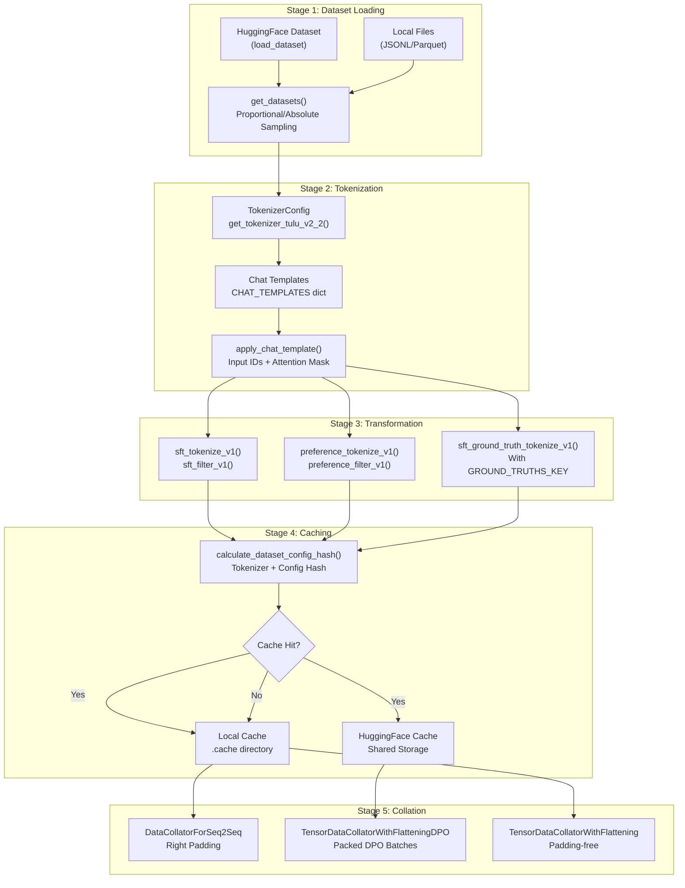
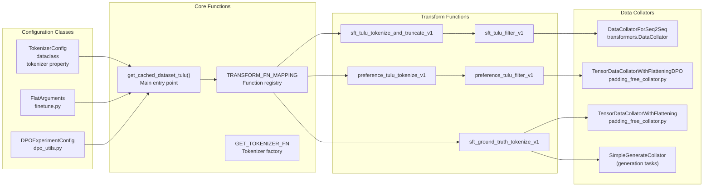

<!-- source: DeepWiki mcp.deepwiki.com · repo allenai/open-instruct · page 4 Data Processing Pipeline · fetched 2026-10-26 -->

# Data Processing Pipeline

Relevant source files

The following files were used as context for generating this wiki page:

- [open_instruct/dataset_transformation.py](open_instruct/dataset_transformation.py)
- [open_instruct/dpo_tune_cache.py](open_instruct/dpo_tune_cache.py)
- [open_instruct/finetune.py](open_instruct/finetune.py)
- [open_instruct/mix_data.py](open_instruct/mix_data.py)
- [open_instruct/mix_data_preferences.py](open_instruct/mix_data_preferences.py)
- [open_instruct/model_utils.py](open_instruct/model_utils.py)
- [open_instruct/test_dpo_utils.py](open_instruct/test_dpo_utils.py)
- [open_instruct/test_model_utils.py](open_instruct/test_model_utils.py)
- [open_instruct/test_utils.py](open_instruct/test_utils.py)
- [open_instruct/utils.py](open_instruct/utils.py)

## Purpose and Scope

The Data Processing Pipeline is responsible for loading, transforming, tokenizing, and caching datasets for all training modes in the repository. It handles multiple training paradigms: Supervised Fine-Tuning (SFT), Direct Preference Optimization (DPO), and Reinforcement Learning (RL/GRPO). The pipeline implements a hash-based caching system that prevents redundant tokenization across multi-node distributed training, saving significant compute time (e.g., "21 hours of H100 time" as noted in the code [open_instruct/dataset_transformation.py:34-37]()).

This document covers dataset preparation through the point where data is ready for consumption by training scripts.

## Pipeline Architecture

The data processing pipeline operates in five main stages: dataset loading/mixing, tokenization, transformation, filtering, and caching. Each stage can be customized through configuration objects and supports multiple parallel workers for efficient processing.

### High-Level Flow

**Diagram: Complete Data Processing Pipeline Flow**

Sources: [open_instruct/dataset_transformation.py:29-41](), [open_instruct/dataset_transformation.py:1123-1158](), [open_instruct/utils.py:1159-1256]()

### Code Entity Mapping

**Diagram: Code Entities and Their Relationships**

Sources: [open_instruct/dataset_transformation.py:773-810](), [open_instruct/dataset_transformation.py:1401-1521](), [open_instruct/padding_free_collator.py:22-60](), [open_instruct/finetune.py:77-136]()

## Child Pages

For detailed technical documentation of each stage, refer to the following child pages:

### [Dataset Transformation and Tokenization](#4.1)
Covers the `dataset_transformation.py` module, including the `TokenizerConfig` class [open_instruct/dataset_transformation.py:773-810](), the `CHAT_TEMPLATES` dictionary containing specialized templates for Tulu, OLMo, Zephyr, and R1/Thinker variants [open_instruct/dataset_transformation.py:152-538](), and the transformation logic for SFT and DPO [open_instruct/dataset_transformation.py:1277-1383]().

### [Dataset Mixing and Preparation](#4.2)
Explains the dataset mixing utility `get_datasets()` [open_instruct/utils.py:1159-1256](), which supports proportional and absolute sampling via `dataset_mixer` dictionaries. Also covers the `mix_data.py` script [open_instruct/mix_data.py:35-53]() and `mix_data_preferences.py` [open_instruct/mix_data_preferences.py:27-53]() for offline dataset preparation.

### [Data Collation Strategies](#4.3)
Compares standard padding collators with optimized strategies like `TensorDataCollatorWithFlattening` [open_instruct/padding_free_collator.py:22-60]() for padding-free training and `TensorDataCollatorWithFlatteningDPO` [open_instruct/padding_free_collator.py:136-160]() for packed preference optimization batches.

### [Data Decontamination and Filtering](#4.4)
Documents the `decontamination/` subsystem used for detecting overlap between training sets and evaluation benchmarks using Elasticsearch or ngram matching, as well as rejection sampling pipelines used to refine dataset quality for RLHF.

## Hash-Based Caching System

The caching system is a critical performance feature. It calculates a unique MD5 hash based on the tokenizer files (using file hashes of `tokenizer.json`, `config.json`, etc.), the chat template, transformation functions, and dataset sources [open_instruct/dataset_transformation.py:1062-1121]().

If a cache hit occurs:
1. Rank 0 checks for the existence of the hashed directory [open_instruct/dataset_transformation.py:1123-1135]().
2. The dataset is loaded directly from disk using `datasets.load_from_disk()`.
3. This bypasses redundant tokenization across nodes, which is essential for large-scale runs (e.g., 405B models) where tokenization can take 20+ hours of compute time across a cluster [open_instruct/dataset_transformation.py:34-37]().

Sources: [open_instruct/dataset_transformation.py:34-41](), [open_instruct/dataset_transformation.py:1062-1158]()

## Visualization and Debugging

The pipeline includes utilities for inspecting tokenization quality:
- `visualize_token`: Renders tokens with alternating background colors for manual inspection of tokenizer behavior [open_instruct/dataset_transformation.py:120-129]().
- `visualize_token_role`: Visualizes tokens while highlighting the mask/label status, helping verify that loss is applied only to the correct segments (e.g., assistant responses) [open_instruct/dataset_transformation.py:131-141]().

Sources: [open_instruct/dataset_transformation.py:120-141]()

---

