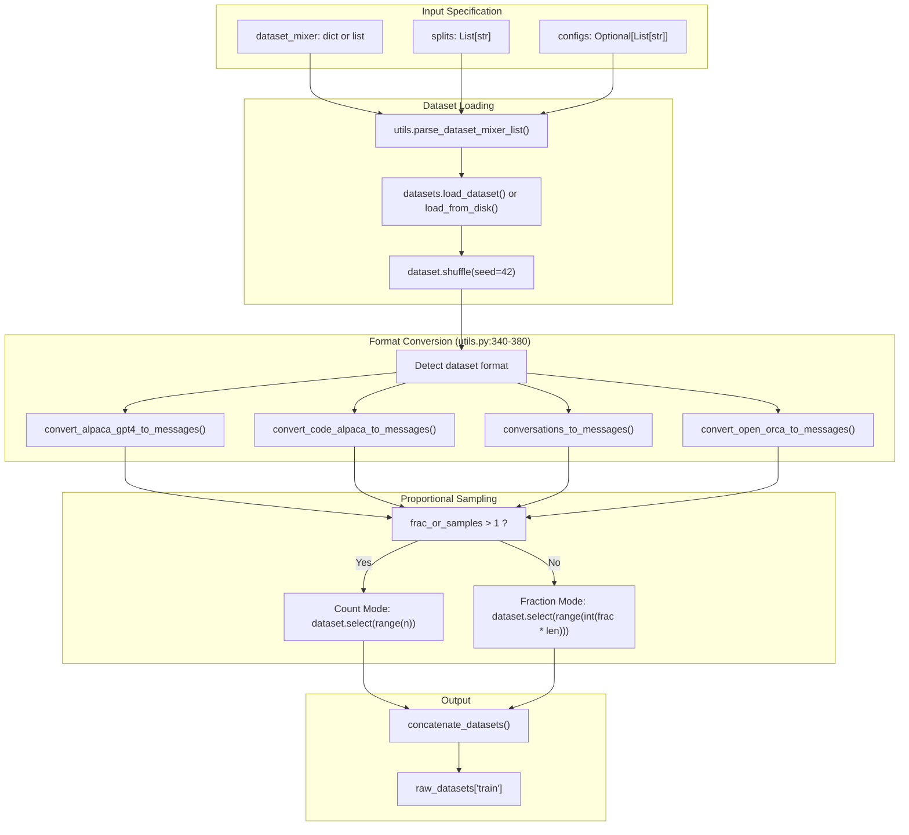
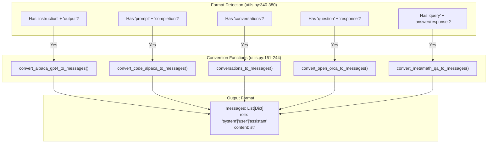
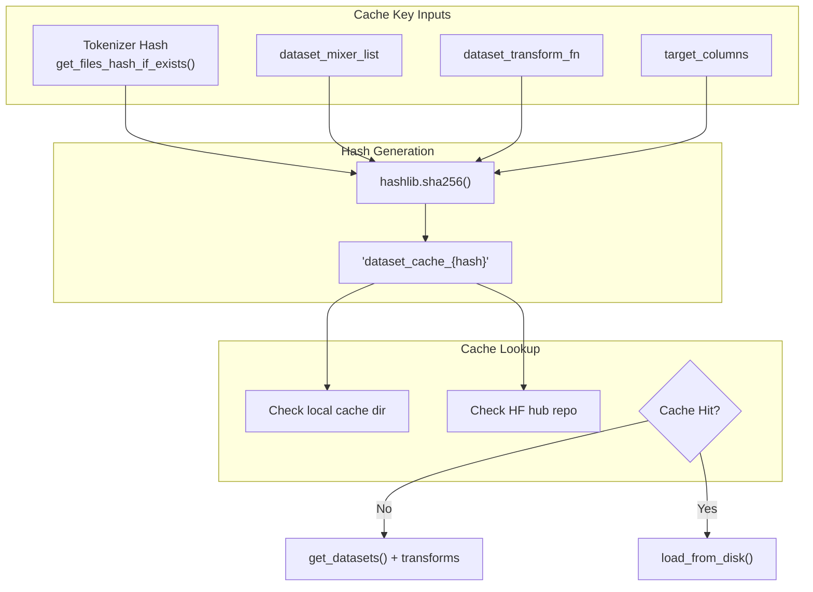

<!-- source: DeepWiki mcp.deepwiki.com · repo allenai/open-instruct · page 4.2 Dataset Mixing and Preparation · fetched 2026-10-26 -->

# Dataset Mixing and Preparation

<details>
<summary>Relevant source files</summary>

The following files were used as context for generating this wiki page:

- [configs/train_configs/sft/tulu3_8b_preview_mix_v3.7.yaml](configs/train_configs/sft/tulu3_8b_preview_mix_v3.7.yaml)
- [open_instruct/dataset_transformation.py](open_instruct/dataset_transformation.py)
- [open_instruct/dpo_tune_cache.py](open_instruct/dpo_tune_cache.py)
- [open_instruct/finetune.py](open_instruct/finetune.py)
- [open_instruct/mix_data.py](open_instruct/mix_data.py)
- [open_instruct/mix_data_preferences.py](open_instruct/mix_data_preferences.py)
- [open_instruct/model_utils.py](open_instruct/model_utils.py)
- [open_instruct/test_dpo_utils.py](open_instruct/test_dpo_utils.py)
- [open_instruct/test_model_utils.py](open_instruct/test_model_utils.py)
- [open_instruct/test_utils.py](open_instruct/test_utils.py)
- [open_instruct/utils.py](open_instruct/utils.py)
- [scripts/data/build_hardcoded.py](scripts/data/build_hardcoded.py)
- [scripts/data/create_nq_tqa_hotpotqa_2wiki_simplqa_data.py](scripts/data/create_nq_tqa_hotpotqa_2wiki_simplqa_data.py)
- [scripts/data/get_statistics_tulu_v3.sh](scripts/data/get_statistics_tulu_v3.sh)
- [scripts/data/get_token_distribution.py](scripts/data/get_token_distribution.py)
- [scripts/data/read_statistics.py](scripts/data/read_statistics.py)
- [scripts/data/rlvr_code/filter_seq_len.py](scripts/data/rlvr_code/filter_seq_len.py)
- [scripts/data/rlvr_code/plot_seq_len.py](scripts/data/rlvr_code/plot_seq_len.py)
- [scripts/data/rlvr_code/sft_to_rlvr_azure.py](scripts/data/rlvr_code/sft_to_rlvr_azure.py)
- [scripts/data/scripts/data/create_asqa_data.py](scripts/data/scripts/data/create_asqa_data.py)

</details>


This document explains how `open-instruct` loads and mixes multiple datasets for training. The system supports both proportional sampling (fractions) and absolute count sampling, with sophisticated caching to avoid redundant preprocessing. The core mixing logic is implemented in the `get_datasets` function in [open_instruct/utils.py:246-474]().

Key capabilities:
- **Dataset Mixing**: Combine multiple datasets with configurable proportions or absolute counts.
- **Format Conversion**: Automatic detection and conversion of common dataset formats (Alpaca, conversations, etc.).
- **Caching**: Hash-based caching with support for local and HuggingFace cache modes.
- **Preprocessing**: Apply transformation functions before training.
- **Hardcoded Data Generation**: Scripts to inject model-specific identity and context (e.g., "You are Tulu 3...").

## Dataset Mixing Overview

The `get_datasets` function in [open_instruct/utils.py:246-474]() is the entry point for dataset mixing. It loads multiple datasets from HuggingFace Hub or local files, applies format conversions, and samples according to specified proportions.

### Dataset Mixing Flow



Sources: [open_instruct/utils.py:246-474](), [open_instruct/test_utils.py:130-156]()

## Dataset Mixer Configuration

The system accepts datasets in two formats: dictionary or list. The list format is converted to dictionary internally using `parse_dataset_mixer_list` at [open_instruct/utils.py:286-298]().

### Input Formats

**Dictionary Format:**
```python
dataset_mixer = {
    "allenai/tulu-3-sft-personas-algebra": 0.7,  # 70% of dataset
    "allenai/wildchat-reused": 1000,              # 1000 samples
    "local_dataset.jsonl": 0.3                    # 30% of local dataset
}
```

**List Format (CLI friendly):**
```python
dataset_mixer_list = [
    "allenai/tulu-3-sft-personas-algebra", "0.7",
    "allenai/wildchat-reused", "1000"
]
```

In [open_instruct/finetune.py:124-130](), these are defined as core arguments for SFT. If a dictionary `dataset_mixer` is provided via config, it takes precedence.

### Proportional vs Absolute Sampling

The `get_datasets` function detects the sampling mode by checking if any value in the mixer is greater than 1 [open_instruct/utils.py:422-429]():

```python
# If any value > 1, use count mode
if any(frac_or_samples > 1 for frac_or_samples in frac_or_sample_list):
    is_count = True
    if not all(isinstance(frac_or_samples, int) for frac_or_samples in frac_or_sample_list):
        raise NotImplementedError("Cannot mix fractions and counts, yet.")
else:
    is_count = False
```

Sampling is applied at [open_instruct/utils.py:434-442]():
```python
for dataset, frac_or_samples in zip(raw_train_datasets, frac_or_sample_list):
    if is_count:
        train_subset = dataset.select(range(frac_or_samples))
    else:
        train_subset = dataset.select(range(int(frac_or_samples * len(dataset))))
    train_subsets.append(train_subset)
```

Sources: [open_instruct/utils.py:286-442](), [open_instruct/finetune.py:124-130](), [open_instruct/test_utils.py:76-129]()

## Format Conversion

The `get_datasets` function automatically detects and converts common dataset formats to a unified `messages` format. This happens at [open_instruct/utils.py:340-380]().

### Format Detection and Conversion Logic



### Supported Formats

| Format | Detection Keys | Converter Function |
|--------|-----------|-------------------|
| Alpaca | `instruction`, `output` | `convert_alpaca_gpt4_to_messages` |
| Code Alpaca | `prompt`, `completion` | `convert_code_alpaca_to_messages` |
| Conversations | `conversations` | `conversations_to_messages` |
| OpenOrca | `question`, `response` | `convert_open_orca_to_messages` |
| MetaMath | `query`, `response` | `convert_metamath_qa_to_messages` |

Sources: [open_instruct/utils.py:151-380]()

## Data Preparation Scripts

The repository includes standalone scripts for mixing and preparing data outside of the main training loop.

### Mixing Scripts
- **`mix_data.py`**: A utility for mixing SFT datasets. It uses `get_datasets` with `columns_to_keep=["messages"]` and optionally pushes the result to the HuggingFace Hub [open_instruct/mix_data.py:35-64]().
- **`mix_data_preferences.py`**: Specialized for preference data (DPO). It keeps `chosen`, `rejected`, `chosen_model`, and `rejected_model` columns [open_instruct/mix_data_preferences.py:27-56]().

### Hardcoded Identity Injection
The script `scripts/data/build_hardcoded.py` is used to build "identity" data so models know their name, creator (Ai2), and knowledge cutoff.
- **Placeholders**: Uses keys like `<|MODEL_NAME|>`, `<|DATE_CUTOFF|>`, and `<|LICENSE|>` [scripts/data/build_hardcoded.py:45-53]().
- **Processing**: The `process_example` function replaces placeholders and prepends a system prompt if one is missing [scripts/data/build_hardcoded.py:174-200]().

### Statistics and Distribution
- **`get_token_distribution.py`**: Plots histograms of token lengths across datasets to help balance mixtures [scripts/data/get_token_distribution.py:22-154]().
- **`read_statistics.py`**: Aggregates token counts and sample sizes from JSON statistics files.

Sources: [open_instruct/mix_data.py](), [open_instruct/mix_data_preferences.py](), [scripts/data/build_hardcoded.py](), [scripts/data/get_token_distribution.py]()

## Caching System

The caching system prevents redundant dataset processing. It uses hash-based cache keys derived from the tokenizer configuration and dataset parameters. The core logic is in `get_cached_dataset_tulu` at [open_instruct/dataset_transformation.py:1469-1650]().

### Cache Key Generation



### Cache Modes

- **Local Cache Mode**: Saves to `dataset_local_cache_dir`. On Beaker jobs, this is automatically redirected to a shared Weka directory to avoid re-tokenizing across experiments [open_instruct/finetune.py:137-140, 407-409]().
- **HuggingFace Cache Mode**: Processed datasets are pushed to the HF Hub, allowing nodes without shared storage to download pre-tokenized data [open_instruct/dataset_transformation.py:1600-1620]().

Sources: [open_instruct/dataset_transformation.py:1469-1650](), [open_instruct/finetune.py:136-143, 407-409]()

## Additional Utilities

### Column Management
The `get_datasets` function ensures schema consistency by removing redundant columns and adding missing columns with `None` values [open_instruct/utils.py:388-400]().

### Source Tracking
When `add_source_col=True`, a `source` column is added to identify which component dataset an example originated from, which is useful for debugging and balancing [open_instruct/utils.py:393-395]().

Sources: [open_instruct/utils.py:383-400]()

---

