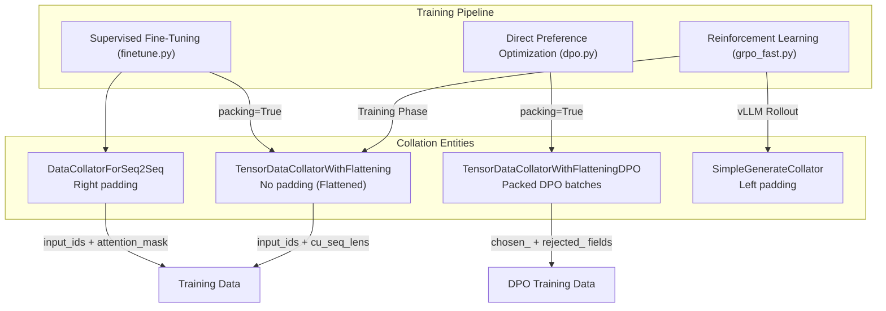
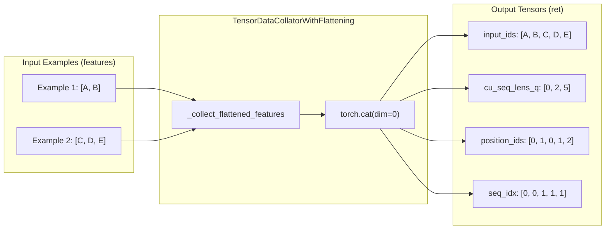
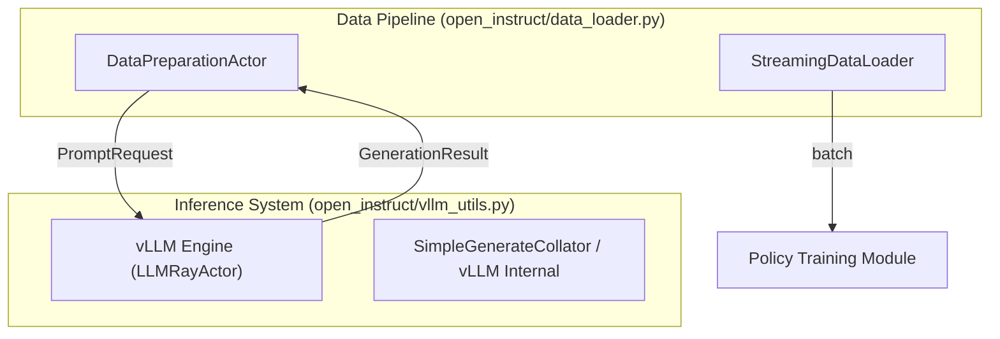

<!-- source: DeepWiki mcp.deepwiki.com · repo allenai/open-instruct · page 4.3 Data Collation Strategies · fetched 2026-10-26 -->

# Data Collation Strategies

<details>
<summary>Relevant source files</summary>

The following files were used as context for generating this wiki page:

- [AGENTS.md](AGENTS.md)
- [docs/algorithms/rejection_sampling.md](docs/algorithms/rejection_sampling.md)
- [open_instruct/olmo_core_callbacks.py](open_instruct/olmo_core_callbacks.py)
- [open_instruct/padding_free_collator.py](open_instruct/padding_free_collator.py)
- [open_instruct/rejection_sampling/__init__.py](open_instruct/rejection_sampling/__init__.py)
- [open_instruct/rejection_sampling/generation.py](open_instruct/rejection_sampling/generation.py)
- [open_instruct/rejection_sampling/prompt_templates.py](open_instruct/rejection_sampling/prompt_templates.py)
- [open_instruct/rejection_sampling/rejection_sampling.py](open_instruct/rejection_sampling/rejection_sampling.py)
- [open_instruct/test_data/generation_with_tools_expected.json](open_instruct/test_data/generation_with_tools_expected.json)
- [open_instruct/test_data/generation_without_tools_expected.json](open_instruct/test_data/generation_without_tools_expected.json)
- [open_instruct/test_data_loader.py](open_instruct/test_data_loader.py)
- [open_instruct/test_data_loader_gpu.py](open_instruct/test_data_loader_gpu.py)
- [open_instruct/test_dpo_utils_gpu.py](open_instruct/test_dpo_utils_gpu.py)
- [open_instruct/test_grpo_fast_gpu.py](open_instruct/test_grpo_fast_gpu.py)
- [open_instruct/test_padding_free_collator.py](open_instruct/test_padding_free_collator.py)
- [open_instruct/test_streaming_data_loader_gpu.py](open_instruct/test_streaming_data_loader_gpu.py)
- [scripts/benchmarking/launch_benchmark_single_gpu.sh](scripts/benchmarking/launch_benchmark_single_gpu.sh)
- [scripts/benchmarking/launch_benchmark_single_node.sh](scripts/benchmarking/launch_benchmark_single_node.sh)
- [scripts/rejection_sampling_tulu.bash](scripts/rejection_sampling_tulu.bash)
- [scripts/rejection_sampling_tulu_docker.bash](scripts/rejection_sampling_tulu_docker.bash)
- [scripts/train/debug/dpo/7b_instruct_dpo_olmo_core.sh](scripts/train/debug/dpo/7b_instruct_dpo_olmo_core.sh)
- [scripts/train/debug/dpo/checkpoint_integration_test.sh](scripts/train/debug/dpo/checkpoint_integration_test.sh)
- [scripts/train/debug/dpo/local.sh](scripts/train/debug/dpo/local.sh)
- [scripts/train/debug/dpo/multi_node.sh](scripts/train/debug/dpo/multi_node.sh)
- [scripts/train/debug/dpo/multi_node_cache.sh](scripts/train/debug/dpo/multi_node_cache.sh)
- [scripts/train/debug/dpo/single_gpu.sh](scripts/train/debug/dpo/single_gpu.sh)
- [scripts/train/debug/dpo_integration_test.sh](scripts/train/debug/dpo_integration_test.sh)
- [scripts/train/olmo3/7b_instruct_dpo_olmocore.sh](scripts/train/olmo3/7b_instruct_dpo_olmocore.sh)

</details>


This document describes the different data collation strategies used throughout the `open-instruct` repository. Collators are responsible for batching tokenized examples, applying padding, or flattening sequences to prepare them for model training or inference. Different training paradigms (SFT, DPO, RL) and execution contexts (training vs. generation) require different collation approaches.

## Overview of Collation Strategies

The repository implements several specialized collation strategies, each optimized for specific training objectives and architectures.

| Collator | Padding Direction | Padding-Free | Primary Use Case | Training Stage |
|----------|------------------|--------------|------------------|----------------|
| `DataCollatorForSeq2Seq` | Right | No | Standard SFT training | SFT |
| `TensorDataCollatorWithFlattening` | N/A | Yes | Memory-efficient training | SFT, RL |
| `TensorDataCollatorWithFlatteningDPO`| N/A | Yes | Packed DPO training | DPO |
| `SimpleGenerateCollator` | Left | No | Generation/inference | RL rollout |

### Collation Workflow


Sources: [open_instruct/padding_free_collator.py:68-146](), [open_instruct/dpo.py:33-33](), [scripts/train/debug/dpo/multi_node.sh:32-33]()

## Standard Padding: DataCollatorForSeq2Seq

The `DataCollatorForSeq2Seq` from HuggingFace Transformers is the default collator for standard Supervised Fine-Tuning (SFT). It pads sequences from the **right** to the length of the longest sequence in the batch.

### Characteristics
- **Padding direction**: Right (sequences are padded at the end).
- **Labels**: Padded with `-100` to ensure they are ignored by the cross-entropy loss function.
- **Primary use**: Standard SFT training.

Sources: [open_instruct/padding_free_collator.py:115-115](), [open_instruct/test_padding_free_collator.py:132-133]()

## Padding-Free: TensorDataCollatorWithFlattening

The `TensorDataCollatorWithFlattening` implements a "packing" strategy where multiple sequences are concatenated into a single flat tensor. This eliminates wasted computation on padding tokens and is highly efficient when used with Flash Attention 2.

### Characteristics
- **No Padding**: Sequences are concatenated end-to-end.
- **Metadata**: Returns `cu_seq_lens` (cumulative sequence lengths) to demarcate example boundaries.
- **Shape**: Returns tensors with shape `(1, total_tokens)` instead of `(batch_size, max_length)`.
- **Primary use**: Memory-efficient SFT and the training phase of RL (GRPO).

### Data Flow for Flattening


Sources: [open_instruct/padding_free_collator.py:19-49](), [open_instruct/padding_free_collator.py:68-120]()

## Packed DPO: TensorDataCollatorWithFlatteningDPO

Used in the optimized DPO path, this collator extends the flattening strategy to preference data. It ensures that chosen and rejected sequences are packed efficiently within a token budget.

### Implementation Details
- **Token Budgeting**: Uses `count_features_within_token_budget` to determine how many DPO pairs can fit into a single packed batch without exceeding `max_seq_length`. It stops before the first feature that would cause either branch to exceed the budget.
- **Dual Flattening**: Separately flattens the "chosen" and "rejected" branches of the batch using `_filter_feature_dicts`.
- **Metadata**: Prepends `chosen_` and `rejected_` prefixes to the returned tensor keys (e.g., `chosen_input_ids`, `rejected_cu_seq_lens_q`).

Sources: [open_instruct/padding_free_collator.py:123-142](), [open_instruct/padding_free_collator.py:146-163]()

## Generation Collation: SimpleGenerateCollator

For inference and the rollout phase of RL training (GRPO), models require **left-padding**. This ensures that the last token of the prompt is at the same position for all sequences in a batch, which is critical for autoregressive generation.

### Characteristics
- **Padding direction**: Left.
- **Primary use**: vLLM-based generation and RL rollout steps.
- **Implementation**: In the GRPO pipeline, `StreamingDataLoader` coordinates with `DataPreparationActor` to provide prompts for rollout.

### RL Rollout Data Flow


Sources: [open_instruct/data_loader.py:131-152](), [open_instruct/vllm_utils.py:60-60](), [open_instruct/test_streaming_data_loader_gpu.py:129-152]()

## Log-Probability Calculation

A critical function shared by several collators and training modules is `calculate_per_token_logps`. This function computes the log-probabilities of labels given the model's logits, handling the necessary internal shifting.

Sources: [open_instruct/padding_free_collator.py:10-16]()

```python
def calculate_per_token_logps(logits: torch.Tensor, labels: torch.Tensor) -> torch.Tensor:
    # Shift labels: shifted_labels[:, :-1] = labels[:, 1:]
    shifted_labels = torch.full_like(labels, -100)
    shifted_labels[:, :-1] = labels[:, 1:]

    logits = logits.to(torch.float32)
    safe = shifted_labels.clamp(min=0)
    # Gather log_softmax values at the label indices
    return torch.gather(logits.log_softmax(-1), 2, safe.unsqueeze(2)).squeeze(2)
```

This is used extensively in DPO and RLHF to compute the objective functions by gathering log-probs for specific tokens.

Sources: [open_instruct/padding_free_collator.py:10-16](), [open_instruct/olmo_core_train_modules.py:21-21]()

## Summary of Metadata Keys

When using flattening collators (`TensorDataCollatorWithFlattening`), the following keys are added to the batch dictionary to guide the model's attention mechanisms:

- `cu_seq_lens_q` / `cu_seq_lens_k`: Cumulative sequence lengths for query and key, used by Flash Attention kernels.
- `max_length_q` / `max_length_k`: The maximum sequence length present in the packed batch.
- `position_ids`: Reset to 0 at the start of each individual sequence within the packed tensor.
- `seq_idx`: An index identifying which original example each token belongs to, preventing cross-contamination in attention.

Sources: [open_instruct/padding_free_collator.py:101-112](), [open_instruct/olmo_core_train_modules.py:132-142]()

---

