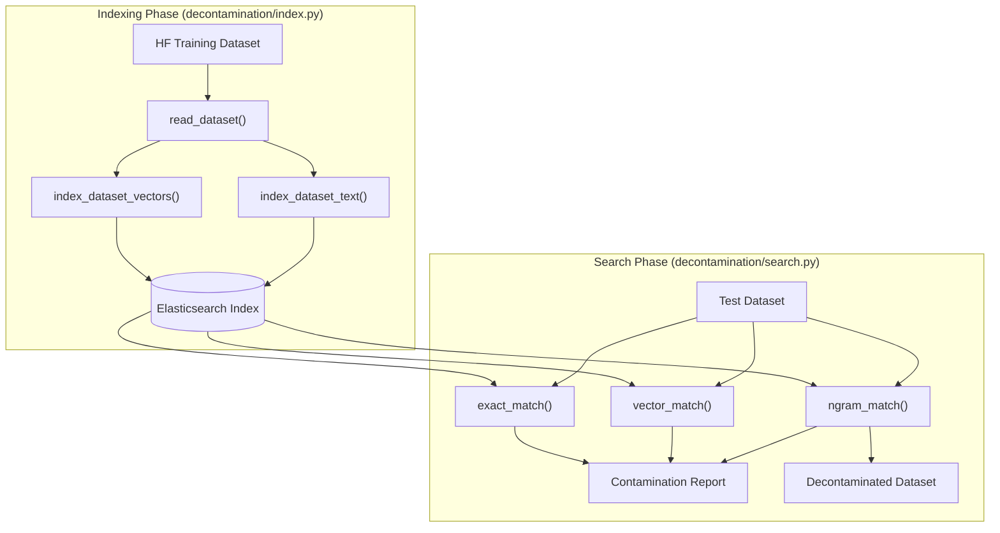
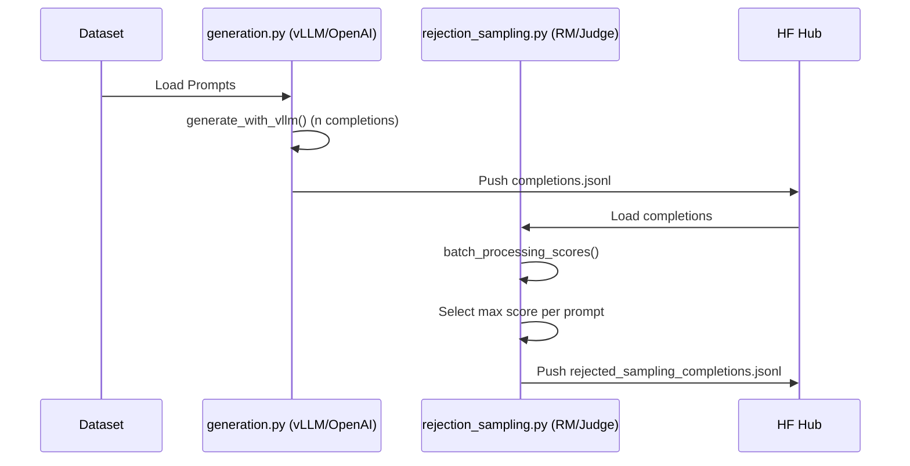

<!-- source: DeepWiki mcp.deepwiki.com · repo allenai/open-instruct · page 4.4 Data Decontamination and Filtering · fetched 2026-10-26 -->

# Data Decontamination and Filtering

Relevant source files

The following files were used as context for generating this wiki page:

- [decontamination/README.md](decontamination/README.md)
- [decontamination/index.py](decontamination/index.py)
- [decontamination/search.py](decontamination/search.py)
- [docs/algorithms/rejection_sampling.md](docs/algorithms/rejection_sampling.md)
- [open_instruct/rejection_sampling/__init__.py](open_instruct/rejection_sampling/__init__.py)
- [open_instruct/rejection_sampling/generation.py](open_instruct/rejection_sampling/generation.py)
- [open_instruct/rejection_sampling/prompt_templates.py](open_instruct/rejection_sampling/prompt_templates.py)
- [open_instruct/rejection_sampling/rejection_sampling.py](open_instruct/rejection_sampling/rejection_sampling.py)
- [open_instruct/test_padding_free_collator.py](open_instruct/test_padding_free_collator.py)
- [scripts/data/filtering_and_updates/README.md](scripts/data/filtering_and_updates/README.md)
- [scripts/data/filtering_and_updates/TEST_README.md](scripts/data/filtering_and_updates/TEST_README.md)
- [scripts/data/filtering_and_updates/filter_chinese.py](scripts/data/filtering_and_updates/filter_chinese.py)
- [scripts/data/filtering_and_updates/filter_chinese_batch.sh](scripts/data/filtering_and_updates/filter_chinese_batch.sh)
- [scripts/data/filtering_and_updates/filter_cots.py](scripts/data/filtering_and_updates/filter_cots.py)
- [scripts/data/filtering_and_updates/filter_cutoff_date.py](scripts/data/filtering_and_updates/filter_cutoff_date.py)
- [scripts/data/filtering_and_updates/filter_dataset_by_keywords.py](scripts/data/filtering_and_updates/filter_dataset_by_keywords.py)
- [scripts/data/filtering_and_updates/filter_datasets_sequential.sh](scripts/data/filtering_and_updates/filter_datasets_sequential.sh)
- [scripts/data/filtering_and_updates/filter_ngram_repetitions.py](scripts/data/filtering_and_updates/filter_ngram_repetitions.py)
- [scripts/data/filtering_and_updates/filter_repetition.sh](scripts/data/filtering_and_updates/filter_repetition.sh)
- [scripts/data/filtering_and_updates/filter_special_tokens.py](scripts/data/filtering_and_updates/filter_special_tokens.py)
- [scripts/data/filtering_and_updates/filter_wildchat.py](scripts/data/filtering_and_updates/filter_wildchat.py)
- [scripts/data/filtering_and_updates/run_tests.py](scripts/data/filtering_and_updates/run_tests.py)
- [scripts/data/filtering_and_updates/test_filter_ngram_repetitions.py](scripts/data/filtering_and_updates/test_filter_ngram_repetitions.py)
- [scripts/data/filtering_and_updates/update_subsets.py](scripts/data/filtering_and_updates/update_subsets.py)
- [scripts/rejection_sampling_tulu.bash](scripts/rejection_sampling_tulu.bash)
- [scripts/rejection_sampling_tulu_docker.bash](scripts/rejection_sampling_tulu_docker.bash)

This page documents the decontamination and filtering subsystem of the `open-instruct` repository. This system is responsible for identifying and removing overlaps between training data and evaluation benchmarks, as well as filtering datasets based on quality, keywords, and rejection sampling results.

## Overview of Decontamination

The decontamination subsystem uses [Elasticsearch](https://www.elastic.co/) to index training datasets and search for overlaps with test sets using exact string matching, n-gram matching, or semantic embedding-based matching.

### Data Flow and Architecture

The decontamination process consists of two primary stages: **Indexing** and **Searching/Decontaminating**.

#### 1. Indexing Stage
Training datasets (e.g., Tulu mixtures) are processed into Elasticsearch documents. By default, the system indexes the `user` role's content to identify prompt-side leakage [decontamination/README.md:30-34](). The indexing script `index.py` handles reading the dataset and pushing it to Elasticsearch [decontamination/index.py:40-54]().

#### 2. Search and Decontamination Stage
Test sets (e.g., AlpacaEval, GSM8K) are used to query the indices via `search.py`. The system computes match scores and can optionally generate a decontaminated version of the training set by removing flagged instances using the `--decontaminate` flag [decontamination/README.md:101-104]().

### System Architecture Diagram

Sources: [decontamination/index.py:14-38](), [decontamination/search.py:41-68](), [decontamination/README.md:1-50]()

---

## Implementation Details

### Indexing Strategies
The system supports two types of indices:
*   **Text Index**: Uses a custom `tulu_analyzer` to handle math and code tokens, which are often split incorrectly by standard analyzers. It splits on a specific set of punctuation and newlines while lowercasing [decontamination/index.py:14-26]().
*   **Vector Index**: Stores dense embeddings (defaulting to `nvidia/NV-Embed-v2`) with 4096 dimensions using dot product similarity [decontamination/index.py:28-37]().

### Matching Algorithms
| Method | Function | Description |
| :--- | :--- | :--- |
| **Exact Match** | `exact_match` | Uses Elasticsearch `match_phrase` filters to find identical strings in the query dataset [decontamination/search.py:41-65](). |
| **N-gram Match** | `ngram_match` | Computes a ratio of overlapping n-grams between test and train docs using `spacy` tokenization and the `get_ngram_mapping` helper [decontamination/search.py:68-139](). |
| **Vector Match** | `vector_match` | Performs semantic search using model-generated embeddings (via `prepare_embedding_model`) and cosine similarity [decontamination/search.py:142-180](). |

Sources: [decontamination/index.py:14-37](), [decontamination/search.py:41-180](), [decontamination/search.py:19-30]()

---

## Rejection Sampling Pipeline

Rejection sampling samples `n` outputs from a policy and uses a Reward Model (RM) or LLM Judge to select the best candidate, a technique used in the Llama 3 development [docs/algorithms/rejection_sampling.md:1-5]().

### Pipeline Execution
The pipeline is typically executed in shards across a cluster using `mason.py` to launch parallel generation and scoring tasks [scripts/rejection_sampling_tulu.bash:69-74]().

1.  **Generation**: `generation.py` uses `vLLM` (via `generate_with_vllm`) or OpenAI APIs (`generate_with_openai`) to sample completions [open_instruct/rejection_sampling/generation.py:152-184]().
2.  **Scoring**: `rejection_sampling.py` scores these completions using `AutoModelForSequenceClassification` for RM-based scoring or `process_shard_api` for LLM-as-a-judge [open_instruct/rejection_sampling/rejection_sampling.py:111-116](), [open_instruct/rejection_sampling/rejection_sampling.py:125-158]().
3.  **Selection**: The script identifies the best response per prompt based on the computed scores [open_instruct/rejection_sampling/rejection_sampling.py:203-215]().

### Rejection Sampling Logic

Sources: [open_instruct/rejection_sampling/generation.py:152-184](), [open_instruct/rejection_sampling/rejection_sampling.py:81-123](), [scripts/rejection_sampling_tulu.bash:34-56]()

---

## Filtering and Update Scripts

Located in `scripts/data/filtering_and_updates/`, these scripts perform post-processing to remove undesirable artifacts from training mixtures.

### Key Filtering Modules

#### 1. Keyword and Identity Filtering
The `filter_dataset_by_keywords.py` script uses regex patterns to remove instances where a model identifies itself as a competitor (e.g., "I am a model developed by OpenAI") [scripts/data/filtering_and_updates/filter_dataset_by_keywords.py:45-105](). It checks both assistant and (optionally) user turns [scripts/data/filtering_and_updates/filter_dataset_by_keywords.py:108-131]().

#### 2. Date Cutoff Filtering
`filter_cutoff_date.py` removes snippets containing outdated knowledge cutoff mentions (e.g., "as of my last update in April 2023") to prevent the model from claiming old knowledge limits [scripts/data/filtering_and_updates/filter_cutoff_date.py:17-38]().

#### 3. Chain-of-Thought (CoT) Filtering
`filter_cots.py` ensures that reasoner model generations follow specific tag formats, such as `` [scripts/data/filtering_and_updates/filter_cots.py:32-43](). It can also add or remove `<answer>` tags to standardize output formats [scripts/data/filtering_and_updates/filter_cots.py:47-73]().

#### 4. Repetition and Quality Filtering
*   **N-gram Repetitions**: `filter_ngram_repetitions.py` detects and removes sequences with high internal repetition.
*   **Special Tokens**: `filter_special_tokens.py` scrubs unwanted control tokens from the text.

### Summary of Filtering Tools
| Script | Primary Function | Key Logic |
| :--- | :--- | :--- |
| `filter_dataset_by_keywords.py` | Identity scrubbing | Regex matching against `PROVIDERS` list [scripts/data/filtering_and_updates/filter_dataset_by_keywords.py:25-41](). |
| `filter_cutoff_date.py` | Knowledge date cleaning | `CUT_OFF_PATTERN` regex matching [scripts/data/filtering_and_updates/filter_cutoff_date.py:17-38](). |
| `filter_cots.py` | CoT formatting | `is_think` and `is_think_answer` regex checks [scripts/data/filtering_and_updates/filter_cots.py:18-43](). |
| `filter_chinese.py` | Language filtering | Detects and removes Chinese language content from English-centric mixtures. |

Sources: [scripts/data/filtering_and_updates/filter_dataset_by_keywords.py:1-105](), [scripts/data/filtering_and_updates/filter_cutoff_date.py:1-72](), [scripts/data/filtering_and_updates/filter_cots.py:18-73]()

---

