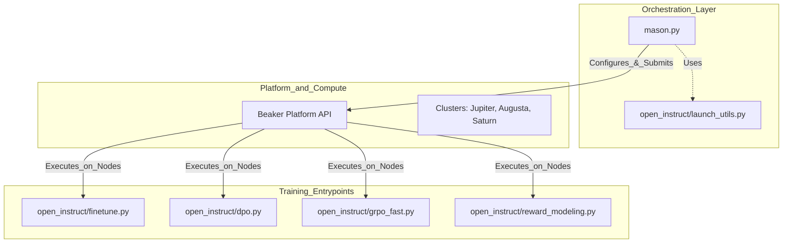
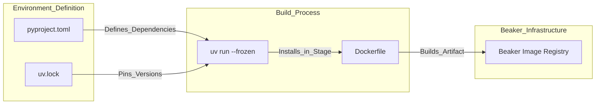

<!-- source: DeepWiki mcp.deepwiki.com · repo allenai/open-instruct · page 5 Job Orchestration and Infrastructure · fetched 2026-10-26 -->

# Job Orchestration and Infrastructure

Relevant source files

The following files were used as context for generating this wiki page:

- [Dockerfile](Dockerfile)
- [README.md](README.md)
- [configs/beaker_configs/ray_node_setup.sh](configs/beaker_configs/ray_node_setup.sh)
- [mason.py](mason.py)
- [pyproject.toml](pyproject.toml)
- [requirements.txt](requirements.txt)
- [test_mason.py](test_mason.py)
- [uv.lock](uv.lock)

This page provides a high-level overview of the infrastructure and orchestration systems used to manage training jobs at scale. The repository relies heavily on the **Beaker** platform for compute resource allocation and **Ray** for distributed execution.

## Job Submission and Management

The core of the orchestration system is built around `mason.py`, a specialized launcher that handles the complexities of submitting jobs to Beaker clusters. It manages environment setup, resource specification, and job lifecycle.

The launcher recognizes several core training scripts as first-class commands, including Supervised Fine-Tuning, Direct Preference Optimization, and Group Relative Policy Optimization [mason.py:27-36](). It also identifies resumable jobs like `grpo_fast.py` to handle preemptions effectively [mason.py:38]().

Title: Orchestration to Execution Flow

For a detailed guide on using the launcher, see **[Mason: Beaker Job Launcher](#5.1)**.

Sources: [mason.py:27-39](), [mason.py:110-186](), [open_instruct/launch_utils.py:1-22]()

## Cluster and Resource Configuration

Training performance is highly dependent on cluster-specific networking and storage configurations. The infrastructure handles environment variables for different hardware backends and storage mounts.

| Component | Responsibility | Key Code Entities / Flags |
| :--- | :--- | :--- |
| **Networking** | NCCL and IB configuration | `NCCL_DEBUG`, `NCCL_CUMEM_ENABLE` [mason.py:104](), [configs/beaker_configs/ray_node_setup.sh:7]() |
| **Storage** | Weka and Dataset mounting | `auto_output_dir_path`, `beaker_datasets` [mason.py:137-145](), [mason.py:166-170]() |
| **Compute** | GPU and Node allocation | `--gpus`, `--num_nodes`, `--cluster` [mason.py:112-126]() |

Detailed environment settings, including the setup of Triton autotune caches and NCCL optimizations, are covered in **[Cluster Configuration](#5.2)**.

Sources: [mason.py:101-107](), [mason.py:166-183](), [configs/beaker_configs/ray_node_setup.sh:1-20]()

## Containerization and Environment

Reproducibility is ensured through Docker-based containerization. The repository uses `uv` for fast, locked dependency management, which is integrated directly into the Docker build process to manage complex dependencies like `flash-attn` and `vllm` [pyproject.toml:31-48]().

Title: Environment to Docker Image Pipeline

The `Dockerfile` installs essential system packages (NVIDIA drivers, DOCA OFED, Google Cloud CLI) and uses `uv` to install the Python environment [Dockerfile:1-61](). It also sets up the `PYTHONPATH` and environment variables for HuggingFace transfers [Dockerfile:63-88]().

For more information on image building and the `uv` workflow, see **[Docker Images and Containerization](#5.3)**.

Sources: [Dockerfile:1-89](), [pyproject.toml:1-48](), [uv.lock:1-16]()

## Distributed Training Architecture

Large-scale training (e.g., Tulu 3) requires multi-node coordination. This is achieved through a combination of **Ray** for process management and **DeepSpeed** or **FSDP2** (via `ai2-olmo-core`) for model sharding [pyproject.toml:14-21]().

*   **Ray Setup**: A head node is initialized on rank 0, and worker nodes connect via the `BEAKER_LEADER_REPLICA_IP` [configs/beaker_configs/ray_node_setup.sh:16-29]().
*   **Node Monitoring**: Worker nodes monitor the head node's availability and perform clean exits if the head becomes unreachable [configs/beaker_configs/ray_node_setup.sh:40-48]().
*   **Model Sharding**: The system supports DeepSpeed ZeRO stages and `olmo-core` based FSDP2 for efficient memory usage across nodes.

Technical details on multi-node synchronization, sequence parallelism (Ulysses), and sharding strategies are found in **[Distributed Training Architecture](#5.4)**.

Sources: [configs/beaker_configs/ray_node_setup.sh:1-50](), [pyproject.toml:14-32]()

## Child Pages

*   **[Mason: Beaker Job Launcher](#5.1)** — Comprehensive guide to `mason.py`: command-line arguments, cluster selection, environment setup, and job submission workflow.
*   **[Cluster Configuration](#5.2)** — Explanation of cluster-specific settings: Weka storage, NCCL environment variables, and networking (InfiniBand vs FASTRAK).
*   **[Docker Images and Containerization](#5.3)** — Documentation of Docker image building, `uv`-based dependency management, and Beaker image lifecycle.
*   **[Distributed Training Architecture](#5.4)** — Deep dive into multi-node training: Ray cluster setup, DeepSpeed/FSDP2, and sequence parallelism.

---

