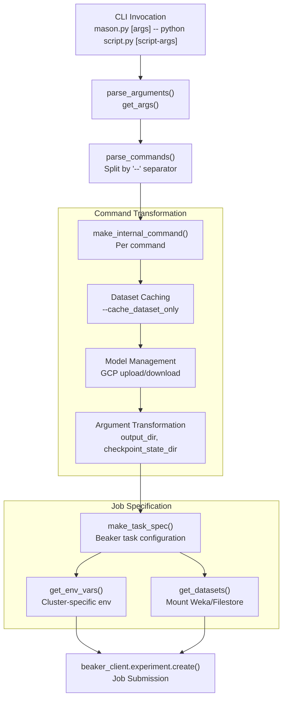
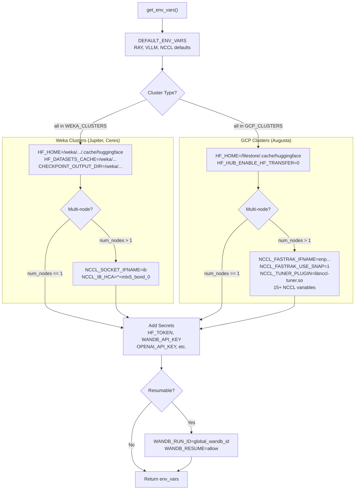
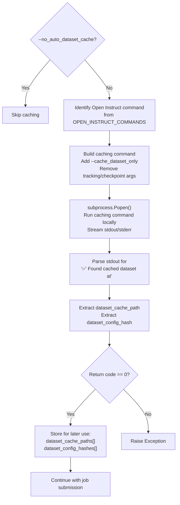
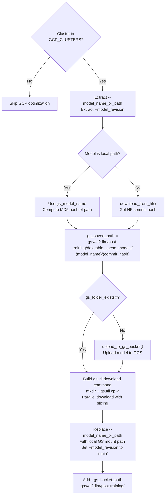
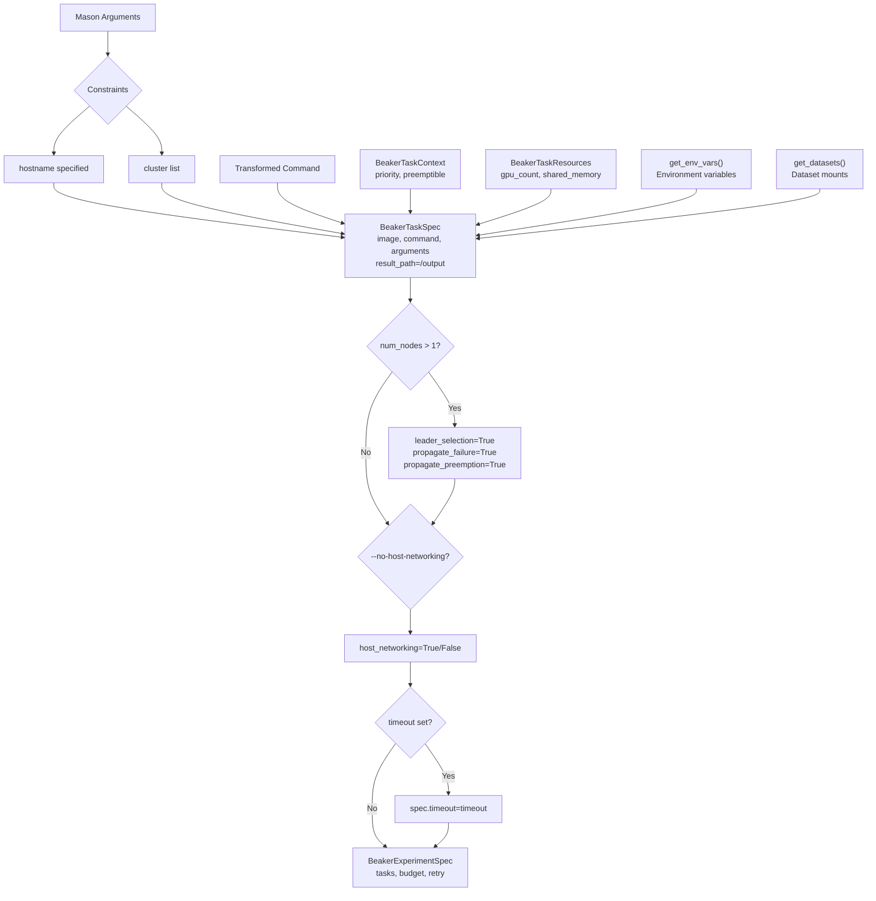

<!-- source: DeepWiki mcp.deepwiki.com · repo allenai/open-instruct · page 5.1 Mason: Beaker Job Launcher · fetched 2026-10-26 -->

# Mason: Beaker Job Launcher

<details>
<summary>Relevant source files</summary>

The following files were used as context for generating this wiki page:

- [Dockerfile](Dockerfile)
- [README.md](README.md)
- [configs/beaker_configs/default_dpo_multinode.yaml](configs/beaker_configs/default_dpo_multinode.yaml)
- [configs/train_configs/sft/tulu3_L3.1_70b_preview_mix_v3.3.yaml](configs/train_configs/sft/tulu3_L3.1_70b_preview_mix_v3.3.yaml)
- [mason.py](mason.py)
- [pyproject.toml](pyproject.toml)
- [requirements.txt](requirements.txt)
- [scripts/README.md](scripts/README.md)
- [scripts/submit_dpo_job.py](scripts/submit_dpo_job.py)
- [scripts/submit_finetune_job.py](scripts/submit_finetune_job.py)
- [test_mason.py](test_mason.py)
- [uv.lock](uv.lock)

</details>


## Purpose and Scope

Mason (`mason.py`) is the primary orchestration tool for submitting training and evaluation jobs to Beaker infrastructure. It serves as a command-line wrapper that transforms local training commands into Beaker-compatible job specifications, handles cluster-specific environment setup, manages dataset caching, and coordinates distributed training across multiple nodes.

This page covers the Mason job launcher itself. For cluster-specific configurations, see [Cluster Configuration](5.2). For distributed training architecture details, see [Distributed Training Architecture](5.4). For evaluation job submission, see [Evaluation Orchestration](6.1).

## Overview

Mason bridges the gap between local development and Beaker execution by:

1.  **Parsing arguments** from CLI and merging them with training command arguments [mason.py:106-200]().
2.  **Selecting clusters** and applying cluster-specific configurations (Weka vs GCP) [mason.py:56-62]().
3.  **Setting up environments** with appropriate NCCL, vLLM, and storage settings [mason.py:225-359]().
4.  **Caching datasets** locally before job submission to avoid redundant tokenization [mason.py:438-509]().
5.  **Managing models** on GCP by uploading to Google Storage buckets [mason.py:569-679]().
6.  **Transforming commands** to work in the Beaker container environment [mason.py:682-711]().
7.  **Creating Beaker experiments** with proper resource allocation and constraints [mason.py:776-820]().

**Mason Execution Flow**



Sources: [mason.py:74-189](), [mason.py:390-711](), [mason.py:714-773](), [mason.py:776-820]()

## Command-Line Interface

Mason uses a two-part argument structure: Mason-specific arguments followed by training command arguments separated by `--` [mason.py:390-395]().

### Basic Invocation Pattern

```bash
python mason.py \
  --cluster ai2/jupiter \
  --budget ai2/allennlp \
  --gpus 8 \
  --num_nodes 1 \
  -- \
  python open_instruct/finetune.py \
  --model_name_or_path meta-llama/Llama-3.1-8B \
  --dataset_name allenai/tulu-3-sft-mixture
```

### Mason Arguments

| Argument | Type | Default | Description |
| :--- | :--- | :--- | :--- |
| `--cluster` | List\[str\] | Required | Beaker clusters (e.g., `ai2/jupiter`, `ai2/augusta`) [mason.py:112-114]() |
| `--budget` | str | Required | Beaker budget to charge [mason.py:120-121]() |
| `--gpus` | int | 0 | Number of GPUs per node [mason.py:122]() |
| `--num_nodes` | int | 1 | Number of nodes for distributed training [mason.py:126]() |
| `--shared_memory` | str | "10.24gb" | Shared memory size for Docker containers [mason.py:124-125]() |
| `--image` | str | `ai2/cuda11.8...` | Beaker Docker image to use [mason.py:128-132]() |
| `--workspace` | str | None | Beaker workspace (defaults to user's default) [mason.py:134-136]() |
| `--beaker_datasets` | List | \[\] | Additional datasets in format `mount_path:beaker_id` [mason.py:137-145]() |
| `--priority` | str | "normal" | Job priority (normal, high, urgent) [mason.py:153]() |
| `--preemptible` | bool | False | Enable preemptible mode [mason.py:154]() |
| `--max_retries` | int | 0 | Number of allowed retries [mason.py:118]() |
| `--timeout` | int | None | Task timeout in seconds [mason.py:195]() |
| `--env` | List | \[\] | Additional env vars in format `name=value` [mason.py:185-190]() |
| `--secret` | List | \[\] | Additional secrets in format `name=value` [mason.py:180]() |
| `--auto_output_dir_path` | str | `/weka/...` | Auto-set output directory prefix [mason.py:166-170]() |
| `--auto_checkpoint_state_dir` | str | `/weka/...` | Auto-set checkpoint state directory [mason.py:172-176]() |
| `--gs_model_name` | str | None | Model name for GCS upload (Augusta only) [mason.py:204]() |
| `--no_auto_dataset_cache` | bool | False | Disable automatic dataset caching [mason.py:163-165]() |
| `--non_resumable` | bool | False | Disable resumable mode [mason.py:161]() |
| `--pure_docker_mode` | bool | False | Run in pure Docker mode (no NFS) [mason.py:155]() |
| `--no-host-networking` | bool | False | Disable host networking [mason.py:188]() |

Sources: [mason.py:110-210]()

### Cluster Selection

Mason supports multiple cluster types with different characteristics [mason.py:56-62]():

```python
WEKA_CLUSTERS = ["ai2/jupiter", "ai2/saturn", "ai2/titan", "ai2/neptune", "ai2/ceres", "ai2/triton", "ai2/rhea"]
GCP_CLUSTERS = ["ai2/augusta"]
INTERCONNECT_CLUSTERS = ["ai2/jupiter", "ai2/ceres", "ai2/titan", "ai2/augusta"]
```

*   **Weka Clusters**: Use Weka shared storage (`/weka/oe-adapt-default`), InfiniBand NCCL for multi-node.
*   **GCP Clusters**: Use Filestore (`/filestore`), FASTRAK/TCPXO NCCL for multi-node.
*   **Interconnect Clusters**: Support high-performance multi-node training.

Sources: [mason.py:56-62]()

## Environment Variable Configuration

Mason sets up different environment variables based on cluster type to optimize performance and compatibility [mason.py:225-359]().

**Environment Variable Setup Flow**



Sources: [mason.py:225-359]()

### Default Environment Variables

```python
DEFAULT_ENV_VARS = {
    "RAY_CGRAPH_get_timeout": "300",
    "VLLM_DISABLE_COMPILE_CACHE": "1",  # Torch compile caching is broken
    "NCCL_DEBUG": "ERROR",
    "VLLM_LOGGING_LEVEL": "WARNING",
    "VLLM_ALLOW_INSECURE_SERIALIZATION": "1",
}
```

Sources: [mason.py:101-107]()

### Weka Cluster Environment

For Weka-based clusters, Mason configures [mason.py:273-293]():

*   **Storage paths**: HuggingFace cache at `/weka/oe-adapt-default/allennlp/.cache/huggingface`.
*   **Checkpoint directory**: `/weka/oe-adapt-default/allennlp/deletable_checkpoint_states/{wandb_id}`.
*   **Multi-node NCCL**: InfiniBand interface configuration.

```python
# Weka multi-node NCCL settings
NCCL_SOCKET_IFNAME=ib
NCCL_IB_HCA=^=mlx5_bond_0
```

Sources: [mason.py:273-293]()

### GCP Cluster Environment

For GCP clusters (Augusta), Mason sets up extensive FASTRAK/TCPXO NCCL configuration [mason.py:296-346]():

*   **Storage paths**: HuggingFace cache at `/filestore/.cache/huggingface`.
*   **HF Transfer**: Disabled due to GCP upload issues (`HF_HUB_ENABLE_HF_TRANSFER=0`).
*   **Multi-node NCCL**: 20+ environment variables for FASTRAK configuration including tuner plugins, network interfaces, and protocol settings.

Sources: [mason.py:296-346]()

### Secret Management

Mason automatically mounts user-specific secrets from Beaker [mason.py:252-266]():

```python
useful_secrets = [
    "HF_TOKEN",
    "WANDB_API_KEY", 
    "BEAKER_TOKEN",
    "OPENAI_API_KEY",
    "AZURE_API_KEY",
    "AZURE_API_BASE",
    "ANTHROPIC_API_KEY",
]
```

The system checks for secrets in format `{whoami}_{SECRET_NAME}` first, then falls back to `{SECRET_NAME}` [mason.py:255-257]().

Sources: [mason.py:252-266]()

## Dataset Mounting

Mason handles dataset mounting differently based on cluster type [mason.py:362-387]().

### Weka Cluster Datasets

```python
datasets = [
    BeakerDataMount(
        source=BeakerDataSource(weka="oe-adapt-default"),
        mount_path="/weka/oe-adapt-default"
    ),
    BeakerDataMount(
        source=BeakerDataSource(weka="oe-training-default"),
        mount_path="/weka/oe-training-default"
    ),
]
```

### GCP Cluster Datasets

```python
datasets = [
    BeakerDataMount(
        source=BeakerDataSource(host_path="/mnt/filestore_1"),
        mount_path="/filestore"
    )
]
```

### Additional Beaker Datasets

Users can mount additional datasets using `--beaker_datasets` [mason.py:137-145]():

```bash
--beaker_datasets /models:01HQXGAYGCS6D4ZK51K83CM49Y /data:01ABC123XYZ
```

Sources: [mason.py:362-387]()

## Automatic Dataset Caching

One of Mason's key optimizations is pre-caching datasets before job submission. This prevents redundant tokenization across distributed training runs [mason.py:438-509]().

**Dataset Caching Workflow**



Sources: [mason.py:438-509]()

### Caching Process

1.  **Command identification**: Mason searches for Open Instruct commands in the argument list [mason.py:439]().
2.  **Command transformation**: Removes tracking/checkpoint arguments, adds `--cache_dataset_only` [mason.py:441-450]().
3.  **Local execution**: Runs the caching command via `subprocess.Popen` with real-time output [mason.py:456-483]().
4.  **Path extraction**: Parses stdout to extract the cached dataset path and config hash [mason.py:485-502]().
5.  **Hash storage**: Stores config hashes to pass to training command later [mason.py:503-509]().

Example transformation:

```python
# Original command
python open_instruct/finetune.py --model_name_or_path ... --with_tracking

# Caching command
python open_instruct/finetune.py --model_name_or_path ... --cache_dataset_only
```

The caching command uses a hash-based system to determine if tokenization is needed [mason.py:41-46]().

Sources: [mason.py:438-509](), [mason.py:41-46]()

## Automatic Argument Injection

Mason automatically modifies training commands to ensure compatibility with Beaker infrastructure [mason.py:511-566]().

### Output Directory Override

For Weka clusters, Mason ensures `--output_dir` points to a Weka path for auto-evaluation to work [mason.py:536-566]():

```python
if need_to_override_output_dir:
    new_output_dir = f"{args.auto_output_dir_path}/{whoami}/"
    command.append("--output_dir")
    command.append(new_output_dir)
```

Default: `/weka/oe-adapt-default/allennlp/deletable_checkpoint/{whoami}/` [mason.py:168]().

Sources: [mason.py:536-566](), [mason.py:166-170]()

### Checkpoint State Directory

For resumable jobs, Mason automatically sets checkpoint state directory [mason.py:511-531]():

```python
new_checkpoint_state_dir = f"{args.auto_checkpoint_state_dir}/{whoami}/{timestamp}_{random_id}"
command.append("--checkpoint_state_dir")
command.append(new_checkpoint_state_dir)
command.append("--checkpoint_state_freq")
command.append(str(default_checkpoint_state_freq))
```

Sources: [mason.py:511-531]()

### Entity Configuration

Mason automatically adds HuggingFace and Weights & Biases entity information [mason.py:428-434]():

```python
if not any("hf_entity" in c for c in command):
    command.append("--hf_entity")
    command.append("allenai")
if not any("wandb_entity" in c for c in command):
    command.append("--wandb_entity")
    command.append("ai2-llm")
```

Sources: [mason.py:428-434]()

## GCP-Specific Model Management

For GCP clusters, Mason implements an optimization to speed up model loading from shared Filestore storage [mason.py:569-679]().

**GCP Model Upload/Download Flow**



Sources: [mason.py:569-679]()

### Model Upload Process

1.  **Model identification**: Extract `model_name_or_path` and `model_revision` from command [mason.py:575-582]().
2.  **Hash computation**: Get HuggingFace commit hash or compute MD5 for local models [mason.py:584-601]().
3.  **GCS path**: Construct path like `gs://ai2-llm/post-training/deletable_cache_models/{model}/{hash}` [mason.py:603]().
4.  **Upload**: If not exists, upload using `upload_to_gs_bucket()` [mason.py:606-608]().
5.  **Download command**: Prepend gsutil download command to training script [mason.py:610-630]().
6.  **Path replacement**: Replace HF model path with local GCS mount path [mason.py:633-638]().

### GSUtil Download Command

```bash
mkdir -p /gs/ai2-llm/post-training/deletable_cache_models/{model}/{hash} && \
gsutil -o GSUtil:parallel_thread_count=1 \
       -o GSUtil:sliced_object_download_threshold=150 \
       -m cp -r \
       gs://ai2-llm/post-training/deletable_cache_models/{model}/{hash} \
       /gs/ai2-llm/post-training/deletable_cache_models/{model}/ && \
ls /gs/ai2-llm/post-training/deletable_cache_models/{model}/{hash}
```

This downloads the model to `/gs/` mount before training starts, avoiding slow Filestore access [mason.py:611-627]().

Sources: [mason.py:569-679]()

## Multi-Node Command Transformation

For multi-node jobs, Mason modifies Accelerate commands to use Beaker's replica coordination [mason.py:694-707]().

### Accelerate Multi-Node Configuration

Mason automatically transforms single-node Accelerate commands for multi-node execution:

```python
# Regex replacement
join_full_command = re.sub(
    r"--num_processes (\d+)",
    lambda m: (
        f"--num_processes {int(m.group(1)) * args.num_nodes} "
        f"--num_machines {args.num_nodes} "
        "--machine_rank $BEAKER_REPLICA_RANK "
        "--main_process_ip $BEAKER_LEADER_REPLICA_HOSTNAME "
        "--main_process_port 29400 "
    ),
    join_full_command,
)
```

Before:
```bash
accelerate launch --num_processes 8 train.py
```

After (with `--num_nodes 4`):
```bash
accelerate launch \
  --num_processes 32 \
  --num_machines 4 \
  --machine_rank $BEAKER_REPLICA_RANK \
  --main_process_ip $BEAKER_LEADER_REPLICA_HOSTNAME \
  --main_process_port 29400 \
  train.py
```

Sources: [mason.py:694-707]()

## Beaker Task Specification

Mason creates Beaker task specifications with cluster-specific constraints and resource allocation [mason.py:714-773]().

**Task Specification Assembly**



Sources: [mason.py:714-773]()

### Task Specification Fields

```python
spec = beaker.BeakerTaskSpec(
    name=f"{args.task_name}__{i}",
    image=beaker.BeakerImageSource(beaker=args.image),
    command=["/bin/bash", "-c"],
    arguments=[full_command],
    result=beaker.BeakerResultSpec(path="/output"),
    datasets=get_datasets(args.beaker_datasets, args.cluster),
    context=beaker.BeakerTaskContext(
        priority=beaker.BeakerJobPriority[args.priority],
        preemptible=args.preemptible
    ),
    constraints=constraints,
    env_vars=get_env_vars(...),
    resources=beaker.BeakerTaskResources(
        gpu_count=args.gpus,
        shared_memory=args.shared_memory
    ),
    replicas=args.num_nodes,
)
```

### Multi-Node Task Configuration

For multi-node jobs (`num_nodes > 1`) [mason.py:761-764]():

*   **leader\_selection = True**: Elect one replica as leader.
*   **propagate\_failure = True**: Fail all replicas if one fails.
*   **propagate\_preemption = True**: Preempt all replicas together.

Sources: [mason.py:761-764]()

### Validation Checks

Mason performs several validation checks:

1.  **Interconnect clusters for multi-node**: Warns if using non-interconnect clusters [mason.py:716-721]().
2.  **GCP image compatibility**: Ensures proper image for GCP clusters [mason.py:722-726]().
3.  **Accelerate num\_processes**: Requires explicit `--num_processes` for multi-node Accelerate jobs [mason.py:727-731]().

Sources: [mason.py:716-731]()

## Resumable Jobs

Mason supports resumable training by generating a unique WANDB run ID shared across all retries [mason.py:191-199]().

```python
global_wandb_id = generate_id()  # 8-character base-36 string

# In get_env_vars when resumable=True:
env_vars.extend([
    beaker.BeakerEnvVar(name="WANDB_RUN_ID", value=global_wandb_id),
    beaker.BeakerEnvVar(name="WANDB_RESUME", value="allow"),
])
```

Resumable mode is automatically enabled for commands in `OPEN_INSTRUCT_RESUMABLES` [mason.py:38]():

```python
OPEN_INSTRUCT_RESUMABLES = ["open_instruct/grpo.py", "open_instruct/grpo_fast.py"]
```

Users can disable with `--non_resumable` [mason.py:161]().

Sources: [mason.py:38](), [mason.py:191-199](), [mason.py:351-357]()

## Job Submission

The final step creates a Beaker experiment and submits it [mason.py:809-819]():

```python
experiment_spec = beaker.BeakerExperimentSpec(
    description=args.description,
    tasks=[
        make_task_spec(args, full_command, i, beaker_secrets, whoami, args.resumable)
        for i, full_command in enumerate(full_commands)
    ],
    budget=args.budget,
    retry=beaker.BeakerRetrySpec(allowed_task_retries=args.max_retries),
)
exp = beaker_client.experiment.create(spec=experiment_spec)
console.log(f"Kicked off Beaker job. https://beaker.org/ex/{exp.experiment.id}")
```

Sources: [mason.py:809-819]()

## Example Usage

### Single-Node SFT Training

```bash
python mason.py \
  --cluster ai2/jupiter \
  --budget ai2/allennlp \
  --gpus 8 \
  --priority high \
  --description "Llama 3.1 8B SFT" \
  -- \
  python open_instruct/finetune.py \
  --model_name_or_path meta-llama/Llama-3.1-8B \
  --dataset_mixer '{"allenai/tulu-3-sft-mixture": 1.0}' \
  --per_device_train_batch_size 2 \
  --gradient_accumulation_steps 8 \
  --num_train_epochs 2
```

### Multi-Node GRPO Training

```bash
python mason.py \
  --cluster ai2/jupiter ai2/ceres \
  --budget ai2/allennlp \
  --gpus 8 \
  --num_nodes 8 \
  --priority normal \
  --description "Llama 3.1 70B GRPO" \
  -- \
  python open_instruct/grpo_fast.py \
  --model_name_or_path meta-llama/Llama-3.1-70B \
  --dataset_mixer '{"allenai/tulu-3-rlvr-prompts": 1.0}' \
  --num_train_epochs 1 \
  --num_processes 56 \
  --vllm_device_count_per_node 1
```

Sources: [mason.py:1-823]()

---

