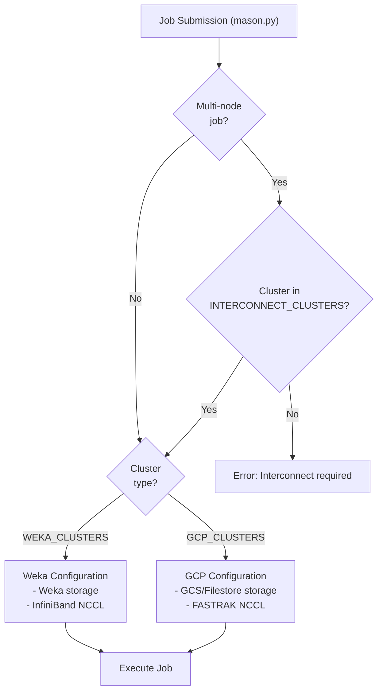
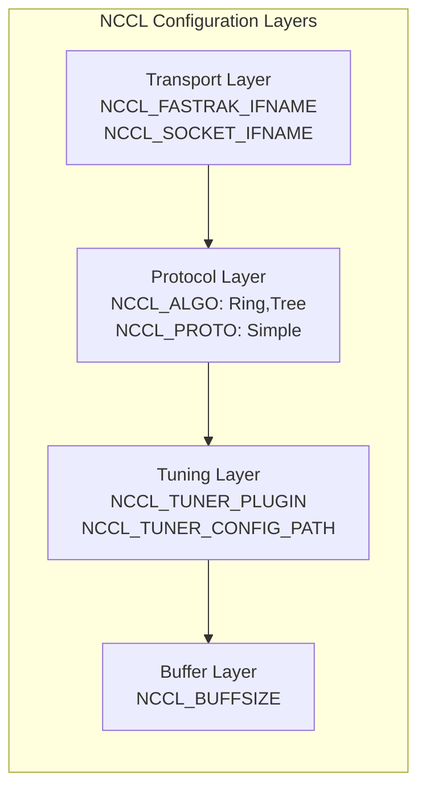
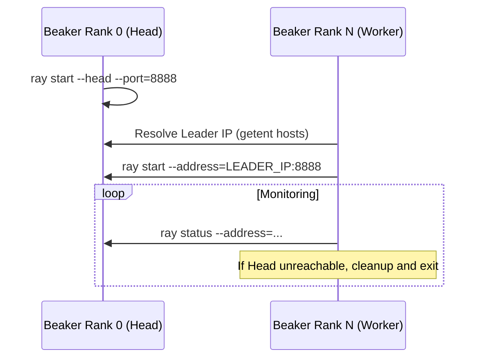

<!-- source: DeepWiki mcp.deepwiki.com · repo allenai/open-instruct · page 5.2 Cluster Configuration · fetched 2026-10-26 -->

# Cluster Configuration

<details>
<summary>Relevant source files</summary>

The following files were used as context for generating this wiki page:

- [Dockerfile](Dockerfile)
- [README.md](README.md)
- [configs/beaker_configs/alpaca_7B.yaml](configs/beaker_configs/alpaca_7B.yaml)
- [configs/beaker_configs/alpaca_7B_lora.yaml](configs/beaker_configs/alpaca_7B_lora.yaml)
- [configs/beaker_configs/default_finetune_lora_multinode.yaml](configs/beaker_configs/default_finetune_lora_multinode.yaml)
- [configs/beaker_configs/default_finetune_multinode.yaml](configs/beaker_configs/default_finetune_multinode.yaml)
- [configs/beaker_configs/default_finetune_qlora_multinode.yaml](configs/beaker_configs/default_finetune_qlora_multinode.yaml)
- [configs/beaker_configs/ray_node_setup.sh](configs/beaker_configs/ray_node_setup.sh)
- [mason.py](mason.py)
- [pyproject.toml](pyproject.toml)
- [requirements.txt](requirements.txt)
- [test_mason.py](test_mason.py)
- [uv.lock](uv.lock)

</details>


## Purpose and Scope

This page documents cluster-specific configuration settings for training jobs on Beaker infrastructure. It covers storage systems (Weka vs GCS), networking protocols (InfiniBand vs FASTRAK/TCPXO), resource specifications, and the initialization scripts required for distributed environments like Ray. For information about launching jobs with these configurations, see [Mason: Beaker Job Launcher](). For multi-node training architecture details, see [Distributed Training Architecture]().

## Cluster Categories

The repository supports two main categories of clusters, each with distinct infrastructure characteristics. These are managed primarily through the `mason.py` orchestration script which determines environment variables and resource mounts based on the target cluster.

| Category | Clusters | Storage | Networking | GPU Type | Use Case |
|----------|----------|---------|------------|----------|----------|
| **Weka Clusters** | `ai2/jupiter`, `ai2/saturn`, `ai2/titan`, `ai2/neptune`, `ai2/ceres`, `ai2/triton`, `ai2/rhea` | Weka NFS | InfiniBand | H100 | Primary training infrastructure |
| **GCP Clusters** | `ai2/augusta` | GCS + Filestore | FASTRAK/TCPXO | A100 | GCP-based training |

**Interconnect clusters** (subset with high-bandwidth networking): `ai2/jupiter`, `ai2/ceres`, `ai2/titan`, `ai2/augusta`. Multi-node jobs require interconnect clusters for efficient communication.

**Cluster Selection Flow:**

Title: Cluster Selection and Infrastructure Logic


Sources: [mason.py:112-114](), [mason.py:126-135]()

## Storage Configuration

### Weka Clusters

Weka clusters mount a high-performance NFS filesystem at `/weka/`. The `mason.py` script automatically configures output paths to Weka to ensure persistence across preemptions.

| Mount Point | Purpose | Environment Variable |
|-------------|---------|---------------------|
| `/weka/oe-adapt-default` | Primary storage, HF cache, checkpoints | `HF_HOME`, `HF_DATASETS_CACHE` |
| `/weka/oe-training-default` | Training data storage | - |

**HuggingFace Cache Configuration** (Weka):
By default, `mason.py` redirects HuggingFace caches to Weka to avoid filling up container disk space and to share data across nodes.

```python
# Default Weka paths in mason.py
auto_output_dir_path = "/weka/oe-adapt-default/allennlp/deletable_checkpoint"
auto_checkpoint_state_dir = "/weka/oe-adapt-default/allennlp/deletable_checkpoint_states"
```

Sources: [mason.py:166-176](), [configs/beaker_configs/default_finetune_multinode.yaml:63-66]()

### GCP Clusters

GCP clusters (like `ai2/augusta`) use a combination of Google Cloud Storage (GCS) and Filestore. While `mason.py` handles the mounting, the scripts also support direct GCS checkpointing via arguments like `--gs_checkpoint_state_dir`.

Sources: [mason.py:45-46](), [mason.py:172-176]()

## Networking Configuration

### InfiniBand (Weka Clusters)

Weka clusters use InfiniBand for high-bandwidth GPU-to-GPU communication. This is typically configured in the Beaker task environment variables using `NCCL_NET=IB`.

**Multi-node NCCL Configuration (Weka):**
```yaml
envVars:
  - name: NCCL_NET
    value: IB
  - name: NCCL_DEBUG
    value: INFO
```

Sources: [configs/beaker_configs/default_finetune_lora_multinode.yaml:63-66](), [configs/beaker_configs/default_finetune_qlora_multinode.yaml:62-65]()

### FASTRAK/TCPXO (GCP Clusters)

GCP's `ai2/augusta` cluster uses Google's FASTRAK network stack and TCPXO (TCP with offload) for GPU communication. This requires extensive NCCL tuning injected by `mason.py` or specific submit scripts to optimize for the virtualized network environment.

Title: NCCL Tuning and Networking Stack


Sources: [mason.py:98-107]()

## Default Environment Variables

The following environment variables are applied by default in `mason.py` or the Ray setup script to stabilize training and generation across different cluster types:

| Variable | Default Value | Purpose |
|----------|---------------|---------|
| `RAY_CGRAPH_get_timeout` | `300` | Prevents premature timeouts in Ray Compiled Graphs |
| `VLLM_DISABLE_COMPILE_CACHE` | `1` | Disables vLLM's torch.compile cache (often unstable in containers) |
| `NCCL_DEBUG` | `ERROR` | Limits NCCL noise unless debugging |
| `VLLM_LOGGING_LEVEL` | `WARNING` | Reduces vLLM log verbosity |
| `VLLM_ALLOW_INSECURE_SERIALIZATION` | `1` | Required for certain model loading paths |
| `NCCL_CUMEM_ENABLE` | `0` | Set in setup scripts for performance (vLLM requirement) |

Sources: [mason.py:101-107](), [configs/beaker_configs/ray_node_setup.sh:5-7]()

## Ray Node Setup

For RLHF training (GRPO), a Ray cluster is initialized across Beaker replicas using `configs/beaker_configs/ray_node_setup.sh`. This script handles the distinction between the head node and worker nodes within a Beaker multi-replica task.

### Ray Cluster Lifecycle

Title: Ray Distributed Initialization Sequence


**Key Implementation Details:**
- **Leader Detection**: Uses `getent hosts ${BEAKER_LEADER_REPLICA_HOSTNAME}` to resolve the IP of the rank 0 node in the Beaker cluster. [configs/beaker_configs/ray_node_setup.sh:16]()
- **Health Monitoring**: Workers run a `while true` loop to poll the head node's status via `ray status`; if the head node becomes unreachable, workers trigger a `cleanup` and exit with code 0 to allow Beaker to handle rescheduling. [configs/beaker_configs/ray_node_setup.sh:42-48]()

Sources: [configs/beaker_configs/ray_node_setup.sh:1-50]()

## Resource Specifications

### GPU and Memory Allocation

Beaker resource requirements are specified in YAML configs or passed as arguments to `mason.py`. High-memory workloads (like 70B model SFT) typically require 8 GPUs per node and substantial shared memory.

```yaml
resources:
  gpuCount: 8
shared_memory: 10.24gb
```

In multi-node scenarios, configurations must enable `hostNetworking: true` and `leaderSelection: true` to facilitate NCCL and Ray communication.

Sources: [configs/beaker_configs/default_finetune_multinode.yaml:7-8](), [configs/beaker_configs/default_finetune_multinode.yaml:69-70](), [mason.py:122-125]()

### Multi-node Execution Logic

When running multi-node SFT/DPO via `accelerate`, the following environment variables are critical for coordination across the Beaker replicas:

| Variable | Source | Purpose |
|----------|--------|---------|
| `--num_machines` | YAML/Args | Total number of Beaker replicas |
| `--machine_rank` | `$BEAKER_REPLICA_RANK` | The index of the current node (0 to N-1) |
| `--main_process_ip` | `$BEAKER_LEADER_REPLICA_HOSTNAME` | Hostname of the rank 0 node for rendezvous |
| `--main_process_port` | `29400` | Default port for process group rendezvous |

Sources: [configs/beaker_configs/default_finetune_multinode.yaml:20-24](), [configs/beaker_configs/default_finetune_lora_multinode.yaml:19-23]()

## Configuration Entity Mapping

The following diagram maps infrastructure concepts to the code entities and files that manage them.

Title: Infrastructure and Configuration Mapping
```mermaid
classDiagram
    class MasonLauncher {
        +get_args()
        +get_env_vars()
        +make_task_spec()
    }
    class RaySetupScript {
        +BEAKER_LEADER_REPLICA_IP
        +RAY_NODE_PORT
        +ray_start_head()
        +ray_start_worker()
    }
    class BeakerConfig {
        +replicas
        +leaderSelection
        +hostNetworking
    }
    class AccelerateConfig {
        +num_machines
        +machine_rank
        +main_process_ip
    }

    MasonLauncher ..> BeakerConfig : Generates
    BeakerConfig ..> RaySetupScript : Provides Environment
    BeakerConfig ..> AccelerateConfig : Provides Environment
    RaySetupScript --|> "configs/beaker_configs/ray_node_setup.sh"
    MasonLauncher --|> "mason.py"
```

Sources: [mason.py:111](), [configs/beaker_configs/ray_node_setup.sh:16](), [configs/beaker_configs/default_finetune_multinode.yaml:1-10]()

---

