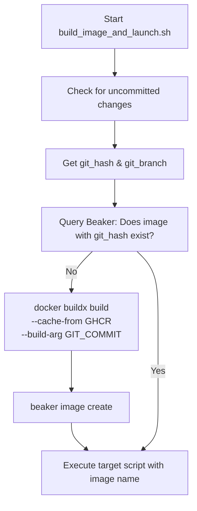
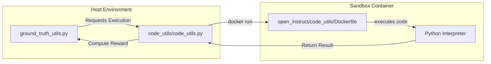

<!-- source: DeepWiki mcp.deepwiki.com · repo allenai/open-instruct · page 5.3 Docker Images and Containerization · fetched 2026-10-26 -->

# Docker Images and Containerization

Relevant source files

The following files were used as context for generating this wiki page:

- [.claude/skills/update-pr-body/SKILL.md](.claude/skills/update-pr-body/SKILL.md)
- [.dockerignore](.dockerignore)
- [.github/workflows/beaker-experiment.yml](.github/workflows/beaker-experiment.yml)
- [.github/workflows/docs.yml](.github/workflows/docs.yml)
- [.github/workflows/tests.yml](.github/workflows/tests.yml)
- [Dockerfile](Dockerfile)
- [README.md](README.md)
- [configs/beaker_configs/code_api_setup.sh](configs/beaker_configs/code_api_setup.sh)
- [configs/judge_configs/general_verifier_judge.yaml](configs/judge_configs/general_verifier_judge.yaml)
- [docs/index.md](docs/index.md)
- [mason.py](mason.py)
- [open_instruct/code_utils/Dockerfile](open_instruct/code_utils/Dockerfile)
- [open_instruct/code_utils/__init__.py](open_instruct/code_utils/__init__.py)
- [open_instruct/code_utils/code_utils.py](open_instruct/code_utils/code_utils.py)
- [open_instruct/code_utils/test_api.py](open_instruct/code_utils/test_api.py)
- [open_instruct/code_utils/test_code_utils.py](open_instruct/code_utils/test_code_utils.py)
- [open_instruct/test_data/acecode_sample.jsonl](open_instruct/test_data/acecode_sample.jsonl)
- [open_instruct/test_dataset_transformation.py](open_instruct/test_dataset_transformation.py)
- [pyproject.toml](pyproject.toml)
- [requirements.txt](requirements.txt)
- [scripts/train/build_image_and_launch.sh](scripts/train/build_image_and_launch.sh)
- [scripts/train/olmo3/README.md](scripts/train/olmo3/README.md)
- [scripts/train/rlvr/judge_general_verifier.sh](scripts/train/rlvr/judge_general_verifier.sh)
- [test_mason.py](test_mason.py)
- [uv.lock](uv.lock)

This document covers the Docker image building, versioning, and management system in the `open-instruct` repository. The containerization infrastructure provides reproducible environments for training and evaluation jobs on the Beaker platform, utilizing `uv` for dependency management and Git-based versioning to ensure traceability between code changes and deployed images.

For information about Beaker job submission using these images, see page 5.1 (Mason: Beaker Job Launcher). For distributed training architecture, see page 5.4 (Distributed Training Architecture).

## Docker Image Structure

The repository utilizes a multi-stage-capable `Dockerfile` to produce images containing the complete training and evaluation environment. The primary environment is built atop NVIDIA CUDA base images and optimized with high-performance networking drivers.

### Base Image and System Dependencies
The image starts from `nvidia/cuda:12.8.1-devel-ubuntu22.04` [Dockerfile:1](). It installs essential build tools, networking utilities, and specialized drivers:
- **DOCA OFED Drivers**: User-space drivers for Mellanox hardware, essential for high-bandwidth multi-node training [Dockerfile:23-38]().
- **Google Cloud CLI**: Installed for cloud storage interactions [Dockerfile:40-47]().
- **Beaker CLI**: Version `v1.5.235` is baked into the image to allow jobs to interact with the Beaker API [Dockerfile:49-59]().

### Dependency Management with `uv`
The repository has transitioned to using `uv` for fast, reproducible builds.
- The `uv` binary is copied from the official image [Dockerfile:61]().
- Dependencies are installed using `uv run --frozen`, ensuring the `uv.lock` file is strictly followed [Dockerfile:71-74]().
- **NLTK Data**: The build process pre-downloads `punkt`, `punkt_tab`, and `words` to avoid runtime download issues [Dockerfile:74]().

### Image Content Mapping

| Local Path | Container Path | Description |
|------------|----------------|-------------|
| `configs/` | `/stage/configs` | Training and evaluation YAML/JSON configs [Dockerfile:77]() |
| `scripts/` | `/stage/scripts` | Shell scripts for launching and data prep [Dockerfile:78]() |
| `open_instruct/` | `/stage/open_instruct` | Core Python package source [Dockerfile:80]() |
| `oe-eval-internal/` | `/stage/oe-eval-internal` | Private evaluation suite (if present) [Dockerfile:81]() |

Sources: [Dockerfile:1-89]()

## Docker Context Filtering

The `.dockerignore` file excludes unnecessary files from the Docker build context to reduce image size and prevent sensitive or large data from being baked into the image.

**Excluded Categories:**
- **Git metadata**: `**/.git/`, `.github/` [/.dockerignore:1-4]()
- **Python cache**: `__pycache__/`, `*.pyc`, `.pytest_cache/`, `.ruff_cache/` [/.dockerignore:7-12, 39, 81-82]()
- **Virtual environments**: `.venv/`, `venv/` [/.dockerignore:20-23]()
- **Large Data/Models**: `data/`, `models/`, `checkpoints/`, `*.safetensors`, `*.pth` [/.dockerignore:60-66]()
- **Local Caches**: `local_dataset_cache/`, `.cache/` [/.dockerignore:16, 80]()

Sources: [/.dockerignore:1-88]()

## Git-Based Image Versioning: `build_image_and_launch.sh`

The `scripts/train/build_image_and_launch.sh` script implements a strict versioning policy for development and integration testing.

### Pre-Build Validation
The script enforces repository hygiene before allowing an image build:
1. **Git Status**: Fails if there are uncommitted or untracked changes to ensure the image exactly matches a commit [scripts/train/build_image_and_launch.sh:12-17]().
2. **Metadata Extraction**: Captures the short Git hash and branch name [scripts/train/build_image_and_launch.sh:19-20]().

### Automated Naming and Caching
The script sanitizes branch names to meet Beaker requirements and checks for existing images to save time.

**Image Management Workflow**

Sources: [scripts/train/build_image_and_launch.sh:1-58]()

## Integration Testing: `beaker-experiment.yml`

The `.github/workflows/beaker-experiment.yml` workflow automates the validation of code changes by building images and launching integration tests on Beaker clusters.

### Change Detection Logic
The workflow uses `git diff` against the common ancestor of `main` to determine which tests to run based on modified files [/.github/workflows/beaker-experiment.yml:52-70]():
- **DPO Tests**: Triggered by changes in `open_instruct/(dpo|dpo_tune_cache|dpo_utils).py`.
- **SFT Tests**: Triggered by changes in `open_instruct/finetune.py`.
- **GRPO/Infra Tests**: Triggered by changes to `Dockerfile`, `mason.py`, or any file in `open_instruct/`.

### Execution Flow
1. **Setup**: Configures Python 3.12, `uv`, and Beaker CLI [/.github/workflows/beaker-experiment.yml:72-84]().
2. **Build**: Invokes `build_image_and_launch.sh` which handles the Docker build and Beaker image registration [/.github/workflows/beaker-experiment.yml:123]().
3. **Launch**: Executes specific integration scripts (e.g., `grpo_integration_test.sh`) [/.github/workflows/beaker-experiment.yml:145-149]().
4. **Monitoring**: Extracts the Beaker Experiment ID from logs and monitors for completion [/.github/workflows/beaker-experiment.yml:130-142]().

Sources: [/.github/workflows/beaker-experiment.yml:1-174]()

## GPU Test Infrastructure: `tests.yml`

For standard PR validation, the `tests.yml` workflow handles both unit and specialized GPU tests.

### GPU Test Image Building
Unlike the development script, this workflow uses the `docker/build-push-action@v6` for optimized CI builds:
- **Caching**: Uses `ghcr.io/allenai/open-instruct:buildcache` to speed up CI runs [/.github/workflows/tests.yml:116]().
- **Tags**: Tags the image as `open-instruct-gpu-tests:latest` [/.github/workflows/tests.yml:112]().
- **Execution**: Runs `scripts/test/run_gpu_tests_on_beaker.sh` to offload heavy tests to GPU-enabled Beaker nodes [/.github/workflows/tests.yml:123]().

Sources: [/.github/workflows/tests.yml:33-124]()

## Sandbox Environment: Code Execution

A specialized Dockerfile exists within `open_instruct/code_utils/` for sandboxed code execution [open_instruct/code_utils/Dockerfile](). This is used by the `code_utils.py` logic to evaluate model-generated code safely.

**Code Execution Data Flow**

Sources: [open_instruct/code_utils/code_utils.py:1-100](), [open_instruct/ground_truth_utils.py:1-50]()

## Summary of Environment Variables

The containerized environment is pre-configured with several critical runtime variables:

| Variable | Value/Source | Purpose |
|----------|--------------|---------|
| `UV_CACHE_DIR` | `/root/.cache/uv` | Speeds up subsequent package installs [Dockerfile:65]() |
| `HF_HUB_ENABLE_HF_TRANSFER` | `1` | Uses `hf_transfer` for faster model downloads [Dockerfile:66]() |
| `GIT_COMMIT` | Build Arg | In-container traceability to source code [Dockerfile:86]() |
| `PATH` | `/stage/.venv/bin:$PATH` | Ensures the `uv` virtualenv is active by default [Dockerfile:88]() |
| `VLLM_DISABLE_COMPILE_CACHE` | `1` | Default environment variable for vLLM stability [mason.py:103]() |

Sources: [Dockerfile:65-89](), [mason.py:101-107]()

---

