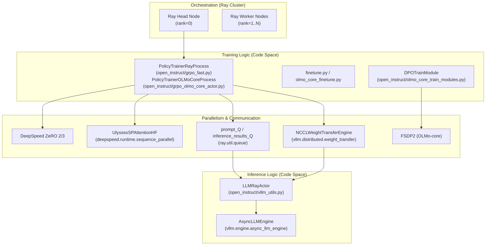
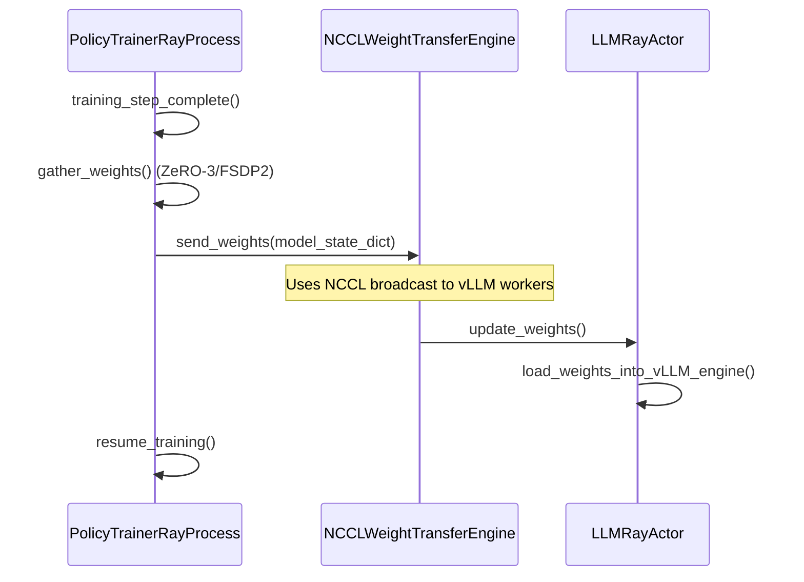

<!-- source: DeepWiki mcp.deepwiki.com · repo allenai/open-instruct · page 5.4 Distributed Training Architecture · fetched 2026-10-26 -->

# Distributed Training Architecture

Relevant source files

The following files were used as context for generating this wiki page:

- [CHANGELOG.md](CHANGELOG.md)
- [configs/beaker_configs/ray_node_setup.sh](configs/beaker_configs/ray_node_setup.sh)
- [open_instruct/benchmark_generators.py](open_instruct/benchmark_generators.py)
- [open_instruct/data_loader.py](open_instruct/data_loader.py)
- [open_instruct/data_types.py](open_instruct/data_types.py)
- [open_instruct/dpo.py](open_instruct/dpo.py)
- [open_instruct/dpo_utils.py](open_instruct/dpo_utils.py)
- [open_instruct/grpo.py](open_instruct/grpo.py)
- [open_instruct/grpo_callbacks.py](open_instruct/grpo_callbacks.py)
- [open_instruct/grpo_fast.py](open_instruct/grpo_fast.py)
- [open_instruct/grpo_olmo_core_actor.py](open_instruct/grpo_olmo_core_actor.py)
- [open_instruct/grpo_utils.py](open_instruct/grpo_utils.py)
- [open_instruct/olmo_core_train_modules.py](open_instruct/olmo_core_train_modules.py)
- [open_instruct/olmo_core_utils.py](open_instruct/olmo_core_utils.py)
- [open_instruct/test_grpo_fast.py](open_instruct/test_grpo_fast.py)
- [open_instruct/test_vllm_utils.py](open_instruct/test_vllm_utils.py)
- [open_instruct/test_vllm_utils_gpu.py](open_instruct/test_vllm_utils_gpu.py)
- [open_instruct/vllm_utils.py](open_instruct/vllm_utils.py)
- [scripts/train/debug/large_test_script.sh](scripts/train/debug/large_test_script.sh)
- [scripts/train/debug/single_gpu_on_beaker.sh](scripts/train/debug/single_gpu_on_beaker.sh)

## Purpose and Scope

This document describes the distributed training architecture used in Open Instruct, focusing on multi-node, multi-GPU training for reinforcement learning from verifiable rewards (RLVR), large-scale supervised fine-tuning (SFT), and Direct Preference Optimization (DPO). The architecture enables scaling training to 64+ GPUs across multiple nodes using Ray for orchestration, DeepSpeed or FSDP2 for distributed training, and vLLM for distributed inference. It details the integration of **Ulysses Sequence Parallelism** for long-context training and the synchronization mechanisms between training and inference engines.

For algorithm-specific details, see [2.1 Supervised Fine-Tuning (SFT)](), [2.2 Direct Preference Optimization (DPO)](), and [2.3.1 GRPO Implementation]().

---

## Architecture Overview

The distributed training system consists of asynchronous subsystems coordinated via Ray, NCCL, and shared memory primitives.

### System Components Diagram (Natural Language to Code)

This diagram maps system concepts to the specific Python classes and communication primitives used in the codebase.

**Sources:** [open_instruct/grpo_fast.py:139-165](), [open_instruct/vllm_utils.py:445-451](), [open_instruct/olmo_core_train_modules.py:103-113](), [open_instruct/grpo_olmo_core_actor.py:47-54]()

---

## Multi-Node Coordination

### Ray Placement Groups and Actors

The system uses Ray placement groups to manage resource allocation, particularly for models requiring Tensor Parallelism (TP) in inference and distributed training.

*   **PolicyTrainerRayProcess**: An actor managing a single training GPU. It initializes the distributed environment (DeepSpeed or FSDP) and coordinates with the global process group [open_instruct/grpo_fast.py:139-165]().
*   **LLMRayActor**: An actor managing `tensor_parallel_size` GPUs for vLLM inference. It uses a `PlacementGroupSchedulingStrategy` to ensure TP workers are co-located on the same node for low-latency communication [open_instruct/vllm_utils.py:41-42](), [open_instruct/grpo_fast.py:1879-1900]().

### NCCL Process Groups

While Ray handles actor lifecycle, **NCCL** handles high-performance data transfer. The system creates custom process groups for:
1.  **Global Training**: Standard DeepSpeed/DDP/FSDP group for gradient synchronization.
2.  **Weight Synchronization**: A specific group linking training ranks to vLLM worker ranks for broadcasting updated parameters via the `NCCLWeightTransferEngine` [open_instruct/grpo_fast.py:80-81](), [open_instruct/grpo_fast.py:1911-1936]().

---

## Parallelism Strategies

### DeepSpeed ZeRO and Ulysses Sequence Parallelism

For long-context SFT and RLHF, the architecture supports **Ulysses Sequence Parallelism (SP)**. This shards the sequence dimension across GPUs within a sequence parallel group.

**Implementation Detail:**
- `UlyssesSPAttentionHF` is monkey-patched into the model to handle the all-to-all communication required for attention across sharded sequences [open_instruct/grpo_fast.py:38-41]().
- Data is sharded by the `UlyssesSPSplitter` to ensure each GPU receives the correct sequence segment for training [open_instruct/grpo_fast.py:114-115]().
- Sequence parallelism is integrated with DeepSpeed ZeRO-3 to allow training models that exceed single-GPU memory both in weights and activations [open_instruct/grpo_fast.py:1550-1560]().

### FSDP2 for OLMo-core Models

The repository has migrated several paths (DPO, GRPO, SFT) to use **OLMo-core**, which leverages **FSDP2** (Fully Sharded Data Parallelism v2).

- **Weight Gathering**: FSDP2 provides efficient weight gathering for synchronization with inference engines [open_instruct/dpo.py:46-49]().
- **Mixed Precision**: Uses `olmo_core.config.DType` for granular control over compute and parameter precision [open_instruct/grpo_olmo_core_actor.py:124-126]().
- **Training Modules**: `DPOTrainModule` and `GRPOTrainModule` encapsulate the FSDP2 logic, including gradient clipping and optimizer stepping [open_instruct/olmo_core_train_modules.py:103-113]().

---

## Weight Synchronization Architecture

The weight synchronization mechanism ensures the inference engine (vLLM) always uses the latest policy weights from the trainer.

### Weight Update Flow (Code Entity Space)

**Key Implementation Details:**
- **NCCL Transfer**: The system has migrated from custom broadcast code to vLLM's native `NCCLWeightTransferEngine` for parameter transfer [CHANGELOG.md:36]().
- **Weight Mapping**: A name mapper handles differences in parameter naming between HuggingFace (trainer) and vLLM (inference), such as the `language_model.` prefix in Qwen models [open_instruct/grpo_fast.py:167-172]().
- **Blocking vs Async**: Weight synchronization is typically a blocking operation at the end of a training iteration to ensure data consistency [open_instruct/grpo_fast.py:1596-1605]().

**Sources:** [open_instruct/grpo_fast.py:80-81](), [open_instruct/vllm_utils.py:45-48](), [open_instruct/grpo_olmo_core_actor.py:27-28]()

---

## Data Flow and Coordination

### Queue-Based Communication

The training and inference loops are decoupled via Ray Queues, allowing for asynchronous "Inflight Updates" where generation for step $N+1$ happens while training on step $N$.

| Queue | Entity | Content |
| :--- | :--- | :--- |
| `prompt_Q` | `ray.util.queue.Queue` | `PromptRequest` containing input IDs and sampling configs [open_instruct/data_types.py:60]() |
| `inference_results_Q` | `ray.util.queue.Queue` | `GenerationResult` containing tokens, logprobs, and rewards [open_instruct/data_types.py:59]() |

**Sources:** [open_instruct/grpo_fast.py:511-521](), [open_instruct/data_loader.py:32]()

### Replica Coordination

The `ActorManager` coordinates multiple trainer and inference replicas, tracking metrics to identify bottlenecks.

- **Trainer Idle Time**: Logged as `time/trainer_waiting_for_data` to identify if inference is slower than training [CHANGELOG.md:15]().
- **Generation Idle Time**: Logged as `time/generation_waiting_for_trainer` to identify if training is the bottleneck [CHANGELOG.md:15]().

---

## Implementation Summary Table

| Feature | Component | Implementation |
| :--- | :--- | :--- |
| **Multi-Node Orchestration** | Ray | `PlacementGroup` with `STRICT_PACK` or `PACK` [open_instruct/grpo_fast.py:1879-1900]() |
| **SFT Parallelism** | DeepSpeed Ulysses | `UlyssesSPAttentionHF` and `UlyssesSPSplitter` [open_instruct/grpo_fast.py:40-41](), [open_instruct/grpo_fast.py:114]() |
| **RLHF Parallelism** | DeepSpeed ZeRO-2/3 | `get_train_ds_config()` [open_instruct/utils.py:119-120]() |
| **OLMo-core Parallelism** | FSDP2 / TP | `DPOTrainModule` and `GRPOTrainModule` [open_instruct/olmo_core_train_modules.py:103-113]() |
| **Weight Sync** | vLLM NCCL Engine | `NCCLWeightTransferEngine` [open_instruct/vllm_utils.py:81]() |
| **Async Generation** | vLLM | `AsyncLLMEngine` inside `LLMRayActor` [open_instruct/vllm_utils.py:49]() |

**Sources:** [open_instruct/grpo_fast.py:1-100](), [open_instruct/vllm_utils.py:1-100](), [open_instruct/olmo_core_train_modules.py:1-50](), [open_instruct/grpo_olmo_core_actor.py:1-50]()

---

