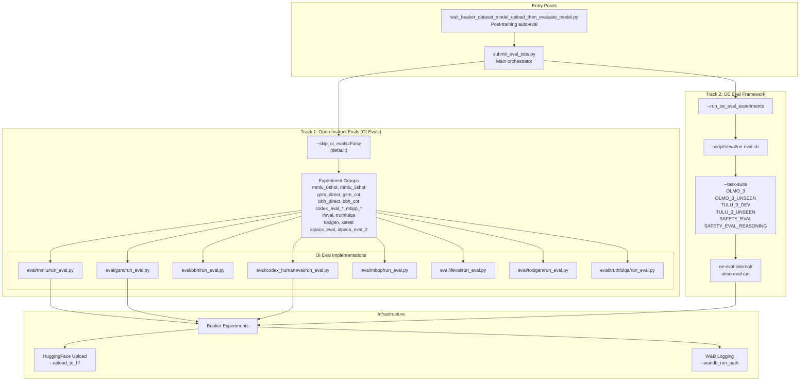
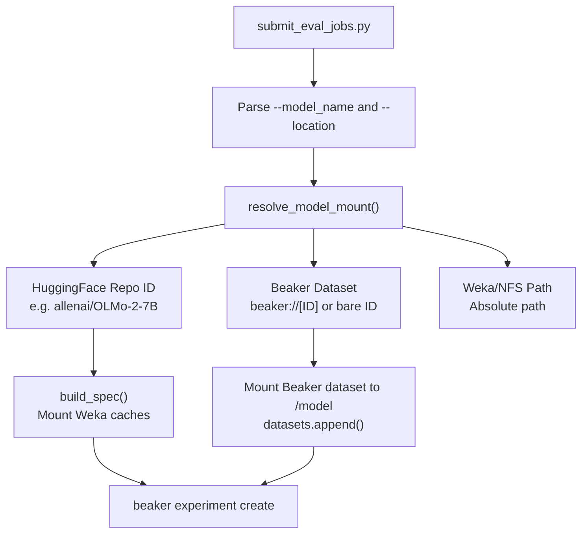

<!-- source: DeepWiki mcp.deepwiki.com · repo allenai/open-instruct · page 6 Evaluation System · fetched 2026-10-26 -->

# Evaluation System

Relevant source files

The following files were used as context for generating this wiki page:

- [configs/beaker_configs/default_eval.yaml](configs/beaker_configs/default_eval.yaml)
- [open_instruct/launch_utils.py](open_instruct/launch_utils.py)
- [scripts/collect_eval_results.py](scripts/collect_eval_results.py)
- [scripts/eval/alpaca_farm.sh](scripts/eval/alpaca_farm.sh)
- [scripts/eval/bbh.sh](scripts/eval/bbh.sh)
- [scripts/eval/codex_humaneval.sh](scripts/eval/codex_humaneval.sh)
- [scripts/eval/gsm.sh](scripts/eval/gsm.sh)
- [scripts/eval/mbpp.sh](scripts/eval/mbpp.sh)
- [scripts/eval/mmlu.sh](scripts/eval/mmlu.sh)
- [scripts/eval/oe-eval.sh](scripts/eval/oe-eval.sh)
- [scripts/eval/toxigen.sh](scripts/eval/toxigen.sh)
- [scripts/eval/truthfulqa.sh](scripts/eval/truthfulqa.sh)
- [scripts/eval/tulu3_baselines.sh](scripts/eval/tulu3_baselines.sh)
- [scripts/eval/tydiqa.sh](scripts/eval/tydiqa.sh)
- [scripts/submit_eval_jobs.py](scripts/submit_eval_jobs.py)
- [scripts/submit_eval_jobs_old.py](scripts/submit_eval_jobs_old.py)
- [scripts/wait_beaker_dataset_model_upload_then_evaluate_model.py](scripts/wait_beaker_dataset_model_upload_then_evaluate_model.py)

## Overview

The Evaluation System provides a two-track framework for assessing language model performance. The system supports both **Open Instruct (OI) Evals** for direct execution of standard benchmarks and **OE Eval** for integration with AI2's internal evaluation framework. This dual-track approach enables comprehensive model assessment across academic benchmarks, safety evaluations, and specialized task suites.

**Key Components:**
- **OI Evals**: Direct execution benchmarks (MMLU, GSM8K, BBH, Codex, etc.) implemented in the `eval/` directory.
- **OE Eval**: Task suite coordination via [scripts/eval/oe-eval.sh]() and the `oe-eval-internal` framework.
- **Orchestration**: Unified job submission through [scripts/submit_eval_jobs.py]().
- **Safety Evaluation**: Specialized safety benchmarks using dedicated task suites like `SAFETY_EVAL`.
- **Verifier Systems**: Ground truth verification and LLM judge integration.

For training systems that produce models, see [Core Training Systems](#2). For infrastructure details, see [Job Orchestration and Infrastructure](#5).

## Two-Track Evaluation Architecture

The evaluation system implements a dual-track architecture that supports both direct benchmark execution and external evaluation framework integration.

**Diagram: Evaluation System Architecture**

**Sources**: [scripts/submit_eval_jobs.py:58-111](), [scripts/eval/oe-eval.sh:49-82](), [scripts/wait_beaker_dataset_model_upload_then_evaluate_model.py:28-86]()

## Evaluation Tracks

### Track 1: Open Instruct (OI) Evals

OI Evals are benchmarks implemented directly within the repository. These run as individual Beaker tasks, typically defined in `eval/` subdirectories.

**Default Experiment Groups:**

| Group | Benchmark | Module |
|-------|-----------|--------|
| `mmlu_0shot` | MMLU | [eval/mmlu/run_eval.py]() |
| `gsm_cot` | GSM8K | [eval/gsm/run_eval.py]() |
| `bbh_cot` | Big Bench Hard | [eval/bbh/run_eval.py]() |
| `ifeval` | IFEval | [eval/ifeval/run_eval.py]() |
| `truthfulqa` | TruthfulQA | [eval/truthfulqa/run_eval.py]() |

OI Evals can be selectively disabled in the deprecated [scripts/submit_eval_jobs_old.py:144]() using `--skip_oi_evals`. Modern orchestration focuses on the OE Eval track for unified results. For details on individual benchmark implementations, see [Open Instruct Benchmarks](#6.3).

### Track 2: OE Eval Framework

OE Eval provides integration with AI2's internal evaluation framework via [scripts/eval/oe-eval.sh](). This track supports predefined task suites and is triggered by the `olmo-eval run` command in [scripts/submit_eval_jobs.py:125-149]().

**Common Task Suites:**

| Suite Name | Purpose |
|------------|---------|
| `TULU_3_DEV` | Standard development suite including GSM8K, BBH, MMLU, etc. [scripts/eval/oe-eval.sh:175-185]() |
| `TULU_3_UNSEEN` | Hidden test set including GPQA, MMLU Pro, and BigCodeBench. [scripts/eval/oe-eval.sh:190-197]() |
| `SAFETY_EVAL` | Safety benchmarks (WildGuard, Harmbench, XSTest). [scripts/eval/oe-eval.sh:201-204]() |

For details on task suite resolution and configuration, see [OE Eval Task Suites](#6.2).

## Orchestration and Model Resolution

The orchestrator [scripts/submit_eval_jobs.py]() manages job submission, resource heuristics, and model location resolution.

**Diagram: Model Location Resolution**

**Resource Allocation Heuristics:**
The system in the legacy [scripts/submit_eval_jobs_old.py:27-78]() automatically adjusts GPU counts (`adjust_gpus`) and batch sizes (`adjust_batch_size`) based on model size patterns (e.g., "70B", "13B") detected in the model name. The new orchestrator [scripts/submit_eval_jobs.py:76-78]() defaults to user-specified `--num_gpus` and `--cluster`. For a deep dive into these heuristics and the submission process, see [Evaluation Orchestration](#6.1).

**Sources**: [scripts/submit_eval_jobs.py:114-120](), [scripts/submit_eval_jobs.py:152-166](), [configs/beaker_configs/default_eval.yaml:47-49]()

### Automatic Post-Training Evaluation

The script [scripts/wait_beaker_dataset_model_upload_then_evaluate_model.py]() automates the transition from training to evaluation. It polls a Beaker workload ID using `beaker_experiment_succeeded` and, upon success, triggers both standard and safety evaluation suites using `subprocess.Popen` [scripts/wait_beaker_dataset_model_upload_then_evaluate_model.py:33-84]().

## Safety Evaluation

Safety evaluations assess model alignment and resistance to jailbreaking. The system uses the `SAFETY_EVAL` and `SAFETY_EVAL_REASONING` suites in [scripts/eval/oe-eval.sh:201-208]().

**Key Safety Benchmarks:**
- **WildGuard**: Default classifier for safety evaluation.
- **Harmbench**: Evaluates model refusal on harmful prompts.
- **XSTest**: Tests for exaggerated safety (over-refusal).

For detailed methodology and benchmark lists, see [Safety Evaluation](#6.4).

## Verifier Systems and LLM Judges

Evaluations rely on various verifiers to determine correctness:
- **Math Extraction**: Used for GSM8K and MATH benchmarks.
- **Code Execution**: Sandboxed execution for HumanEval and MBPP.
- **LLM Judges**: Using models like GPT-4 or specialized reward models to score open-ended responses.

For details on the implementation of these verifiers and the `judge_utils.py` logic, see [Verifier Systems and LLM Judges](#6.5).

**Sources**: [scripts/submit_eval_jobs.py:123-149](), [scripts/eval/oe-eval.sh:175-212](), [scripts/collect_eval_results.py:72-110]()

---

