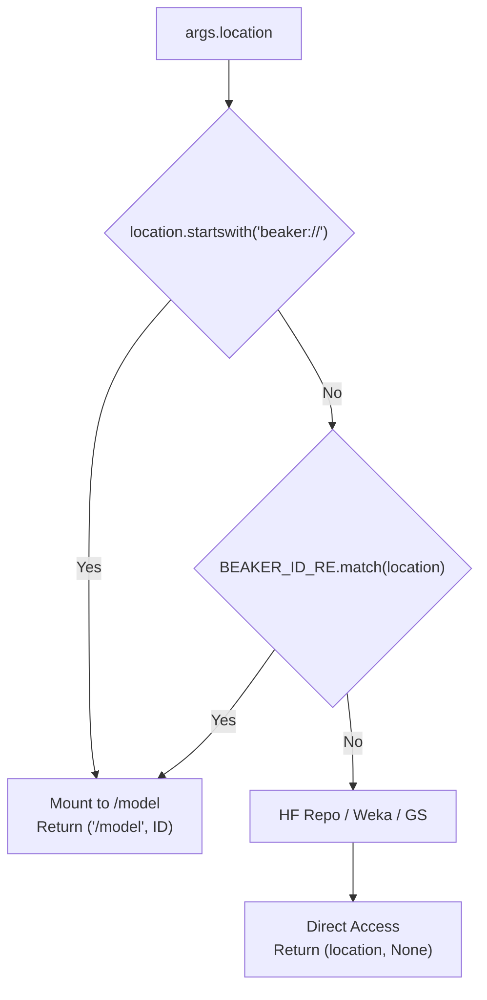
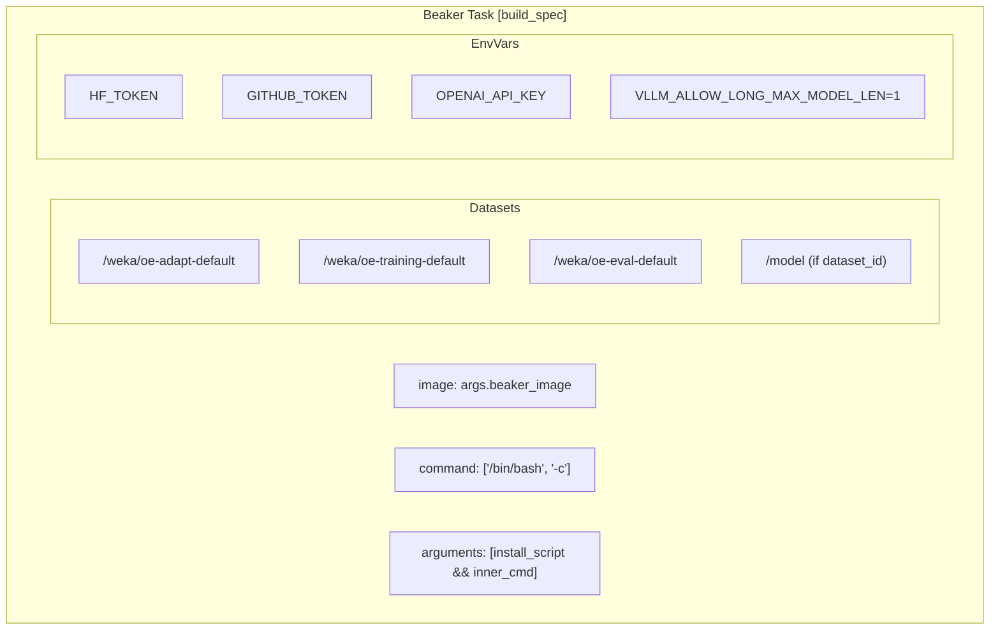

<!-- source: DeepWiki mcp.deepwiki.com · repo allenai/open-instruct · page 6.1 Evaluation Orchestration · fetched 2026-10-26 -->

# Evaluation Orchestration

Relevant source files

The following files were used as context for generating this wiki page:

- [configs/beaker_configs/default_eval.yaml](configs/beaker_configs/default_eval.yaml)
- [open_instruct/launch_utils.py](open_instruct/launch_utils.py)
- [scripts/collect_eval_results.py](scripts/collect_eval_results.py)
- [scripts/eval/faster_oe_eval_mmlu.sh](scripts/eval/faster_oe_eval_mmlu.sh)
- [scripts/eval/fetch_mmlu_jobs.py](scripts/eval/fetch_mmlu_jobs.py)
- [scripts/eval/oe-eval.sh](scripts/eval/oe-eval.sh)
- [scripts/eval/truthfulqa.sh](scripts/eval/truthfulqa.sh)
- [scripts/eval/tulu3_baselines.sh](scripts/eval/tulu3_baselines.sh)
- [scripts/submit_eval_jobs.py](scripts/submit_eval_jobs.py)
- [scripts/submit_eval_jobs_old.py](scripts/submit_eval_jobs_old.py)
- [scripts/wait_beaker_dataset_model_upload_then_evaluate_model.py](scripts/wait_beaker_dataset_model_upload_then_evaluate_model.py)

The evaluation orchestration system is centered around `scripts/submit_eval_jobs.py`, which manages the submission and coordination of evaluation jobs across distributed computing platforms. This script handles model location resolution, resource allocation heuristics, task configuration, and job submission to the Beaker platform for both Open-Instruct internal evaluations and OE-Eval benchmarks.

## Overview

The `scripts/submit_eval_jobs.py` script orchestrates evaluation workflows by:

1.  **Argument Parsing**: Processes command-line arguments and configuration for model evaluation [scripts/submit_eval_jobs.py:57-111]().
2.  **Model Location Resolution**: Resolves model sources from HuggingFace Hub, Beaker datasets (ID or `beaker://` prefix), absolute Weka/NFS paths, or Google Storage (`gs://`) [scripts/submit_eval_jobs.py:60-69, 114-121]().
3.  **Resource Allocation**: Automatically builds Beaker task specifications with appropriate GPU counts and cluster constraints [scripts/submit_eval_jobs.py:152-198]().
4.  **Task Configuration**: Generates the internal `olmo-eval run` command with model paths, task lists, and vLLM provider settings [scripts/submit_eval_jobs.py:123-149]().
5.  **Job Submission**: Submits jobs to Beaker v2 clusters and manages environment variables like `HF_TOKEN` and `GITHUB_TOKEN` [scripts/submit_eval_jobs.py:180-184, 203-211]().
6.  **Result Handling**: Configures result output paths and Weka mounts for persistent storage [scripts/submit_eval_jobs.py:148, 159-163]().

The orchestration system primarily targets the **OE Eval** track, delegating execution to the `olmo-eval` command within a Beaker container [scripts/submit_eval_jobs.py:3-7, 125]().

Sources: [scripts/submit_eval_jobs.py:1-211](), [scripts/eval/oe-eval.sh:1-56]()

## Command-Line Interface

The `scripts/submit_eval_jobs.py` script defines a specialized argument parser for the modern evaluation pipeline [scripts/submit_eval_jobs.py:57-111]().

### Core Arguments

| Argument | Type | Default | Description |
| :--- | :--- | :--- | :--- |
| `--model_name` | `str` | Required | Human-readable run name [scripts/submit_eval_jobs.py:59]() |
| `--location` | `str` | Required | Model source (HF repo, Beaker ID, Weka path, or GS URL) [scripts/submit_eval_jobs.py:61-69]() |
| `--tasks` | `str` | `"aime_2025:pass_at_32"` | Comma-separated `olmo-eval` task specifications [scripts/submit_eval_jobs.py:71-75]() |
| `--cluster` | `list` | `["ai2/jupiter"]` | Target Beaker clusters (must support Weka) [scripts/submit_eval_jobs.py:77, 153-158]() |
| `--num_gpus` | `int` | `1` | Number of GPUs to allocate per task [scripts/submit_eval_jobs.py:76]() |
| `--workspace` | `str` | `"ai2/tulu-3-results"` | Beaker workspace for the experiment [scripts/submit_eval_jobs.py:80]() |

### Execution Configuration

| Argument | Type | Default | Description |
| :--- | :--- | :--- | :--- |
| `--max_length` | `int` | `32768` | Provider `max_model_len` for vLLM [scripts/submit_eval_jobs.py:90-94]() |
| `--sampling_max_tokens` | `int` | `None` | Override per-task sampling limits [scripts/submit_eval_jobs.py:96-100]() |
| `--olmo_eval_ref` | `str` | `"main"` | Git ref of `olmo-eval-internal` to install at job start [scripts/submit_eval_jobs.py:103-107]() |
| `--priority` | `str` | `"normal"` | Beaker job priority [scripts/submit_eval_jobs.py:78]() |
| `--preemptible` | `flag` | `False` | Use preemptible instances [scripts/submit_eval_jobs.py:79]() |

Sources: [scripts/submit_eval_jobs.py:57-111]()

## Model Location Resolution

The function `resolve_model_mount` in `submit_eval_jobs.py` determines how the model is accessed within the Beaker container [scripts/submit_eval_jobs.py:114-121]().

### Model Resolution Flow

### Implementation Details
*   **Beaker Datasets**: If the location is a 26-character alphanumeric ID or uses the `beaker://` prefix, the dataset is mounted to `/model` in the container [scripts/submit_eval_jobs.py:116-120]().
*   **HuggingFace/Weka**: Other strings (like `allenai/OLMo-2-1124-7B-Instruct` or `/weka/...`) are passed directly to the evaluation command without an explicit Beaker mount [scripts/submit_eval_jobs.py:65-67, 120]().
*   **Weka Enforcement**: The script validates that the chosen clusters belong to `launch_utils.WEKA_CLUSTERS` to ensure availability of necessary mounts [scripts/submit_eval_jobs.py:153-158]().

Sources: [scripts/submit_eval_jobs.py:114-121, 153-163](), [open_instruct/launch_utils.py:8-17]()

## Resource Allocation and Installation Heuristics

The orchestration system uses a dynamic installation script to ensure the latest evaluation code is used without needing to rebuild Docker images for every change.

### The Build-and-Install Script
The `build_install_script` function generates a bash command that runs at the start of every Beaker job [scripts/submit_eval_jobs.py:41-54]():
1.  Clones `allenai/olmo-eval-internal` using a `GITHUB_TOKEN` [scripts/submit_eval_jobs.py:46-47]().
2.  Checks out the specified `--olmo_eval_ref` [scripts/submit_eval_jobs.py:49]().
3.  Installs the package in editable mode with `vllm` support [scripts/submit_eval_jobs.py:50]().
4.  Upgrades `vllm` and `transformers` to required versions [scripts/submit_eval_jobs.py:51-52]().
5.  Uses a shared Weka pip cache at `/weka/oe-eval-default/olmo-eval-pypi-cache` to speed up startup [scripts/submit_eval_jobs.py:50-51]().

### Beaker Spec Construction
The `build_spec` function assembles the final Beaker v2 experiment configuration [scripts/submit_eval_jobs.py:152-198]():

Sources: [scripts/submit_eval_jobs.py:41-54, 152-198]()

## Evaluation Task Suites and oe-eval.sh

While `submit_eval_jobs.py` is the primary entry point for individual task submissions, `scripts/eval/oe-eval.sh` provides a shell-based wrapper for running predefined task suites [scripts/eval/oe-eval.sh:1-56]().

### Task Suite Resolution
`oe-eval.sh` maps high-level suite names to lists of `olmo-eval` tasks [scripts/eval/oe-eval.sh:173-254]():
*   **TULU_3_DEV**: Includes `gsm8k::tulu`, `bbh:cot-v1::tulu`, `ifeval::tulu`, and `mmlu:mc::tulu` [scripts/eval/oe-eval.sh:175-189]().
*   **TULU_3_UNSEEN**: Includes `gpqa:0shot_cot::tulu3`, `mmlu_pro:0shot_cot::tulu3`, and `bigcodebench::tulu` [scripts/eval/oe-eval.sh:191-199]().
*   **SAFETY_EVAL**: Focuses on `wildguard`, `harmbench`, and `xstest` variants [scripts/eval/oe-eval.sh:229-241]().

### Output Processing
The script supports an `--upload_to_hf` flag which constructs a `--hf-save-dir` argument for `olmo-eval`, enabling automatic result synchronization to the Hugging Face Hub [scripts/eval/oe-eval.sh:159-164](). It also supports `--process-output r1_style` for models that use reasoning tokens [scripts/eval/oe-eval.sh:54, 77]().

Sources: [scripts/eval/oe-eval.sh:50-54, 159-254]()

## Result Collection and Monitoring

For monitoring and aggregating results across multiple jobs, the repository provides utility scripts.

### Metric Aggregation
`scripts/collect_eval_results.py` connects to the Beaker API to gather metrics from an experiment's jobs [scripts/collect_eval_results.py:130-155]():
*   **Summary Extraction**: Uses `get_summary_metric` to pull the primary score for each task (e.g., `average_acc` for MMLU, `pass@1` for Codex) [scripts/collect_eval_results.py:72-111]().
*   **Rescaling**: Automatically rescales metrics from 0-100 to 0-1 for consistency across tasks like `alpaca_eval` [scripts/collect_eval_results.py:92, 106-108]().

### Automated Evaluation Pipelines
`scripts/wait_beaker_dataset_model_upload_then_evaluate_model.py` implements a polling mechanism [scripts/wait_beaker_dataset_model_upload_then_evaluate_model.py:31-33]():
1.  Waits for a training experiment (specified by `--beaker_workload_id`) to succeed [scripts/wait_beaker_dataset_model_upload_then_evaluate_model.py:33]().
2.  Retrieves the resulting model dataset ID [scripts/wait_beaker_dataset_model_upload_then_evaluate_model.py:38]().
3.  Automatically triggers a suite of evaluation jobs using the resolved dataset [scripts/wait_beaker_dataset_model_upload_then_evaluate_model.py:39-84]().

Sources: [scripts/collect_eval_results.py:72-155](), [scripts/wait_beaker_dataset_model_upload_then_evaluate_model.py:28-87]()

---

