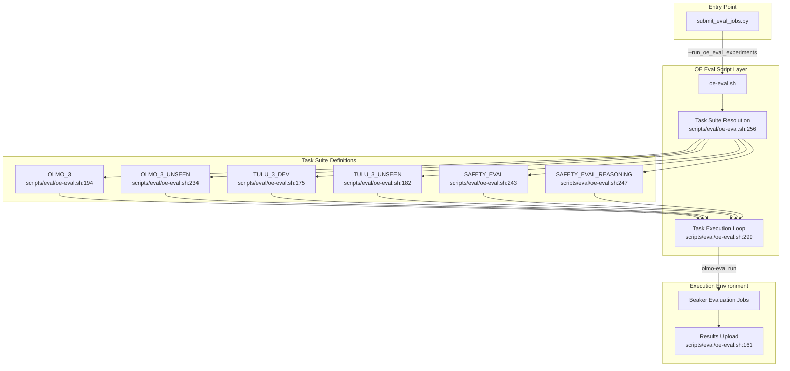
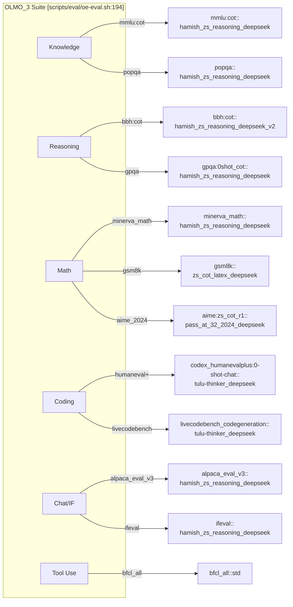
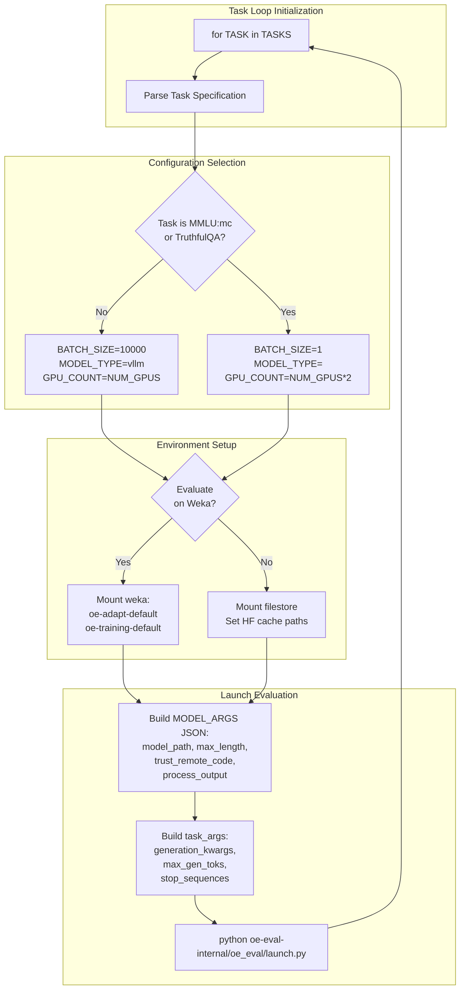

<!-- source: DeepWiki mcp.deepwiki.com · repo allenai/open-instruct · page 6.2 OE Eval Task Suites · fetched 2026-10-26 -->

# OE Eval Task Suites

<details>
<summary>Relevant source files</summary>

The following files were used as context for generating this wiki page:

- [configs/beaker_configs/default_eval.yaml](configs/beaker_configs/default_eval.yaml)
- [open_instruct/launch_utils.py](open_instruct/launch_utils.py)
- [scripts/collect_eval_results.py](scripts/collect_eval_results.py)
- [scripts/eval/oe-eval.sh](scripts/eval/oe-eval.sh)
- [scripts/eval/truthfulqa.sh](scripts/eval/truthfulqa.sh)
- [scripts/eval/tulu3_baselines.sh](scripts/eval/tulu3_baselines.sh)
- [scripts/submit_eval_jobs.py](scripts/submit_eval_jobs.py)
- [scripts/submit_eval_jobs_old.py](scripts/submit_eval_jobs_old.py)
- [scripts/wait_beaker_dataset_model_upload_then_evaluate_model.py](scripts/wait_beaker_dataset_model_upload_then_evaluate_model.py)

</details>


## Purpose and Scope

This document describes the **OE Eval task suite system**, which provides predefined collections of evaluation benchmarks for comprehensive model assessment. OE Eval is an internal AI2 evaluation framework that complements the Open Instruct (OI) evaluation system. While OI Evals (documented in [6.3]()) run benchmarks directly within this repository, OE Eval delegates to the `oe-eval-internal` framework for coordinated execution of complex evaluation suites.

For information about the overall evaluation orchestration system, see [6.1](). For safety-specific evaluations, see [6.4]().

## Overview

OE Eval provides several predefined task suites, each targeting different evaluation scenarios. The system has evolved from Tulu 3 development to the current OLMo 3 and reasoning-focused suites.

| Task Suite | Purpose | Typical Use Case |
|------------|---------|------------------|
| `OLMO_3` | Primary development suite | Active model development and iteration for OLMo 3 [scripts/eval/oe-eval.sh:113]() |
| `OLMO_3_UNSEEN` | Held-out test suite | Final model assessment on unseen tasks [scripts/eval/oe-eval.sh:234-241]() |
| `TULU_3_DEV` | Tulu 3 development benchmarks | Tulu 3 specific development [scripts/eval/oe-eval.sh:175-181]() |
| `TULU_3_UNSEEN` | Tulu 3 held-out benchmarks | Tulu 3 final assessment [scripts/eval/oe-eval.sh:182-191]() |
| `SAFETY_EVAL` | Safety benchmarks | Safety evaluation for standard models [scripts/eval/oe-eval.sh:243-245]() |
| `SAFETY_EVAL_REASONING` | Safety benchmarks for reasoning | Safety evaluation for reasoning/thinking models [scripts/eval/oe-eval.sh:247-249]() |

Task suites are resolved in `scripts/eval/oe-eval.sh` [scripts/eval/oe-eval.sh:256-280]() and executed via the `oe-eval-internal` Python framework [scripts/submit_eval_jobs.py:41-54]().

**Sources:** [scripts/eval/oe-eval.sh:1-119](), [scripts/submit_eval_jobs.py:1-19](), [scripts/eval/oe-eval.sh:175-249]()

## System Architecture

The following diagram illustrates the flow from evaluation submission to execution in the OE Eval framework.



**Sources:** [scripts/submit_eval_jobs.py:123-149](), [scripts/eval/oe-eval.sh:256-397]()

## Task Specification Format

OE Eval tasks use a structured specification format with three components separated by `::`:

```
<benchmark>[:<variant>]::<prompt_template>
```

### Format Components

| Component | Description | Examples |
|-----------|-------------|----------|
| `<benchmark>` | The evaluation benchmark name | `gsm8k`, `mmlu`, `bbh`, `codex_humaneval` |
| `<variant>` | Optional variant specification | `cot`, `0shot_cot`, `mc`, `cot-v1` |
| `<prompt_template>` | Prompt template identifier | `tulu`, `hamish_zs_reasoning_deepseek`, `llama3` |

### Example Task Specifications

```bash
# GSM8K with Tulu prompt template
"gsm8k::tulu" [scripts/eval/oe-eval.sh:176]()

# BBH with chain-of-thought variant and custom prompt
"bbh:cot-v1::tulu" [scripts/eval/oe-eval.sh:177]()

# MMLU with multiple choice variant
"mmlu:mc::tulu" [scripts/eval/oe-eval.sh:184]()
```

**Sources:** [scripts/eval/oe-eval.sh:167-249]()

## OLMO_3 Task Suite

The `OLMO_3` suite is the primary development benchmark for the OLMo 3 series, containing tasks across knowledge, reasoning, math, and coding.



### Key Capabilities

**Knowledge and Reasoning:**
- `mmlu:cot::hamish_zs_reasoning_deepseek` [scripts/eval/oe-eval.sh:195]()
- `gpqa:0shot_cot::hamish_zs_reasoning_deepseek` [scripts/eval/oe-eval.sh:200]()
- `bbh:cot::hamish_zs_reasoning_deepseek_v2` [scripts/eval/oe-eval.sh:198]()

**Math and Coding:**
- `gsm8k::zs_cot_latex_deepseek` [scripts/eval/oe-eval.sh:204]()
- `aime:zs_cot_r1::pass_at_32_2024_deepseek` [scripts/eval/oe-eval.sh:207]()
- `codex_humanevalplus:0-shot-chat::tulu-thinker_deepseek` [scripts/eval/oe-eval.sh:211]()

**Instruction Following and Tools:**
- `ifeval::hamish_zs_reasoning_deepseek` [scripts/eval/oe-eval.sh:216]()
- `bfcl_all::std` - Berkeley Function Calling Leaderboard [scripts/eval/oe-eval.sh:218]()

**Sources:** [scripts/eval/oe-eval.sh:194-232]()

## Other Task Suites

### OLMO_3_UNSEEN

Held-out evaluation suite with tasks for final model assessment, including `mmlu_pro` and `ifbench` [scripts/eval/oe-eval.sh:234-241]().

### TULU_3 Suites

The Tulu 3 development and unseen suites were used for the Tulu 3 model series [scripts/eval/oe-eval.sh:175-191]().
- **TULU_3_DEV**: Includes `gsm8k::tulu`, `bbh:cot-v1::tulu`, `drop::llama3`, and `ifeval::tulu` [scripts/eval/oe-eval.sh:175-181]().
- **TULU_3_UNSEEN**: Includes `agi_eval_english:0shot_cot::tulu3`, `gpqa:0shot_cot::tulu3`, and `bigcodebench_hard::tulu` [scripts/eval/oe-eval.sh:182-191]().

### Safety Evaluation Suites

Safety evaluations use the `SAFETY_EVAL` or `SAFETY_EVAL_REASONING` suites [scripts/eval/oe-eval.sh:243-249](). These suites trigger benchmarks such as WildGuardTest, Harmbench, and XSTest.

**Sources:** [scripts/eval/oe-eval.sh:167-249](), [scripts/wait_beaker_dataset_model_upload_then_evaluate_model.py:72]()

## Task Execution Workflow

The `oe-eval.sh` script handles the complexity of launching these tasks on Beaker using Gantry.



**Sources:** [scripts/eval/oe-eval.sh:299-397]()

## Configuration Options

### Model and Task Arguments

Arguments are constructed as JSON objects and passed to the `oe_eval` launch script.

- **MODEL_ARGS**: Contains `model_path`, `max_length`, `trust_remote_code`, and optional `process_output` (e.g., `r1_style`) [scripts/eval/oe-eval.sh:290-295]().
- **Task Arguments**: Includes `generation_kwargs` such as `max_gen_toks` and `stop_sequences` [scripts/eval/oe-eval.sh:362]().

### Gantry and Infrastructure

OE Eval supports execution on different clusters with specific mount configurations.

- **Weka clusters**: Mounts `oe-adapt-default`, `oe-training-default`, and `oe-eval-default` [scripts/submit_eval_jobs.py:160-162]().
- **Augusta (GCS)**: Model locations starting with `gs://` trigger specific handling [scripts/eval/oe-eval.sh:95-97]().

### GPU Configuration

GPU counts are automatically adjusted. For example, standard multiple-choice tasks double the GPU count while reducing batch size to 1 [scripts/eval/oe-eval.sh:301-309]().

**Sources:** [scripts/eval/oe-eval.sh:301-359](), [scripts/submit_eval_jobs.py:153-163]()

## Integration with submit_eval_jobs.py

The current `scripts/submit_eval_jobs.py` script serves as the primary entry point for launching `olmo-eval` jobs on Beaker [scripts/submit_eval_jobs.py:123-149]().

### Key Arguments

| Argument | Description |
|----------|-------------|
| `--model_name` | Human-readable run name [scripts/submit_eval_jobs.py:59]() |
| `--location` | Model location (Beaker ID, HF repo, Weka path, or GS URL) [scripts/submit_eval_jobs.py:61-69]() |
| `--tasks` | Comma-separated list of task specs [scripts/submit_eval_jobs.py:71-75]() |
| `--olmo_eval_ref` | Git ref of `olmo-eval-internal` to install [scripts/submit_eval_jobs.py:103-107]() |

### Result Management

OE Eval results can be managed through several integrations:
- **Hugging Face**: Results are uploaded to a specified dataset path [scripts/eval/oe-eval.sh:161]().
- **Weights & Biases**: Logging is supported via `--wandb-run-path` and Beaker secrets for API keys [scripts/eval/oe-eval.sh:137-146]().
- **Datalake**: Results are tagged with `run_id` and `step` for database logging [scripts/eval/oe-eval.sh:148-157]().

**Sources:** [scripts/eval/oe-eval.sh:128-164](), [scripts/submit_eval_jobs.py:171-186]()

---

