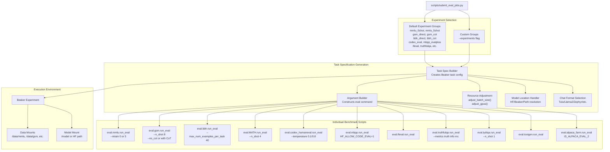
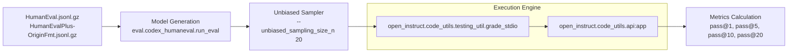

<!-- source: DeepWiki mcp.deepwiki.com · repo allenai/open-instruct · page 6.3 Open Instruct Benchmarks · fetched 2026-10-26 -->

# Open Instruct Benchmarks

Relevant source files

The following files were used as context for generating this wiki page:

- [docs/data/preference-data.md](docs/data/preference-data.md)
- [human_eval/README.md](human_eval/README.md)
- [human_eval/app.py](human_eval/app.py)
- [human_eval/compute_metrics.py](human_eval/compute_metrics.py)
- [human_eval/data/eval_annotations_tulu_1.xlsx](human_eval/data/eval_annotations_tulu_1.xlsx)
- [human_eval/data/eval_instances_tulu_1.jsonl](human_eval/data/eval_instances_tulu_1.jsonl)
- [human_eval/export_db.py](human_eval/export_db.py)
- [human_eval/requirements.txt](human_eval/requirements.txt)
- [human_eval/screenshot.png](human_eval/screenshot.png)
- [human_eval/static/app.js](human_eval/static/app.js)
- [human_eval/static/favicon.png](human_eval/static/favicon.png)
- [open_instruct/IFEvalG/instructions.py](open_instruct/IFEvalG/instructions.py)
- [open_instruct/code_utils/api.py](open_instruct/code_utils/api.py)
- [open_instruct/code_utils/testing_util.py](open_instruct/code_utils/testing_util.py)
- [scripts/data/preferences/helpsteer2.py](scripts/data/preferences/helpsteer2.py)
- [scripts/data/preferences/helpsteer2_nvidia.py](scripts/data/preferences/helpsteer2_nvidia.py)
- [scripts/data/preferences/nectar.py](scripts/data/preferences/nectar.py)
- [scripts/data/preferences/ultrafeedback_replications.py](scripts/data/preferences/ultrafeedback_replications.py)
- [scripts/eval/alpaca_farm.sh](scripts/eval/alpaca_farm.sh)
- [scripts/eval/bbh.sh](scripts/eval/bbh.sh)
- [scripts/eval/codex_humaneval.sh](scripts/eval/codex_humaneval.sh)
- [scripts/eval/gsm.sh](scripts/eval/gsm.sh)
- [scripts/eval/mbpp.sh](scripts/eval/mbpp.sh)
- [scripts/eval/mmlu.sh](scripts/eval/mmlu.sh)
- [scripts/eval/toxigen.sh](scripts/eval/toxigen.sh)
- [scripts/eval/tydiqa.sh](scripts/eval/tydiqa.sh)

This document covers the Open Instruct (OI) evaluation benchmarks that are executed directly within the `open-instruct` repository. These benchmarks are distinct from the OE Eval framework (covered in section 6.2) and are managed primarily through `scripts/submit_eval_jobs.py` [scripts/submit_eval_jobs.py:1-10](). OI Evals provide standardized evaluation across knowledge, reasoning, code generation, instruction following, multilingual, safety, and chat capabilities.

For information about the orchestration layer that coordinates both OI and OE evaluations, see section 6.1. For safety-specific evaluations using the OE Eval framework, see section 6.4.

## Evaluation System Architecture

The OI Evals system consists of benchmark-specific evaluation scripts in the `eval/` directory, coordinated by a submission script that generates Beaker experiments.

**Diagram: OI Evals Execution Flow**

**Sources:** [scripts/submit_eval_jobs.py:161-184](), [scripts/submit_eval_jobs.py:194-606]()

## Shared Utilities and Interfaces

The `eval/` directory contains shared logic to ensure consistency across benchmarks.

### Shared Utilities (`eval/utils.py`)
Common functions used across benchmarks include:
- **`generate_completions`**: Handles batch generation using either HuggingFace `generate` or vLLM.
- **`load_hf_lm_and_tokenizer`**: Standardized model loading with support for 8-bit quantization and device mapping.
- **`dynamic_import_function`**: Used to load chat formatting functions at runtime [scripts/eval/alpaca_farm.sh:15]().

### Human Eval Annotation Interface
The `human_eval/` directory contains a Flask-based web application for human review and annotation of model outputs [human_eval/app.py:1-20](). This interface is used to build preference datasets and perform qualitative error analysis.
- **`human_eval/app.py`**: The core web server handling instance serving and annotation storage [human_eval/app.py:1-50]().
- **`human_eval/compute_metrics.py`**: Calculates inter-annotator agreement and final scores from the annotation database.
- **`human_eval/export_db.py`**: Exports annotations to JSONL or CSV formats for further processing.

**Sources:** [human_eval/app.py:1-50](), [human_eval/compute_metrics.py:1-30](), [scripts/eval/alpaca_farm.sh:15]()

## Benchmark Implementations

### Knowledge and Language Understanding

#### MMLU (Massive Multitask Language Understanding)
MMLU evaluates knowledge across 57 subjects. The implementation supports 0-shot and 5-shot settings [scripts/eval/mmlu.sh:7-25]().
- **Script**: `eval.mmlu.run_eval`
- **Key Args**: `--ntrain` (0 or 5), `--eval_batch_size` (typically 4 for 8-bit loading) [scripts/eval/mmlu.sh:8-13]().

#### TruthfulQA
Evaluates model truthfulness using specialized judge models.
- **Metrics**: `truth`, `info`, `mc` [scripts/submit_eval_jobs.py:422-436]().

### Mathematical Reasoning

#### GSM8K (Grade School Math)
Evaluates multi-step mathematical reasoning.
- **Script**: `eval.gsm.run_eval`
- **Configuration**: Supports 8-shot prompting with or without Chain-of-Thought (`--no_cot`) [scripts/eval/gsm.sh:7-25]().
- **Integration**: Uses `eval.templates.create_prompt_with_tulu_chat_format` for instruction-tuned models [scripts/eval/gsm.sh:38]().

#### MATH
Evaluates advanced mathematical problem-solving (Level 1-5 problems).
- **Script**: `eval.MATH.run_eval`
- **Configuration**: Defaults to 4-shot with Chain-of-Thought.

#### MGSM (Multilingual GSM)
A multilingual variant of GSM8K evaluated via the TyDiQA or specialized MGSM scripts.

**Sources:** [scripts/eval/gsm.sh:1-95](), [scripts/submit_eval_jobs.py:422-436]()

### Coding Benchmarks

#### Codex HumanEval and MBPP
Evaluates Python code generation using `pass@k` metrics.
- **Execution**: Requires `HF_ALLOW_CODE_EVAL=1` for MBPP to execute generated code [scripts/eval/mbpp.sh:5]().
- **Sampling**: Supports unbiased sampling with `n` samples to calculate `pass@1`, `pass@5`, etc. [scripts/eval/codex_humaneval.sh:8-10]().
- **Data Variants**: Supports `HumanEvalPlus` for more rigorous testing [scripts/eval/codex_humaneval.sh:46-57]().

#### Code Execution Infrastructure
The codebase provides a sophisticated sandbox for code evaluation in `open_instruct/code_utils/`.
- **`testing_util.py`**: Implements `grade_stdio` [open_instruct/code_utils/testing_util.py:216]() and `compile_code` [open_instruct/code_utils/testing_util.py:185]() for executing untrusted code with timeouts [open_instruct/code_utils/testing_util.py:49]().
- **`api.py`**: A FastAPI server that exposes endpoints like `/test_program` and `/test_program_stdio` to allow sandboxed execution via Docker [open_instruct/code_utils/api.py:34-76]().

**Diagram: Code Evaluation Data Flow**

**Sources:** [scripts/eval/codex_humaneval.sh:1-135](), [open_instruct/code_utils/api.py:34-76](), [open_instruct/code_utils/testing_util.py:216-230]()

### Instruction Following and Safety

#### IFEval (Instruction Following Evaluation)
Tests ability to follow explicit formatting constraints. The implementation in `open_instruct/IFEvalG/` includes a library of instruction checkers.
- **`instructions.py`**: Defines classes like `ResponseLanguageChecker` [open_instruct/IFEvalG/instructions.py:136]() and `NumberOfSentences` [open_instruct/IFEvalG/instructions.py:188]() to programmatically verify if constraints were met.

#### BBH (Big-Bench Hard)
Tests reasoning across 23 challenging tasks where LMs previously underperformed.
- **Script**: `eval.bbh.run_eval`
- **Configuration**: 3-shot or Chain-of-Thought; typically 40 examples per task [scripts/eval/bbh.sh:7-13]().

#### ToxiGen and XSTest
Evaluate toxicity and exaggerated safety (refusal behavior).
- **Script**: `eval.toxigen.run_eval` [scripts/eval/toxigen.sh:5-11]().
- **Configuration**: Supports chat format via `create_prompt_with_tulu_chat_format` [scripts/eval/toxigen.sh:11]().

**Sources:** [scripts/eval/bbh.sh:1-87](), [scripts/eval/toxigen.sh:1-38](), [open_instruct/IFEvalG/instructions.py:117-210]()

## Resource and Format Management

### Resource Allocation Heuristics
The system automatically adjusts `gpuCount` and `eval_batch_size` based on model strings (e.g., "70B", "13B") to prevent OOMs [scripts/submit_eval_jobs.py:14-61]().

### Chat Formatting Resolution
The system maps model names to template functions in `eval/templates.py`:
- **Tulu**: `create_prompt_with_tulu_chat_format` [scripts/eval/alpaca_farm.sh:15]().
- **Llama2**: `create_prompt_with_llama2_chat_format` [scripts/eval/gsm.sh:51]().
- **Zephyr**: `create_prompt_with_zephyr_chat_format` [scripts/submit_eval_jobs.py:534]().

**Sources:** [scripts/submit_eval_jobs.py:508-556](), [eval/templates.py:1-50]()

---

