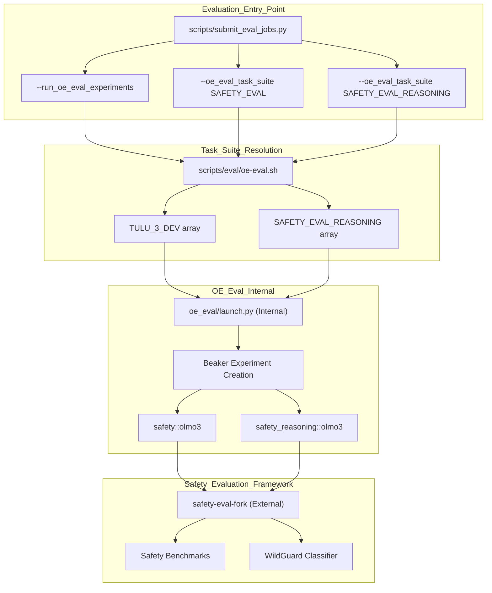
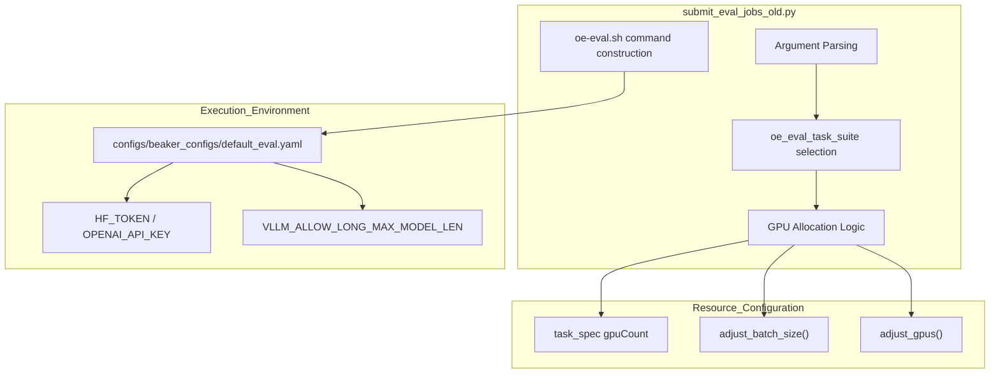

<!-- source: DeepWiki mcp.deepwiki.com · repo allenai/open-instruct · page 6.4 Safety Evaluation · fetched 2026-10-26 -->

# Safety Evaluation

<details>
<summary>Relevant source files</summary>

The following files were used as context for generating this wiki page:

- [configs/beaker_configs/default_eval.yaml](configs/beaker_configs/default_eval.yaml)
- [configs/train_configs/tulu3/tulu3_dpo_70b.yaml](configs/train_configs/tulu3/tulu3_dpo_70b.yaml)
- [configs/train_configs/tulu3/tulu3_dpo_8b.yaml](configs/train_configs/tulu3/tulu3_dpo_8b.yaml)
- [configs/train_configs/tulu3/tulu3_sft.yaml](configs/train_configs/tulu3/tulu3_sft.yaml)
- [docs/safety-eval/safety.md](docs/safety-eval/safety.md)
- [docs/safety.md](docs/safety.md)
- [open_instruct/launch_utils.py](open_instruct/launch_utils.py)
- [scripts/collect_eval_results.py](scripts/collect_eval_results.py)
- [scripts/eval/oe-eval.sh](scripts/eval/oe-eval.sh)
- [scripts/eval/truthfulqa.sh](scripts/eval/truthfulqa.sh)
- [scripts/eval/tulu3_baselines.sh](scripts/eval/tulu3_baselines.sh)
- [scripts/submit_eval_jobs.py](scripts/submit_eval_jobs.py)
- [scripts/submit_eval_jobs_old.py](scripts/submit_eval_jobs_old.py)
- [scripts/wait_beaker_dataset_model_upload_then_evaluate_model.py](scripts/wait_beaker_dataset_model_upload_then_evaluate_model.py)

</details>


## Purpose and Scope

This document covers the safety evaluation system in `open-instruct`, which assesses language models for potential harmful outputs, refusal behaviors, and adherence to safety guidelines. Safety evaluation is implemented through the `OE Eval` framework as specialized task suites that integrate with the main evaluation orchestration pipeline.

## Safety Evaluation Architecture

The safety evaluation system is invoked through `scripts/submit_eval_jobs.py` (and its legacy counterpart `scripts/submit_eval_jobs_old.py`) using the `--run_oe_eval_experiments` flag and the `--oe_eval_task_suite` parameter set to either `SAFETY_EVAL` or `SAFETY_EVAL_REASONING` [scripts/submit_eval_jobs_old.py:143-151](). The evaluation is then delegated to `scripts/eval/oe-eval.sh`, which launches the `oe-eval-internal` framework [scripts/eval/oe-eval.sh:5-8]().

### Natural Language to Code Entity Mapping: Safety Pipeline
This diagram maps the high-level safety evaluation concepts to the specific scripts and arguments used in the codebase.

Title: Safety Evaluation Orchestration Pipeline


Sources: [scripts/submit_eval_jobs_old.py:143-151](), [scripts/eval/oe-eval.sh:51-55](), [docs/safety-eval/safety.md:3-7]()

## Task Suites

The safety evaluation system defines two primary task suites in `scripts/eval/oe-eval.sh`:

### SAFETY_EVAL Task Suite
This suite is designed for standard (non-reasoning) models and evaluates safety across multiple benchmarks using the `safety::olmo3` task specification [scripts/eval/oe-eval.sh:243-245]().

### SAFETY_EVAL_REASONING Task Suite
This suite is optimized for reasoning models (e.g., models using CoT) and includes additional configuration to handle longer generation sequences [docs/safety-eval/safety.md:20-22](). It uses the `safety_reasoning::olmo3` task specification [scripts/eval/oe-eval.sh:247-249]().

### Supported Safety Benchmarks
The safety evaluation framework (implemented in the external `safety-eval-fork` repository) includes several key benchmarks:

| Benchmark | Purpose | Reference |
|-----------|---------|-----------|
| **WildGuardTest** | General safety and refusal evaluation | [arXiv:2406.18495](https://arxiv.org/abs/2406.18495) |
| **Harmbench** | Automated red-teaming and harm detection | [arXiv:2402.04249](https://arxiv.org/abs/2402.04249) |
| **ToxiGen** | Detection of implicit toxicity | [arXiv:2203.09509](https://arxiv.org/abs/2203.09509) |
| **XSTest** | Evaluating exaggerated safety (over-refusal) | [arXiv:2308.01263](https://arxiv.org/abs/2308.01263) |
| **WildJailbreak** | Testing resistance to jailbreak prompts | [arXiv:2406.18510](https://arxiv.org/abs/2406.18510) |

By default, the evaluation uses the **WildGuard** classifier to assess the safety of model outputs [docs/safety-eval/safety.md:43-44]().

Sources: [scripts/eval/oe-eval.sh:243-249](), [docs/safety-eval/safety.md:41-52]()

## Submission and Automation

Safety evaluation is typically triggered as part of the model development lifecycle.

### Automated Post-Training Evaluation
The `scripts/wait_beaker_dataset_model_upload_then_evaluate_model.py` script automates safety evaluation immediately after a training job succeeds on Beaker [scripts/wait_beaker_dataset_model_upload_then_evaluate_model.py:33-40](). 

It executes two distinct phases:
1. **General Evaluation**: Runs standard OE Eval experiments [scripts/wait_beaker_dataset_model_upload_then_evaluate_model.py:40-50]().
2. **Safety Evaluation**: Specifically calls `submit_eval_jobs_old.py` with the `--oe_eval_task_suite "SAFETY_EVAL"` argument [scripts/wait_beaker_dataset_model_upload_then_evaluate_model.py:61-73]().

### Manual Submission
To run standard safety evaluations on a model manually:
```bash
python scripts/submit_eval_jobs.py \
    --model_name <model_name> \
    --location <beaker_id_or_hf_path> \
    --run_oe_eval_experiments \
    --tasks "safety::olmo3"
```
*Note: The `scripts/submit_eval_jobs.py` script is the modern entry point, while `scripts/submit_eval_jobs_old.py` is maintained for backwards compatibility [scripts/submit_eval_jobs_old.py:1-2]().*

Sources: [docs/safety-eval/safety.md:23-35](), [scripts/wait_beaker_dataset_model_upload_then_evaluate_model.py:61-84](), [scripts/submit_eval_jobs.py:59-75]()

## Resource and Command Flow

This diagram illustrates how arguments are processed and transformed into executable commands with specific resource requirements.

Title: Safety Evaluation Command and Resource Flow


The system applies resource allocation heuristics for safety evaluations:
1. **Batch Size Adjustment**: `adjust_batch_size` reduces the batch size for large models (e.g., 70B) to prevent OOM errors [scripts/submit_eval_jobs_old.py:27-50]().
2. **GPU Scaling**: `adjust_gpus` increases the GPU count based on model size patterns (e.g., models with "70B" or "72B" in the name get increased counts) [scripts/submit_eval_jobs_old.py:53-78]().
3. **Beaker Integration**: The `default_eval.yaml` configuration defines the base Beaker environment, including secrets for `OPENAI_API_KEY` and `HF_TOKEN` required for certain safety classifiers and external API calls [configs/beaker_configs/default_eval.yaml:37-40]().

Sources: [scripts/submit_eval_jobs_old.py:27-78](), [configs/beaker_configs/default_eval.yaml:37-40]()

## Evaluation Methodology

### Safety Classifiers
The repository supports multiple classification methods:
- **WildGuard**: The default classifier for most safety benchmarks [docs/safety-eval/safety.md:43-44]().
- **HarmBench Classifiers**: Can be configured by specifying `classifier_model_name` in the task YAML files [docs/safety-eval/safety.md:60-64]().
- **TruthfulQA Judges**: Uses specific judges like `allenai/truthfulqa-truth-judge-llama2-7B` to score truthfulness and informativeness [scripts/eval/truthfulqa.sh:22-23]().

### Result Tracking and Collection
Results are collected and summarized using `scripts/collect_eval_results.py`. For safety-related tasks like **XSTest**, it extracts specific metrics such as `gpt4_label`, `refusal_prf`, and `f1` [scripts/collect_eval_results.py:86]().

Results can be automatically uploaded to the Hugging Face Hub by providing the `--upload_to_hf` argument [scripts/submit_eval_jobs_old.py:131-135](). This creates a results directory structure: `{UPLOAD_TO_HF}//results/{MODEL_NAME_SAFE}` [scripts/eval/oe-eval.sh:160-161]().

Sources: [docs/safety-eval/safety.md:43-64](), [scripts/collect_eval_results.py:72-89](), [scripts/eval/oe-eval.sh:160-164](), [scripts/eval/truthfulqa.sh:22-23]()

---

