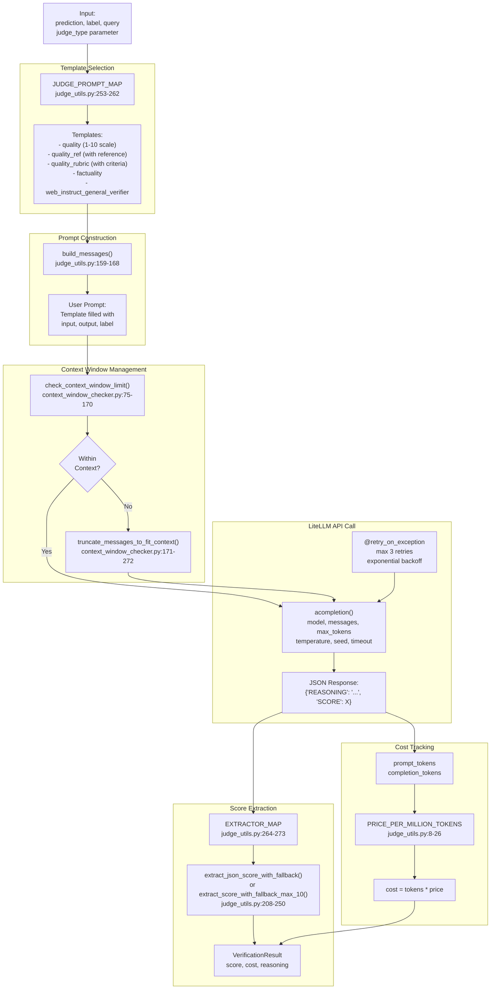
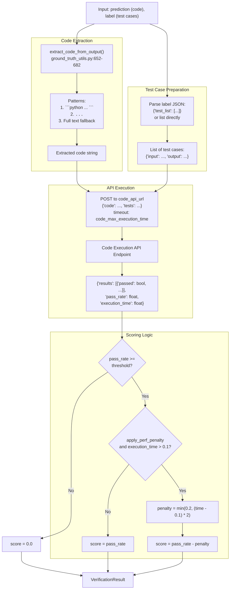

<!-- source: DeepWiki mcp.deepwiki.com · repo allenai/open-instruct · page 6.5 Verifier Systems and LLM Judges · fetched 2026-10-26 -->

# Verifier Systems and LLM Judges

Relevant source files

The following files were used as context for generating this wiki page:

- [open_instruct/context_window_checker.py](open_instruct/context_window_checker.py)
- [open_instruct/ground_truth_utils.py](open_instruct/ground_truth_utils.py)
- [open_instruct/judge_utils.py](open_instruct/judge_utils.py)
- [open_instruct/math_utils.py](open_instruct/math_utils.py)
- [open_instruct/rubrics/__init__.py](open_instruct/rubrics/__init__.py)
- [open_instruct/rubrics/evolving_rubric_step.py](open_instruct/rubrics/evolving_rubric_step.py)
- [open_instruct/rubrics/metrics.py](open_instruct/rubrics/metrics.py)
- [open_instruct/rubrics/prompts.py](open_instruct/rubrics/prompts.py)
- [open_instruct/rubrics/rubric_utils.py](open_instruct/rubrics/rubric_utils.py)
- [open_instruct/rubrics/run_utils.py](open_instruct/rubrics/run_utils.py)
- [open_instruct/rubrics/test_rubrics.py](open_instruct/rubrics/test_rubrics.py)
- [open_instruct/test_ground_truth_utils.py](open_instruct/test_ground_truth_utils.py)
- [open_instruct/test_if_functions.py](open_instruct/test_if_functions.py)
- [open_instruct/test_math_utils.py](open_instruct/test_math_utils.py)
- [scripts/train/debug/evolving_rubric_mini_test.sh](scripts/train/debug/evolving_rubric_mini_test.sh)
- [scripts/train/debug/judge.sh](scripts/train/debug/judge.sh)

This document covers the verifiable reward infrastructure used during reinforcement learning training. Verifiers evaluate model-generated responses against ground truth answers or constraints, returning scores between 0.0 and 1.0. This system enables training with programmatic correctness checks for tasks like math, code, instruction following, and general quality assessment via LLM judges.

For information about how these verifiers are integrated into the RL training loop, see [Verifiable Rewards and Ground Truth](#2.3.2). For the broader RLHF training systems that use these verifiers, see [Reinforcement Learning (RLHF)](#2.3).

## System Architecture

All verifiers inherit from the `VerifierFunction` abstract base class [open_instruct/ground_truth_utils.py:108-185](), which defines a common interface for evaluating predictions. Each verifier takes a prediction (both tokenized and decoded), a ground truth label, and optionally the original query, returning a `VerificationResult` containing a score and optional cost/reasoning metadata.

**Verifier Class Hierarchy Diagram**

```mermaid
graph TB
    subgraph "Base Classes"
        VF["VerifierFunction<br/>(ABC)<br/>ground_truth_utils.py:108-185"]
        VC["VerifierConfig<br/>(dataclass)<br/>ground_truth_utils.py:53-74"]
        VR["VerificationResult<br/>(dataclass)<br/>score, cost, reasoning<br/>ground_truth_utils.py:97-101"]
    end
    
    subgraph "Configuration Classes"
        LMJC["LMJudgeVerifierConfig<br/>llm_judge_model, max_tokens<br/>ground_truth_utils.py:78-86"]
        CVC["CodeVerifierConfig<br/>code_api_url, pass_rate<br/>ground_truth_utils.py:89-94"]
        MVC["MaxLengthVerifierConfig<br/>max_length<br/>ground_truth_utils.py:104-106"]
    end
    
    subgraph "Math Verifiers"
        MV["MathVerifier<br/>boxed + Minerva extraction<br/>ground_truth_utils.py:218-267"]
        SMV["StrictMathVerifier<br/>Minerva only<br/>ground_truth_utils.py:270-291"]
        GSM["GSM8KVerifier<br/>last number extraction<br/>ground_truth_utils.py:199-215"]
    end
    
    subgraph "Text Verifiers"
        SMatcher["StringMatcherVerifier<br/>answer tag extraction<br/>ground_truth_utils.py:417-436"]
        F1V["F1Verifier<br/>token F1 score<br/>ground_truth_utils.py:439-456"]
        FlanV["FlanVerifier<br/>'The answer is:' parsing<br/>ground_truth_utils.py:400-414"]
        PuzzleV["PuzzleMatcherVerifier<br/>exact matching<br/>ground_truth_utils.py:459-475"]
    end
    
    subgraph "Instruction Following"
        IFEval["IFEvalVerifier<br/>constraint checking<br/>ground_truth_utils.py:294-333"]
        IFEvalOld["IFEvalVerifierOld<br/>legacy version<br/>ground_truth_utils.py:336-363"]
    end
    
    subgraph "Search Verifiers"
        RSF1["ReSearchVerifierF1<br/>F1 + format<br/>ground_truth_utils.py:478-513"]
        R1S["R1SearchVerifier<br/>normalized exact match<br/>ground_truth_utils.py:516-572"]
    end
    
    subgraph "Length Verifiers"
        MaxLV["MaxLenVerifier<br/>absolute length<br/>ground_truth_utils.py:575-603"]
        UpToMaxLV["UpToMaxLenVerifier<br/>max constraint<br/>ground_truth_utils.py:605-635"]
    end
    
    subgraph "Advanced Verifiers"
        CodeV["CodeVerifier<br/>API execution<br/>ground_truth_utils.py:638-742"]
        LMJV["LMJudgeVerifier<br/>GPT-4/Claude judges<br/>ground_truth_utils.py:745-977"]
        RV["RubricVerifier<br/>evolving rubric scoring<br/>ground_truth_utils.py:980-1043"]
    end
    
    VF -->|inherits| MV
    VF -->|inherits| SMV
    VF -->|inherits| GSM
    VF -->|inherits| SMatcher
    VF -->|inherits| F1V
    VF -->|inherits| FlanV
    VF -->|inherits| PuzzleV
    VF -->|inherits| IFEval
    VF -->|inherits| IFEvalOld
    VF -->|inherits| RSF1
    VF -->|inherits| R1S
    VF -->|inherits| MaxLV
    VF -->|inherits| UpToMaxLV
    VF -->|inherits| CodeV
    VF -->|inherits| LMJV
    VF -->|inherits| RV
    
    VC -->|subclass| LMJC
    VC -->|subclass| CVC
    VC -->|subclass| MVC
    
    LMJC -.->|configures| LMJV
    CVC -.->|configures| CodeV
    MVC -.->|configures| MaxLV
    MVC -.->|configures| UpToMaxLV
    
    VF -->|returns| VR
```

Sources: [open_instruct/ground_truth_utils.py:53-1043]()

The base `VerifierFunction` class provides both synchronous (`__call__`) and asynchronous (`async_call`) methods [open_instruct/ground_truth_utils.py:132-180](), enabling parallel execution of multiple verifiers during reward computation. Each verifier has a `name`, `weight` (for combining multiple verifiers), and optional `verifier_config` for parameterization.

## Built-in Verifier Catalog

### Math and Numeric Verifiers

**MathVerifier** [open_instruct/ground_truth_utils.py:218-267]() attempts multiple extraction methods in sequence:
1. Extracts answers from `\boxed{}` LaTeX commands using `last_boxed_only_string` [open_instruct/math_utils.py:13-37]().
2. Uses Minerva format extraction (via `get_unnormalized_answer` [open_instruct/math_utils.py:54-62]()).
3. Falls back to last LaTeX-formatted answer between dollar signs.
4. Compares extracted answers using both `is_equiv` [open_instruct/math_utils.py:177-210]() and `hendrycks_is_equiv` (referenced from `math_utils.py`) for mathematical equivalence.

**StrictMathVerifier** [open_instruct/ground_truth_utils.py:270-291]() uses only the Minerva format extraction, providing stricter validation.

**GSM8KVerifier** [open_instruct/ground_truth_utils.py:199-215]() extracts the last number from the response by:
- Removing comma separators from numbers.
- Finding all numeric patterns (including decimals and negatives).
- Comparing the last number to the ground truth (case-insensitive).

### Text Matching Verifiers

| Verifier | Method | Use Case |
|----------|--------|----------|
| **StringMatcherVerifier** | Extracts text between `<answer>` tags | Structured answer formats |
| **F1Verifier** | Token-level F1 score after normalization | Partial credit for overlapping content |
| **FlanVerifier** | Parses "The answer is: " prefix | Flan-style prompted responses |
| **PuzzleMatcherVerifier** | Exact match after normalization | Puzzle/logic tasks requiring precision |

All text verifiers use the `normalize_answer` function [open_instruct/ground_truth_utils.py:366-384]() which lowercases, removes articles (a/an/the), strips punctuation, and normalizes whitespace.

Sources: [open_instruct/ground_truth_utils.py:366-475]()

### Instruction Following Verifiers

**IFEvalVerifier** [open_instruct/ground_truth_utils.py:294-333]() evaluates instruction-following constraints:
- Parses constraint dictionaries containing `instruction_id` and `kwargs`.
- Looks up constraint classes from `instructions_registry.INSTRUCTION_DICT` [open_instruct/IFEvalG/instructions_registry.py:28]().
- Removes thinking sections via `remove_thinking_section` helper [open_instruct/ground_truth_utils.py:190-196]().
- Returns average score across all constraints (partial credit supported).

**IFEvalVerifierOld** [open_instruct/ground_truth_utils.py:336-363]() uses the legacy constraint format with direct function lookup via `IF_FUNCTIONS_MAP` [open_instruct/if_functions.py:27]().

### Search-Based Verifiers

**R1SearchVerifier** [open_instruct/ground_truth_utils.py:516-572]() implements the Search-R1 evaluation format:
- Extracts answers between `<finish>...</finish>` tags using case-insensitive regex.
- Supports both single labels and JSON arrays of labels.
- Returns 1.0 for exact match (after normalization), 0.0 otherwise.
- Handles JSON parsing with proper fallbacks.

**ReSearchVerifierF1** [open_instruct/ground_truth_utils.py:478-513]() combines format checking with F1 scoring:
- Returns 0.0 if tags are missing or answer is empty.
- Computes F1 score against label(s).
- Returns 0.1 for correct format but zero F1 (partial credit for structure).

Sources: [open_instruct/ground_truth_utils.py:478-572]()

### Length Constraint Verifiers

**MaxLenVerifier** [open_instruct/ground_truth_utils.py:575-603]() penalizes deviations from target length:
- Computes `length_diff` between tokenized prediction and `desired_length`.
- Normalizes penalty based on `max_length_verifier_max_length`.

**UpToMaxLenVerifier** [open_instruct/ground_truth_utils.py:605-635]() only penalizes exceeding max length:
- Returns 1.0 if under the limit.
- Applies linear penalty for tokens beyond limit.

Both use tokenized length (not character count) and require `MaxLengthVerifierConfig` [open_instruct/ground_truth_utils.py:104-106]() with `max_length_verifier_max_length` parameter.

Sources: [open_instruct/ground_truth_utils.py:575-635]()

## LLM Judge System

The `LMJudgeVerifier` [open_instruct/ground_truth_utils.py:745-977]() uses large language models as evaluators, enabling flexible quality assessment for tasks without programmatic ground truth.

**LLM Judge Evaluation Flow**

Sources: [open_instruct/ground_truth_utils.py:745-977](), [open_instruct/judge_utils.py:1-274](), [open_instruct/context_window_checker.py:1-272]()

### Judge Configuration

`LMJudgeVerifierConfig` [open_instruct/ground_truth_utils.py:78-86]() specifies:

| Parameter | Purpose |
|-----------|---------|
| `llm_judge_model` | Model identifier (e.g., "gpt-4o", "claude-sonnet", "hosted_vllm/..." for self-hosted) |
| `llm_judge_max_tokens` | Maximum completion length |
| `llm_judge_max_context_length` | Context window limit for truncation |
| `llm_judge_temperature` | Sampling temperature (typically 0.0 for deterministic evaluation) |
| `llm_judge_timeout` | API timeout in seconds |
| `seed` | Random seed for reproducibility |

### Supported Judge Types

The `judge_type` parameter selects from predefined templates in `JUDGE_PROMPT_MAP` [open_instruct/judge_utils.py:253-262]():

1. **quality**: General quality assessment (1-10 scale) [open_instruct/judge_utils.py:29-48]()
2. **quality_ref**: Quality with reference answer [open_instruct/judge_utils.py:78-102]()
3. **quality_rubric**: Rubric-based evaluation [open_instruct/judge_utils.py:51-75]()
4. **factuality**: Factual correctness [open_instruct/judge_utils.py:109-121]()
5. **web_instruct_general_verifier**: WebInstruct format [open_instruct/judge_utils.py:123-134]()

### Context Window Management

The `LMJudgeVerifier` integrates context window checking via `check_context_window_limit` [open_instruct/context_window_checker.py:75-170]() to prevent `ContextWindowExceededError`.

The truncation strategy `truncate_messages_to_fit_context` [open_instruct/context_window_checker.py:171-272]():
1. Always preserves system messages.
2. Truncates user/assistant messages from oldest to newest.
3. Uses `AutoTokenizer` from HuggingFace with fallback to `tiktoken` [open_instruct/context_window_checker.py:97-133]().

### Price Tracking

The judge tracks API costs using `PRICE_PER_MILLION_TOKENS` [open_instruct/judge_utils.py:8-26]().
Supported models include:
- **OpenAI**: gpt-4o, gpt-4o-mini, gpt-4.1-standard, o3-standard.
- **Anthropic**: claude-sonnet, claude-3-7-sonnet.
- **DeepSeek**: deepseek-chat, deepseek-reasoner.

The cost is included in the returned `VerificationResult` [open_instruct/ground_truth_utils.py:99]().

## Code Execution Verifier

The `CodeVerifier` [open_instruct/ground_truth_utils.py:638-742]() evaluates code correctness by executing solutions against test cases via an external API.

### Architecture

Sources: [open_instruct/ground_truth_utils.py:638-742]()

### Scoring Logic

`CodeVerifierConfig` [open_instruct/ground_truth_utils.py:89-94]():
- `code_pass_rate_reward_threshold`: Minimum pass rate to receive non-zero reward.
- `code_apply_perf_penalty`: Penalizes solutions taking longer than 0.1s [open_instruct/ground_truth_utils.py:726-731]().

## Rubric-Based Verifiers

The `RubricVerifier` [open_instruct/ground_truth_utils.py:980-1043]() evaluates responses against dynamically evolving rubrics. It uses the `RUBRIC_SCORING_PROMPT` [open_instruct/rubrics/prompts.py:38]() and `run_litellm_async` [open_instruct/rubrics/run_utils.py:172-200]() to get judgments.

The system supports:
- **Instance-wise rubric generation**: `generate_instance_wise_evolving_rubrics` [open_instruct/rubrics/rubric_utils.py:22-56]().
- **Rubric Buffer Management**: Managed by `RubricManager` [open_instruct/rubrics/evolving_rubric_step.py:19]().
- **Concurrency Control**: LiteLLM calls are throttled via `_get_litellm_semaphore` [open_instruct/rubrics/run_utils.py:32-43]().

Sources: [open_instruct/ground_truth_utils.py:980-1043](), [open_instruct/rubrics/run_utils.py:1-200](), [open_instruct/rubrics/rubric_utils.py:1-170]()

## Helper Utilities

- `remove_thinking_section` [open_instruct/ground_truth_utils.py:190-196](): Strips `<|assistant|>`, `<think>`, and `<answer>` tags from model output.
- `f1_score` [open_instruct/ground_truth_utils.py:387-397](): Computes token-level precision, recall, and F1.
- `normalize_answer` [open_instruct/ground_truth_utils.py:366-384](): Standardizes text by removing punctuation and articles.
- `extract_json_from_response` [open_instruct/rubrics/run_utils.py:46-75](): Robust JSON extraction from LLM outputs, handling markdown blocks and doubled braces.

Sources: [open_instruct/ground_truth_utils.py:190-397](), [open_instruct/rubrics/run_utils.py:46-75]()

---

