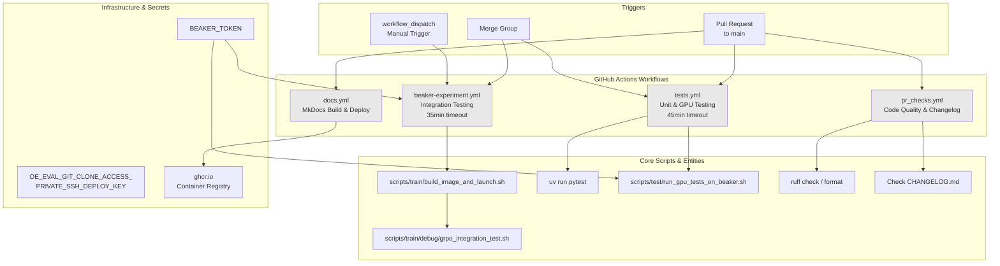
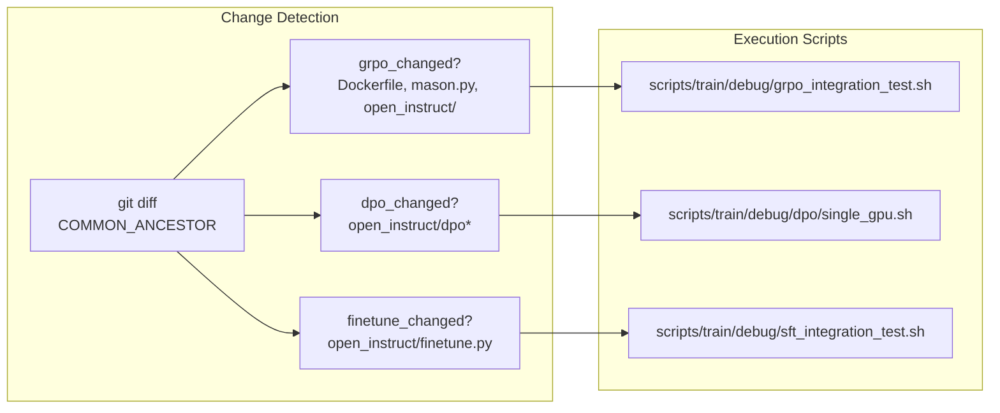
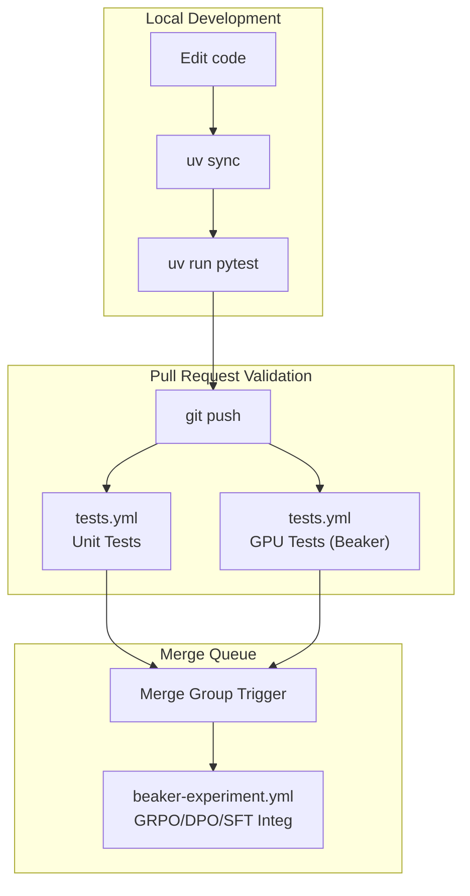

<!-- source: DeepWiki mcp.deepwiki.com · repo allenai/open-instruct · page 7 CI/CD and Development Workflow · fetched 2026-10-26 -->

# CI/CD and Development Workflow

Relevant source files

The following files were used as context for generating this wiki page:

- [.claude/skills/update-pr-body/SKILL.md](.claude/skills/update-pr-body/SKILL.md)
- [.dockerignore](.dockerignore)
- [.github/workflows/beaker-experiment.yml](.github/workflows/beaker-experiment.yml)
- [.github/workflows/docs.yml](.github/workflows/docs.yml)
- [.github/workflows/tests.yml](.github/workflows/tests.yml)
- [docs/index.md](docs/index.md)
- [open_instruct/test_dataset_transformation.py](open_instruct/test_dataset_transformation.py)
- [scripts/benchmarking/launch_dpo_cache_benchmark.sh](scripts/benchmarking/launch_dpo_cache_benchmark.sh)
- [scripts/test/run_gpu_pytest.sh](scripts/test/run_gpu_pytest.sh)
- [scripts/test/run_gpu_tests.sh](scripts/test/run_gpu_tests.sh)
- [scripts/train/build_image_and_launch.sh](scripts/train/build_image_and_launch.sh)
- [scripts/train/olmo3/README.md](scripts/train/olmo3/README.md)

## Purpose and Scope

This document describes the automated CI/CD pipelines and development workflows for the `open-instruct` repository. The system provides automated Docker image building, integration testing on Beaker infrastructure, unit testing, and code quality enforcement. These pipelines ensure code quality before merge and enable reproducible deployments to the Beaker platform.

For details on automated workflows, see [GitHub Actions Workflows](#7.1). For details on test infrastructure and quality gates, see [Testing and Integration](#7.2). For details on performance validation, see [Image Building and Benchmarking](#7.3).

## GitHub Actions Architecture

The repository uses several primary GitHub Actions workflows that handle different aspects of continuous integration and deployment. Note that `push-image.yml`, `quality.yml`, and `claude-code-review.yml` have been deprecated or removed in favor of these consolidated workflows.

**Workflow Execution Matrix**

| Workflow | Triggers | Timeout | Runner | Primary Purpose |
|----------|----------|---------|--------|-----------------|
| `beaker-experiment.yml` | merge_group, manual | 35 min | 8-Core-XL-Runner | Integration test on Beaker platform [.github/workflows/beaker-experiment.yml:1-20]() |
| `tests.yml` | pull_request, merge_group | 45 min | 8-Core-XL-Runner | Run unit and GPU tests [.github/workflows/tests.yml:1-36]() |
| `pr_checks.yml` | pull_request, merge_group | N/A | ubuntu-latest | Enforce style, linting, and changelog updates |
| `docs.yml` | push, pull_request | N/A | ubuntu-latest | Build and deploy MkDocs documentation [.github/workflows/docs.yml:1-13]() |

Sources: [.github/workflows/beaker-experiment.yml:1-20](), [.github/workflows/tests.yml:1-36](), [.github/workflows/docs.yml:1-13]()

## Integration Testing System

The `beaker-experiment.yml` workflow validates the entire training stack by building a Docker image and launching targeted training experiments on Beaker. It uses change detection via `git diff` against the `COMMON_ANCESTOR` to only run relevant tests [.github/workflows/beaker-experiment.yml:52-70]().

### Integration Test Logic

The workflow uses `scripts/train/build_image_and_launch.sh` to handle image building and experiment submission [.github/workflows/beaker-experiment.yml:123](). This script ensures a clean git tree by checking `git status --porcelain` before execution [scripts/train/build_image_and_launch.sh:12-17]().

For details, see [GitHub Actions Workflows](#7.1).

Sources: [.github/workflows/beaker-experiment.yml:52-163](), [scripts/train/build_image_and_launch.sh:1-17]()

## Testing and Quality Gates

The repository employs a multi-tiered testing strategy:

1.  **Unit Tests**: Standard `pytest` suite running on CPU runners via `uv run --frozen pytest` [.github/workflows/tests.yml:31-31]().
2.  **GPU Tests**: Pytest execution on Beaker GPUs for hardware-dependent code (e.g., `open_instruct/test_*_gpu.py`). This is orchestrated by `scripts/test/run_gpu_tests_on_beaker.sh` [.github/workflows/tests.yml:123-123]().
3.  **Override Mechanism**: Internal contributors can bypass GPU tests via a `GPU_TESTS` override in the PR body, which is parsed by `scripts/test/detect_gpu_tests_skip.sh` [.github/workflows/tests.yml:55-59]().
4.  **Code Quality**: Documentation changes are validated by `docs.yml`, which builds the site and compares the diff between the PR branch and the base branch [.github/workflows/docs.yml:29-41]().

For details, see [Testing and Integration](#7.2).

Sources: [.github/workflows/tests.yml:11-124](), [.github/workflows/docs.yml:1-132](), [scripts/test/run_gpu_tests.sh:1-16]()

## Development Workflow

The complete development workflow integrates local development, pull request validation, and merge queue processing.

### Pull Request Flow

**Image Building and Benchmarking:**
The `build_image_and_launch.sh` script is the primary entry point for launching experiments. It:
- Verifies the Git state [scripts/train/build_image_and_launch.sh:12-17]().
- Tags Docker images with the commit hash and sanitized branch name [scripts/train/build_image_and_launch.sh:19-24]().
- Pushes images to Beaker and rotates aliases [scripts/train/build_image_and_launch.sh:55-57]().

For details on image building and benchmarking, see [Image Building and Benchmarking](#7.3).

Sources: [scripts/train/build_image_and_launch.sh:1-75](), [scripts/benchmarking/launch_dpo_cache_benchmark.sh:1-52]()

---

