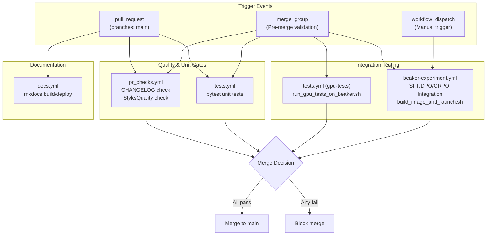
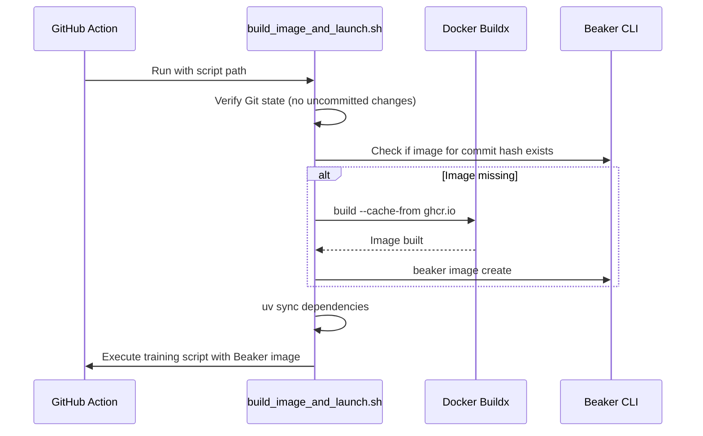

<!-- source: DeepWiki mcp.deepwiki.com · repo allenai/open-instruct · page 7.1 GitHub Actions Workflows · fetched 2026-10-26 -->

# GitHub Actions Workflows

<details>
<summary>Relevant source files</summary>

The following files were used as context for generating this wiki page:

- [.claude/skills/update-pr-body/SKILL.md](.claude/skills/update-pr-body/SKILL.md)
- [.dockerignore](.dockerignore)
- [.github/workflows/beaker-experiment.yml](.github/workflows/beaker-experiment.yml)
- [.github/workflows/docs.yml](.github/workflows/docs.yml)
- [.github/workflows/tests.yml](.github/workflows/tests.yml)
- [docs/index.md](docs/index.md)
- [open_instruct/test_dataset_transformation.py](open_instruct/test_dataset_transformation.py)
- [scripts/test/detect_gpu_tests_skip.sh](scripts/test/detect_gpu_tests_skip.sh)
- [scripts/train/build_image_and_launch.sh](scripts/train/build_image_and_launch.sh)
- [scripts/train/olmo3/README.md](scripts/train/olmo3/README.md)

</details>


## Purpose and Scope

This document describes the GitHub Actions CI/CD workflows that automate testing, code quality checks, Docker image building, documentation generation, and integration testing for the `open-instruct` repository. These workflows enforce quality gates, build deployment artifacts, and validate changes before they are merged into the `main` branch.

The CI/CD pipeline ensures that every change is verified against unit tests, style guides, and real-world execution on Beaker GPU infrastructure. Note that several legacy workflows (`push-image.yml`, `quality.yml`, and `claude-code-review.yml`) have been removed in favor of the current consolidated system.

## Workflow Overview

The repository implements four primary active GitHub Actions workflows:

| Workflow | File | Primary Purpose | Triggers |
|----------|------|-----------------|----------|
| **Tests** | `tests.yml` | Run unit tests and coordinate GPU integration tests | `pull_request`, `merge_group` |
| **Beaker Experiment Launch** | `beaker-experiment.yml` | Launch specialized integration tests (SFT/DPO/GRPO) | `merge_group`, `workflow_dispatch` |
| **PR Checks** | `pr_checks.yml` | Enforce CHANGELOG updates and code quality | `pull_request`, `merge_group` |
| **Docs** | `docs.yml` | Build and deploy MkDocs documentation | `push`, `pull_request`, `merge_group` |

### Workflow Trigger and Architecture



**Sources:** [.github/workflows/tests.yml:3-8](), [.github/workflows/beaker-experiment.yml:3-8](), [.github/workflows/docs.yml:2-9]()

## tests.yml: Unit and GPU Testing

The `tests.yml` workflow is the primary gate for code correctness. It is divided into two major jobs: `unit-tests` and `gpu-tests`.

### Unit Testing
The `unit-tests` job runs on standard GitHub runners. It uses `uv` for high-speed dependency management and executes `pytest` across the repository [.github/workflows/tests.yml:11-32]().

[.github/workflows/tests.yml:24-31]():
```yaml
- name: Install uv
  uses: astral-sh/setup-uv@v5
  with:
    version: "0.8.6"
- name: Set up Python
  run: uv sync --frozen
- name: Run unit tests
  run: uv run --frozen pytest
```

### GPU Integration Testing
The `gpu-tests` job handles more complex scenarios requiring hardware acceleration. It includes a sophisticated detection mechanism to skip tests for fork PRs unless an override is provided [.github/workflows/tests.yml:33-124]().

1.  **Change Detection**: It uses `scripts/test/detect_gpu_tests_skip.sh` to determine if the environment supports GPU execution or if a `GPU_TESTS=bypass` flag exists in the PR body [scripts/test/detect_gpu_tests_skip.sh:9-41]().
2.  **Override Verification**: If a specific experiment ID is provided in the PR body (e.g., `GPU_TESTS=[exp_id](url)`), the workflow verifies this via `scripts/test/verify_gpu_tests_override.sh` [.github/workflows/tests.yml:68-70]().
3.  **Docker Build**: If tests are to run, it builds a local Docker image using `docker/build-push-action@v6` with the current `GIT_COMMIT` and `GIT_BRANCH` [.github/workflows/tests.yml:105-117]().
4.  **Beaker Execution**: It triggers `scripts/test/run_gpu_tests_on_beaker.sh` to upload the image and execute the test suite on AI2's Beaker clusters [.github/workflows/tests.yml:123]().

**Sources:** [.github/workflows/tests.yml:1-124](), [scripts/test/detect_gpu_tests_skip.sh:1-54]()

## beaker-experiment.yml: Specialized Integration

This workflow validates specific training paradigms (SFT, DPO, GRPO) by launching short integration runs on Beaker. It uses granular change detection to avoid unnecessary GPU spend.

### Change Detection Logic
The workflow identifies which training files have changed using `git diff` against the common ancestor of `main` to decide which experiments to launch [.github/workflows/beaker-experiment.yml:52-70]().

- `dpo_changed`: Matches `open_instruct/(dpo|dpo_tune_cache|dpo_utils)\.py`.
- `finetune_changed`: Matches `open_instruct/finetune\.py`.
- `grpo_changed`: Matches `Dockerfile`, `mason.py`, or any file in the `open_instruct/` directory.

### Experiment Matrix
The workflow defines a set of integration scripts to run based on the detected changes [.github/workflows/beaker-experiment.yml:145-149]():

```bash
EXPERIMENT_DEFINITIONS=(
  "grpo|scripts/train/debug/grpo_integration_test.sh|always"
  "dpo|scripts/train/debug/dpo/single_gpu.sh|${DPO_CHANGED}"
  "sft|scripts/train/debug/sft_integration_test.sh|${FINETUNE_CHANGED}"
)
```

### Build and Launch Implementation
The workflow orchestrates the build through `scripts/train/build_image_and_launch.sh` [.github/workflows/beaker-experiment.yml:123]().



**Sources:** [.github/workflows/beaker-experiment.yml:1-174](), [scripts/train/build_image_and_launch.sh:1-75]()

## pr_checks.yml: Quality and Compliance

This workflow ensures that every PR follows the project's contribution guidelines and maintains code standards.

### CHANGELOG Enforcement
The `changelog` job requires that any changes to the `open_instruct/` directory are accompanied by an update to `CHANGELOG.md` that includes the PR URL. This can be bypassed by including `CHANGELOG=reason` in the PR body.

### Code Quality
The `code-quality` job executes standard linting and formatting checks.
- **Style**: Ensures consistent formatting using `ruff`.
- **Quality**: Runs linting and syntax checks across the codebase.

## docs.yml: Documentation Pipeline

The `docs.yml` workflow manages the project's documentation using MkDocs.

### Documentation Diffing
For pull requests, the `check-diff` job performs a validation of the rendered output [.github/workflows/docs.yml:14-103]():
1.  Builds the documentation from the PR branch using `uv run mkdocs build` [.github/workflows/docs.yml:31-33]().
2.  Builds the documentation from the base branch (e.g., `main`) [.github/workflows/docs.yml:36-40]().
3.  Compares the two sites using `diff -rq` and posts a comment on the PR showing a 10-line `diff` of the changed files [.github/workflows/docs.yml:43-80]().

### Deployment
On pushes to `main`, the `deploy` job uses `uv run mkdocs gh-deploy --force` to publish the updated documentation to GitHub Pages [.github/workflows/docs.yml:104-131]().

**Sources:** [.github/workflows/docs.yml:1-132]()

## Code Review and PR Utilities

The repository includes utilities to streamline the PR process.

### Claude PR Body Updates
The project includes a specialized Claude "skill" to handle PR descriptions [.claude/skills/update-pr-body/SKILL.md:1-67](). Due to GraphQL deprecations in the `gh` CLI, this skill instructs the model to use the GitHub REST API (`PATCH /repos/{owner}/{repo}/pulls/<number>`) to update PR bodies with test plans and summaries [.claude/skills/update-pr-body/SKILL.md:11-29]().

**Sources:** [.claude/skills/update-pr-body/SKILL.md:1-67]()

---

