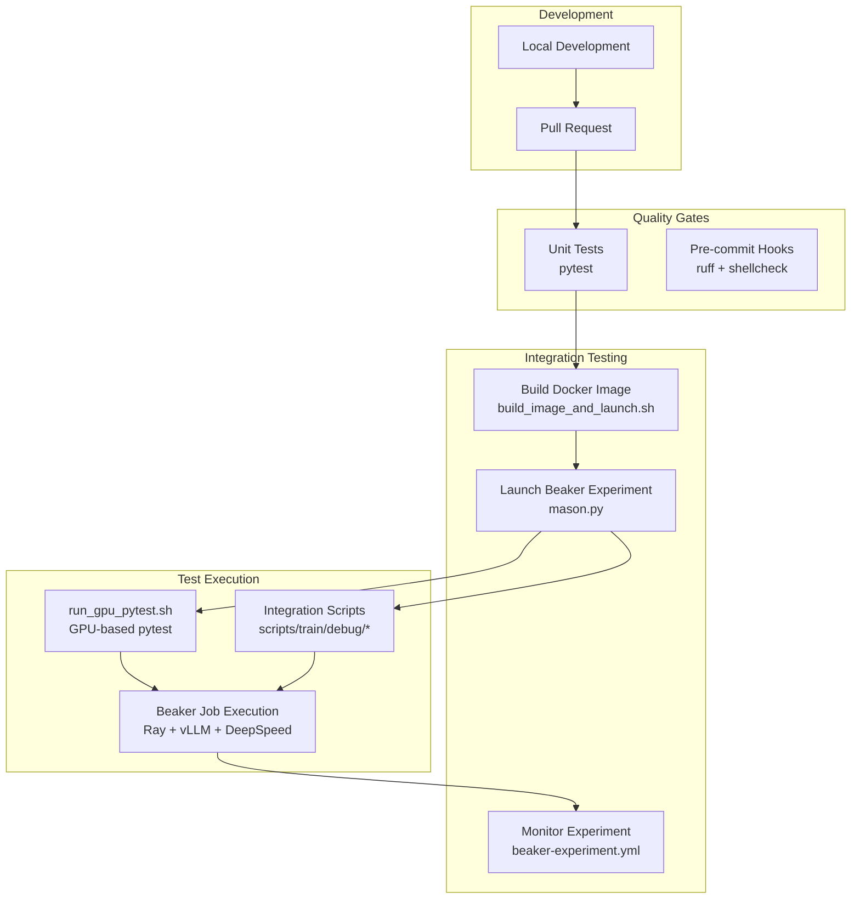
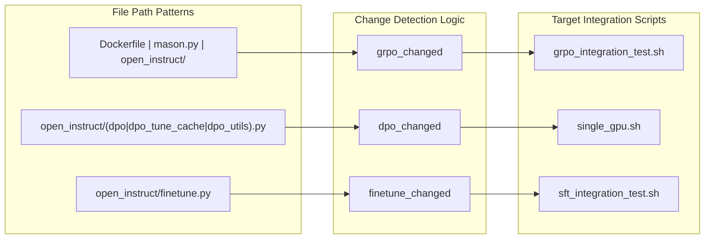
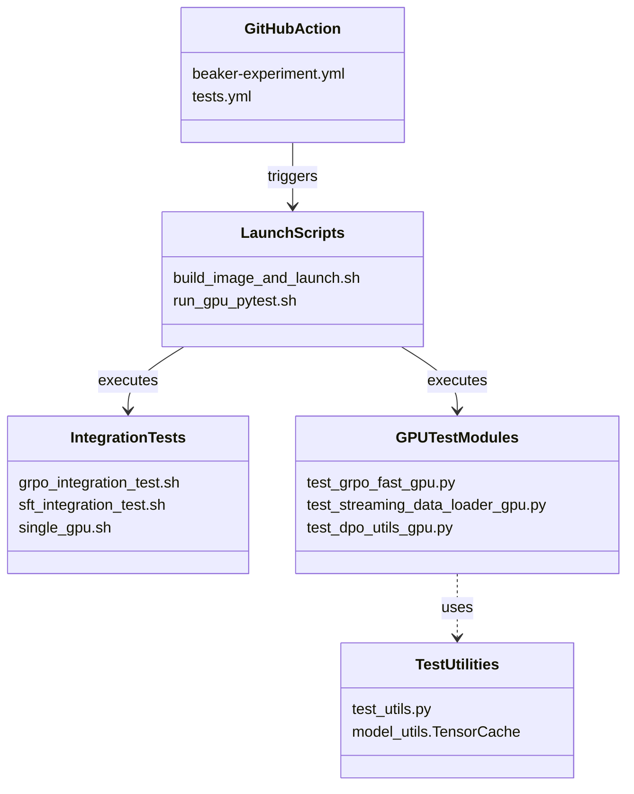

<!-- source: DeepWiki mcp.deepwiki.com · repo allenai/open-instruct · page 7.2 Testing and Integration · fetched 2026-10-26 -->

# Testing and Integration

<details>
<summary>Relevant source files</summary>

The following files were used as context for generating this wiki page:

- [.claude/skills/update-pr-body/SKILL.md](.claude/skills/update-pr-body/SKILL.md)
- [.dockerignore](.dockerignore)
- [.github/workflows/beaker-experiment.yml](.github/workflows/beaker-experiment.yml)
- [.github/workflows/docs.yml](.github/workflows/docs.yml)
- [.github/workflows/tests.yml](.github/workflows/tests.yml)
- [AGENTS.md](AGENTS.md)
- [docs/index.md](docs/index.md)
- [open_instruct/test_data/generation_with_tools_expected.json](open_instruct/test_data/generation_with_tools_expected.json)
- [open_instruct/test_data/generation_without_tools_expected.json](open_instruct/test_data/generation_without_tools_expected.json)
- [open_instruct/test_data_loader.py](open_instruct/test_data_loader.py)
- [open_instruct/test_dataset_transformation.py](open_instruct/test_dataset_transformation.py)
- [open_instruct/test_dpo_utils_gpu.py](open_instruct/test_dpo_utils_gpu.py)
- [open_instruct/test_grpo_fast_gpu.py](open_instruct/test_grpo_fast_gpu.py)
- [open_instruct/test_streaming_data_loader_gpu.py](open_instruct/test_streaming_data_loader_gpu.py)
- [scripts/benchmarking/launch_dpo_cache_benchmark.sh](scripts/benchmarking/launch_dpo_cache_benchmark.sh)
- [scripts/test/run_gpu_pytest.sh](scripts/test/run_gpu_pytest.sh)
- [scripts/test/run_gpu_tests.sh](scripts/test/run_gpu_tests.sh)
- [scripts/train/build_image_and_launch.sh](scripts/train/build_image_and_launch.sh)
- [scripts/train/debug/grpo_integration_test.sh](scripts/train/debug/grpo_integration_test.sh)
- [scripts/train/debug/sft_integration_test.sh](scripts/train/debug/sft_integration_test.sh)
- [scripts/train/olmo3/README.md](scripts/train/olmo3/README.md)

</details>


## Purpose and Scope

This page documents the testing infrastructure and integration systems used to ensure code quality and functionality in the `open-instruct` repository. It covers unit tests, Beaker-based integration tests, GPU-specific testing mechanisms, and automated experiment monitoring.

## Testing Architecture Overview

The repository employs a multi-layered testing strategy combining fast unit tests with comprehensive integration tests running on actual GPU infrastructure.

Title: Testing and Integration Workflow


**Testing Workflow**: Pull requests trigger unit tests. On merge to the merge group, the system builds a Docker image and launches a full integration test on Beaker, executing SFT, DPO, or GRPO training runs to validate end-to-end functionality.

Sources: [.github/workflows/tests.yml:1-32](), [.github/workflows/beaker-experiment.yml:1-17](), [AGENTS.md:1-32]()

## Unit Testing Infrastructure

### Test Framework
The repository uses `pytest` as the primary testing framework. Unit tests run in GitHub Actions on every pull request to the `main` branch.

**Execution Command**:
```bash
uv run pytest
```

| Property | Value |
|----------|-------|
| Runner | `8-Core-XL-Runner-Ubuntu-Latest` |
| Timeout | 20 minutes |
| Python Setup | `uv sync --frozen` |
| Triggers | Pull requests to `main`, merge group |

Sources: [.github/workflows/tests.yml:11-32](), [AGENTS.md:2-2]()

### GPU Test Override Mechanism
To save resources, the CI allows bypassing GPU tests if the developer provides proof of a successful manual run.

1. **Manual Run**: Developer runs `./scripts/train/build_image_and_launch.sh scripts/test/run_gpu_pytest.sh` [AGENTS.md:33-33]().
2. **PR Body**: Developer includes `GPU_TESTS=[EXPERIMENT_ID](https://beaker.org/ex/EXPERIMENT_ID)` in the PR description [AGENTS.md:34-34]().
3. **Verification**: The `detect_gpu_tests_skip.sh` script parses the PR body [.github/workflows/tests.yml:55-59](). If a valid ID is found, `verify_gpu_tests_override.sh` checks the Beaker experiment status [.github/workflows/tests.yml:70-71]().
4. **Bypass**: Use `GPU_TESTS=bypass` to skip entirely [AGENTS.md:34-34]().

Sources: [.github/workflows/tests.yml:50-71](), [AGENTS.md:33-34]()

## Integration Testing System

### Beaker Experiment Launch
The `beaker-experiment.yml` workflow automates the launch of integration tests when code changes are detected in core modules.

Title: Change Detection and Launch Logic


**Workflow Logic**:
- **DPO**: Triggered if files matching `open_instruct/(dpo|dpo_tune_cache|dpo_utils)\.py` change [.github/workflows/beaker-experiment.yml:61-61]().
- **SFT**: Triggered if `open_instruct/finetune\.py` changes [.github/workflows/beaker-experiment.yml:62-62]().
- **GRPO**: Triggered by changes to `Dockerfile`, `mason.py`, or any file in `open_instruct/` [.github/workflows/beaker-experiment.yml:63-63]().

Sources: [.github/workflows/beaker-experiment.yml:52-71](), [.github/workflows/beaker-experiment.yml:145-149]()

### The `build_image_and_launch.sh` Script
This script is the entry point for launching any Beaker-based test. It enforces a clean git state before proceeding.

1. **Git Check**: Fails if there are uncommitted or untracked changes [scripts/train/build_image_and_launch.sh:12-17]().
2. **Image Tagging**: Generates a tag based on the sanitized branch name: `open-instruct-integration-test-${sanitized_branch}` [scripts/train/build_image_and_launch.sh:23-24]().
3. **Caching**: Uses `ghcr.io/allenai/open-instruct:buildcache` to speed up Docker builds [scripts/train/build_image_and_launch.sh:34-34]().
4. **Launch**: Executes the provided script (e.g., `scripts/train/debug/grpo_integration_test.sh`) passing the Beaker image name as the first argument [scripts/train/build_image_and_launch.sh:72-74]().

Sources: [scripts/train/build_image_and_launch.sh:1-75]()

## GPU Test Infrastructure

The repository contains specialized tests that require CUDA and Ray, typically run on Beaker via `scripts/test/run_gpu_pytest.sh`.

### Key GPU Test Modules
- **StreamingDataLoader**: `open_instruct/test_streaming_data_loader_gpu.py` tests the `StreamingDataLoader` with real vLLM engines [open_instruct/test_streaming_data_loader_gpu.py:45-46](). It includes a `tool_server` setup for testing tool-augmented generation [open_instruct/test_streaming_data_loader_gpu.py:56-64]().
- **GRPO Generation**: `open_instruct/test_grpo_fast_gpu.py` validates deterministic generation and tool invocation [open_instruct/test_grpo_fast_gpu.py:168-170]().
- **DPO Utils**: `open_instruct/test_dpo_utils_gpu.py` tests `TensorCache` on GPU and concatenated forward passes for OLMo and HF models [open_instruct/test_dpo_utils_gpu.py:22-24](), [open_instruct/test_dpo_utils_gpu.py:96-98]().

### Determinism and Expected Data
GPU tests often compare model outputs against "golden" files in `open_instruct/test_data/` [open_instruct/test_grpo_fast_gpu.py:170-171]().
- If generation behavior changes (e.g., vLLM update), developers must delete the old expected file, run the test on Beaker to generate a new one, and fetch the result dataset to update the repo [open_instruct/test_grpo_fast_gpu.py:9-34]().

Sources: [open_instruct/test_streaming_data_loader_gpu.py:1-168](), [open_instruct/test_grpo_fast_gpu.py:1-184](), [open_instruct/test_dpo_utils_gpu.py:1-151]()

## Code Entity Mapping

The following diagram maps high-level testing concepts to specific code entities within the repository.

Title: Testing Entity Relationship


Sources: [.github/workflows/beaker-experiment.yml:118-143](), [scripts/train/build_image_and_launch.sh:72-74](), [open_instruct/test_dpo_utils_gpu.py:17-18]()

## Monitoring and Debugging

### Beaker Experiment Monitoring
Integration tests are monitored via the Beaker CLI and automated GitHub Actions steps.
- **Experiment ID Extraction**: The `launch-experiment` job extracts the ID from logs using `grep` [.github/workflows/beaker-experiment.yml:130-130]().
- **Status Updates**: The system can update Beaker descriptions to reflect the current test status [open_instruct/test_grpo_fast_gpu.py:68-68]().

### Logging Conventions
The codebase enforces a specific logging setup to ensure consistency across distributed components:
- **Requirement**: Always use `logger = logger_utils.setup_logger(__name__)` and `logger.info()` [AGENTS.md:52-52]().
- **Restriction**: Direct use of `import logging` or `logging.info()` is discouraged in favor of the standardized utility [AGENTS.md:52-52]().

Sources: [.github/workflows/beaker-experiment.yml:123-143](), [open_instruct/test_grpo_fast_gpu.py:62-68](), [AGENTS.md:52-52]()

---

