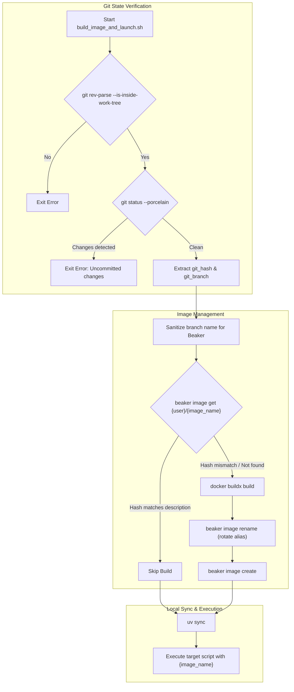
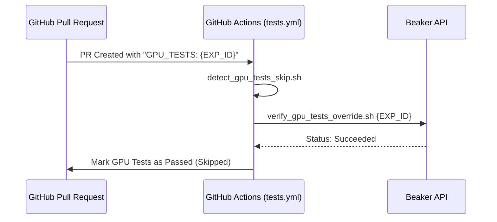

<!-- source: DeepWiki mcp.deepwiki.com · repo allenai/open-instruct · page 7.3 Image Building and Benchmarking · fetched 2026-10-26 -->

# Image Building and Benchmarking

Relevant source files

The following files were used as context for generating this wiki page:

- [.claude/skills/update-pr-body/SKILL.md](.claude/skills/update-pr-body/SKILL.md)
- [.dockerignore](.dockerignore)
- [.github/workflows/beaker-experiment.yml](.github/workflows/beaker-experiment.yml)
- [.github/workflows/docs.yml](.github/workflows/docs.yml)
- [.github/workflows/tests.yml](.github/workflows/tests.yml)
- [docs/index.md](docs/index.md)
- [open_instruct/olmo_core_callbacks.py](open_instruct/olmo_core_callbacks.py)
- [open_instruct/padding_free_collator.py](open_instruct/padding_free_collator.py)
- [open_instruct/test_data_loader_gpu.py](open_instruct/test_data_loader_gpu.py)
- [open_instruct/test_dataset_transformation.py](open_instruct/test_dataset_transformation.py)
- [scripts/benchmarking/launch_benchmark_single_gpu.sh](scripts/benchmarking/launch_benchmark_single_gpu.sh)
- [scripts/benchmarking/launch_benchmark_single_node.sh](scripts/benchmarking/launch_benchmark_single_node.sh)
- [scripts/train/build_image_and_launch.sh](scripts/train/build_image_and_launch.sh)
- [scripts/train/debug/dpo/7b_instruct_dpo_olmo_core.sh](scripts/train/debug/dpo/7b_instruct_dpo_olmo_core.sh)
- [scripts/train/debug/dpo/checkpoint_integration_test.sh](scripts/train/debug/dpo/checkpoint_integration_test.sh)
- [scripts/train/debug/dpo/local.sh](scripts/train/debug/dpo/local.sh)
- [scripts/train/debug/dpo/multi_node.sh](scripts/train/debug/dpo/multi_node.sh)
- [scripts/train/debug/dpo/multi_node_cache.sh](scripts/train/debug/dpo/multi_node_cache.sh)
- [scripts/train/debug/dpo/single_gpu.sh](scripts/train/debug/dpo/single_gpu.sh)
- [scripts/train/debug/dpo_integration_test.sh](scripts/train/debug/dpo_integration_test.sh)
- [scripts/train/olmo3/7b_instruct_dpo_olmocore.sh](scripts/train/olmo3/7b_instruct_dpo_olmocore.sh)
- [scripts/train/olmo3/README.md](scripts/train/olmo3/README.md)

## Purpose and Scope

This document covers the technical implementation of image building, environment synchronization, and performance benchmarking within the `open-instruct` repository. These tools facilitate reproducible experimentation by ensuring that code running on Beaker clusters matches the local Git state and that performance metrics (throughput, utilization) are consistently measured across different hardware configurations.

Key components include:
- **`build_image_and_launch.sh`**: A validation and deployment script that enforces Git hygiene, builds versioned Docker images, and rotates Beaker image aliases [scripts/train/build_image_and_launch.sh:1-75]().
- **Benchmark Launchers**: Specialized scripts for measuring performance across various hardware scales, from single GPUs to multi-node clusters [scripts/benchmarking/launch_benchmark_single_gpu.sh](), [scripts/benchmarking/launch_benchmark_single_node.sh]().
- **Automated Integration**: GitHub Actions workflows that utilize these scripts to validate PRs via real Beaker experiments [.github/workflows/beaker-experiment.yml:101-163]().

## Build Image and Launch Workflow

The `build_image_and_launch.sh` script is the primary entry point for AI2 internal developers to launch jobs. It automates the transition from "Local Code" to "Cloud Execution" while maintaining a strict 1:1 mapping between Git commits and Docker images.

### Implementation Logic

**Sources:** [scripts/train/build_image_and_launch.sh:1-75](), [.github/workflows/beaker-experiment.yml:118-143]()

### Key Functions and Mechanisms
- **Git Hygiene Enforcement**: The script explicitly fails if there are uncommitted or untracked files [scripts/train/build_image_and_launch.sh:12-17](). This prevents "ghost code" (code that exists locally but isn't in the commit) from being included in the Docker build context without a corresponding hash.
- **Branch-Based Tagging**: Images are tagged based on the sanitized branch name: `open-instruct-integration-test-${sanitized_branch}` [scripts/train/build_image_and_launch.sh:23-24]().
- **Alias Rotation**: Before creating a new image with the same name, the script attempts to rename the existing one to an empty string, effectively rotating the name alias to the newest commit [scripts/train/build_image_and_launch.sh:55-57]().
- **Docker Build Optimization**: It uses `docker buildx` with `--cache-from` and `--cache-to` pointing to a registry-based build cache (`ghcr.io/allenai/open-instruct:buildcache`) to accelerate repeated builds [scripts/train/build_image_and_launch.sh:34-43]().

## Performance Benchmarking Scripts

The repository provides dedicated scripts to evaluate the performance of the training and generation engines, particularly for high-throughput RLHF (GRPO) and DPO workflows.

### Benchmarking Implementations

| Script | Focus Area | Key Features |
| :--- | :--- | :--- |
| `launch_benchmark_single_gpu.sh` | Single-device efficiency | Uses `open_instruct/dpo.py` or `finetune.py` with minimal batch sizes to test throughput. |
| `launch_benchmark_single_node.sh` | Intra-node scaling | Tests performance on 8xH100/A100 nodes using `torchrun`. |
| `launch_dpo_cache_benchmark.sh` | DPO Caching Strategy | Measures the speedup of using `dpo_tune_cache.py` vs. standard concatenated forward passes. |

### Performance Monitoring with Callbacks
During benchmarking and training, `PerfCallback` (within `olmo_core_callbacks.py`) calculates hardware-level efficiency metrics:
- **MFU (Model FLOPs Utilization)**: Calculated using `ModelDims` to determine how much of the theoretical peak GPU performance is achieved [open_instruct/olmo_core_callbacks.py:122-129]().
- **Tokens Per Second**: Measured by tracking the delta in `train/token_count` over time intervals [open_instruct/olmo_core_callbacks.py:174-180]().

**Sources:** [open_instruct/olmo_core_callbacks.py:122-200](), [scripts/train/olmo3/README.md:5-11]()

## CI/CD Integration

The image building workflow is integrated into GitHub Actions to provide automated "integration tests" for every PR.

### Beaker Experiment Launch Workflow
The `beaker-experiment.yml` workflow performs the following:
1. **Change Detection**: Uses `git diff` to identify if DPO, SFT, or GRPO logic has changed [.github/workflows/beaker-experiment.yml:52-70]().
2. **Conditional Launch**: Executes `build_image_and_launch.sh` for the relevant integration test script (e.g., `grpo_integration_test.sh`) [.github/workflows/beaker-experiment.yml:145-163]().
3. **Experiment Capture**: Extracts the Beaker experiment ID from the logs and monitors it for success [.github/workflows/beaker-experiment.yml:129-143]().

### GPU Test Override Mechanism
To save resources, the `tests.yml` workflow can skip live GPU tests if a developer provides a pre-run Beaker experiment ID in the PR body. The `verify_gpu_tests_override.sh` script checks the status of that experiment before allowing the CI to pass [.github/workflows/tests.yml:50-70]().

**Sources:** [.github/workflows/tests.yml:33-71](), [.github/workflows/beaker-experiment.yml:1-163]()

## Docker Environment Configuration

The `Dockerfile` and `.dockerignore` are optimized for the `open-instruct` stack, ensuring that large artifacts like datasets or local virtual environments do not bloat the image.

### Build Context Optimization
The `.dockerignore` file excludes several categories of files to maintain a lean build context:
- **Python Artifacts**: `__pycache__`, `.venv`, `.pytest_cache` [.dockerignore:7-20]().
- **Large Data**: `data/`, `models/`, `checkpoints/`, and `.safetensors` files [.dockerignore:60-66]().
- **Git History**: `.git/` (unless specifically required by build args) [.dockerignore:2]().

### Dependency Resolution
The workflow relies on `uv` for fast, reproducible dependency installation both during the image build and in the local pre-launch phase [scripts/train/build_image_and_launch.sh:60-70]().

**Sources:** [.dockerignore:1-88](), [scripts/train/build_image_and_launch.sh:60-75]()

---

