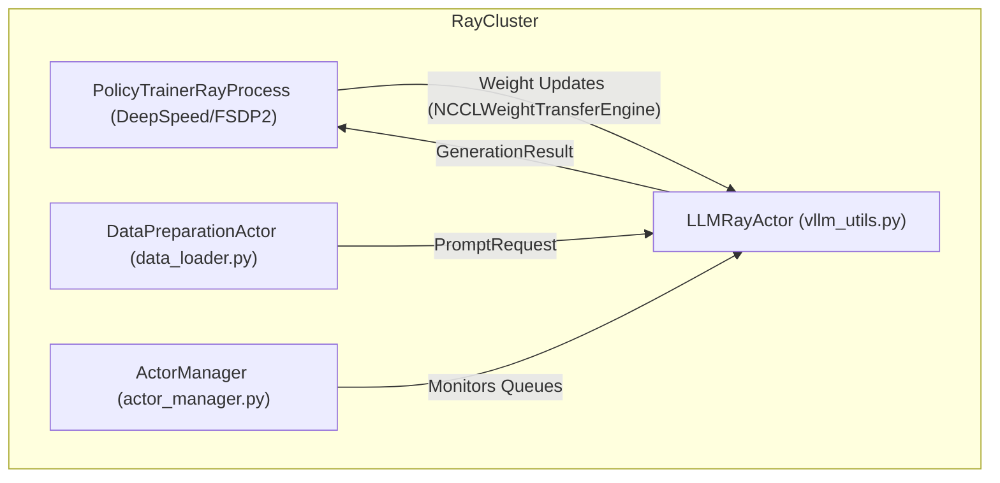
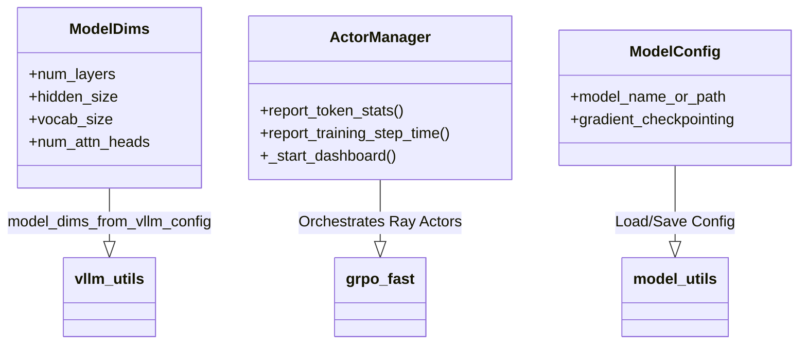

<!-- source: DeepWiki mcp.deepwiki.com · repo allenai/open-instruct · page 8 Specialized Components · fetched 2026-10-26 -->

# Specialized Components

Relevant source files

The following files were used as context for generating this wiki page:

- [CHANGELOG.md](CHANGELOG.md)
- [open_instruct/actor_manager.py](open_instruct/actor_manager.py)
- [open_instruct/benchmark_generators.py](open_instruct/benchmark_generators.py)
- [open_instruct/data_loader.py](open_instruct/data_loader.py)
- [open_instruct/data_types.py](open_instruct/data_types.py)
- [open_instruct/grpo_fast.py](open_instruct/grpo_fast.py)
- [open_instruct/static/dashboard.css](open_instruct/static/dashboard.css)
- [open_instruct/static/dashboard.html](open_instruct/static/dashboard.html)
- [open_instruct/test_grpo_fast.py](open_instruct/test_grpo_fast.py)
- [open_instruct/test_vllm_utils.py](open_instruct/test_vllm_utils.py)
- [open_instruct/vllm_utils.py](open_instruct/vllm_utils.py)

This page provides a high-level overview of the specialized subsystems within the `open-instruct` repository. These components extend the core training loops with high-performance inference, sandboxed code execution, model optimization utilities, and compression frameworks.

## vLLM Integration
The repository leverages **vLLM** for high-throughput generation during RLHF (specifically GRPO) and evaluation. The integration is designed for distributed environments using **Ray**, allowing training workers to request generations from a pool of inference engines.

### Distributed Generation Architecture

Sources: [open_instruct/grpo_fast.py:83-85](), [open_instruct/vllm_utils.py:35-48](), [open_instruct/data_loader.py:54-55]()

Key features include:
*   **Async Generation**: Non-blocking generation requests using `asyncio` and `ray.util.queue.Queue` [open_instruct/vllm_utils.py:35-42]().
*   **Weight Synchronization**: Migration to vLLM 0.16.0's native `NCCLWeightTransferEngine` and `IPCWeightTransferEngine` for rapid weight updates from the learner to the inference engines [open_instruct/vllm_utils.py:45-48](), [open_instruct/grpo_fast.py:80-81]().
*   **Hybrid Model Support**: Specific monkey-patches for `MambaSpec` to handle hybrid models like Olmo-Hybrid that produce multi-element dtype tuples [open_instruct/vllm_utils.py:73-91]().

For implementation details on weight syncing and the actor factory, see [vLLM Integration](#8.1).

## Code Execution API
To support verifiable rewards in programming and math tasks, the system includes a code execution subsystem. This allows models to run generated code in a sandboxed environment to determine functional correctness.

*   **Verifiable Rewards**: Integrated into the RL loop via `ground_truth_utils.py` to compute rewards based on execution success [open_instruct/grpo_fast.py:100-101]().
*   **Sandboxing**: Designed to run within isolated environments (e.g., Docker) to prevent side effects during execution.
*   **Pass Rate Calculation**: Utilities for calculating Pass@k metrics during evaluation.

For details on the sandbox architecture and API endpoints, see [Code Execution API](#8.3).

## Model Utilities and Helpers
The `model_utils.py`, `launch_utils.py`, and `actor_manager.py` modules provide the foundational logic for model handling and experiment monitoring.

### Utility Class to Code Entity Mapping

Sources: [open_instruct/vllm_utils.py:100-123](), [open_instruct/actor_manager.py:34-63](), [open_instruct/model_utils.py:101-108]()

| Utility | Purpose |
| :--- | :--- |
| `ModelDims` | Calculates architecture metadata, including hidden sizes and head dimensions [open_instruct/vllm_utils.py:100-123](). |
| `ActorManager` | Provides a FastAPI-based dashboard (`dashboard.html`) to monitor Ray queue sizes and token throughput [open_instruct/actor_manager.py:82-132](). |
| `prepare_deepspeed` | Configures DeepSpeed ZeRO stages for training [open_instruct/grpo_fast.py:119](). |
| `GenerationResult` | Standardized container for responses, logprobs, and reward scores returned via Ray [open_instruct/data_types.py:47-62](). |

For details on hardware-specific optimizations and the dashboard, see [Model Utilities and Helpers](#8.4).

## Model Compression and Distillation
The `distillkit` subsystem provides tools for reducing model size and improving inference efficiency through distillation and compression techniques.

*   **Distillation**: Implements monotonic logprobs distillation to align student models with teacher outputs.
*   **Teacher Sampling**: `sample_logits_vllm.py` allows for efficient logit sampling from large teacher models using vLLM.
*   **Performance Benchmarking**: `benchmark_generators.py` measures tokens/sec, Model Flops Utilization (MFU), and Memory Bandwidth Utilization (MBU) [open_instruct/benchmark_generators.py:107-132]().
*   **Compression**: Support for bitpack compression via the `distillkit` compressor interface.

For details on the distillation pipeline and compression configurations, see [Model Compression and Distillation](#8.5).

Sources: [open_instruct/benchmark_generators.py:1-35](), [open_instruct/vllm_utils.py:45-48](), [CHANGELOG.md:13-15]()

---

